# dian-einvoice

[English](README.md) · **Español**

<!-- Traducción de README.md con SHA-256 bdb96088cdd4d101d93f7dac1a52225f08c560d0c5949bae22c2f7d1bfdd9554. make docs-stamp actualiza esta línea cuando la traducción ya sigue al original. -->

Facturación electrónica para pequeñas y medianas empresas colombianas, con la API primero.

Muestra la cadena completa de la facturación electrónica y una arquitectura serverless de AWS como código, que corre en un emulador local sin cuenta de AWS.

[](https://github.com/iamcesarcuellar/dian-einvoice/actions/workflows/ci.yml) [](LICENSE)     

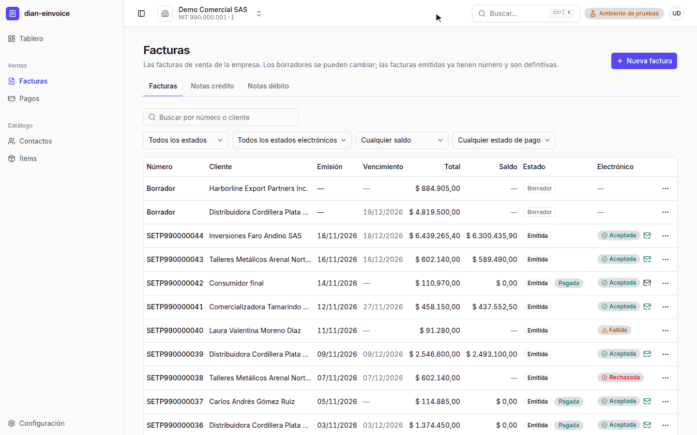

> **Sin relación con la DIAN.** En este repositorio, la DIAN, la autoridad tributaria de Colombia, siempre es un simulador local. Todas las personas, empresas y documentos de la demo son sintéticos, y nunca se desplegó nada en AWS: la nube corre en un emulador local. Mira los [límites](#límites).

## Qué es y qué muestra

Una plataforma multiempresa para compañías y para el software que las atiende (contabilidad, punto de venta, comercio electrónico). Es una implementación de referencia y corre completa en tu máquina.

- **La cadena electrónica completa de un documento.** El XML UBL 2.1, su CUFE o CUDE y su firma XAdES-EPES van por SOAP al simulador de la DIAN, y su respuesta da paso al AttachedDocument, al PDF y al correo. `make dian-check` y `make delivery-check` revisan cada pieza contra los ejemplos del anexo, los XSD oficiales y xmlsec1 ([conformidad con la DIAN](docs/es/dian-conformance.md)).
- **Multiempresa y con la API primero.** Cada tabla del negocio lleva su empresa, y cada consulta se limita a ella ([TenantIsolationTest](backend/tests/Integration/Identity/TenantIsolationTest.php)). La aplicación web usa la misma API pública que las integraciones, y `make api-check` y `make docs-examples` la recorren por HTTP ([guía de la API](docs/es/api-guide.md)).
- **Correcta con concurrencia y con fallas.** Veinte procesos en paralelo toman números sin saltos (`make stress`), y si se matan los workers y el relay a mitad de la cadena, cada factura se acepta una sola vez (`make chaos`). De veinte pagos simultáneos, se registran exactamente los diez que caben (`make payments-check`).
- **La arquitectura de AWS como código, corriendo en un emulador.** Una app de CDK y un servicio serverless ponen la API en Lambda detrás de API Gateway y CloudFront, con SNS, SQS, S3, DynamoDB, KMS, Secrets Manager, SES y EventBridge Scheduler. `make cloud-check` prueba la etapa local de punta a punta, y la etapa de producción, con su VPC, Aurora MySQL y AWS WAF, se valida sin conexión ([infraestructura](docs/es/infrastructure.md), [estimación de costos](docs/es/cost.md)).
- **Operada como un servicio.** Un id de correlación sigue a una factura desde su petición hasta sus webhooks, a través de registros en JSON, métricas, alarmas que nombran cada una su runbook y un notificador que publica en un chat. `make cloud-drill` tumba la DIAN y trae de vuelta cada factura una sola vez ([runbooks](docs/es/runbooks/README.md), [observabilidad](docs/es/observability.md)).
- **En inglés y en español.** La aplicación web, los mensajes de la API y su referencia, el PDF y los correos salen en inglés o en español de Colombia: la interfaz sigue al navegador o a lo que elija cada usuario, cada petición su `Accept-Language`, y cada empresa elige el idioma de sus documentos. `make demo LOCALE=es` carga los datos de ejemplo en español ([LanguageTest](backend/tests/Integration/Security/LanguageTest.php), [la prueba en el navegador en español](e2e/tests/spanish.spec.ts)).
- **Revisada de punta a punta.** 732 pruebas, PHPStan en el nivel 10 sin línea base, auditorías de cada dependencia y del historial de git, y una prueba en el navegador bajo la Content-Security-Policy del borde. cdk-nag y cfn-lint revisan las dos etapas ([calidad](#calidad)).

## Galería

| | |
| --- | --- |
| 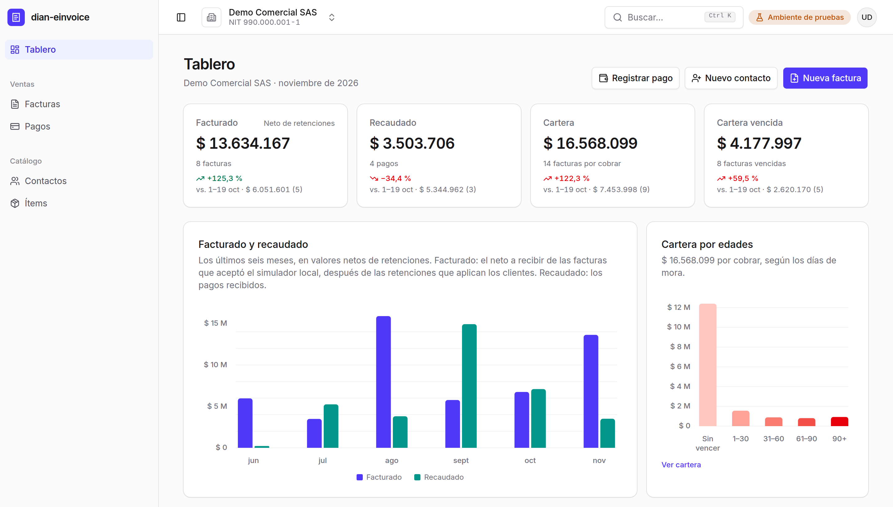 | 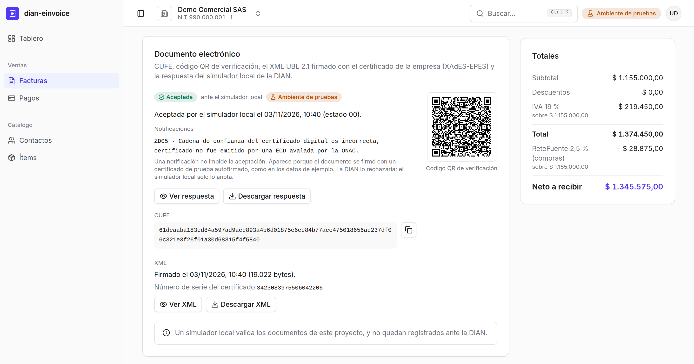 |
| El tablero, con seis meses de ventas sintéticas. | Una factura aceptada: la respuesta del simulador, el CUFE, el código QR y el XML firmado. |
| 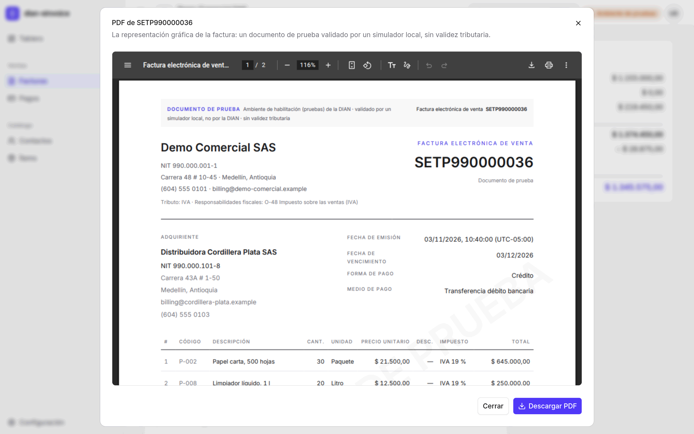 | 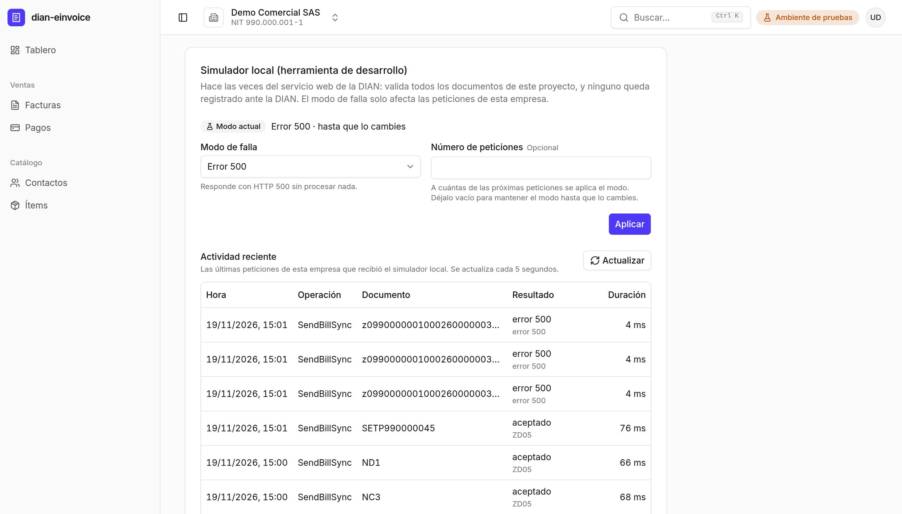 |
| La representación gráfica que recibe el cliente. | Configuración → DIAN: el simulador con una falla inyectada, y las peticiones que rechazó. |
| 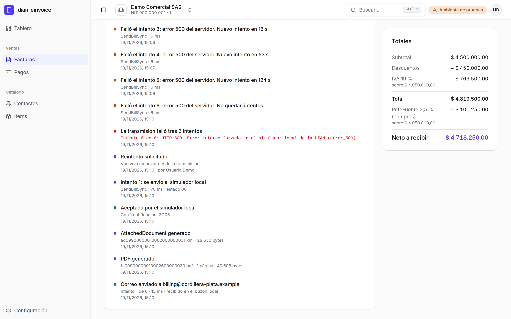 | 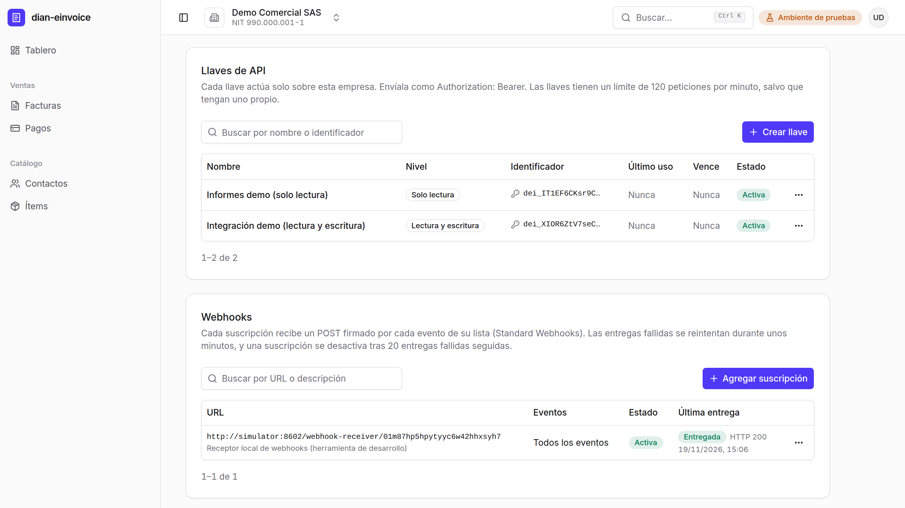 |
| El final de la línea de tiempo de esa factura: los intentos fallidos, Reintentar ahora, aceptada y entregada. | Las llaves de API, y la suscripción de webhooks a un receptor local con su última entrega. |

Todas las pantallas de [docs/assets/es](docs/assets/es/), el tema oscuro incluido, salen de `make screenshots`, que las graba también en inglés en [docs/assets](docs/assets/).

## Para empezar

Necesitas:

- Docker con Docker Compose 2.24 o posterior, GNU make y git. No se instala nada más en tu equipo.
- Unos 3 GB de disco y 3 GB de memoria para el stack local. La prueba en el navegador y la nube emulada piden más.
- Los puertos 8600 a 8603 libres en 127.0.0.1. La nube emulada usa además el 8604, el 8605 y del 8610 al 8619.
- Linux, o Windows con WSL 2: se probó en Linux bajo WSL 2, con Docker 29.1, Compose 2.40 y GNU make 4.3.

> En un clon nuevo, el stack local ocupó 2,7 GB de disco: 1,7 GB de imágenes, 0,3 GB de volúmenes y 0,7 GB de dependencias en la carpeta del repositorio. Ya arriba, usó 2,4 GB de memoria con los datos de ejemplo en inglés y 2,5 GB con los de español, dentro de límites de memoria que suman 4,8 GB. Solo el servidor de desarrollo de la aplicación web ocupó de 1,6 a 1,7 GB. La prueba en el navegador y las capturas suman la imagen de Playwright (2,6 GB), y la nube emulada unos 2 GB más.

```sh
git clone https://github.com/iamcesarcuellar/dian-einvoice.git
cd dian-einvoice
make demo
```

El primer `make demo` construye las imágenes, instala las dependencias, migra la base de datos y carga seis meses de datos de ejemplo sintéticos a través de la cadena real; `make demo LOCALE=es` hace lo mismo con los datos de ejemplo en español. En un clon nuevo, `make demo` tardó 58 segundos, y `make demo LOCALE=es` tardó 57 en otro clon nuevo. Los dos corrieron en una máquina cuyo Docker ya tenía las imágenes base y su caché de construcción. Sin ellas, primero descarga unos 1,5 GB de imágenes base. Crea `backend/.env` con secretos locales aleatorios e imprime una sola vez una llave de API sintética. Luego abre:

| Qué | Dirección |
| --- | --- |
| Aplicación web | http://localhost:8601 |
| API | http://localhost:8600/api/v1/health |
| Referencia de la API | http://localhost:8600/docs/api/es |
| Simulador de la DIAN y receptor de webhooks | http://localhost:8602/health |
| Buzón local, adonde llega cada correo | http://localhost:8603 |

Inicia sesión como `demo@example.com` con la contraseña `password`: el propietario de Demo Comercial SAS y de Demo Servicios SAS, las dos sintéticas y ubicadas en Medellín. `admin@example.com`, `member@example.com` y `viewer@example.com`, con la misma contraseña, muestran los otros roles.

La aplicación web abre en el idioma del navegador, inglés o español, y el menú de la cuenta lo cambia. `make demo LOCALE=es` carga los mismos datos de ejemplo con todos sus textos en español, y las dos empresas de la demo emiten sus documentos en español; sin `LOCALE`, la demo queda en inglés.

`make down` detiene todo y conserva los datos, `make clean` también los borra, y `make help` lista todos los comandos.

Si algo no arranca, `make ps` muestra la salud de cada contenedor y `make logs` sigue sus registros. Un puerto ya ocupado en 127.0.0.1 detiene el servicio que lo publica: libera el puerto o detén el otro proyecto que lo tiene. `make seed` vuelve a cargar los datos de ejemplo desde cero en cualquier momento, y `make seed LOCALE=es` los vuelve a cargar en español.

## Comandos de todos los días

`make help` lista todos los comandos, uno por línea. Estos son los que más se usan:

| Comando | Qué hace |
| --- | --- |
| `make demo` | Arranca el stack local y carga los datos de ejemplo sintéticos; `LOCALE=es` los carga en español |
| `make up`, `make down` | Arranca el stack con el código actual; lo detiene y conserva los datos |
| `make seed` | Vuelve a cargar los datos de ejemplo desde cero; `LOCALE=es` los carga en español |
| `make test`, `make lint`, `make analyse` | Pruebas sin navegador, formateadores y linters, análisis estático |
| `make e2e`, `make checks` | La prueba en el navegador, y las revisiones contra el stack en marcha |
| `make security` | Audita las dependencias, sus licencias y los archivos de terceros, y busca secretos en el historial |
| `make cloud-demo`, `make cloud-check` | Despliega la arquitectura de AWS en el emulador local y la revisa de punta a punta |
| `make screenshots` | Vuelve a escribir las capturas y los GIF de esta página, en inglés y en español |
| `make logs`, `make ps` | Sigue los registros; muestra los contenedores y su salud |

## Un recorrido de cinco minutos

**1. Emite una factura y síguela.** En la aplicación web, abre **Facturas → Nueva factura**, elige el cliente Distribuidora Cordillera Plata SAS y un ítem; los totales, los impuestos y las retenciones se actualizan mientras escribes. **Emitir factura** le da su número y su CUFE, y la franja de arriba sigue la cadena: XML, firmada, enviada, aceptada, entregada. La **Línea de tiempo** de abajo lista cada paso con su hora y con quién lo hizo. El correo al cliente, con el PDF y el AttachedDocument en un zip, está en el buzón local.

**2. Tumba la DIAN.** En **Configuración → DIAN**, la tarjeta del simulador local pone un modo de falla para la empresa. Elige **Error 500** y emite otra factura: cada intento falla, y los reintentos esperan 2, 5, 15, 45 y 120 segundos hasta que la transmisión se rinde. Vuelve a poner el modo **Normal** y presiona **Reintentar ahora** en la factura: se acepta y se entrega una sola vez.

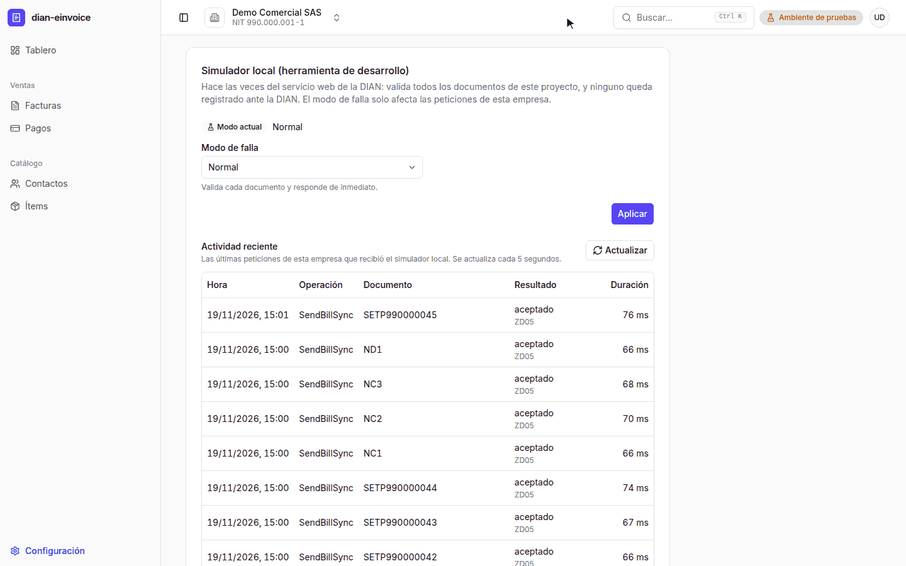

**3. Descarga el XML y el PDF.** En una factura aceptada, **Descargar XML** guarda el documento UBL firmado y **Ver PDF** abre la representación gráfica que recibió el cliente; **Ver respuesta** muestra el ApplicationResponse del simulador.

**4. Usa la API con curl.** `make demo` imprimió una llave de API sintética de Demo Comercial SAS, que se muestra una sola vez; **Configuración → Desarrolladores → Crear llave** crea otra. Con ella, busca un cliente y un ítem, escribe un borrador y emítelo con una llave de idempotencia:

<!-- example -->
```sh
KEY=dei_...   # la llave sintética que imprimió make demo
API=http://localhost:8600/api/v1
first_id() { grep -o '"id":"[0-9a-z]\{26\}"' | head -n 1 | cut -d '"' -f 4; }

CONTACT=$(curl -s "$API/contacts?search=Cordillera" -H "Authorization: Bearer $KEY" | first_id)
ITEM=$(curl -s "$API/items?search=P-001" -H "Authorization: Bearer $KEY" | first_id)
INVOICE=$(curl -s "$API/invoices" -H "Authorization: Bearer $KEY" -H 'Content-Type: application/json' \
  -d "{\"contact_id\":\"$CONTACT\",\"payment_form\":\"1\",\"payment_means_code\":\"10\",\"lines\":[{\"item_id\":\"$ITEM\",\"quantity\":\"2\"}]}" | first_id)

# La misma Idempotency-Key dos veces: la segunda respuesta repite la primera, y nada corre dos veces.
curl -s -o /dev/null -w '%{http_code}\n' -X POST "$API/invoices/$INVOICE/issue" -H "Authorization: Bearer $KEY" -H "Idempotency-Key: issue-$INVOICE"
curl -s -D - -o /dev/null -X POST "$API/invoices/$INVOICE/issue" -H "Authorization: Bearer $KEY" -H "Idempotency-Key: issue-$INVOICE" | grep -i '^idempotent-replayed'

# La cadena corre en segundo plano: cuando la factura esté entregada, descarga su XML firmado y su PDF.
until curl -s "$API/invoices/$INVOICE" -H "Authorization: Bearer $KEY" | grep -q '"delivery":{"status":"delivered"'; do sleep 1; done
curl -sf "$API/invoices/$INVOICE/xml" -H "Authorization: Bearer $KEY" -o invoice.xml
curl -sf "$API/invoices/$INVOICE/pdf" -H "Authorization: Bearer $KEY" -o invoice.pdf
```

Imprime el estado de la primera emisión y la cabecera de la repetición:

<!-- output -->
```text
200
Idempotent-Replayed: true
```

Para recibir los mensajes de la API en español, agrega `-H 'Accept-Language: es-CO'` a cualquier petición. Cada respuesta lleva un `X-Correlation-Id`, que comparte cada línea de registro del recorrido, y cada respuesta a una petición con llave lleva el límite de peticiones de la llave, entre ellas `X-RateLimit-Remaining`. La [guía de la API](docs/es/api-guide.md) va más allá: llaves, errores, paginación y webhooks firmados, con cada ejemplo ejecutado por `make docs-examples`. La [referencia de la API](http://localhost:8600/docs/api/es) documenta cada operación, también [en inglés](http://localhost:8600/docs/api).

**5. Recibe un webhook firmado.** La empresa de la demo está suscrita al receptor local de webhooks, que corre dentro del simulador. En **Configuración → Desarrolladores**, la suscripción muestra su última entrega, y su menú las lista todas, incluidas las de la factura que acabas de emitir (`invoice.issued`, `invoice.accepted`, `invoice.delivered`). Más abajo, la tarjeta del receptor muestra cada webhook con la revisión de su firma (Standard Webhooks, HMAC-SHA256), y **Enviar evento de prueba** envía uno más.

## La nube de AWS en tu máquina

`make cloud-demo` detiene la aplicación del stack local y despliega la etapa local de la arquitectura de AWS en [Floci](https://github.com/floci-io/floci), un emulador de AWS de código abierto que no pide cuenta. Usa la misma app de CDK, el mismo servicio serverless y el mismo script de despliegue (`scripts/deploy.sh`) que usaría una cuenta real, y luego carga los datos de ejemplo a través de las funciones; `make cloud-demo LOCALE=es` los carga en español. La aplicación web y la API responden en las mismas direcciones, ahora a través del CloudFront emulado; `make up` vuelve al stack local. El simulador de la DIAN guarda aparte los documentos de cada uno, así que ir y volver no obliga a recargar los datos de ejemplo.

| Servicio de AWS | Qué corre en el emulador | Qué hace aquí |
| --- | --- | --- |
| CloudFront | La distribución de la etapa local, sin caché, CloudFront Functions ni AWS WAF | Un solo origen para la aplicación web y la API, con las cabeceras de seguridad |
| API Gateway y Lambda | Una API HTTP con un autorizador Lambda; cada función en su propio contenedor | La API (PHP 8.5 sobre Bref), la cadena, los webhooks, el relay, el programador, la consola, el verificador de origen y el notificador |
| SNS y SQS | Un tema, las colas de la cadena y de los webhooks, y sus colas de mensajes fallidos | Los eventos del outbox y el trabajo de los consumidores |
| S3, DynamoDB, KMS, Secrets Manager, SSM | Buckets, tablas, una llave, secretos y parámetros | Los documentos y la aplicación web; la caché, las sesiones y los límites de peticiones; el cifrado de sobre de los certificados; las credenciales |
| SES | Una identidad; los correos se guardan y no se entrega ninguno | Los correos a los clientes |
| EventBridge Scheduler | Dos programaciones, cada minuto | El relay del outbox y el programador de Laravel |
| CloudWatch | Registros, filtros de métricas y alarmas sobre una métrica | La observabilidad; las alarmas con métricas calculadas y las compuestas no se evalúan |
| Aurora MySQL, VPC, AWS WAF | No se emulan: solo la etapa de producción, validada sin conexión | El MySQL de Compose hace las veces de la base de datos |

Los resultados de las ejecuciones de este commit, con las cifras del emulador en esta máquina, no las de AWS:

- `make cloud-check` pasó en 3 min 1 s. Treinta facturas fueron de la emisión a la entrega en una mediana de 25,6 s por el camino rápido del outbox, y una más, emitida a través del borde, se siguió por su id de correlación. Otras diez, con los contenedores de las funciones matados a mitad del proceso y un evento del outbox dejado para el relay, terminaron como las demás: 41 de 41 aceptadas y entregadas una sola vez, numeradas sin saltos. Dos rotaciones de la identidad de la aplicación en la base de datos, con las funciones calientes, no rompieron ninguna petición. Cada línea de registro fue un JSON que cumplía el esquema, ninguna tenía un secreto, y una alarma forzada a ALARM llegó al chat. Un arranque en frío de la API tardó 0,90 s, y una respuesta en caliente una mediana de 17 ms.
- `make cloud-drill`, ejecutado por última vez para la 1.0.0, pasó en 271 s. Con la DIAN caída, cinco transmisiones se rindieron y fueron a la cola de mensajes fallidos, y la alarma llegó al chat con su runbook 192 s después de empezar la caída. Los comandos del runbook trajeron de vuelta cada factura, aceptada y entregada una sola vez, a los 204 s ([drill-report.md](docs/es/runbooks/drill-report.md) revisa una ejecución anterior).
- `make cloud-e2e` pasó en 190 s. Primero, la función de consola encontró los datos de ejemplo. También comprobó que los registros propios de la nube en el simulador no tienen ningún documento de las empresas de la demo con un número que la base de datos de la nube aún no haya emitido. Luego vino el recorrido de una factura a través de las funciones, otra en español con su PDF y el correo que recibió SES, la revisión de la disposición en los dos idiomas (50 páginas y diálogos en tres tamaños de ventana), la referencia de la API en los dos idiomas y una visita a sus 31 rutas con 17 de sus diálogos. Todo pasó por el borde, bajo su Content-Security-Policy, sin una sola violación.

## Arquitectura

Los módulos del sistema, en dos aplicaciones separadas que solo se hablan por la API HTTP bajo `/api/v1`:

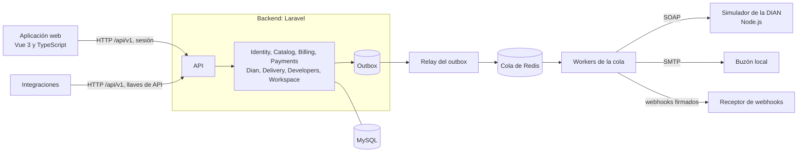

La vida de una factura, simplificada; las notas crédito y débito siguen la misma cadena:

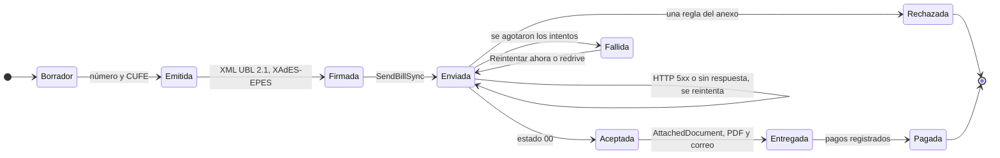

La arquitectura en AWS, como la definen la app de CDK y el servicio serverless:

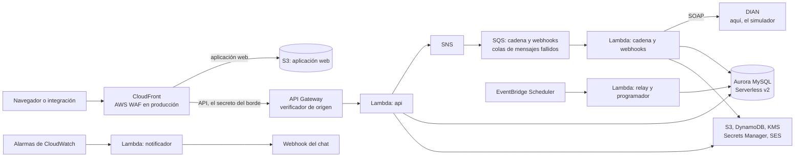

Más detalles: [docs/es/architecture.md](docs/es/architecture.md) para los módulos, el modelo de datos, el ciclo de vida de un documento y las decisiones de diseño; [docs/es/infrastructure.md](docs/es/infrastructure.md) para los stacks, las funciones, la red, la base de datos y el borde; [docs/es/observability.md](docs/es/observability.md) para los registros, las métricas y las alarmas; [docs/es/deployment.md](docs/es/deployment.md) para el despliegue; [docs/es/cost.md](docs/es/cost.md) para lo que costaría en AWS; [docs/es/threat-model.md](docs/es/threat-model.md) para la seguridad.

## El repositorio

| Carpeta | Qué tiene |
| --- | --- |
| [backend/](backend/) | La API en Laravel, por módulos (`backend/app/Modules`): identidad y empresas, catálogo, facturación, la cadena de la DIAN, la entrega, los pagos, la API pública y sus webhooks, y el tablero; sus pruebas unitarias y de integración |
| [frontend/](frontend/) | La aplicación web en Vue 3 y TypeScript, que habla con el backend solo por `/api/v1`; sus mensajes en inglés y en español están en `frontend/src/i18n` |
| [simulator/](simulator/) | Un simulador local del servicio web SOAP de la DIAN, con sus modos de falla y el receptor de webhooks |
| [infra/cdk/](infra/cdk/) | La app de CDK: los stacks de las etapas local y de producción, sus pruebas y cdk-nag |
| [infra/functions/](infra/functions/) | El servicio serverless: las funciones y sus disparadores, el verificador de origen, el notificador y los scripts de la nube emulada |
| [e2e/](e2e/) | Las herramientas del navegador: la prueba de punta a punta, las capturas que toma `make screenshots`, la revisión de la documentación y el ejecutor de sus ejemplos |
| [scripts/](scripts/) | El script de despliegue, la revisión de la nube y el simulacro, las revisiones de seguridad, de licencias y de avisos, la estimación de costos y los ayudantes del Makefile |
| [docs/](docs/es/README.md) | La documentación, en inglés en docs/ y en español en docs/es, con su índice en docs/es/README.md, y las imágenes de esta página |

## Calidad

Los resultados de las ejecuciones de este commit, en la máquina de la sección para empezar. La integración continua (`.github/workflows/ci.yml`) también corre estos comandos, menos el simulacro y parte de `make checks`. Corre en cada push a `main`, en cada pull request y a mano, y deja la nube emulada fuera de los pull requests:

| Qué | Comando | Resultado |
| --- | --- | --- |
| Backend: pruebas unitarias, y de integración contra MySQL, Redis y el simulador | `make test-backend` | 259 pruebas y 6.813 aserciones, en 66 s; el contenedor de las pruebas llegó a un pico de 417 MiB de sus 1.536 MiB |
| Pruebas de la aplicación web, del simulador, de la infraestructura y de las herramientas | `make test-frontend`, `make test-simulator`, `make test-infra`, `make test-tools` | 95 pruebas de la aplicación web, 121 del simulador, 198 de la app de CDK y de las funciones, cdk-nag incluido, y 59 de las herramientas: 16 del codificador de imágenes de las capturas, 29 de la revisión de las traducciones y 14 de la revisión de la referencia de la API en español |
| Formateadores, linters y la documentación | `make lint` | Laravel Pint sobre 608 archivos, ESLint y Prettier: limpios; en la documentación, en los dos idiomas, 640 enlaces relativos y 96 anclas resuelven, 16 imágenes respetan su límite de tamaño y Mermaid dibuja 20 diagramas; las 31 traducciones al español siguen a sus originales, con el mismo código, los mismos enlaces, las mismas cifras y la misma estructura; la referencia de la API en español describe el contrato en inglés, con sus 322 bloques traducidos o declarados iguales; y las dos estimaciones de costos coinciden con sus precios y supuestos |
| Análisis estático | `make analyse` | PHPStan nivel 10 sin línea base, vue-tsc y tsc para el simulador, la app de CDK y las funciones: sin errores |
| Dependencias, licencias y secretos | `make security` | Ningún aviso alto o crítico en las seis auditorías; 472 dependencias de producción, todas con licencia compatible con MIT; los 174 archivos de terceros en 8 grupos, como los lista NOTICE; gitleaks no encuentra secretos en el historial ni en los cambios |
| Infraestructura como código, sin conexión | `make cdk-check` | 21 stacks entre las dos etapas y 3 paquetes de funciones: cdk-nag (AWS Solutions) sin hallazgos sin justificar, cfn-lint y actionlint limpios |
| Una factura de borrador a pagada, una en español, y la disposición, en un navegador | `make e2e` | El recorrido en Chromium, del editor a aceptada, entregada, su PDF y pagada, en 9,4 s; una factura emitida en español, con su PDF y su correo al cliente en español, en 7,8 s; y la revisión de la disposición, 50 páginas y diálogos a 1280×720, 1440×900 y 1920×1080 sin nada fuera de su caja y cada lista dentro de la suya desde 1440×900, en 53,0 s en inglés y 52,6 s en español |
| Revisiones contra el stack en marcha | `make checks` | Todas pasan: los 30 ejemplos de esta página, del README en inglés y de las dos guías de la API imprimen lo que dicen los documentos, y los cuatro ejemplos de verificación de firmas de webhooks aciertan 6 de 6 casos; 60 facturas de 20 procesos quedan numeradas sin saltos y aceptadas en 4,83 s; y 40 se aceptan una sola vez cada una con los workers y el relay matados a mitad de la cadena |
| La nube emulada, de punta a punta | `make cloud-check`, `make cloud-e2e`, `make cloud-drill` | Todas pasan; sus cifras están [más arriba](#la-nube-de-aws-en-tu-máquina) |

Los vacíos conocidos están por escrito, no escondidos: [docs/es/limitations.md](docs/es/limitations.md#pruebas-y-herramientas) lista lo que las pruebas no cubren.

## Tecnologías

| Parte | Tecnologías |
| --- | --- |
| Backend | PHP 8.5, Laravel 13 (solo API), FrankenPHP en local y Bref 3 en Lambda, dompdf, bacon-qr-code, AWS SDK para PHP |
| Aplicación web | Vue 3, TypeScript 6, Vite 8, Pinia, Vue Router, Tailwind CSS 4, shadcn-vue sobre Reka UI, Unovis, vue-i18n |
| Datos y mensajería | MySQL 8.4, Redis 8; en la nube SNS, SQS y DynamoDB; Aurora MySQL Serverless v2 en producción |
| Simulador de la DIAN | Node.js y TypeScript, SOAP 1.2, los XSD oficiales de la caja de herramientas de la DIAN |
| Infraestructura como código | AWS CDK en TypeScript con cdk-nag, osls 4.8.1, cfn-lint, actionlint, Floci como emulador |
| Pruebas y revisiones | PHPUnit, Vitest, node:test, Playwright, PHPStan con Larastan, Laravel Pint, ESLint, Prettier, vue-tsc, gitleaks |
| Entorno local | Docker Compose y make; Mailpit como buzón local |

## Límites

- **Sin certificación de la DIAN.** La DIAN nunca validó un CUFE, un CUDE ni una firma producidos aquí. El simulador aplica una parte de las reglas del anexo 1.9 (`simulator/src/rules.ts`), la cabecera SOAP no se firma con WS-Security, y los documentos se firman con certificados de prueba sintéticos autofirmados que solo acepta el simulador.
- **La DIAN es un simulador.** Cada "aceptada" viene de `simulator/`; sus respuestas, demoras y fallas son las que se le ordena dar.
- **Nunca se desplegó en AWS.** La etapa de producción se sintetiza, se empaqueta y se valida sin conexión, y el flujo de despliegue nunca ha corrido; [docs/es/deployment.md](docs/es/deployment.md) lista lo que nunca se verificó en una cuenta real, y [docs/es/cost.md](docs/es/cost.md) es una estimación, no una factura.
- **Lo que el emulador no reproduce:** no evalúa políticas de IAM, de recursos ni de llaves; no tiene AWS WAF, ni caché, ni CloudFront Functions; no publica métricas nativas de Lambda, API Gateway ni CloudFront, ni evalúa métricas calculadas; no puede correr las funciones de rotación de AWS; y sus arranques en frío y los tiempos de sus colas no son los de AWS.
- **Solo datos sintéticos.** Cada persona, empresa, NIT, documento y pago es inventado; los PDF y los correos no tienen validez tributaria.

Todo eso, con sus razones, en [docs/es/limitations.md](docs/es/limitations.md).

## Documentación

[docs/es/README.md](docs/es/README.md) indexa todos los documentos, y su glosario traduce al español cada término de la interfaz y de los documentos. Cada documento tiene su original en inglés, en docs/. Para ir más allá de esta página: la [arquitectura](docs/es/architecture.md) de la aplicación, la [guía de la API](docs/es/api-guide.md), la [conformidad con la DIAN](docs/es/dian-conformance.md) y la [estimación de costos](docs/es/cost.md); luego las limitaciones, el modelo de amenazas, la infraestructura, la observabilidad, el despliegue, los runbooks y las licencias de terceros. [CHANGELOG.es.md](CHANGELOG.es.md) recoge lo que trae cada versión.

## Hoja de ruta

Lo que el producto deja por fuera a propósito, y lo que vendría después, según [docs/es/limitations.md](docs/es/limitations.md):

- **Por fuera a propósito.** La DIAN real: sin habilitación, sin cabecera WS-Security y sin un certificado de una entidad acreditada, así que nada de aquí vale ante la DIAN. Una pasarela de pagos: los pagos se registran a mano o por la API. Documentos distintos de la factura de venta y sus notas: los eventos de RADIAN, el documento equivalente POS, el documento soporte y la nómina electrónica ([conformidad con la DIAN](docs/es/dian-conformance.md#lo-que-no-está-implementado)). Un proveedor tecnológico: el software es propio del emisor.
- **Lo siguiente, para un despliegue real.** La habilitación con el set de pruebas de la DIAN, la firma WS-Security de la cabecera SOAP, certificados de una entidad acreditada por la ONAC con su revisión de revocación, y el procedimiento de contingencia de la DIAN para caídas largas. Un primer despliegue en una cuenta de AWS, que verificaría lo que lista [docs/es/deployment.md](docs/es/deployment.md#lo-que-nunca-se-verificó-en-una-cuenta-real), y una prueba de carga que mida la capacidad de la base de datos que supone [la estimación de costos](docs/es/cost.md#supuestos).
- **Lo siguiente, para el producto.** Alcances por recurso y listas de direcciones permitidas para las llaves de API, un segundo factor, la rotación del secreto de los webhooks con un periodo en el que ambos secretos firman, la rotación de las llaves de cifrado, búsqueda de texto completo y una página de estado para las empresas.

## Licencia

[MIT](LICENSE). Los archivos de terceros que guarda el repositorio, como los esquemas oficiales, las fuentes tipográficas y los códigos de los municipios, conservan sus propios términos: [NOTICE.es.txt](NOTICE.es.txt) los recoge, y la licencia MIT no cubre esos archivos. Las dependencias y sus licencias, todas compatibles con MIT, están en [docs/es/third-party-licenses.md](docs/es/third-party-licenses.md). Las vulnerabilidades se reportan en privado, como explica [SECURITY.es.md](SECURITY.es.md), y [CONTRIBUTING.es.md](CONTRIBUTING.es.md) tiene las reglas para los cambios.

## Autor

Hecho por [Cesar Cuellar](https://github.com/iamcesarcuellar), ingeniero de software en Medellín, Colombia.
