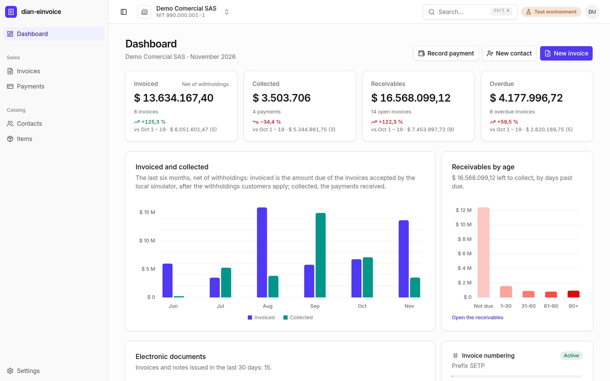
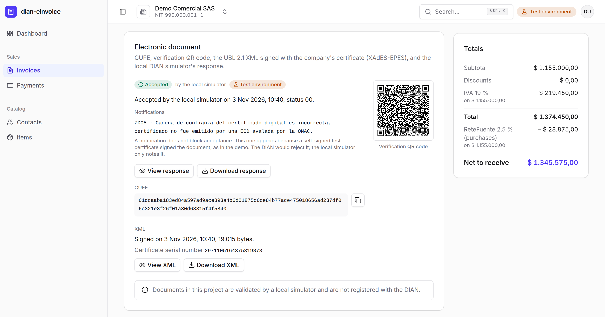
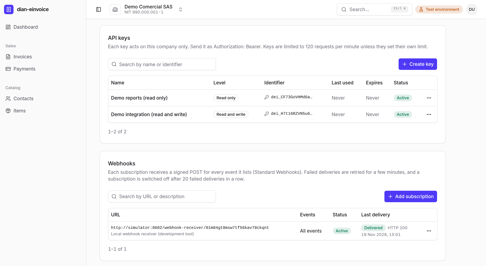
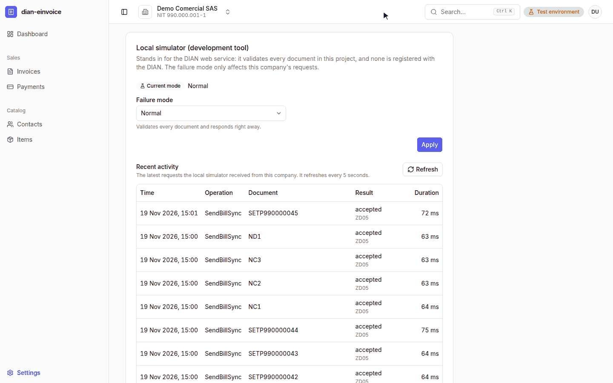
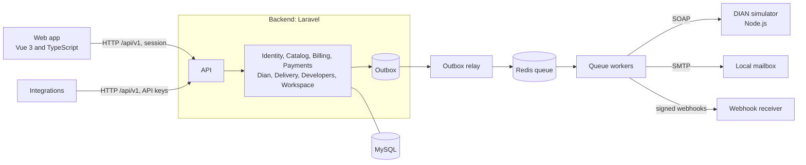
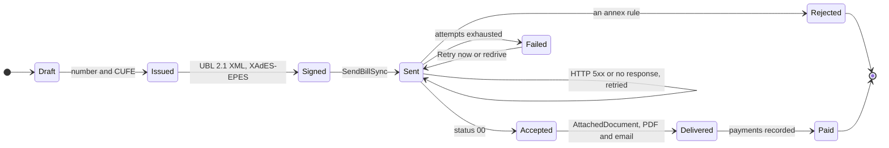

# dian-einvoice

**English** · [Español](README.es.md)

Electronic invoicing for Colombian small and medium businesses, API first.

It shows the full electronic invoicing chain and a serverless AWS architecture as code, running on a local emulator with no AWS account.

[](https://github.com/iamcesarcuellar/dian-einvoice/actions/workflows/ci.yml) [](LICENSE)     


> **Not affiliated with the DIAN.** The DIAN, Colombia's tax authority, is always a local simulator in this repository. Every person, company and document in the demo is synthetic, and nothing was ever deployed to AWS: the cloud runs on a local emulator. See [Limits](#limits).

## What it is and what it shows

A multi-tenant platform for companies and for the software that serves them (accounting, point of sale, e-commerce). It is a reference implementation, and it runs entirely on your machine.

- **The whole electronic chain of a document.** The UBL 2.1 XML, its CUFE or CUDE and its XAdES-EPES signature go over SOAP to the DIAN simulator, and its response leads to the AttachedDocument, the PDF and the email. `make dian-check` and `make delivery-check` check each piece against the annex's examples, the official XSDs and xmlsec1 ([DIAN conformance](docs/dian-conformance.md)).
- **Multi-tenant and API first.** Every business table carries its company, and every query is scoped to it ([TenantIsolationTest](backend/tests/Integration/Identity/TenantIsolationTest.php)). The web app uses the same public API as integrations do, and `make api-check` and `make docs-examples` drive it over HTTP ([API guide](docs/api-guide.md)).
- **Correct under concurrency and failure.** Twenty parallel processes take numbers without a gap (`make stress`), and with the workers and the relay killed mid-chain every invoice is accepted once (`make chaos`). Of twenty simultaneous payments, exactly the ten that fit are recorded (`make payments-check`).
- **The AWS architecture as code, run on an emulator.** A CDK app and a serverless service put the API on Lambda behind API Gateway and CloudFront, with SNS, SQS, S3, DynamoDB, KMS, Secrets Manager, SES and EventBridge Scheduler. `make cloud-check` proves the local stage end to end, and the prod stage, with its VPC, Aurora MySQL and AWS WAF, is validated offline ([infrastructure](docs/infrastructure.md), [cost estimate](docs/cost.md)).
- **Operated like a service.** One correlation id follows an invoice from its request to its webhooks, through JSON logs, metrics, alarms that each name a runbook, and a notifier that posts to a chat. `make cloud-drill` takes the DIAN down and brings every invoice back once ([runbooks](docs/runbooks/README.md), [observability](docs/observability.md)).
- **In English and in Spanish.** The web app, the API's messages and its reference, the PDF and the emails come in English or in Colombian Spanish: the interface follows the browser or the user's choice, each request its `Accept-Language`, and each company chooses the language of its documents. `make demo LOCALE=es` loads the demo data in Spanish ([LanguageTest](backend/tests/Integration/Security/LanguageTest.php), [the browser test in Spanish](e2e/tests/spanish.spec.ts)).
- **Checked from end to end.** 707 tests, PHPStan at level 10 without a baseline, audits of every dependency and the git history, and a browser test under the edge's Content-Security-Policy. cdk-nag and cfn-lint check both stages ([Quality](#quality)).

## Gallery

| | |
| --- | --- |
|  |  |
| The dashboard, over six months of synthetic sales. | An accepted invoice: the simulator's response, the CUFE, the QR code and the signed XML. |
|  |  |
| The PDF the customer receives. | Settings → DIAN: the simulator with a failure injected, and the requests it refused. |
|  |  |
| The end of that invoice's timeline: the failed attempts, Retry now, accepted and delivered. | API keys, and the webhook subscription to a local receiver with its last delivery. |

Every screen in [docs/assets](docs/assets/), the dark theme included, comes from `make screenshots`, which also records them in Spanish in [docs/assets/es](docs/assets/es/).

## Quick start

You need:

- Docker with Docker Compose 2.24 or later, GNU make and git. Nothing else is installed on the host.
- About 3 GB of disk and 3 GB of memory for the local stack. The browser test and the emulated cloud take more.
- Ports 8600 to 8603 free on 127.0.0.1. The emulated cloud also uses 8604, 8605 and 8610 to 8619.
- Linux, or Windows with WSL 2: it was tested on Linux under WSL 2, with Docker 29.1, Compose 2.40 and GNU make 4.3.

> On a clean clone, the local stack took 2.7 GB of disk: 1.7 GB of images, 0.3 GB of volumes and 0.7 GB of dependencies in the repository folder. Once up, it used 2.4 GB of memory with the English demo data and 2.5 GB with the Spanish one, within memory limits that add up to 4.8 GB. The web app's development server alone took 1.6 to 1.7 GB. The browser test and the screenshots add Playwright's image (2.6 GB), and the emulated cloud about 2 GB more.

```sh
git clone https://github.com/iamcesarcuellar/dian-einvoice.git
cd dian-einvoice
make demo
```

The first `make demo` builds the images, installs the dependencies, migrates the database and loads six months of synthetic demo data through the real chain; `make demo LOCALE=es` does the same with the Spanish demo data. On a clean clone, `make demo` took 58 seconds, and `make demo LOCALE=es` took 57 on another clean clone. Both ran on a machine whose Docker already held the base images and their build cache. Without them, it first pulls about 1.5 GB of base images. It creates `backend/.env` with random local secrets and prints a synthetic API key once. Then open:

| What | Address |
| --- | --- |
| Web app | http://localhost:8601 |
| API | http://localhost:8600/api/v1/health |
| API reference | http://localhost:8600/docs/api |
| DIAN simulator and webhook receiver | http://localhost:8602/health |
| Local mailbox, where every email lands | http://localhost:8603 |

Sign in as `demo@example.com` with the password `password`: the owner of Demo Comercial SAS and Demo Servicios SAS, both synthetic and set in Medellín. `admin@example.com`, `member@example.com` and `viewer@example.com`, with the same password, show the other roles.

The web app opens in the browser's language, English or Spanish, and the account menu switches it. `make demo LOCALE=es` loads the same demo data with every text in Spanish, and both demo companies issue their documents in Spanish; without `LOCALE`, the demo stays in English.

`make down` stops everything and keeps the data, `make clean` also deletes it, and `make help` lists every target.

If something does not start, `make ps` shows each container's health and `make logs` follows their logs. A port already taken on 127.0.0.1 stops the service that publishes it: free the port, or stop the other project that holds it. `make seed` reloads the demo data from scratch at any time, and `make seed LOCALE=es` reloads it in Spanish.

## Everyday commands

`make help` lists every target, one line each. These are the ones used most:

| Command | What it does |
| --- | --- |
| `make demo` | Starts the local stack and loads the synthetic demo data; `LOCALE=es` loads it in Spanish |
| `make up`, `make down` | Starts the stack with the current code; stops it and keeps the data |
| `make seed` | Reloads the demo data from scratch; `LOCALE=es` loads it in Spanish |
| `make test`, `make lint`, `make analyse` | Tests without a browser, formatters and linters, static analysis |
| `make e2e`, `make checks` | The browser test, and the checks against the running stack |
| `make security` | Audits the dependencies, their licenses and the third-party files, and scans the history for secrets |
| `make cloud-demo`, `make cloud-check` | Deploys the AWS architecture to the local emulator and checks it end to end |
| `make screenshots` | Writes this page's screenshots and GIFs again, in English and in Spanish |
| `make logs`, `make ps` | Follows the logs; shows the containers and their health |

## A five-minute tour

**1. Issue an invoice and follow it.** In the web app, open **Invoices → New invoice**, choose the customer Distribuidora Cordillera Plata SAS and an item; the totals, taxes and withholdings update as you type. **Issue invoice** gives it its number and CUFE, and the strip at the top follows the chain: XML, signed, sent, accepted, delivered. The **Timeline** at the bottom lists every step with its time and who did it. The email to the customer, with the PDF and the AttachedDocument in a zip, is in the local mailbox.

**2. Take the DIAN down.** In **Settings → DIAN**, the local simulator's card sets a failure mode for the company. Choose **Error 500** and issue another invoice: each attempt fails, and the retries wait 2, 5, 15, 45 and 120 seconds until the transmission gives up. Set the mode back to **Normal** and press **Retry now** on the invoice: it is accepted and delivered once.



**3. Download the XML and the PDF.** On an accepted invoice, **Download XML** saves the signed UBL document and **View PDF** opens what the customer received; **View response** shows the simulator's ApplicationResponse.

**4. Use the API with curl.** `make demo` printed a synthetic API key for Demo Comercial SAS, shown once; **Settings → Developers → Create key** makes another. With it, find a customer and an item, write a draft and issue it with an idempotency key:

<!-- example -->
```sh
KEY=dei_...   # the synthetic key make demo printed
API=http://localhost:8600/api/v1
first_id() { grep -o '"id":"[0-9a-z]\{26\}"' | head -n 1 | cut -d '"' -f 4; }

CONTACT=$(curl -s "$API/contacts?search=Cordillera" -H "Authorization: Bearer $KEY" | first_id)
ITEM=$(curl -s "$API/items?search=P-001" -H "Authorization: Bearer $KEY" | first_id)
INVOICE=$(curl -s "$API/invoices" -H "Authorization: Bearer $KEY" -H 'Content-Type: application/json' \
  -d "{\"contact_id\":\"$CONTACT\",\"payment_form\":\"1\",\"payment_means_code\":\"10\",\"lines\":[{\"item_id\":\"$ITEM\",\"quantity\":\"2\"}]}" | first_id)

# The same Idempotency-Key twice: the second response replays the first one, and nothing runs twice.
curl -s -o /dev/null -w '%{http_code}\n' -X POST "$API/invoices/$INVOICE/issue" -H "Authorization: Bearer $KEY" -H "Idempotency-Key: issue-$INVOICE"
curl -s -D - -o /dev/null -X POST "$API/invoices/$INVOICE/issue" -H "Authorization: Bearer $KEY" -H "Idempotency-Key: issue-$INVOICE" | grep -i '^idempotent-replayed'

# The chain runs in the background: once the invoice is delivered, download its signed XML and its PDF.
until curl -s "$API/invoices/$INVOICE" -H "Authorization: Bearer $KEY" | grep -q '"delivery":{"status":"delivered"'; do sleep 1; done
curl -sf "$API/invoices/$INVOICE/xml" -H "Authorization: Bearer $KEY" -o invoice.xml
curl -sf "$API/invoices/$INVOICE/pdf" -H "Authorization: Bearer $KEY" -o invoice.pdf
```

It prints the first issue's status and the replay's header:

<!-- output -->
```text
200
Idempotent-Replayed: true
```

To get the API's messages in Spanish, add `-H 'Accept-Language: es-CO'` to any request. Every response carries an `X-Correlation-Id`, which every log line of the journey shares, and every response to a request with a key carries the key's rate limit, `X-RateLimit-Remaining` among them. The [API guide](docs/api-guide.md) goes further: keys, errors, pagination and signed webhooks, each example run by `make docs-examples`. The [API reference](http://localhost:8600/docs/api) documents every operation, also [in Spanish](http://localhost:8600/docs/api/es).

**5. Receive a signed webhook.** The demo company is subscribed to the local webhook receiver, which runs inside the simulator. In **Settings → Developers**, the subscription shows its last delivery, and its menu lists them all, including those for the invoice you just issued (`invoice.issued`, `invoice.accepted`, `invoice.delivered`). Further down, the receiver's card shows each webhook with its signature check (Standard Webhooks, HMAC-SHA256), and **Send test event** sends one more.

## The AWS cloud on your machine

`make cloud-demo` stops the local stack's application and deploys the local stage of the AWS architecture to [Floci](https://github.com/floci-io/floci), an open-source AWS emulator that needs no account. It uses the same CDK app, serverless service and deployment script (`scripts/deploy.sh`) a real account would use, then loads the demo data through the functions; `make cloud-demo LOCALE=es` loads it in Spanish. The web app and the API respond on the same addresses, now through the emulated CloudFront; `make up` goes back to the local stack. The DIAN simulator keeps each one's documents apart, so switching back and forth needs no reload of the demo data.

| AWS service | What runs on the emulator | What it does here |
| --- | --- | --- |
| CloudFront | The local stage's distribution, without cache, CloudFront Functions or AWS WAF | One origin for the web app and the API, with the security headers |
| API Gateway and Lambda | An HTTP API with a Lambda authorizer; each function in its own container | The API (PHP 8.5 on Bref), the chain, the webhooks, the relay, the scheduler, the console, the origin verifier and the notifier |
| SNS and SQS | A topic, the chain and webhooks queues, and their dead-letter queues | The outbox events and the consumers' work |
| S3, DynamoDB, KMS, Secrets Manager, SSM | Buckets, tables, a key, secrets and parameters | Documents and the web app; cache, sessions and rate limits; envelope encryption of the certificates; credentials |
| SES | An identity; emails kept, none delivered | The emails to customers |
| EventBridge Scheduler | Two schedules, every minute | The outbox relay and the Laravel scheduler |
| CloudWatch | Logs, metric filters and alarms on one metric | Observability; metric math and composite alarms are not evaluated |
| Aurora MySQL, VPC, AWS WAF | Not emulated: the prod stage only, validated offline | Compose's MySQL stands in for the database |

The results of the runs for this commit, with the emulator's figures on this machine, not AWS's:

- `make cloud-check` passed in 3 min 18 s. Thirty invoices went from issue to delivery in a median of 22.4 s through the outbox's fast path, and one more, issued through the edge, was followed by its correlation id. Ten more, with the functions' containers killed mid-process and an outbox event left for the relay, ended like the rest: 41 of 41 accepted and delivered once, numbered without a gap. Two rotations of the application's database identity, with the functions warm, broke no request. Every log line was JSON that matched the schema, none held a secret, and an alarm forced to ALARM reached the chat. A cold start of the API took 0.93 s, and a warm response a median of 17 ms.
- `make cloud-drill`, last run for 1.0.0, passed in 271 s. With the DIAN down, five transmissions gave up into the dead-letter queue, and the alarm reached the chat with its runbook 192 s after the outage began. The runbook's commands brought every invoice back, accepted and delivered once, at 204 s ([drill-report.md](docs/runbooks/drill-report.md) reviews an earlier run).
- `make cloud-e2e` passed in 179 s, on its second run: the first stopped on a race of the invoice editor that [docs/limitations.md](docs/limitations.md#interface) describes. First, the console function found the demo data. It also found that the cloud's own records in the simulator hold no document of the demo companies under a number the cloud's database has yet to issue. Then came an invoice's journey through the functions, one more in Spanish with its PDF and the email SES took, the layout check in both languages (50 pages and dialogs at three window sizes), the API reference in both languages, and a tour of its 31 routes with 17 of its dialogs. All of it went through the edge, under its Content-Security-Policy, without a violation.

## Architecture

The system's modules, in two separate applications that talk only through the HTTP API under `/api/v1`:



An invoice's life, simplified; credit and debit notes follow the same chain:



The architecture on AWS, as the CDK app and the serverless service define it:


The details: [docs/architecture.md](docs/architecture.md) for the modules, the data model, a document's life cycle and the design decisions; [docs/infrastructure.md](docs/infrastructure.md) for the stacks, the functions, the network, the database and the edge; [docs/observability.md](docs/observability.md) for logs, metrics and alarms; [docs/deployment.md](docs/deployment.md) for the deployment; [docs/cost.md](docs/cost.md) for what it would cost on AWS; [docs/threat-model.md](docs/threat-model.md) for security.

## The repository

| Folder | What it holds |
| --- | --- |
| [backend/](backend/) | The API in Laravel, by modules (`backend/app/Modules`): identity and tenancy, catalog, billing, the DIAN chain, delivery, payments, the public API and its webhooks, and the dashboard; its unit and integration tests |
| [frontend/](frontend/) | The web app in Vue 3 and TypeScript, which talks to the backend only through `/api/v1`; its messages in English and in Spanish are in `frontend/src/i18n` |
| [simulator/](simulator/) | A local simulator of the DIAN's SOAP web service, with its failure modes and the webhook receiver |
| [infra/cdk/](infra/cdk/) | The CDK app: the stacks of the local and prod stages, their tests and cdk-nag |
| [infra/functions/](infra/functions/) | The serverless service: the functions and their triggers, the origin verifier, the notifier and the emulated cloud's scripts |
| [e2e/](e2e/) | The browser tooling: the end-to-end test, the screenshots `make screenshots` takes, the docs check and the docs examples runner |
| [scripts/](scripts/) | The deployment script, the cloud check and the drill, the security, license and notice checks, the cost estimate, and the Makefile's helpers |
| [docs/](docs/README.md) | The documentation, in English in docs/ and in Spanish in docs/es, indexed in docs/README.md, and this page's images |

## Quality

The results of the runs for this commit, on the quick start's machine. Continuous integration (`.github/workflows/ci.yml`) runs these targets too, except for the drill and part of `make checks`. It runs on every push to `main`, on every pull request and by hand, and leaves the emulated cloud out of pull requests:

| What | Command | Result |
| --- | --- | --- |
| Backend: unit tests, and integration tests against MySQL, Redis and the simulator | `make test-backend` | 259 tests and 6,813 assertions, in 59 s; the test container peaked at 378 MiB of its 1,536 MiB |
| Web app, simulator, infrastructure and tooling tests | `make test-frontend`, `make test-simulator`, `make test-infra`, `make test-tools` | 92 web app tests, 121 simulator tests, 198 tests for the CDK app and the functions, cdk-nag included, and 59 for the tooling: 16 for the screenshots' image encoder, 29 for the translations check and 14 for the check of the Spanish API reference |
| Formatters, linters and the documentation | `make lint` | Laravel Pint over 608 files, ESLint and Prettier: clean; in the docs, in both languages, 642 relative links and 98 anchors resolve, 16 images stay within their size limits, and Mermaid draws 20 diagrams; the 31 Spanish translations follow their originals, with the same code, links, figures and structure; the Spanish API reference describes the English contract, with its 322 blocks translated or declared the same; and both cost estimates match their prices and assumptions |
| Static analysis | `make analyse` | PHPStan level 10 without a baseline, vue-tsc and tsc for the simulator, the CDK app and the functions: no errors |
| Dependencies, licenses and secrets | `make security` | No high or critical advisory in the six audits; 472 production dependencies, every license compatible with MIT; the 174 third-party files in 8 groups, as NOTICE lists them; gitleaks finds no secret in the history or the changes |
| Infrastructure as code, offline | `make cdk-check` | 21 stacks across both stages and 3 function packages: cdk-nag (AWS Solutions) with no finding left without a reason, cfn-lint and actionlint clean |
| An invoice from draft to paid, one in Spanish, and the layout, in a browser | `make e2e` | The journey in Chromium, from the editor to accepted, delivered, its PDF and paid, in 9.7 s; an invoice issued in Spanish, with its PDF and its email to the customer in Spanish, in 8.6 s; and the layout check, 50 pages and dialogs at 1280×720, 1440×900 and 1920×1080 with nothing out of its box and every list within its box from 1440×900 up, in 53.8 s in English and 53.3 s in Spanish |
| Checks against the running stack | `make checks` | Every check passes: the 30 examples on this page, in README.es.md and in both API guides print what the docs say, and the four webhook signature examples get 6 of 6 cases right; 60 invoices from 20 processes are numbered without a gap and accepted in 4.33 s; and 40 are accepted once each with the workers and the relay killed mid-chain |
| The emulated cloud, end to end | `make cloud-check`, `make cloud-e2e`, `make cloud-drill` | Every check passes; their figures are [above](#the-aws-cloud-on-your-machine) |

Known gaps are written down, not hidden: [docs/limitations.md](docs/limitations.md#tests-and-tooling) lists what the tests do not cover.

## Technologies

| Part | Technologies |
| --- | --- |
| Backend | PHP 8.5, Laravel 13 (API only), FrankenPHP locally and Bref 3 on Lambda, dompdf, bacon-qr-code, AWS SDK for PHP |
| Web app | Vue 3, TypeScript 6, Vite 8, Pinia, Vue Router, Tailwind CSS 4, shadcn-vue on Reka UI, Unovis |
| Data and messaging | MySQL 8.4, Redis 8; in the cloud SNS, SQS and DynamoDB; Aurora MySQL Serverless v2 in prod |
| DIAN simulator | Node.js and TypeScript, SOAP 1.2, the DIAN toolbox's official XSDs |
| Infrastructure as code | AWS CDK in TypeScript with cdk-nag, osls 4.8.1, cfn-lint, actionlint, Floci as the emulator |
| Tests and checks | PHPUnit, Vitest, node:test, Playwright, PHPStan with Larastan, Laravel Pint, ESLint, Prettier, vue-tsc, gitleaks |
| Local runtime | Docker Compose and make; Mailpit as the local mailbox |

## Limits

- **Not certified by the DIAN.** The DIAN never validated a CUFE, CUDE or signature produced here. The simulator applies a subset of annex 1.9's rules (`simulator/src/rules.ts`), the SOAP header is not signed with WS-Security, and documents are signed with synthetic self-signed test certificates that only the simulator accepts.
- **The DIAN is a simulator.** Every "accepted" comes from `simulator/`; its responses, delays and failures are the ones it is told to give.
- **Never deployed to AWS.** The prod stage is synthesized, packaged and validated offline, and the deployment workflow has never run; [docs/deployment.md](docs/deployment.md) lists what was never verified in a real account, and [docs/cost.md](docs/cost.md) is an estimate, not a bill.
- **What the emulator does not reproduce:** it evaluates no IAM, resource or key policy; it has no AWS WAF, no cache and no CloudFront Functions; it publishes no native Lambda, API Gateway or CloudFront metrics and evaluates no metric math; it cannot run AWS's rotation functions; and its cold starts and queue timings are not AWS's.
- **Synthetic data only.** Every person, company, NIT, document and payment is made up; PDFs and emails have no tax validity.

All of it, with the reasons, in [docs/limitations.md](docs/limitations.md).

## Documentation

[docs/README.md](docs/README.md) indexes every document, and its glossary gives the Spanish of each term the interface and the documents use. Each document also comes in Spanish, in docs/es. To go further than this page: the application's [architecture](docs/architecture.md), the [API guide](docs/api-guide.md), the [DIAN conformance](docs/dian-conformance.md) and the [cost estimate](docs/cost.md); then the limitations, the threat model, the infrastructure, observability, deployment, the runbooks and the third-party licenses. [CHANGELOG.md](CHANGELOG.md) lists what each release brings.

## Roadmap

What the product leaves out on purpose, and what would come next, from [docs/limitations.md](docs/limitations.md):

- **Out on purpose.** The real DIAN: no habilitación, no WS-Security header and no certificate from an accredited authority, so nothing here is valid for the DIAN. A payment gateway: payments are recorded by hand or through the API. Documents other than the sales invoice and its notes: RADIAN events, the POS equivalent document, the documento soporte and the nómina electrónica ([DIAN conformance](docs/dian-conformance.md#what-is-not-implemented)). A technology provider: the software is the issuer's own.
- **Next, for a real deployment.** The habilitación with the DIAN's test set, the SOAP header's WS-Security signature, certificates from an authority accredited by ONAC with their revocation checks, and the DIAN's contingency procedure for long outages. A first deployment to an AWS account, which would verify what [docs/deployment.md](docs/deployment.md#what-has-never-been-verified-in-a-real-account) lists, and a load test that measures the database capacity [the cost estimate](docs/cost.md#assumptions) assumes.
- **Next, for the product.** Per-resource scopes and address allow lists for API keys, a second factor, webhook secret rotation with a period in which both secrets sign, encryption key rotation, full-text search, and a status page for the companies.

## License

[MIT](LICENSE). Third-party files kept in the repository, such as the official schemas, the fonts and the municipality codes, keep their own terms: [NOTICE](NOTICE) gives them, and the MIT License does not cover those files. The dependencies and their licenses, all compatible with MIT, are in [docs/third-party-licenses.md](docs/third-party-licenses.md). Vulnerabilities are reported privately, as [SECURITY.md](SECURITY.md) explains, and [CONTRIBUTING.md](CONTRIBUTING.md) has the rules for changes.

## Author

Made by [Cesar Cuellar](https://github.com/iamcesarcuellar), Software Engineer in Medellín, Colombia.
