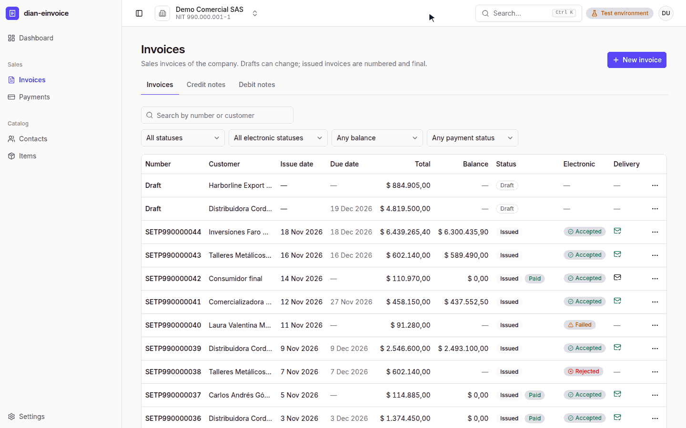
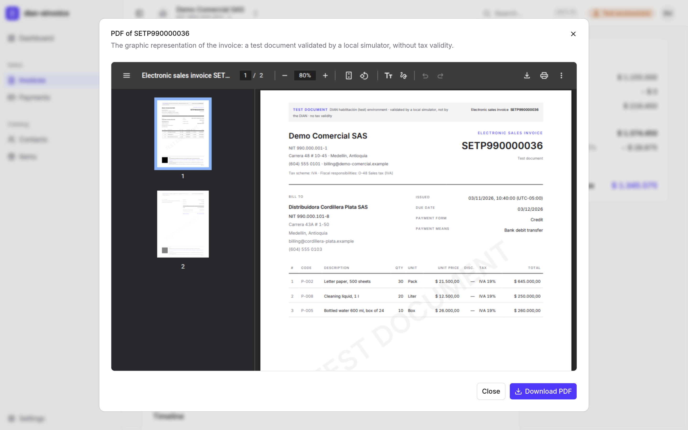
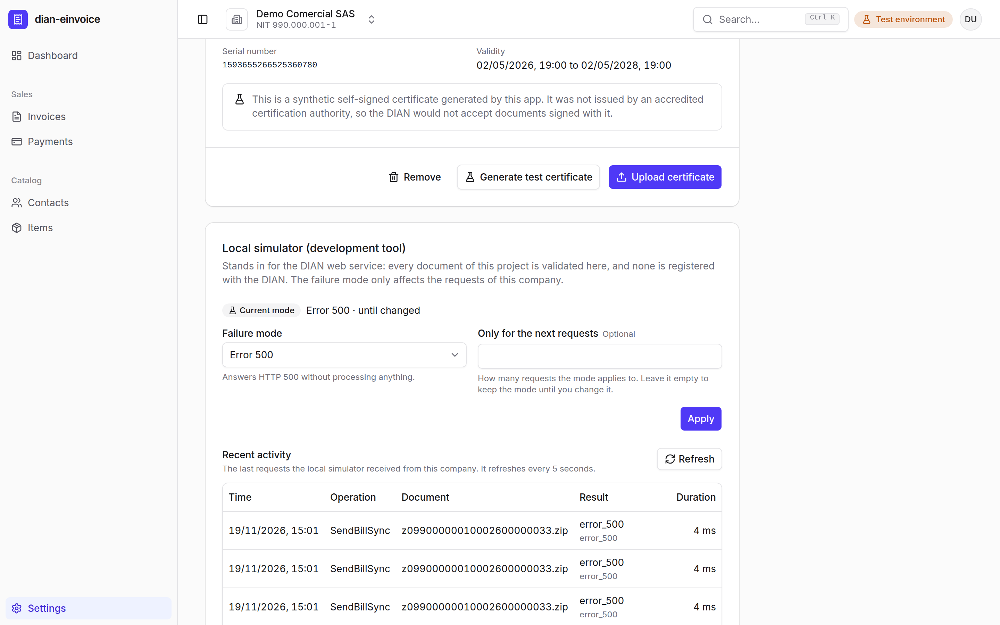
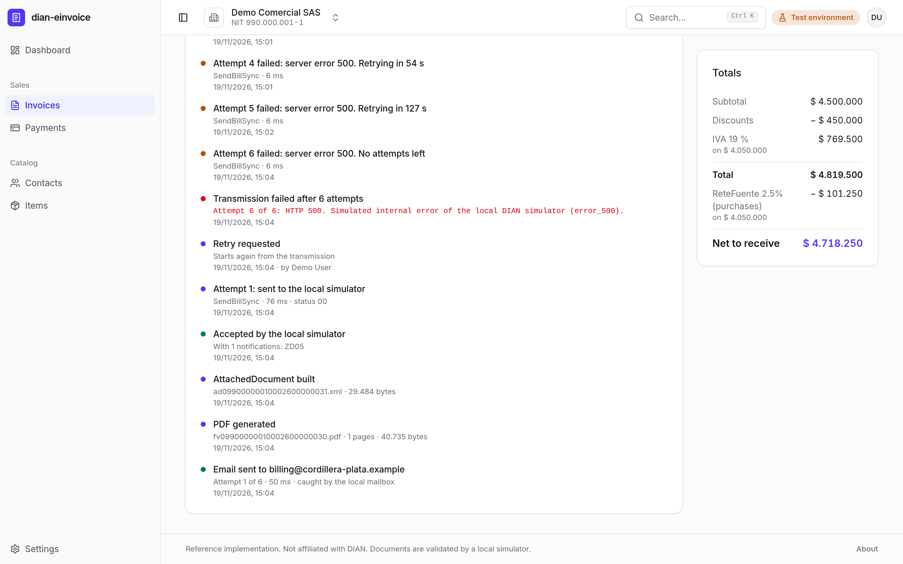
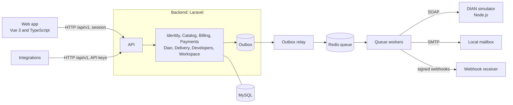
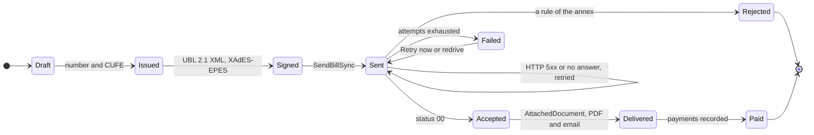
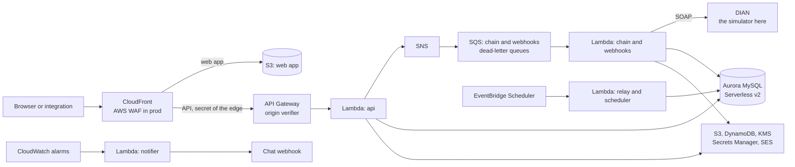

# DIAN e-Invoice

Electronic invoicing for Colombian small and medium businesses, API first: it issues invoices and credit and debit notes, builds their UBL 2.1 XML, computes the CUFE, signs it, sends it to a local simulator of the DIAN and emails the customer the PDF.



> **Not affiliated with DIAN.** The DIAN, the tax authority of Colombia, is always a local simulator in this repository. Every person, company and document of the demo is synthetic, and nothing was ever deployed to AWS: the cloud runs in a local emulator. See [Limits](#limits).

## What it is and what it shows

A multi-tenant platform for companies and for the software that serves them (accounting, point of sale, e-commerce), written as a reference implementation and run entirely on your machine.

- **The whole electronic chain of a document.** UBL 2.1 XML, CUFE and CUDE, XAdES-EPES signature, transmission to a SOAP simulator of the DIAN with retries and its ApplicationResponse, then the AttachedDocument, the PDF and the email. `make dian-check` checks the CUFE against the example of the technical annex, validates the XML against the official XSD and verifies the signature with xmlsec1; `make delivery-check` validates the AttachedDocument and reads the PDF and the email back.
- **Multi-tenant and API first.** Every business table carries its company and every query is scoped to it ([TenantIsolationTest](backend/tests/Integration/Identity/TenantIsolationTest.php)). The web app uses the same public API integrations do, with API keys, idempotency keys, rate limits and signed webhooks: `make api-check` drives it over HTTP.
- **Correct under concurrency and failure.** Numbers without gaps from parallel processes (`make stress`), the workers and the relay killed in the middle of the chain with every invoice accepted once (`make chaos`), twenty simultaneous payments of which exactly ten fit (`make payments-check`), and an outbox that publishes nothing before its commit.
- **The AWS architecture as code, run on an emulator.** A CDK app and a serverless service put the API on Lambda behind API Gateway and CloudFront, with SNS, SQS, S3, DynamoDB, KMS, Secrets Manager, SES and EventBridge Scheduler; production adds a VPC, Aurora MySQL Serverless v2 and AWS WAF, validated offline. `make cloud-check` proves the stage local end to end ([docs/infrastructure.md](docs/infrastructure.md)).
- **Operated like a service.** JSON logs where one correlation id follows an invoice from its request to its webhooks, metrics from those logs, alarms that each name a runbook, a notifier to a chat, and an incident drill that takes the DIAN down and brings every invoice back once: `make cloud-drill` ([docs/runbooks](docs/runbooks/README.md), [docs/observability.md](docs/observability.md)).
- **Checked from end to end.** 561 tests, PHPStan at level 10 without a baseline, audits of every dependency and of the git history, a browser test under the Content-Security-Policy of the edge, and cdk-nag with cfn-lint over both stages: see [Quality](#quality).

## Gallery

| | |
| --- | --- |
|  |  |
| The dashboard, over six months of synthetic sales. | An accepted invoice: the answer of the simulator, the CUFE, the QR code and the delivery. |
|  |  |
| The PDF the customer receives. | Settings → DIAN: the test certificate, and the simulator with a failure injected. |
|  |  |
| The timeline of that invoice: six failed attempts, Retry now, accepted. | API keys and signed webhooks, delivered to a local receiver that verifies them. |

Every screen in [docs/assets](docs/assets/), the dark theme included, comes from `make screenshots`.

## Quick start

You need Docker with Docker Compose 2.24 or later, GNU make and git; nothing else is installed on the host. It was tested on Linux under WSL 2 with Docker 29.1, Compose 2.40 and GNU make 4.3. On a clean clone the local stack took 2.7 GB of disk (1.7 GB of images, 0.3 GB of volumes and 0.7 GB of dependencies in the folder) and used 1.6 GB of memory once up, within limits of 4.8 GB in all; the browser test and the screenshots add the image of Playwright (2.6 GB), and the emulated cloud about 2 GB more. Keep the ports 8600 to 8603 of 127.0.0.1 free (the emulated cloud also uses 8604, 8605 and 8610 to 8619).

```sh
git clone https://github.com/iamcesarcuellar/dian-einvoice.git
cd dian-einvoice
make demo
```

The first `make demo` builds the images, installs the dependencies, migrates and loads six months of synthetic demo data through the real chain: 56 seconds on a clean clone of this commit, on a machine whose Docker already held the base images and its build cache (without them, it first pulls about 1.5 GB of base images). It creates `backend/.env` with random local secrets and prints a synthetic API key once. Then open:

| What | Address |
| --- | --- |
| Web app | http://localhost:8601 |
| API | http://localhost:8600/api/v1/health |
| API reference | http://localhost:8600/docs/api |
| DIAN simulator and webhook receiver | http://localhost:8602/health |
| Local mailbox, where every email lands | http://localhost:8603 |

Sign in as `demo@example.com` with the password `password`: the owner of Demo Comercial SAS and Demo Servicios SAS, both synthetic and set in Medellín. `admin@example.com`, `member@example.com` and `viewer@example.com`, with the same password, show the other roles.

`make down` stops everything and keeps the data, `make clean` also deletes it, and `make help` lists every target.

If something does not start, `make ps` shows the health of each container and `make logs` follows their logs. A port already taken on 127.0.0.1 stops the service that publishes it: free it, or stop the other project that holds it. `make seed` reloads the demo data from scratch at any time.

## Everyday commands

`make help` lists every target with one line each; these are the ones used most:

| Command | What it does |
| --- | --- |
| `make demo` | Starts the local stack and loads the synthetic demo data |
| `make up`, `make down` | Starts the stack with the current code; stops it and keeps the data |
| `make seed` | Reloads the demo data from scratch |
| `make test`, `make lint`, `make analyse` | Tests without a browser, formatters and linters, static analysis |
| `make e2e`, `make checks` | The browser test and the checks of the running stack |
| `make security` | Audits the dependencies and their licenses, and scans the history for secrets |
| `make cloud-demo`, `make cloud-check` | Deploys the AWS architecture to the local emulator and checks it end to end |
| `make screenshots` | Writes the screenshots and GIFs of this page again |
| `make logs`, `make ps` | Follows the logs; shows the containers and their health |

## A five-minute tour

**1. Issue an invoice and follow it.** In the web app, open **Invoices → New invoice**, choose the customer Distribuidora Cordillera Plata SAS and an item; the totals, taxes and withholdings update as you type. **Issue invoice** gives it its number and CUFE, and the strip at the top follows the chain: XML, signed, sent, accepted, delivered. The **Timeline** at the bottom lists every step with its time and who did it, and the email to the customer, with the PDF and the AttachedDocument in a zip, is in the local mailbox.

**2. Take the DIAN down.** In **Settings → DIAN**, the card of the local simulator sets a failure mode for the company. Choose **Error 500** and issue another invoice: each attempt fails and the next one waits 2, 5, 15, 45 and 120 seconds, until the transmission gives up. Set the mode back to **Normal** and press **Retry now** on the invoice: it is accepted and delivered once.


**3. Download the XML and the PDF.** On an accepted invoice, **Download XML** saves the signed UBL document and **View PDF** opens what the customer received; **View response** shows the ApplicationResponse of the simulator.

**4. Use the API with curl.** `make demo` printed a synthetic API key of Demo Comercial SAS, shown once; **Settings → Developers → Create key** makes another. With it, find a customer and an item, write a draft and issue it with an idempotency key:

```sh
KEY=dei_...   # the synthetic key make demo printed
API=http://localhost:8600/api/v1
id() { grep -o '"id":"[0-9a-z]\{26\}"' | head -n 1 | cut -d '"' -f 4; }

CONTACT=$(curl -s "$API/contacts?search=Cordillera" -H "Authorization: Bearer $KEY" | id)
ITEM=$(curl -s "$API/items?search=chair" -H "Authorization: Bearer $KEY" | id)
INVOICE=$(curl -s "$API/invoices" -H "Authorization: Bearer $KEY" -H 'Content-Type: application/json' \
  -d "{\"contact_id\":\"$CONTACT\",\"payment_form\":\"1\",\"payment_means_code\":\"10\",\"lines\":[{\"item_id\":\"$ITEM\",\"quantity\":\"2\"}]}" | id)

# The same Idempotency-Key twice: the second answer is the first one, replayed, and nothing runs twice.
curl -s -o /dev/null -w '%{http_code}\n' -X POST "$API/invoices/$INVOICE/issue" -H "Authorization: Bearer $KEY" -H "Idempotency-Key: issue-$INVOICE"
curl -s -D - -o /dev/null -X POST "$API/invoices/$INVOICE/issue" -H "Authorization: Bearer $KEY" -H "Idempotency-Key: issue-$INVOICE" | grep -i '^idempotent-replayed'

# A few seconds later, once the chain has run: the signed XML and the PDF.
curl -s "$API/invoices/$INVOICE/xml" -H "Authorization: Bearer $KEY" -o invoice.xml
curl -s "$API/invoices/$INVOICE/pdf" -H "Authorization: Bearer $KEY" -o invoice.pdf
```

Every answer carries `X-RateLimit-Remaining` and an `X-Correlation-Id` that the logs of the whole journey share. The [API reference](http://localhost:8600/docs/api) documents every operation, the idempotency rules and the webhooks.

**5. Receive a signed webhook.** The demo company is subscribed to the local webhook receiver, which runs inside the simulator. In **Settings → Developers**, the subscription shows its last delivery and its menu lists every one, those of the invoice you just issued included (`invoice.issued`, `invoice.accepted`, `invoice.delivered`); the card of the receiver, further down, shows each webhook with the check of its signature (Standard Webhooks, HMAC-SHA256), and **Send test event** sends one more.

## The AWS cloud on your machine

`make cloud-demo` stops the application of the local stack and deploys the stage local of the AWS architecture to [Floci](https://github.com/floci-io/floci), an open-source AWS emulator that needs no account, with the same CDK app, serverless service and deployment script (`scripts/deploy.sh`) a real account would take, then loads the demo data through the functions. The web app and the API answer on the same addresses, now through the emulated CloudFront; `make up` goes back to the local stack.

| AWS service | What runs on the emulator | What it does here |
| --- | --- | --- |
| CloudFront | The distribution of the stage local, without cache, CloudFront Functions or AWS WAF | One origin for the web app and the API, with the security headers |
| API Gateway and Lambda | An HTTP API with a Lambda authorizer; each function in its own container | The API (PHP 8.5 on Bref), the chain, the webhooks, the relay, the scheduler, the console, the origin verifier and the notifier |
| SNS and SQS | A topic, the queues of the chain and the webhooks, and their dead-letter queues | The outbox events and the work of the consumers |
| S3, DynamoDB, KMS, Secrets Manager, SSM | Buckets, tables, a key, secrets and parameters | Documents and the web app; cache, sessions and rate limits; envelope encryption of the certificates; credentials |
| SES | An identity; emails kept, none delivered | The emails to customers |
| EventBridge Scheduler | Two schedules, every minute | The relay of the outbox and the Laravel scheduler |
| CloudWatch | Logs, metric filters and alarms on one metric | Observability; metric math and composite alarms are not evaluated |
| Aurora MySQL, VPC, AWS WAF | Not emulated: the stage prod only, validated offline | The MySQL of compose stands in for the database |

The results of the runs for this commit, with the figures of the emulator on this machine, not those of AWS:

- `make cloud-check` passed in 3 min 19 s. Thirty invoices went from issue to delivery in a median of 23.4 s through the fast path of the outbox; ten more, with the containers of the functions killed mid-process and an outbox event left for the relay, ended like the rest: 41 of 41 accepted and delivered once, numbered without a gap. Two rotations of the database identity of the application, with the functions warm, broke no request. Every log line was JSON in the schema and none held a secret, and an alarm forced to ALARM reached the chat. A cold start of the API took 0.96 s and a warm answer a median of 20 ms.
- `make cloud-drill` passed in 249 s. With the DIAN down, five transmissions gave up into the dead-letter queue, the alarm reached the chat with its runbook 171 s after the outage began, and the commands of the runbook brought every invoice back, accepted and delivered once, at 183 s ([drill-report.md](docs/runbooks/drill-report.md) reviews an earlier run).
- `make cloud-e2e` passed: the journey of an invoice through the functions, the API reference, and a tour of the 31 routes of the web app with 17 of its dialogs, through the edge and under its Content-Security-Policy, without a violation.

## Architecture

The modules of the system, in two separate applications that talk only through the HTTP API under `/api/v1`:



The life of an invoice, simplified; credit and debit notes follow the same chain:



The architecture on AWS, as the CDK app and the serverless service define it:



The details: [docs/infrastructure.md](docs/infrastructure.md) for the stacks, the functions, the network, the database and the edge; [docs/observability.md](docs/observability.md) for logs, metrics and alarms; [docs/deployment.md](docs/deployment.md) for the deployment; [docs/threat-model.md](docs/threat-model.md) for security.

## The repository

| Folder | What it holds |
| --- | --- |
| [backend/](backend/) | The API in Laravel, by modules (`backend/app/Modules`): identity and tenancy, catalog, billing, the chain of the DIAN, delivery, payments, the public API and its webhooks, and the dashboard; its unit and integration tests |
| [frontend/](frontend/) | The web app in Vue 3 and TypeScript, which talks to the backend only through `/api/v1` |
| [simulator/](simulator/) | The local simulator of the web service of the DIAN (SOAP), with its failure modes and the webhook receiver |
| [infra/cdk/](infra/cdk/) | The CDK app: the stacks of the stages local and prod, their tests and cdk-nag |
| [infra/functions/](infra/functions/) | The serverless service: the functions and their triggers, the origin verifier, the notifier and the scripts of the emulated cloud |
| [e2e/](e2e/) | The browser tooling: the end-to-end test, the screenshots of `make screenshots` and the check of the docs |
| [scripts/](scripts/) | The deployment script, the cloud check and the drill, the security and license checks, and the helpers of the Makefile |
| [docs/](docs/README.md) | The documentation, indexed in docs/README.md, and the images of this page |

## Quality

The results of the runs for this commit, on the machine of the quick start. Continuous integration (`.github/workflows/ci.yml`) runs these targets too, but for the drill and part of `make checks`, and only when it is dispatched by hand while the repository is private:

| What | Command | Result |
| --- | --- | --- |
| Backend: unit tests, and integration tests against MySQL, Redis and the simulator | `make test-backend` | 207 tests and 6,503 assertions, in 41 s |
| Web app, simulator and infrastructure tests | `make test-frontend`, `make test-simulator`, `make test-infra` | 54 web app tests, 107 simulator tests, and 193 tests of the CDK app and the functions, cdk-nag included |
| Formatters, linters and the documentation | `make lint` | Laravel Pint over 534 files, ESLint and Prettier: clean; in the docs, 194 relative links and 10 anchors resolve, 8 images keep to their size and Mermaid draws 7 diagrams |
| Static analysis | `make analyse` | PHPStan level 10 without a baseline, vue-tsc and tsc for the simulator, the CDK app and the functions: no errors |
| Dependencies, licenses and secrets | `make security` | No high or critical advisory in the six audits; 480 production dependencies, every license compatible with MIT; gitleaks finds no secret in the history or the changes |
| Infrastructure as code, offline | `make cdk-check` | 21 stacks of both stages and 3 packages of the functions: cdk-nag (AWS Solutions) with no finding left without its reason, cfn-lint and actionlint clean |
| An invoice from draft to paid, in a browser | `make e2e` | The journey in Chromium, from the editor to accepted, delivered, its PDF and paid, in 8.8 s |
| The checks of the running stack | `make checks` | Every check passes: 60 invoices from 20 processes numbered without a gap and accepted in 4.6 s, and 40 accepted once each with the workers and the relay killed mid-chain |
| The emulated cloud, end to end | `make cloud-check`, `make cloud-e2e`, `make cloud-drill` | Every check passes; their figures are [above](#the-aws-cloud-on-your-machine) |

Known gaps are written down, not hidden: [docs/limitations.md](docs/limitations.md#tests-and-tooling) lists what the tests do not cover.

## Technologies

| Part | Technologies |
| --- | --- |
| Backend | PHP 8.5, Laravel 13 (API only), FrankenPHP locally and Bref 3 on Lambda, dompdf, bacon-qr-code, AWS SDK for PHP |
| Web app | Vue 3, TypeScript 6, Vite 8, Pinia, Vue Router, Tailwind CSS 4, shadcn-vue on Reka UI, Unovis |
| Data and messaging | MySQL 8.4, Redis 7; in the cloud SNS, SQS and DynamoDB; Aurora MySQL Serverless v2 in prod |
| DIAN simulator | Node.js and TypeScript, SOAP 1.2, the official XSDs of the DIAN toolbox |
| Infrastructure as code | AWS CDK in TypeScript with cdk-nag, osls 4.8.1, cfn-lint, actionlint, Floci as the emulator |
| Tests and checks | PHPUnit, Vitest, node:test, Playwright, PHPStan with Larastan, Laravel Pint, ESLint, Prettier, vue-tsc, gitleaks |
| Local runtime | Docker Compose and make; Mailpit as the local mailbox |

## Limits

- **Not certified by the DIAN.** No CUFE, CUDE or signature produced here was ever validated by the DIAN. The simulator applies a subset of the rules of annex 1.9 (`simulator/src/rules.ts`), the SOAP header is not signed with WS-Security, and documents are signed with synthetic self-signed test certificates that only the simulator accepts.
- **The DIAN is a simulator.** Every "accepted" comes from `simulator/`; its answers, delays and failures are the ones it is told to give.
- **Never deployed to AWS.** The stage prod is synthesized, packaged and validated offline, and the deployment workflow has never run; [docs/deployment.md](docs/deployment.md) lists what was never verified in a real account.
- **What the emulator does not reproduce:** it evaluates no IAM, resource or key policy; it has no AWS WAF, no cache and no CloudFront Functions; it publishes no native metrics of Lambda, API Gateway or CloudFront and evaluates no metric math; it cannot run the rotation functions of AWS; and its cold starts and queue timings are not those of AWS.
- **Synthetic data only.** Every person, company, NIT, document and payment is made up; PDFs and emails have no tax validity.

All of it, with the reasons, in [docs/limitations.md](docs/limitations.md).

## Documentation and roadmap

[docs/README.md](docs/README.md) indexes every document: limitations, threat model, infrastructure, observability, deployment, runbooks and third-party licenses. Next, in order: reference documents (the architecture, a guide to the API, the conformance with the DIAN and an estimate of the cost on AWS); the web app, the PDF and the emails in Spanish, with a README in Spanish; and the release of v1.0.0 with continuous integration green and the repository public.

## License

[MIT](LICENSE). The dependencies and their licenses, all compatible with it, are in [docs/third-party-licenses.md](docs/third-party-licenses.md); vulnerabilities are reported privately as [SECURITY.md](SECURITY.md) explains, and [CONTRIBUTING.md](CONTRIBUTING.md) has the rules for changes.

## Author

Made by [Cesar Cuellar](https://github.com/iamcesarcuellar), Software Engineer in Medellín, Colombia.
