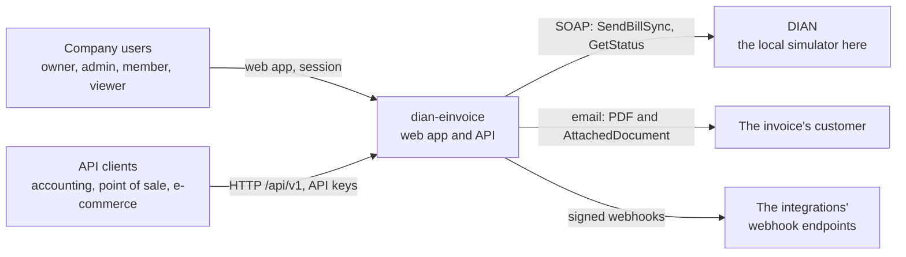
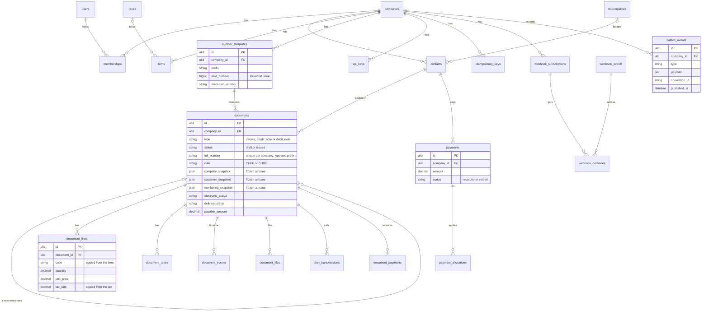
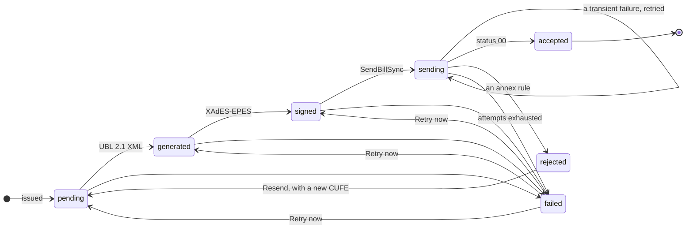

# Architecture

How the application is built: what it does and whom it talks to, its modules, its data model, a document's life cycle, the design decisions behind them, and the guarantees the tests hold. The AWS architecture that runs it in the cloud is in [infrastructure.md](infrastructure.md); paths here are relative to `backend/` unless they start at the repository's root.

## Context

dian-einvoice issues a company's electronic invoices and its credit and debit notes. It builds each document's UBL 2.1 XML, computes its CUFE or CUDE, signs it, sends it to the DIAN, records the response, and delivers the document to the customer. It also records the payments against each invoice and tells other systems about every change through signed webhooks.

- **Company users** work in the web app, signed in with a session. A user may belong to several companies, with one role in each: owner, admin, member or viewer (`app/Modules/Identity/Enums`).
- **API clients** are a company's own software, or software that serves it, with an API key for that company. They use the same API as the web app.
- **The DIAN** receives every document over SOAP. In this repository it is always the local simulator in `simulator/` ([dian-conformance.md](dian-conformance.md)).
- **The customer** receives an email with the PDF and, in a zip, the AttachedDocument that the annex asks for.
- **Webhook endpoints** receive the events their subscriptions name, signed per Standard Webhooks ([api-guide.md](api-guide.md#webhooks)).

## Modules

The backend is one Laravel application, divided into modules under `app/Modules`. Each module owns its tables, models, routes and service provider; `routes/api.php` mounts every module's routes under `/api/v1`. Cross-cutting pieces live in `app/Support`: the outbox, the storage and key ports, observability, retention, the database connector and the AWS adapters.

| Module | Responsibility |
| --- | --- |
| Reference | The DIAN's code lists, as enums, and DANE's departments and municipalities. It depends on no other module. |
| Identity | Users, sign-in, companies, memberships and roles, invitations, password resets, and the tenancy building blocks (`app/Modules/Identity/Tenancy`). |
| Catalog | Each company's contacts, items, taxes and withholdings. |
| Billing | Numbering ranges, invoices, credit and debit notes, the calculator, and the invoice side of payments. |
| Dian | DIAN settings, signing certificates, the CUFE and CUDE, the UBL 2.1 XML, the XAdES-EPES signature, and the chain up to the DIAN's response. |
| Delivery | After the DIAN accepts a document: the AttachedDocument, the PDF and the email. |
| Payments | Payments, their allocation to invoices, and receivables. |
| Developers | API keys, rate limits per key, idempotency keys, and webhooks. |
| Workspace | A read model: the dashboard and the global search. It never writes. |

How many `use App\Modules\…` lines each module (row) has for each other module (column):

| From \ to | Billing | Catalog | Delivery | Developers | Dian | Identity | Payments | Reference |
| --- | ---: | ---: | ---: | ---: | ---: | ---: | ---: | ---: |
| Billing | – | 16 | 5 | 1 | 18 | 32 | 13 | 24 |
| Catalog | | – | | | | 14 | | 26 |
| Delivery | 50 | | – | | 15 | 12 | | 4 |
| Developers | 7 | | 1 | – | 1 | 28 | 3 | |
| Dian | 63 | 1 | 1 | | – | 27 | | 6 |
| Identity | | | | 4 | | – | | 10 |
| Payments | 9 | 3 | 1 | 1 | | 12 | – | 3 |
| Workspace | 13 | 3 | 2 | | 2 | 2 | 6 | |

The modules talk in five ways:

- **Direct calls and shared models**, most of the edges above. Dian and Delivery work on Billing's `Document`, for example.
- **One in-process event.** `Identity\Events\CompanyCreated` fires inside the transaction that creates a company; Catalog gives the company its taxes, and Billing its receipt numbering.
- **Outbox events** for everything asynchronous. A writer records an event in the same transaction as its change (`app/Support/Outbox/Outbox.php`, `Outbox::record`), and the subscriptions in the Dian, Delivery and Developers providers turn each event into a chain or webhook job (`OutboxSubscribers::subscribe`).
- **Ports.** Payments reaches Billing only through `app/Modules/Payments/Ports/InvoiceLedger.php` and `ReceiptNumbering.php`, which Billing implements; their tables share no foreign key.
- **Queued jobs** for Identity's emails (invitations and password resets).

**The boundaries are a convention, not a check.** No tool enforces them: there is no deptrac or architecture test, and PHPStan runs at level 10 with no custom rules. Several pairs import each other, such as Billing and Dian, or Billing and Delivery. Payments is the one boundary kept clean on purpose, since it would be the first to become a service of its own ([limitations.md](limitations.md#payments-and-business-rules)).

## Data model

37 tables, with ULIDs for keys. Every business table carries `company_id`. The exceptions are `users` (a user belongs to companies through `memberships`), `companies` (the tenants themselves), DANE's `departments` and `municipalities`, `password_reset_tokens` and `failed_jobs`.

The diagram leaves out the settings and key tables (`dian_settings`, `signing_certificates`, `key_store_entries`, `kms_key_store_entries`), the delivery table (`delivery_attempts`), the team table (`team_invitations`), webhook attempts and payment events (`webhook_attempts`, `payment_events`), and `dian_file_counters`. Three decisions in it are not obvious:

- **Frozen copies.** An issued document keeps what it was issued with. `IssueDocument` writes the company's, the customer's and the numbering's data into `company_snapshot`, `customer_snapshot` and `numbering_snapshot` (`app/Modules/Billing/Services/DocumentSnapshots.php`). Each line keeps its item's code, description and unit, and its tax's code, name and rate, from the moment the draft was saved. The XML, the PDF and the API read these copies only, so a later change to a contact, an item or a tax never rewrites an issued invoice. A note keeps its invoice's customer and rates, and its reference to the invoice in `related_snapshot`.
- **Money.** Amounts are `decimal(18,2)`, quantities and unit prices `decimal(18,6)`, and rates `decimal(7,4)`. They travel through the API as decimal strings, never as floating-point numbers (`app/Rules/DecimalString.php`), and every calculation uses `Brick\Math\BigDecimal`.
- **Many companies in one schema.** Uniqueness is per company: a number is unique per company, type and prefix (`documents_number_unique`), a contact per company and identification, an idempotency key per company and key. Payments and Billing share no foreign key (`payment_allocations.document_id`, `document_payments.payment_id`, `payments.number_template_id`), so the two modules could split into two databases.

Operational records do not live forever: published outbox events are pruned after 7 days, finished webhook deliveries after 30, and accepted documents' DIAN calls after 180 (`config/retention.php`). Documents, their files, their timelines and payments are never pruned.

## A document's life cycle

A document is a draft until it is issued. Issuing it gives it its number, its CUFE or CUDE and its frozen copies, in one transaction, and records `invoice.issued` (or `credit_note.issued`, `debit_note.issued`) in the outbox. From then on, three states move independently: the electronic status (the chain to the DIAN), the delivery status (the customer), and, for invoices, the payment status.

`app/Modules/Billing/Enums/ElectronicStatus.php` holds these transitions, and `tests/Unit/Billing/ElectronicStatusTest.php` tests them. Each step is a job that locks the document, checks that it is in the state the step expects, does its work and records the next event in the same transaction:

| Step | Job | Started by | Records | When it fails |
| --- | --- | --- | --- | --- |
| XML | `app/Modules/Dian/Pipeline/GenerateXml.php` | `invoice.issued` | `electronic_document.sign_due` | `failed` at this step, with `xml_failed` in the timeline; nothing is sent |
| Signature | `app/Modules/Dian/Pipeline/SignXml.php` | `sign_due` | `transmit_due` | `failed`; a certificate not valid at that instant stops the chain here |
| Transmission | `app/Modules/Dian/Pipeline/TransmitDocument.php` | `transmit_due` | `response_received`, or a `transmit_due` delayed for the next attempt | Retried on a timeout, no response, a refused connection, a 5xx or an unreadable response; failed at once on a 4xx; `failed` after its attempts |
| Response | `app/Modules/Dian/Pipeline/RecordDianResponse.php` | `response_received` | `accepted` and `delivery.attached_document_due`, or `rejected` | A rejection is final until Resend |
| AttachedDocument | `app/Modules/Delivery/Pipeline/BuildAttachedDocument.php` | `attached_document_due` | `delivery.pdf_due` | Delivery `failed`, with the step |
| PDF | `app/Modules/Delivery/Pipeline/GeneratePdf.php` | `pdf_due` | `delivery.email_due` | Delivery `failed` |
| Email | `app/Modules/Delivery/Pipeline/SendDeliveryEmail.php` | `email_due` | `delivery.delivered` | Retried on a transient error; failed at once on an SMTP 5xx or an invalid address |

Webhooks travel separately: `invoice.issued`, the acceptance or rejection and the delivery each become a webhook event, and each subscription's delivery is a job of its own (`webhook.delivery_due`).

- **Retries.** A transmission gets six attempts: the first, then waits of 2, 5, 15, 45 and 120 seconds, each plus up to 20 % of jitter (`DIAN_RETRY_DELAYS`, `DIAN_RETRY_JITTER`). An email uses the same delays, and so does a webhook (`WEBHOOK_RETRY_DELAYS`). A job that fails for an unexpected reason is tried up to 10 times. In the cloud, a step that gives up for good leaves its message in its queue's dead-letter queue ([runbooks/dead-letters.md](runbooks/dead-letters.md)).
- **A call that may have arrived.** When a transmission got no response, its next attempt asks the DIAN with GetStatus first, and sends again only when the DIAN does not have it. When the DIAN has already accepted the number, it responds with rule 90; the chain then asks GetStatus and keeps the response for the document the DIAN already holds.
- **Recovery.** `POST /{type}/{id}/retry` (Retry now) brings a scheduled attempt forward, or starts a new run from the step that failed. `POST /{type}/{id}/resend` corrects a rejected document and sends it again, with a new run and a new CUFE. `POST /invoices/{id}/deliver` sends the email again. Moving a dead letter back to its queue starts the step again, as Retry now does; whichever comes first acts, and the other does nothing.
- **The timeline.** `document_events` lists every step with its time and its actor, a user or an API key: for an invoice that went straight through, `created`, `issued`, `xml_generated`, `xml_signed`, `transmission_attempt`, `accepted`, `attached_document_built`, `pdf_generated` and `email_attempt` ([api-guide.md](api-guide.md#5-follow-its-status)).
- **Payments.** An accepted invoice is `unpaid`, then `partially_paid` and `paid` as payments are allocated to it; credit notes move its balance status to `partially_credited` or `credited`, and a credit note of concept 2 voids it.

## Design decisions

**A modular monolith.** One Laravel application, one database, nine modules with their own tables and routes. One deployable, one transaction for a change that spans modules (an issue writes the document, the numbering, the timeline and the outbox at once), and one place to read a whole flow. The price is that the boundaries hold by convention only, as [Modules](#modules) says. The modules are the folders of `app/Modules`; nothing tests their boundaries.

**Multi-tenancy in one schema.** Every business table carries `company_id`, and every model that holds a company's data uses `app/Modules/Identity/Tenancy/BelongsToCompany.php`, whose global scope filters by the current company and fails closed: with no current company, a query throws instead of reading everything. The one exception is `OutboxEvent`, which the relay reads across companies. The current company comes from the API key, or, for a session, from `X-Company-Id` and the user's membership (`app/Modules/Identity/Http/Middleware/ResolveCurrentCompany.php`). It is resolved before route binding, so another company's record returns 404. One schema keeps operations simple; the price is that every query depends on the scope, and a `withoutGlobalScope` must be justified (27 uses, in sweepers, status commands, API keys and invitations). `TenantIsolationTest::test_every_record_of_another_company_answers_404` walks every API route that takes a parameter, and `test_another_company_cannot_be_acted_on_by_header_or_by_api_key` covers the header and the key.

**Consecutive numbers without gaps.** A number is taken only at issue, inside the issue's transaction, after locking the document and its numbering range (`SELECT … FOR UPDATE`, `app/Modules/Billing/Services/IssueDocument.php`). A failure rolls back the number with everything else, and the transaction retries a deadlock up to five times. The price is that two issues from the same range wait for each other. `IssueTest::test_simultaneous_issues_take_consecutive_numbers_without_gaps_or_repeats` runs 12 processes at once, `test_missing_requirements_answer_422_and_consume_no_number` refuses without taking one, and `make stress` issues 60 invoices from 20 processes.

**A transactional outbox.** Nothing asynchronous starts from inside a transaction: the writer records an event in the `outbox_events` table, in the same transaction as its change, and the event is published only after the commit. A relay publishes what is pending, claiming rows with `FOR UPDATE SKIP LOCKED`; in the cloud, the writer publishes its own events right after its commit, and the relay function is the safety net (`app/Support/Outbox`, [infrastructure.md](infrastructure.md#the-outbox-without-a-relay-that-runs-all-the-time)). Delivery is at least once, so every consumer is idempotent: each step checks the document's state, run and attempt under a lock, and webhook events and deliveries have unique keys. `OutboxFastPathTest` holds it: `test_the_writer_publishes_the_events_of_its_transaction_after_the_commit_together`, `test_a_transaction_that_rolls_back_publishes_nothing`, `test_a_publish_that_fails_loses_nothing_and_the_safety_net_publishes_it_later` and `test_a_row_already_published_or_claimed_by_another_relay_is_not_published_again`.

**API idempotency.** A `POST` with an `Idempotency-Key` runs once per company and key. The key is reserved first, then the request runs in one transaction that claims it (`FOR UPDATE NOWAIT`) and stores the response with the effect, so both commit or neither does. The fingerprint is a SHA-256 of the method, the path and the body, with JSON compared by content. A replay returns the stored response with `Idempotent-Replayed: true`; another request with the same key gets 422, and a key whose request is still running gets 409 (`app/Modules/Developers/Http/Middleware/HandleIdempotency.php`, `app/Modules/Developers/Idempotency`). The price is a database transaction around every such request. `IdempotencyTest` (`test_a_failure_between_the_effect_and_the_key_commits_neither`, `test_a_reservation_whose_request_still_runs_answers_409`, `test_a_reservation_left_by_a_dead_request_is_taken_over_once`) and `PublicApiTest::test_simultaneous_requests_with_one_idempotency_key_create_one_document` hold it, and so does `make api-check`.

**Money and rounding.** Every amount is a decimal string and every calculation a `BigDecimal`; floating-point numbers never touch money. `app/Modules/Billing/Domain/DocumentCalculator.php` is the only place where a document's arithmetic happens. It rounds half to even to two decimals, as section 5.2.1 of the annex asks: each line's base, its discount and its tax. Totals are exact sums of the rounded lines, so they always add up. The price is that a total may differ by cents from one computed on the unrounded lines, within the tolerance the annex allows ([dian-conformance.md](dian-conformance.md#rounding)). `DocumentCalculatorTest::test_the_line_base_rounds_half_to_even` and `test_the_identities_of_the_totals_always_hold`, over 300 random documents, hold it.

**Frozen copies.** An issued document is a legal record, so it reads only the copies it was issued with ([Data model](#data-model)). The price is duplicated data, and a correction is a credit or debit note rather than an edit. The issue itself returns 422 for a draft whose tax or withholding changed its rate or was turned off after the draft was saved (`IssueDocument::staleRates`). `ChainTest::test_regenerating_on_a_later_day_moves_the_dates_and_the_cufe_but_never_of_an_accepted_document` covers the one thing allowed to move: the dates and CUFE of a document not yet accepted, when the chain runs on a later day.

**Ports and adapters.** Each external dependency sits behind an interface, chosen in `config/adapters.php` and the service providers: `DocumentStorage` (the local disk or S3), `KeyStore` (APP_KEY or KMS envelope encryption), `OutboxPublisher` (the Redis queue or SNS), `WindowLimiter` (Redis or DynamoDB), `DocumentRenderer` (dompdf) and `DianGateway` (SOAP to the simulator). The same code runs in the local stack and in the emulated cloud, and the AWS adapters never reach the business code. Mail, the queue, the cache and the sessions use Laravel's own drivers, not interfaces the project defines. The price is a layer per dependency. `tests/Integration/Operations/CloudAdaptersTest.php` tests the AWS adapters, and `make cloud-check` runs them on the emulator.

**A web app separate from the API.** The web app (`frontend/`) is a separate application, built and deployed on its own, that talks to the backend only through `/api/v1`. It signs in with a session and a CSRF token (Laravel Sanctum), while integrations use API keys on the same routes. The backend renders no page: its only templates are the PDF's and the emails' (`app/Modules/Delivery/Views`, `app/Modules/Identity/Views`), and its only HTML response is the API reference at `/docs/api`. Every error is a problem in `application/problem+json` (`ErrorsAndHeadersTest::test_errors_are_problems_without_internal_details`). The price is that a few routes exist only for the web app's session, and a key gets 403 there (`RejectApiKeys`). Nothing tests that the backend renders no page.

**Two languages.** English is the default and Spanish the other language, at three levels. The web app keeps its messages in `frontend/src/i18n` and sends its language in `Accept-Language`; the API answers every message, validation and problems included, in the language a request asks for (`NegotiateLanguage`); and each company chooses the language of its documents (`companies.document_language`), which the chain, the PDF, the customer email and the timeline texts use. The backend's texts sit in each module's `Lang/en` and `Lang/es`, with the framework's validation messages written by hand in `lang/es`. The price is every text twice: `i18n.test.ts` and `tests/Unit/Support/TranslationFilesTest.php` fail when the two languages differ in a key, a placeholder or a plural form, `tests/Integration/Security/LanguageTest.php` covers the API, and `e2e/tests/spanish.spec.ts` the web app, the PDF and the email.

## Guarantees

What must not happen, and what holds it:

| What must not happen | What holds it |
| --- | --- |
| A number repeated, or a gap in a range | The row lock at issue. `IssueTest::test_simultaneous_issues_take_consecutive_numbers_without_gaps_or_repeats` and `test_missing_requirements_answer_422_and_consume_no_number`, `NotesTest::test_two_simultaneous_credit_notes_cannot_both_take_what_is_left`, `make stress` (60 invoices from 20 processes), `make chaos` and `make cloud-check` (numbers 1 to N, consecutive) |
| An invoice accepted twice, or a second call to the DIAN that validates it again | Each step's state checks, GetStatus before a resend, and rule 90. `ChainTest::test_a_send_that_may_have_arrived_asks_get_status_before_sending_again`, `test_the_call_of_a_worker_that_died_is_taken_over_after_its_lease` and `test_a_number_the_simulator_already_accepted_for_another_document_stays_rejected_with_rule_90`; `make chaos` and `make cloud-check`, where the simulator holds one accepted record per invoice. A rare duplicate message may still reach the DIAN, which responds with rule 90 ([limitations.md](limitations.md#operation-and-delivery)) |
| A payment applied twice, or more collected than an invoice owes | The invoice's row lock, unique allocations, and idempotency keys. `PaymentsTest::test_simultaneous_payments_never_collect_more_than_the_balance` and `test_a_payment_above_the_balance_is_refused_and_changes_nothing`, and `make payments-check`: of twenty simultaneous payments of a tenth of a balance, exactly ten fit |
| An event lost | The transactional outbox. The four tests of `OutboxFastPathTest` above; `make chaos`, which kills the workers and the relay mid-chain; and `make cloud-check`, where an event left behind is published by the relay function |
| A request with an idempotency key run twice | `IdempotencyTest`, `PublicApiTest::test_an_idempotency_key_replays_and_refuses_another_request` and `test_simultaneous_requests_with_one_idempotency_key_create_one_document`, and `make api-check` (ten at once) |
| A recovery that acts twice | `RecoveryTest`: Retry now and moving a dead letter back, in either order, make one DIAN call, one email and one set of webhooks (`test_retry_now_first_recovers_the_invoice_and_its_dead_letter_moved_back_afterwards_does_nothing`, `test_the_dead_letter_moved_back_first_recovers_the_invoice_and_retry_now_afterwards_is_refused`, `test_send_again_first_delivers_the_invoice_and_the_dead_letter_of_its_email_moved_back_afterwards_does_nothing`); `make cloud-drill` |
| A company reading or changing another's data | The company scope, which fails closed. `TenantIsolationTest`, over every API route that takes a parameter |
