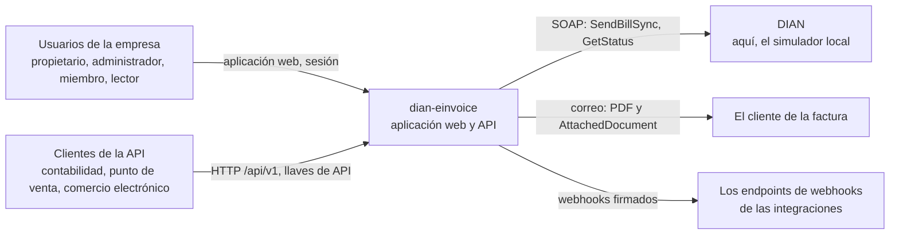
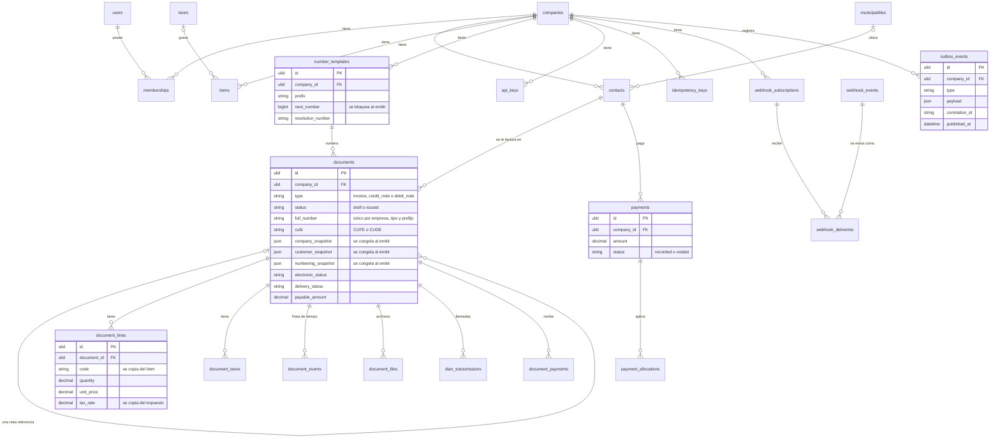
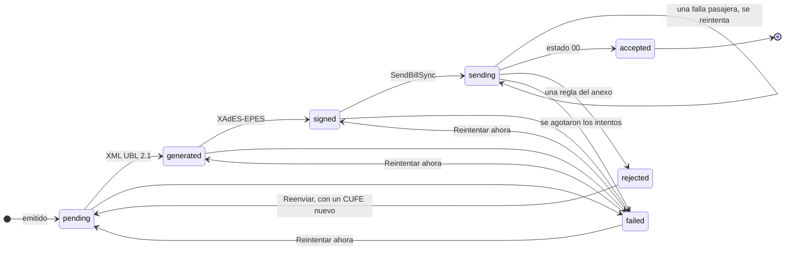

# Arquitectura

[English](../architecture.md) · **Español**

<!-- Traducción de docs/architecture.md con SHA-256 e95bb1a5bc306a3f5ce1bc2a5554f59c5b8ebeb893f884edd044a50fb91766ba. make docs-stamp actualiza esta línea cuando la traducción ya sigue al original. -->

Cómo está construida la aplicación: qué hace y con quién habla, sus módulos, su modelo de datos, el ciclo de vida de un documento, las decisiones de diseño que hay detrás y las garantías que las pruebas sostienen. La arquitectura de AWS sobre la que corre en la nube está en [infrastructure.md](infrastructure.md); aquí, las rutas son relativas a `backend/`, salvo las que empiezan en la raíz del repositorio.

## Contexto

dian-einvoice emite las facturas electrónicas de una empresa y sus notas crédito y débito. Arma el XML UBL 2.1 de cada documento, calcula su CUFE o CUDE, lo firma, lo envía a la DIAN, registra la respuesta y entrega el documento al cliente. También registra los pagos de cada factura y avisa a otros sistemas de cada cambio con webhooks firmados.

- **Los usuarios de la empresa** trabajan en la aplicación web, con una sesión iniciada. Un usuario puede pertenecer a varias empresas, con un rol en cada una: propietario, administrador, miembro o lector (`app/Modules/Identity/Enums`).
- **Los clientes de la API** son el software propio de una empresa, o el software que la atiende, con una llave de API de esa empresa. Usan la misma API que la aplicación web.
- **La DIAN** recibe cada documento por SOAP. En este repositorio, siempre es el simulador local de `simulator/` ([dian-conformance.md](dian-conformance.md)).
- **El cliente** recibe un correo con el PDF y, en un zip, el AttachedDocument que pide el anexo.
- **Los endpoints de webhooks** reciben los eventos que nombran sus suscripciones, firmados según Standard Webhooks ([api-guide.md](api-guide.md#webhooks)).

## Módulos

El backend es una sola aplicación de Laravel, dividida en módulos bajo `app/Modules`. Cada módulo es dueño de sus tablas, sus modelos, sus rutas y su proveedor de servicios; `routes/api.php` monta las rutas de todos los módulos bajo `/api/v1`. Las piezas transversales viven en `app/Support`: el outbox, los puertos del almacenamiento y de las llaves, la observabilidad, la conservación de los datos, el conector de la base de datos y los adaptadores de AWS.

| Módulo | Responsabilidad |
| --- | --- |
| Reference | Las listas de códigos de la DIAN, como enums, y los departamentos y municipios del DANE. No depende de ningún otro módulo. |
| Identity | Los usuarios, el inicio de sesión, las empresas, las membresías y los roles, las invitaciones, el restablecimiento de contraseñas y las piezas básicas del modelo multiempresa (`app/Modules/Identity/Tenancy`). |
| Catalog | Los contactos, los ítems, los impuestos y las retenciones de cada empresa. |
| Billing | Los rangos de numeración, las facturas, las notas crédito y débito, la calculadora y la parte de los pagos que toca a las facturas. |
| Dian | La configuración de la DIAN, los certificados de firma, el CUFE y el CUDE, el XML UBL 2.1, la firma XAdES-EPES y la cadena hasta la respuesta de la DIAN. |
| Delivery | Lo que viene cuando la DIAN acepta un documento: el AttachedDocument, el PDF y el correo. |
| Payments | Los pagos, su aplicación a las facturas y la cartera. |
| Developers | Las llaves de API, los límites de peticiones por llave, las llaves de idempotencia y los webhooks. |
| Workspace | Un modelo de lectura: el tablero y la búsqueda global. Nunca escribe. |

Cuántas líneas `use App\Modules\…` tiene cada módulo (fila) por cada uno de los otros (columna):

| De \ a | Billing | Catalog | Delivery | Developers | Dian | Identity | Payments | Reference |
| --- | ---: | ---: | ---: | ---: | ---: | ---: | ---: | ---: |
| Billing | – | 17 | 5 | 1 | 18 | 32 | 13 | 24 |
| Catalog | | – | | | | 14 | | 26 |
| Delivery | 50 | | – | | 15 | 12 | | 4 |
| Developers | 7 | | 1 | – | 1 | 28 | 3 | |
| Dian | 64 | 1 | 3 | | – | 27 | | 6 |
| Identity | | | 1 | 4 | | – | | 10 |
| Payments | 9 | 3 | 1 | 1 | | 12 | – | 3 |
| Workspace | 13 | 3 | 2 | | 2 | 2 | 6 | |

Los módulos se comunican de cinco maneras:

- **Llamadas directas y modelos compartidos**, la mayoría de las dependencias de la tabla. Dian y Delivery, por ejemplo, trabajan sobre el `Document` de Billing.
- **Un solo evento dentro del proceso.** `Identity\Events\CompanyCreated` se dispara dentro de la transacción que crea una empresa; Catalog le da a la empresa sus impuestos, sus retenciones y el contacto consumidor final, y Billing, la numeración de sus recibos de caja.
- **Eventos del outbox** para todo lo asíncrono. El proceso que escribe registra un evento en la misma transacción que su cambio (`app/Support/Outbox/Outbox.php`, `Outbox::record`), y las suscripciones de los proveedores de servicios de Dian, Delivery y Developers convierten cada evento en un trabajo de la cadena o de los webhooks (`OutboxSubscribers::subscribe`).
- **Puertos.** Payments llega a los documentos de Billing solo a través de `app/Modules/Payments/Ports/InvoiceLedger.php` y `ReceiptNumbering.php`, que Billing implementa; sus tablas no comparten ninguna llave foránea. Sus demás importaciones de Billing son la zona horaria de `NumberTemplate`, en la petición que registra un pago, y el comando `payments:check`, que emite las facturas que paga.
- **Trabajos en cola** para los correos de Identity (las invitaciones y el restablecimiento de contraseñas).

**Las fronteras son una convención, y nada las revisa.** Ninguna herramienta las hace cumplir: no hay deptrac ni una prueba de arquitectura, y PHPStan corre en el nivel 10 sin reglas propias. Varios pares de módulos se importan entre sí, como Billing y Dian, o Billing y Delivery. Payments es la única frontera que se mantiene limpia a propósito, porque sería el primer módulo en volverse un servicio aparte ([limitations.md](limitations.md#pagos-y-reglas-de-negocio)).

## Modelo de datos

37 tablas, con ULID como llaves. Cada tabla del negocio lleva `company_id`. Las excepciones son `users` (un usuario pertenece a empresas a través de `memberships`), `companies` (las empresas mismas), `departments` y `municipalities` del DANE, `password_reset_tokens` y `failed_jobs`.

El diagrama deja por fuera las tablas de configuración y de llaves (`dian_settings`, `signing_certificates`, `key_store_entries`, `kms_key_store_entries`), las de las retenciones (`withholdings`, `document_withholdings`), la de la entrega (`delivery_attempts`), la del equipo (`team_invitations`), las de los intentos de los webhooks y los eventos de los pagos (`webhook_attempts`, `payment_events`), `dian_file_counters`, la tabla `departments` del DANE y las del framework, `password_reset_tokens` y `failed_jobs`. Tres de sus decisiones no son obvias:

- **Copias congeladas.** Un documento emitido conserva los datos con los que se emitió. `IssueDocument` escribe los datos de la empresa, del cliente y de la numeración en `company_snapshot`, `customer_snapshot` y `numbering_snapshot` (`app/Modules/Billing/Services/DocumentSnapshots.php`). Cada línea conserva el código, la descripción y la unidad de su ítem, y el código, el nombre y la tarifa de su impuesto, tal como estaban cuando se guardó el borrador. El XML, el PDF y la API solo leen estas copias, así que un cambio posterior en un contacto, un ítem o un impuesto nunca reescribe una factura emitida. Una nota conserva el cliente y las tarifas de su factura, y su referencia a la factura en `related_snapshot`.
- **Dinero.** Los valores son `decimal(18,2)`, las cantidades y los precios unitarios `decimal(18,6)`, y las tarifas `decimal(7,4)`. Viajan por la API como cadenas decimales, nunca como números de punto flotante (`app/Rules/DecimalString.php`), y cada cálculo usa `Brick\Math\BigDecimal`.
- **Muchas empresas en un solo esquema.** La unicidad es por empresa: un número es único por empresa, tipo y prefijo (`documents_number_unique`), un contacto por empresa e identificación, y una llave de idempotencia por empresa y llave. Payments y Billing no comparten ninguna llave foránea (`payment_allocations.document_id`, `document_payments.payment_id`, `payments.number_template_id`), así que los dos módulos podrían separarse en dos bases de datos.

Los datos operativos no duran para siempre: los eventos del outbox ya publicados se depuran a los 7 días, las entregas de webhooks terminadas a los 30, y las llamadas a la DIAN de los documentos aceptados a los 180 (`config/retention.php`). Los documentos, sus archivos, sus líneas de tiempo y los pagos nunca se depuran.

## El ciclo de vida de un documento

Un documento es un borrador hasta que se emite. La emisión le da su número, su CUFE o CUDE y sus copias congeladas, en una sola transacción, y registra `invoice.issued` (o `credit_note.issued`, `debit_note.issued`) en el outbox. De ahí en adelante, tres estados avanzan cada uno por su lado: el estado electrónico (la cadena hacia la DIAN), el estado de la entrega (el cliente) y, en las facturas, el estado del pago.

`app/Modules/Billing/Enums/ElectronicStatus.php` define estas transiciones, y `tests/Unit/Billing/ElectronicStatusTest.php` las prueba. Cada paso es un trabajo que bloquea el documento, revisa que esté en el estado que el paso espera, hace lo suyo y registra el siguiente evento en la misma transacción:

| Paso | Trabajo | Lo inicia | Registra | Cuando falla |
| --- | --- | --- | --- | --- |
| XML | `app/Modules/Dian/Pipeline/GenerateXml.php` | `invoice.issued` | `electronic_document.sign_due` | `failed` en este paso, con `xml_failed` en la línea de tiempo; no se envía nada |
| Firma | `app/Modules/Dian/Pipeline/SignXml.php` | `sign_due` | `transmit_due` | `failed`; un certificado que no es válido en ese instante detiene la cadena aquí |
| Transmisión | `app/Modules/Dian/Pipeline/TransmitDocument.php` | `transmit_due` | `response_received`, o un `transmit_due` aplazado para el siguiente intento | Se reintenta ante un tiempo de espera agotado, la falta de respuesta, una conexión rechazada, un 5xx o una respuesta ilegible; falla de inmediato ante un 4xx; `failed` después de sus intentos |
| Respuesta | `app/Modules/Dian/Pipeline/RecordDianResponse.php` | `response_received` | `accepted` y `delivery.attached_document_due`, o `rejected` | Un rechazo es definitivo hasta Reenviar |
| AttachedDocument | `app/Modules/Delivery/Pipeline/BuildAttachedDocument.php` | `attached_document_due` | `delivery.pdf_due` | La entrega queda en `failed`, con el paso |
| PDF | `app/Modules/Delivery/Pipeline/GeneratePdf.php` | `pdf_due` | `delivery.email_due` | La entrega queda en `failed` |
| Correo | `app/Modules/Delivery/Pipeline/SendDeliveryEmail.php` | `email_due` | `delivery.delivered` | Se reintenta ante un error pasajero; falla de inmediato ante un 5xx de SMTP o una dirección inválida |

Los webhooks van por aparte: `invoice.issued`, la aceptación o el rechazo y la entrega se vuelven cada uno un evento de webhook, y la entrega a cada suscripción es un trabajo propio (`webhook.delivery_due`).

- **Reintentos.** Una transmisión tiene seis intentos: el primero y luego esperas de 2, 5, 15, 45 y 120 segundos, cada una alargada hasta en un 20 % al azar (`DIAN_RETRY_DELAYS`, `DIAN_RETRY_JITTER`). Un correo usa las mismas esperas, y un webhook también (`WEBHOOK_RETRY_DELAYS`). Un trabajo que falla por una razón inesperada se intenta hasta 10 veces. En la nube, un paso que se rinde definitivamente deja su mensaje en la cola de mensajes fallidos que acompaña a su cola ([runbooks/dead-letters.md](runbooks/dead-letters.md)).
- **Una llamada que quizá llegó.** Cuando una transmisión no recibió respuesta, su siguiente intento primero le pregunta a la DIAN con GetStatus, y solo vuelve a enviar si la DIAN no tiene el documento. Si la DIAN ya aceptó ese número, responde con la regla 90; entonces la cadena pregunta con GetStatus y se queda con la respuesta del documento que la DIAN ya tiene.
- **Recuperación.** `POST /{type}/{id}/retry` (Reintentar ahora) adelanta un intento programado, o arranca una nueva ejecución desde el paso que falló. `POST /{type}/{id}/resend` corrige un documento rechazado y lo envía de nuevo, con una nueva ejecución y un CUFE nuevo. `POST /invoices/{id}/deliver` vuelve a enviar el correo. Devolver un mensaje fallido a su cola arranca el paso otra vez, como hace Reintentar ahora; actúa el que llegue primero, y el otro no hace nada.
- **La línea de tiempo.** `document_events` lista cada paso con su hora y su actor, un usuario o una llave de API: para una factura que pasó sin tropiezos, `created`, `issued`, `xml_generated`, `xml_signed`, `transmission_attempt`, `accepted`, `attached_document_built`, `pdf_generated` y `email_attempt` ([api-guide.md](api-guide.md#5-sigue-su-estado)).
- **Pagos.** Una factura aceptada queda `unpaid`, y pasa a `partially_paid` y a `paid` a medida que se le aplican pagos; las notas crédito llevan el estado del saldo de la factura a `partially_credited` o a `credited`, y una nota crédito con el concepto 2 la anula.

## Decisiones de diseño

**Un monolito modular.** Una aplicación de Laravel, una base de datos y nueve módulos con sus propias tablas y rutas. Un solo artefacto que desplegar, una sola transacción para un cambio que cruza módulos (una emisión escribe a la vez el documento, la numeración, la línea de tiempo y el outbox) y un solo lugar donde leer un flujo completo. El precio es que las fronteras se sostienen solo por convención, como dice [Módulos](#módulos). Los módulos son las carpetas de `app/Modules`; nada prueba sus fronteras.

**Multiempresa en un solo esquema.** Cada tabla del negocio lleva `company_id`, y cada modelo que guarda datos de una empresa usa `app/Modules/Identity/Tenancy/BelongsToCompany.php`, cuyo scope global filtra por la empresa actual y falla en modo cerrado: sin una empresa actual, una consulta lanza una excepción en vez de leerlo todo. La única excepción es `OutboxEvent`, que el relay lee sin filtrar por empresa. La empresa actual sale de la llave de API o, en una sesión, de `X-Company-Id` y de la membresía del usuario (`app/Modules/Identity/Http/Middleware/ResolveCurrentCompany.php`). Se resuelve antes de que la ruta cargue sus modelos, así que el registro de otra empresa devuelve 404. Un solo esquema mantiene simple la operación; el precio es que cada consulta depende del scope, y cada `withoutGlobalScope` debe justificarse (27 usos, en los barridos, los comandos de estado, las llaves de API y las invitaciones). `TenantIsolationTest::test_every_record_of_another_company_answers_404` recorre cada ruta de la API que recibe un parámetro, y `test_another_company_cannot_be_acted_on_by_header_or_by_api_key` cubre la cabecera y la llave.

**Números consecutivos sin saltos.** Un número se toma solo al emitir, dentro de la transacción de la emisión, después de bloquear el documento y su rango de numeración (`SELECT … FOR UPDATE`, `app/Modules/Billing/Services/IssueDocument.php`). Una falla revierte el número junto con todo lo demás, y después de un deadlock la transacción vuelve a correr, hasta cinco intentos en total. El precio es que dos emisiones del mismo rango se esperan entre sí. `IssueTest::test_simultaneous_issues_take_consecutive_numbers_without_gaps_or_repeats` corre 12 procesos a la vez, `test_missing_requirements_answer_422_and_consume_no_number` rechaza la emisión sin tomar ninguno, y `make stress` emite 60 facturas desde 20 procesos.

**Un outbox transaccional.** Nada asíncrono arranca desde dentro de una transacción: el proceso que escribe registra un evento en la tabla `outbox_events`, en la misma transacción que su cambio, y el evento se publica solo después del commit. Un relay publica lo pendiente y toma las filas con `FOR UPDATE SKIP LOCKED`; en la nube, el proceso que escribe publica sus propios eventos justo después de su commit, y la función relay es la red de seguridad (`app/Support/Outbox`, [infrastructure.md](infrastructure.md#el-outbox-sin-un-relay-que-corra-todo-el-tiempo)). Cada evento se entrega al menos una vez, así que cada consumidor es idempotente: cada paso revisa el estado, la ejecución y el intento del documento bajo un bloqueo, y los eventos y las entregas de webhooks tienen llaves únicas. `OutboxFastPathTest` lo comprueba: `test_the_writer_publishes_the_events_of_its_transaction_after_the_commit_together`, `test_a_transaction_that_rolls_back_publishes_nothing`, `test_a_publish_that_fails_loses_nothing_and_the_safety_net_publishes_it_later` y `test_a_row_already_published_or_claimed_by_another_relay_is_not_published_again`.

**Idempotencia en la API.** Un `POST` con una `Idempotency-Key` corre una sola vez por empresa y llave. Primero se reserva la llave; luego la petición corre en una transacción que la toma (`FOR UPDATE NOWAIT`) y guarda la respuesta junto con el efecto, así que se confirman los dos o ninguno. La huella es un SHA-256 del método, la ruta y el cuerpo, con el JSON comparado por su contenido. Una repetición devuelve la respuesta guardada con `Idempotent-Replayed: true`; otra petición con la misma llave recibe 422, y una llave cuya petición todavía corre recibe 409 (`app/Modules/Developers/Http/Middleware/HandleIdempotency.php`, `app/Modules/Developers/Idempotency`). El precio es una transacción de base de datos alrededor de cada una de esas peticiones. `IdempotencyTest` (`test_a_failure_between_the_effect_and_the_key_commits_neither`, `test_a_reservation_whose_request_still_runs_answers_409`, `test_a_reservation_left_by_a_dead_request_is_taken_over_once`) y `PublicApiTest::test_simultaneous_requests_with_one_idempotency_key_create_one_document` lo comprueban, y `make api-check` también.

**Dinero y redondeo.** Cada valor es una cadena decimal y cada cálculo un `BigDecimal`; los números de punto flotante nunca tocan el dinero. `app/Modules/Billing/Domain/DocumentCalculator.php` es el único lugar donde se hace la aritmética de un documento. Redondea la mitad al par, a dos decimales, como pide la sección 5.2.1 del anexo: la base de cada línea, su descuento y su impuesto. Los totales son sumas exactas de las líneas ya redondeadas, así que siempre cuadran. El precio es que un total puede diferir en centavos del que se calcularía con las líneas sin redondear, dentro de la tolerancia que permite el anexo ([dian-conformance.md](dian-conformance.md#redondeo)). `DocumentCalculatorTest::test_the_line_base_rounds_half_to_even` y `test_the_identities_of_the_totals_always_hold`, sobre 300 documentos aleatorios, lo comprueban.

**Copias congeladas.** Un documento emitido es un registro legal, así que solo usa las copias con las que se emitió ([Modelo de datos](#modelo-de-datos)). El precio son datos duplicados, y una corrección es una nota crédito o débito, no una edición. La emisión misma devuelve 422 para un borrador cuyo impuesto o retención cambió de tarifa o se desactivó después de guardar el borrador (`IssueDocument::staleRates`). `ChainTest::test_regenerating_on_a_later_day_moves_the_dates_and_the_cufe_but_never_of_an_accepted_document` cubre lo único que puede moverse: las fechas y el CUFE de un documento aún no aceptado, cuando la cadena corre en un día posterior.

**Puertos y adaptadores.** Cada dependencia externa está detrás de una interfaz, cuyo adaptador se elige en `config/adapters.php` y en los proveedores de servicios: `DocumentStorage` (el disco local o S3), `KeyStore` (APP_KEY o el cifrado de sobre de KMS), `OutboxPublisher` (la cola de Redis o SNS), `WindowLimiter` (Redis o DynamoDB), `DocumentRenderer` (dompdf) y `DianGateway` (SOAP hacia el simulador). El mismo código corre en el stack local y en la nube emulada, y los adaptadores de AWS nunca llegan al código del negocio. El correo, la cola, la caché y las sesiones usan los drivers propios de Laravel, no interfaces que defina el proyecto. El precio es una capa por dependencia. `tests/Integration/Operations/CloudAdaptersTest.php` prueba los adaptadores de AWS, y `make cloud-check` los corre en el emulador.

**Una aplicación web separada de la API.** La aplicación web (`frontend/`) es una aplicación aparte, que se compila y se despliega por su cuenta y habla con el backend solo por `/api/v1`. Se autentica con una sesión y un token CSRF (Laravel Sanctum), mientras que las integraciones usan llaves de API en las mismas rutas. El backend no renderiza ninguna página: sus únicas plantillas son las del PDF y las de los correos (`app/Modules/Delivery/Views`, `app/Modules/Identity/Views`), y su única respuesta en HTML es la referencia de la API en `/docs/api`. Cada error es un problema en `application/problem+json` (`ErrorsAndHeadersTest::test_errors_are_problems_without_internal_details`). El precio es que unas pocas rutas existen solo para la sesión de la aplicación web, y una llave recibe 403 en ellas (`RejectApiKeys`). Nada prueba que el backend no renderice ninguna página.

**Dos idiomas.** El inglés es el idioma por defecto y el español el otro, en tres niveles. La aplicación web guarda sus mensajes en `frontend/src/i18n` y envía su idioma en `Accept-Language`; la API devuelve cada mensaje, incluidas las validaciones y los problemas, en el idioma que pide la petición (`NegotiateLanguage`); y cada empresa elige el idioma de sus documentos (`companies.document_language`), que usan la cadena, el PDF, el correo al cliente y los textos de la línea de tiempo. La referencia de la API también está en los dos idiomas: `ApiDocumentation` registra una copia en español de la referencia en inglés, cuyos textos para personas salen de un solo catálogo (`ReferenceCatalog`), y `e2e/docs/reference.mjs` la mantiene a la par de la inglesa. Los textos del backend están en `Lang/en` y `Lang/es` de cada módulo, y los mensajes de validación del framework, escritos a mano, en `lang/es`. El precio es tener cada texto dos veces: `i18n.test.ts` y `tests/Unit/Support/TranslationFilesTest.php` fallan cuando los dos idiomas difieren en una llave, un marcador de posición o una forma plural, `tests/Integration/Security/LanguageTest.php` cubre la API, y `e2e/tests/spanish.spec.ts`, la aplicación web, el PDF y el correo.

## Garantías

Lo que no debe pasar, y lo que lo impide:

| Lo que no debe pasar | Lo que lo impide |
| --- | --- |
| Un número repetido, o un salto en un rango | El bloqueo de la fila al emitir. `IssueTest::test_simultaneous_issues_take_consecutive_numbers_without_gaps_or_repeats` y `test_missing_requirements_answer_422_and_consume_no_number`, `NotesTest::test_two_simultaneous_credit_notes_cannot_both_take_what_is_left`, `make stress` (60 facturas desde 20 procesos), `make chaos` y `make cloud-check` (números del 1 al N, consecutivos) |
| Una factura aceptada dos veces, o una segunda llamada a la DIAN que la vuelva a validar | Las revisiones de estado de cada paso, GetStatus antes de volver a enviar y la regla 90. `ChainTest::test_a_send_that_may_have_arrived_asks_get_status_before_sending_again`, `test_the_call_of_a_worker_that_died_is_taken_over_after_its_lease` y `test_a_number_the_simulator_already_accepted_for_another_document_stays_rejected_with_rule_90`; `make chaos` y `make cloud-check`, donde el simulador guarda un solo registro aceptado por factura. En casos raros, todavía puede llegar a la DIAN un mensaje duplicado, y la DIAN responde con la regla 90 ([limitations.md](limitations.md#operación-y-entrega)) |
| Un pago aplicado dos veces, o un recaudo mayor de lo que debe una factura | El bloqueo de la fila de la factura, las aplicaciones únicas y las llaves de idempotencia. `PaymentsTest::test_simultaneous_payments_never_collect_more_than_the_balance` y `test_a_payment_above_the_balance_is_refused_and_changes_nothing`, y `make payments-check`: de veinte pagos simultáneos de una décima parte de un saldo, caben exactamente diez |
| Un evento perdido | El outbox transaccional. Las cuatro pruebas de `OutboxFastPathTest` de arriba; `make chaos`, que mata los workers y el relay a mitad de la cadena; y `make cloud-check`, donde la función relay publica un evento que quedó rezagado |
| Una petición con llave de idempotencia ejecutada dos veces | `IdempotencyTest`, `PublicApiTest::test_an_idempotency_key_replays_and_refuses_another_request` y `test_simultaneous_requests_with_one_idempotency_key_create_one_document`, y `make api-check` (diez a la vez) |
| Una recuperación que actúa dos veces | `RecoveryTest`: Reintentar ahora y devolver un mensaje fallido a su cola, en cualquier orden, hacen una sola llamada a la DIAN, un solo correo y un solo juego de webhooks (`test_retry_now_first_recovers_the_invoice_and_its_dead_letter_moved_back_afterwards_does_nothing`, `test_the_dead_letter_moved_back_first_recovers_the_invoice_and_retry_now_afterwards_is_refused`, `test_send_again_first_delivers_the_invoice_and_the_dead_letter_of_its_email_moved_back_afterwards_does_nothing`); `make cloud-drill` |
| Una empresa que lee o cambia los datos de otra | El scope de la empresa, que falla en modo cerrado. `TenantIsolationTest`, sobre cada ruta de la API que recibe un parámetro |
