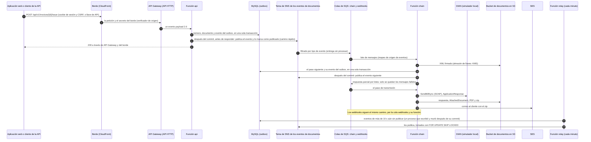
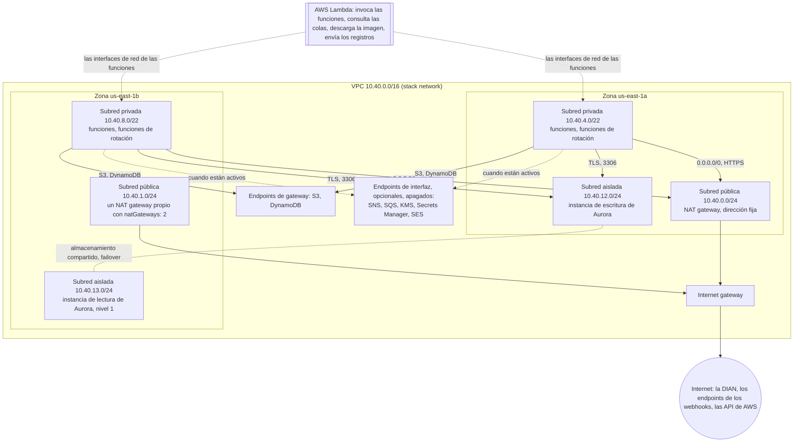
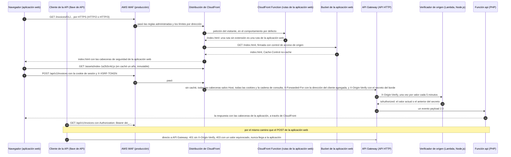

# Infraestructura

[English](../infrastructure.md) · **Español**

<!-- Traducción de docs/infrastructure.md con SHA-256 21f019f816b52a2b4b39cf88a6cf4188a4a0db608d7de8efb66362b34d07af72. make docs-stamp actualiza esta línea cuando la traducción ya sigue al original. -->

Esta página describe la arquitectura de nube de producción de la plataforma, escrita como código y probada en local. No hay nada desplegado en una cuenta real de AWS. Los servicios de AWS corren en un emulador local, [Floci](https://github.com/floci-io/floci) (de código abierto, MIT, sin cuenta ni token).

La arquitectura abarca:

- **La mensajería, el almacenamiento, los datos, las llaves y el correo.**
- **La aplicación, como funciones de AWS Lambda.**
- **Una red privada y una base de datos administrada para producción** (Aurora MySQL Serverless v2). Solo existen en la etapa de producción y se validan sin conexión. Nunca se despliegan, ni siquiera en el emulador. En las dos etapas, el acceso a la base de datos se reparte entre dos identidades.
- **El borde delante de la aplicación web y de la API**: una sola distribución de CloudFront bajo un solo dominio, sus cabeceras de seguridad, un firewall en producción y un verificador de origen. La API solo responde a las peticiones que llegaron por el borde.
- **La observabilidad** ([observability.md](observability.md)): registros estructurados en los que un mismo id sigue cada factura de punta a punta, métricas de la aplicación y de AWS, alarmas, un tablero y un notificador de alarmas.
- **La operación y la entrega**: un runbook para cada alarma, y un simulacro de incidente que corre de punta a punta en la nube emulada. El despliegue en una cuenta real está escrito como código, con su guía ([deployment.md](deployment.md)), y nunca se ha ejecutado.

## Cómo encaja todo

El código define cada recurso una sola vez:

- La app de CDK (`infra/cdk`) tiene los recursos compartidos y los que guardan estado, y todos los roles de IAM.
- El servicio serverless (`infra/functions`) tiene las funciones y sus disparadores. Lee los nombres que la app de CDK publica en SSM.

Un solo script despliega una etapa (`scripts/deploy.sh`). `make cloud-up` lo corre contra el emulador local, y el flujo de despliegue lo correría contra una cuenta.

La aplicación llega a AWS solo a través de sus adaptadores, y la configuración decide cuáles usa. Escribe una línea JSON por evento. Las métricas y las alarmas salen de esas líneas, y cada alarma nombra el runbook que la atiende.

| Para conocer | Lee |
| --- | --- |
| Los dos entornos, los stacks, las funciones, la red, la base de datos, el borde | esta página |
| Las líneas de registro, el id de correlación, las métricas, las alarmas, el notificador, el tablero, los objetivos de servicio | [observability.md](observability.md) |
| Qué hacer cuando suena una alarma, cómo rotar un secreto, cómo atender el reporte de un cliente | [runbooks](runbooks/README.md) |
| Cómo se ensaya un incidente, y qué mostró una ejecución | `make cloud-drill`, [drill-report.md](runbooks/drill-report.md) |
| Desplegar en una cuenta real: qué necesita, el primer despliegue, los despliegues de rutina, revertir, desmontar | [deployment.md](deployment.md) |
| Lo que el emulador no reproduce, lo que nunca se verificó, lo que no está construido | [limitations.md](limitations.md) |
| Los activos, las fronteras de confianza, las amenazas y las mitigaciones | [threat-model.md](threat-model.md) |

## Dos entornos

| | Stack local (por defecto) | Nube emulada |
| --- | --- | --- |
| Arrancar | `make up`, `make demo` | `make cloud-up`, `make cloud-demo` |
| Detener | `make down` | `make cloud-down`; `make cloud-clean` también borra su estado |
| Revisar | `make test`, `make checks`, `make e2e` | `make cloud-check`, `make cloud-e2e`, `make cloud-alarm-check` (la evaluación real de una alarma, [observability.md](observability.md)), `make cloud-drill` (un simulacro de incidente, [runbooks](runbooks/README.md)) |
| Desplegar | `make up` | `make cloud-up`, a través de `scripts/deploy.sh`, el script de todas las etapas ([deployment.md](deployment.md)); `make cloud-deploy STEP=<step>` corre un solo paso |
| Registros | el formato de línea de Laravel, en la salida de cada contenedor | un objeto JSON por línea con el esquema de registros de la plataforma, en un grupo de registros por función; `make cloud-follow ID=<correlation-id>` imprime un recorrido |
| La aplicación | contenedores que corren todo el tiempo: `api`, `worker` ×2, `relay` | funciones Lambda en el emulador, que arrancan con cada entorno de ejecución; ninguna parte de la aplicación corre todo el tiempo |
| La aplicación web | el servidor de desarrollo de Vite (`web`), que reenvía `/api` y `/sanctum` a la API | la compilación de producción, en el bucket del borde, servida por la distribución de CloudFront del emulador, con la API en el mismo origen |
| Servicios de AWS | ninguno | Floci en 127.0.0.1:8604 (perfil `cloud` de Compose), con el socket de Docker. Su consola web no pide cuenta y corre en 127.0.0.1:8605. Arranca la primera vez que abres `http://localhost:8604/_floci/ui`. Muestra las funciones y sus registros, las colas, los buckets, las tablas, los secretos, las llaves, los correos que aceptó SES y los stacks |
| Configuración | `backend/.env` | el entorno de cada función, que sale del servicio serverless y de los parámetros de SSM de la app de CDK; los secretos, de Secrets Manager |
| Base de datos | MySQL, base de datos `dian_einvoice`, un solo usuario | el mismo MySQL, base de datos `dian_einvoice_cloud`, con sus dos identidades, cada una con su propio secreto: migraciones (la función de consola) y aplicación (todas las demás funciones) |

Los dos entornos usan los mismos puertos (aplicación web 8601, API 8600, simulador de la DIAN 8602), así que solo corre uno a la vez:

- `make cloud-up` detiene la API, los workers, el relay y el servidor de desarrollo de la aplicación web del stack local.
- `make up` detiene el emulador y el proxy de la nube emulada, y borra los contenedores de las funciones de la nube emulada.

Un solo simulador de la DIAN atiende los dos entornos, y guarda aparte los registros de cada uno: contribuyentes, documentos procesados, modos de falla, el registro de actividad y el receptor de webhooks.

- El stack local usa las rutas raíz del simulador (`http://simulator:8602/...`). La nube emulada usa las mismas rutas bajo `/cloud` (`http://simulator:8602/cloud/...`).
- Así, alternar entre `make up` y `make cloud-up` nunca hace que el simulador rechace un documento nuevo con la regla 90, ni obliga a recargar los datos de ejemplo.
- `make seed` borra solo los registros del stack local en el simulador, y `make cloud-demo` solo los de la nube. `make clean` borra el volumen del simulador, y con él los dos.
- Aun así, `make cloud-e2e` comprueba primero (`cloud:check demo`) que los registros de la nube no tengan ningún documento de las empresas de la demo con un número que la base de datos de la nube aún no haya emitido. Cuando encuentra uno, la revisión se detiene de inmediato y pide correr `make cloud-demo`.

En la nube emulada, los dos puertos son de `cloud-gateway`, un proxy inverso mínimo (nginx) delante de la distribución de CloudFront. El emulador sirve la distribución solo por su nombre de host (`<id>.cloudfront.localhost.floci.io`). El puerto 8601 sirve la aplicación web y la API en un mismo origen, como en producción. El puerto 8600 sirve el mismo borde, así que la dirección de la API sigue respondiendo. En AWS, el dominio de la plataforma apunta a la distribución (mira [El borde](#el-borde)).

## La app de CDK

La app de CDK vive en `infra/cdk`. Es AWS CDK en TypeScript, que Node corre quitándole los tipos (type stripping), en su propio contenedor. Tiene dos etapas:

- `local` se despliega en el emulador con los comandos de siempre de CDK (`cdk bootstrap`, `cdk deploy`). Primero van todos los stacks menos el del borde y el de observabilidad. El borde va después de las funciones que tiene detrás, y el de observabilidad va al final, solo.
- `prod` se sintetiza y se valida, pero nunca se despliega. Su cuenta es ficticia, así que la CLI rechaza las credenciales reales. La excepción es un despliegue que pasa la cuenta como parámetro (`-c account=<12 digits>`), como hace `scripts/deploy.sh prod` ([deployment.md](deployment.md)).

La síntesis no necesita red: `make cdk-check` la corre en un contenedor sin red.

Los stacks network y database solo existen en producción. El emulador no podría dar evidencia útil de una VPC, de sus rutas y sus grupos de seguridad, ni de una base de datos administrada. Por eso estos stacks se revisan sobre lo que produce la síntesis (aserciones, cdk-nag, cfn-lint y la validación de esquema de CDK), y nunca se despliegan. Lo mismo pasa con el stack delivery, que tiene los roles del pipeline de despliegue para una cuenta real.

| Stack | Recursos |
| --- | --- |
| `dian-einvoice-<stage>-messaging` | El tema de SNS de los eventos de documentos: solo TLS, cifrado con la llave administrada por AWS. Las colas de SQS `chain` y `webhooks`, cada una con una cola de mensajes fallidos (dead-letter queue, 14 días), un tiempo de visibilidad de 60 s en local y de 360 s en producción, y un `maxReceiveCount` de 10. Una suscripción por cola con entrega sin procesar (raw), filtrada por el atributo `type` con las rutas que declara el backend (`backend/resources/outbox/routes.json`). |
| `dian-einvoice-<stage>-storage` | El bucket de los documentos: privado, SSE-S3 con bucket key, versionado, solo TLS, con registros de acceso del servidor. Las versiones actuales pasan a Standard-IA a los 90 días y a Glacier Instant Retrieval a los 365, y nunca expiran. Las versiones anteriores expiran a los 30 días en local y a los 90 en producción. El bucket de despliegues del servicio serverless, para sus plantillas y su estado (7 días en local, 90 en producción). |
| `dian-einvoice-<stage>-data` | Las tablas de DynamoDB `cache`, `sessions` y `limits`, en el formato del almacén de DynamoDB de Laravel (clave `key`, TTL sobre `expires_at`), con capacidad bajo demanda. |
| `dian-einvoice-<stage>-security` | La llave de KMS de los certificados de firma, con la rotación activa. El secreto `dian-einvoice/<stage>/app`, que solo guarda `APP_KEY`, generado por Secrets Manager. El secreto del borde `dian-einvoice/<stage>/edge/origin-verify`: 64 letras y dígitos que genera Secrets Manager (mira [El verificador de origen](#el-verificador-de-origen)). En la etapa local, que no tiene base de datos administrada, este stack también guarda los secretos de las dos identidades de la base de datos ([más abajo](#las-dos-identidades-de-la-base-de-datos)); en producción van en el stack database. |
| `dian-einvoice-<stage>-mail` | La identidad de SES: la dirección del remitente en local; en producción, el dominio, con Easy DKIM y un subdominio MAIL FROM. |
| `dian-einvoice-<stage>-alerts` | Adonde van las alarmas. Se despliega antes de las funciones, porque el notificador se suscribe a él. Tiene el tema de las alarmas y el tema de respaldo, los dos cifrados con su propia llave de KMS, que el CloudWatch de la cuenta puede usar. También tiene la suscripción por correo del tema de respaldo (un parámetro del despliegue), la cola de mensajes fallidos del notificador y el secreto con la dirección del webhook del chat ([observability.md](observability.md)). |
| `dian-einvoice-<stage>-compute` | Los roles de IAM: uno por función, más uno para el verificador de origen, otro para el notificador y otro para EventBridge Scheduler (debajo de la tabla). El repositorio de ECR de la imagen de las funciones: escaneo en cada push, un ciclo de vida que conserva las imágenes recientes, y solo Lambda puede descargar la imagen, para las funciones de la etapa. En producción, además, etiquetas inmutables y cifrado con la llave administrada por AWS para ECR. |
| `dian-einvoice-<stage>-edge` | La distribución de CloudFront delante de la aplicación web y de la API. El bucket de la aplicación web: privado, versionado, y solo lo lee la distribución. La CloudFront Function de la distribución, su política de caché, su política de cabeceras de respuesta y su bucket de registros de acceso. En producción, además, su dominio y su certificado, su web ACL de AWS WAF y los registros de lo que bloquea el firewall (mira [El borde](#el-borde)). Se despliega después de las funciones, cuya API HTTP tiene detrás. |
| `dian-einvoice-<stage>-observability` | Las métricas de la aplicación, como filtros de métricas sobre los registros estructurados de las funciones. Las alarmas con sus runbooks; en producción, además, la alarma compuesta de servicio degradado. El tablero de operación y las consultas guardadas de Logs Insights ([observability.md](observability.md)). Se despliega de último, después de las funciones y del borde, porque lee sus grupos de registros, su API HTTP y su distribución. |
| `dian-einvoice-prod-network` (solo producción) | Una VPC en dos zonas, con subredes públicas, privadas y aisladas. Un NAT gateway con una dirección fija (uno por zona, como opción). Endpoints de gateway para S3 y DynamoDB y, como opción, endpoints de interfaz para los demás servicios de AWS de los adaptadores. El grupo de seguridad de las funciones, el grupo de seguridad por defecto sin reglas, y registros de flujo (más abajo). |
| `dian-einvoice-prod-database` (solo producción) | Aurora MySQL Serverless v2, compatible con MySQL 8.4, con su llave de KMS, sus parámetros, sus grupos de registros y sus grupos de seguridad. Los secretos de las dos identidades, con las funciones de rotación de AWS. RDS Proxy, como opción (más abajo). |
| `dian-einvoice-prod-delivery` (solo producción) | El pipeline de despliegue para una cuenta real: el proveedor de OpenID Connect de GitHub Actions (o el que ya tenga la cuenta); el rol de despliegue, que el flujo de despliegue solo asume desde el entorno `production` de este repositorio; y el rol que usa CloudFormation para desplegar el stack de las funciones ([deployment.md](deployment.md)). Un administrador lo despliega una vez; el pipeline nunca lo hace. Se valida sin conexión y nunca se despliega. |

Los roles del stack compute:

- uno por función (`dian-einvoice-<stage>-<function>-function`), que puede leer el secreto de su identidad de la base de datos (la función de consola puede leer los dos);
- el rol del verificador de origen, que solo puede leer el secreto del borde;
- el rol del notificador, que solo puede leer el secreto del webhook del chat y enviar a su cola de mensajes fallidos;
- el rol que usa EventBridge Scheduler para invocar las funciones programadas.

Cada stack crea además una política administrada de IAM por consumidor y capacidad:

- consumir una cola;
- publicar en el tema;
- leer y escribir los documentos;
- usar una tabla;
- usar la llave de firma con el contexto de cifrado del almacén de llaves;
- leer el secreto;
- enviar correo desde la dirección de la plataforma;
- leer las colas y sus mensajes fallidos.

Cada stack publica sus nombres, ARN y políticas en SSM Parameter Store, bajo `/dian-einvoice/<stage>/<stack>/`. Los nombres llevan la etapa. Los recursos llevan las etiquetas `project`, `stage` y `managed-by`, y los stacks llevan además `component`.

cdk-nag (AWS Solutions) corre en cada síntesis. Sus excepciones están declaradas junto a sus recursos, con sus razones, y listadas en `infra/cdk/cdk.out/validation-report.json`:

- **En cada etapa:**
  - las tres tablas sin recuperación a un momento dado;
  - los objetos del bucket de los documentos;
  - el secreto de `APP_KEY`, que no rota;
  - el secreto del borde, que se rota con su procedimiento y no con una función de rotación;
  - el secreto del webhook del chat, cuya dirección emite el servicio de chat;
  - la cola de mensajes fallidos del notificador, que ya es en sí misma una cola de mensajes fallidos;
  - una por rol, por los flujos de registros de su función (incluidos el verificador de origen y el notificador);
  - la distribución, que no tiene restricción geográfica.
- **En producción, además:**
  - una por rol, por las interfaces de red de una función en una VPC;
  - tres sobre la base de datos: la autenticación con IAM, el puerto por defecto, Backtrack;
  - una por cada recurso con comodín en los dos roles del stack delivery. Cada una da la razón por la que no puede ser más estrecho (`lib/delivery-stack.ts`): una acción que no recibe ARN, o un nombre que CloudFormation o un servicio completan con su propio id.
- **En local, además:**
  - los secretos de las dos identidades, que ninguna función de rotación de AWS puede rotar en el emulador;
  - sobre la distribución, el certificado por defecto de CloudFront (sin dominio propio) y la falta de web ACL (el emulador no aplica AWS WAF).

Las razones están junto a cada recurso, y en las secciones de la base de datos y del borde, más abajo.

## Las funciones

Las funciones viven en `infra/functions`, un servicio serverless que se despliega con [osls](https://github.com/oss-serverless/osls) 4.8.1, en su propio contenedor. osls es el fork libre del Serverless Framework (MIT, sin cuenta, sin telemetría). El servicio se despliega como el stack `dian-einvoice-<stage>-functions`. `make cloud-up` despliega la etapa local en el emulador. La etapa de producción se empaqueta sin red ni credenciales, y la valida `make cdk-check`.

Todas las funciones de PHP corren una misma imagen de contenedor: el target `lambda` de `backend/Dockerfile`. La imagen tiene:

- la aplicación con sus dependencias de producción, sobre la imagen oficial de [Bref](https://bref.sh) 3 para PHP 8.5 (`bref/php-85:3.0.12`, la misma versión menor de PHP que la imagen local);
- las extensiones que exige la aplicación (las entradas `ext-*` de `backend/composer.json`; la compilación falla si falta una);
- el puente de Bref para Laravel.

Cada función elige su runtime de Bref (`BREF_RUNTIME`) y su handler (el comando de la imagen):

| Función | Disparador | Modo de Bref | Memoria | Tiempo de espera | Concurrencia | Por qué |
| --- | --- | --- | --- | --- | --- | --- |
| `api` | La API HTTP de API Gateway, todas las rutas (`$default`), payload 2.0, detrás del verificador de origen | `fpm`, `public/index.php` | 1024 MB | 28 s | 40 reservadas | Toda la API HTTP bajo `/api/v1`, la cookie CSRF de la aplicación web y la referencia de la API en `/docs/api`. Más memoria es más CPU (Lambda asigna la CPU en proporción a la memoria), para tener respuestas rápidas y arranques en frío cortos. El tiempo de espera queda por debajo de los 30 s que API Gateway espera a una integración. 40 entornos a la vez son 40 peticiones en curso: la mayor parte del presupuesto de conexiones. |
| `chain` | La cola de SQS `chain`: lotes de hasta 10, sin ventana de agrupación, respuesta parcial por lotes, como máximo 10 invocaciones a la vez | `function`, `App\Support\Outbox\Sqs\SqsEventsHandler` | 1024 MB | 60 s | 10 reservadas | Cada paso de la cadena del documento electrónico y de la entrega: XML, firma XAdES, transmisión a la DIAN, PDF (dompdf) y correo. La firma y el PDF necesitan CPU y memoria. Un trabajo puede tardar 35 s, como en los workers locales, y en 60 s cabe uno de esos trabajos más un margen. Un lote no arranca los trabajos que ya no alcanzaría a terminar antes del plazo, y los devuelve. |
| `webhooks` | La cola de SQS `webhooks`: lo mismo, como máximo 5 a la vez | `function`, el mismo handler | 512 MB | 60 s | 5 reservadas | Los eventos de los webhooks y sus entregas: llamadas HTTP de 5 s como máximo, con poca CPU. |
| `relay` | EventBridge Scheduler, `rate(1 minute)`, entrada `"outbox:publish-pending"` | `function`, `App\Support\Lambda\ArtisanHandler` | 512 MB | 60 s | 1 reservada | La red de seguridad del outbox. Publica durante 40 s como máximo y deja el resto para la siguiente ejecución. Una ejecución a la vez. Una ejecución fallida no se reintenta (sin reintentos asíncronos, los eventos de más de 60 s se descartan, sin reintentos de la programación): el minuto siguiente es su reintento. |
| `scheduler` | EventBridge Scheduler, `rate(1 minute)`, entrada `"schedule:run"` | `function`, el mismo handler | 512 MB | 120 s | 2 reservadas | El programador de Laravel: las tareas de barrido (cadenas, entregas y webhooks estancados, llaves de idempotencia vencidas, la poda de conservación de cada hora) y un latido. Con dos a la vez, una poda larga puede cruzarse con el minuto siguiente. Cada tarea corre en un solo proceso por minuto, y nunca corre dos veces a la vez (bloqueos en la caché). Sin reintentos, como el relay. |
| `console` | ninguno: se invoca bajo demanda | `function`, el mismo handler | 1024 MB | 900 s | 2 reservadas | Las migraciones y los comandos de operación: `make cloud-up` migra con ella, `make cloud-demo` carga los datos, `make cloud-check` corre sus pasos, y `make cloud-artisan ARGS="..."` corre cualquier otro comando. El evento es la línea de comandos de `php artisan`. El tiempo de espera es lo máximo que puede correr una función Lambda. |
| `origin-verifier` | el autorizador de todas las rutas de API Gateway: un autorizador de peticiones con payload 2.0 y respuestas simples, cuya respuesta se guarda en caché 5 minutos por cada valor de `X-Origin-Verify` | no es Bref: Node.js 24, un zip de `origin-verifier/` compilado desde TypeScript | 128 MB | 5 s | 10 reservadas | El verificador de origen del borde (más abajo): una comparación y, como mucho cada 30 s, o cada 5 s mientras le lleguen valores que no tiene, una lectura de Secrets Manager. Fuera de la VPC, con un rol que solo puede leer el secreto del borde; sin base de datos. Su tope limita lo que puede hacer correr una avalancha de valores inventados enviados directo a API Gateway. |
| `notifier` | el tema de las alarmas (stack alerts): una suscripción de SNS, cuyas fallas van a la cola de mensajes fallidos del notificador | no es Bref: Node.js 24, un zip de `notifier/` compilado desde TypeScript | 128 MB | 20 s | 2 reservadas | Convierte cada cambio de estado de una alarma en un mensaje corto al webhook del chat, cuya dirección está en Secrets Manager ([observability.md](observability.md)). Tres intentos de 5 s como máximo, luego dos reintentos asíncronos de Lambda, y luego su cola de mensajes fallidos. Fuera de la VPC; las alarmas son pocas. |

La concurrencia reservada es un parámetro de la etapa (el `reservedConcurrency` del servicio serverless):

- `reserved` fija los valores de arriba, en las dos etapas.
- `unreserved` deja `ReservedConcurrentExecutions` por fuera de todas las funciones. Sirve para una cuenta cuya cuota de ejecuciones simultáneas está por debajo de la suma de esos valores (72) más las 100 que Lambda mantiene sin reservar, como puede pasar con la cuota de una cuenta nueva ([deployment.md](deployment.md)).

Las transmisiones a la DIAN se reintentan cinco veces en producción (2, 5, 15, 45 y 120 s), y dos veces en la etapa local (2 y 5 s, `dianRetryDelays`). La etapa local reintenta menos porque el emulador estira cada reintento programado hasta el tiempo de visibilidad de su cola ([limitations.md](limitations.md)).

De dónde sale la configuración de cada función:

- **Los roles** vienen del stack compute (`role: !Sub '${ApiRoleArn}'`). Las funciones no tienen IAM propio.
- **Las colas, los temas, el bucket, las tablas, la llave y los secretos** vienen de los parámetros que la app de CDK publica en SSM (`resources/parameters.yml`). Son parámetros de la plantilla cuyos valores por defecto son esos nombres, y CloudFormation los lee cuando despliega.
- **Los mapeos de las colas, las programaciones y la suscripción del notificador** están escritos en CloudFormation (`resources/triggers.yml`). La razón: osls no puede tomar un ARN de un parámetro, ni fijar una política de reintentos en una programación.

Cada función escribe un objeto JSON por línea, con el esquema de registros de la plataforma ([observability.md](observability.md)), en su grupo de registros `/aws/lambda/<function>` (7 días en local, 365 en producción). Los registros de sistema de Lambda también van en JSON. API Gateway escribe su registro de acceso, un objeto JSON por petición, en un grupo de registros del servicio serverless.

El relay, el programador y la consola corren php artisan a través del handler propio de la aplicación (`App\Support\Lambda\ArtisanHandler`, sobre el runtime function de Bref). Ese handler devuelve la salida del comando en su respuesta, y solo registra JSON. El runtime console de Bref, en cambio, imprimiría esa salida en el registro.

### El recorrido de una factura

### El outbox sin un relay que corra todo el tiempo

Cada cambio anota sus eventos de integración en la tabla del outbox, dentro de su propia transacción, como en el stack local. En local, el proceso relay los publica todo el tiempo. Las funciones no tienen ese proceso. Una función relay que corriera sola una vez por minuto le sumaría hasta un minuto a cada paso de la cadena. Por eso las funciones trabajan así (`OUTBOX_PUBLISH_AFTER_COMMIT`):

- **Camino rápido.** El proceso que escribe publica sus eventos justo después del commit de su transacción (`DB::afterCommit`), antes de responder la petición o de terminar el trabajo. Luego los marca como publicados (`App\Support\Outbox\OutboxFastPath`). Los eventos de una misma transacción van juntos. Una publicación fallida no pierde nada: el commit del cambio ya se hizo, el error se reporta y las filas quedan sin publicar en el outbox.
- **Red de seguridad.** Una vez por minuto, la función relay publica los eventos sin publicar de más de 10 s (`php artisan outbox:publish-pending`). Son de un proceso que murió después de su commit, o cuya publicación falló.
- **Cómo se toman las filas.** Los dos toman las filas como lo hace cualquier relay: `FOR UPDATE SKIP LOCKED` en read committed, y luego publican, las marcan como publicadas y hacen commit. Cada uno se salta la fila que tiene el otro, y ninguno toma una fila ya publicada. Cada evento se sigue entregando al menos una vez: un proceso que muere entre la publicación y su commit vuelve a publicar. Todos los consumidores son idempotentes.
- **El seeder de la demo** corre la cadena de sus documentos en su mismo proceso, así que no publica nada después de sus commits. Hasta que termina, pausa la función relay y las tareas de barrido a través de la caché compartida (`App\Support\Outbox\OutboxPause`), como `make seed` detiene el relay local.

El stack local conserva su proceso relay, y allí el camino rápido está apagado.

### Dentro de una función

- **Sistema de archivos de solo lectura, salvo `/tmp`.** El puente de Bref para Laravel, que solo se registra dentro de Lambda, pone en `/tmp` el storage de Laravel, las vistas compiladas y la caché de archivos. dompdf, el latido y la caché de los secretos también escriben ahí. Los manifiestos de los paquetes y de los service providers se escriben cuando se construye la imagen. El emulador corre cada función como un usuario sin privilegios (`993:990`, como lo hace Lambda) que no es dueño de nada en la imagen.
- **Los secretos, una vez por arranque en frío.** Cuando arranca un entorno de ejecución, el puente guarda toda la configuración en caché en `/tmp` (`php artisan config:cache`, `BREF_LARAVEL_CACHE_CONFIG`). Al construir esa caché se leen dos secretos de Secrets Manager (`App\Support\Secrets\LoadSecrets`): el secreto de la aplicación y el de la identidad de la base de datos de la función. Las peticiones y los trabajos que siguen arrancan desde esa caché y no leen nada. Un secreto rotado llega a los entornos que arrancan después de la rotación. Un entorno en caliente vuelve a leer el secreto de su identidad solo cuando la base de datos rechaza su contraseña (más abajo).
- **Los registros, a stderr.** Lambda los envía a CloudWatch Logs: un objeto JSON por línea, con el esquema de registros de la plataforma (`App\Support\Observability\JsonLogFormatter`, [observability.md](observability.md)). PHP-FPM registra del nivel warning para arriba, y Bref no imprime nada sobre su inicialización (`BREF_LARAVEL_OMIT_INITLOG`), así que ninguna línea queda por fuera del esquema.
- **Nada después de la respuesta.** AWS congela un entorno apenas responde. El emulador no reproduce esto, así que ningún trabajo puede quedar para después de la respuesta:
  - el outbox publica antes de la respuesta;
  - el PHP-FPM de Bref tiene `fastcgi_finish_request` deshabilitado;
  - ninguna tarea programada corre en segundo plano;
  - `tests/Unit/Support/NothingAfterTheAnswerTest.php` rechaza las llamadas que dejarían trabajo para después (despachos después de la respuesta, `defer()`, callbacks de terminación, funciones de apagado, procesos en segundo plano).
- **La dirección del cliente.** PHP-FPM recibe cada petición del runtime de Bref (127.0.0.1), y las funciones solo confían en 127.0.0.1 (`TRUSTED_PROXIES`). Así, la dirección de una petición es la última entrada de `X-Forwarded-For`, que detrás del borde no es la del cliente. Antes de que algo cuente una petición, la aplicación se queda solo con la entrada que agregó el borde (`App\Http\Middleware\EdgeClientAddress`; mira [La aplicación detrás del borde](#la-aplicación-detrás-del-borde)). Esa es la última entrada, una vez descartada la que API Gateway haya agregado por el extremo de su conexión.
  - Un cliente no puede elegir la dirección con la que lo cuentan los límites de peticiones, mande la cabecera que mande.
  - Sin esa entrada, todas esas peticiones comparten la dirección del runtime. Eso hace un límite más estricto, nunca más laxo.
  - De las cabeceras reenviadas solo cuentan la dirección y el esquema, nunca el host. Detrás del borde, la aplicación genera cada URL a partir de `APP_URL`, el origen público.
- **Los consumidores.** El handler de la cola convierte cada registro de SQS en su trabajo con `SqsEventsQueue::jobFor`: el mismo mapeo de eventos del outbox a trabajos que usa el driver de colas de SQS, con los mismos handlers. Corre los trabajos uno tras otro con el worker de colas de Laravel:
  - un trabajo que termina bien borra su mensaje;
  - un trabajo que lanza una excepción fija la visibilidad de su mensaje en la espera de su backoff, y se reporta como fallido;
  - un evento que debe correr más tarde se queda invisible hasta entonces;
  - un registro cuyo trabajo no alcanzaría a terminar antes del plazo se devuelve de inmediato.

  Los reintentos, la cola de mensajes fallidos después de `maxReceiveCount` y la idempotencia de los handlers son de la capa de mensajería de SQS, no de las funciones. Después de cada lote, la función libera su conexión a la base de datos.

### El presupuesto de conexiones a la base de datos

Cada entorno de ejecución tiene como máximo una conexión a la base de datos. El PHP-FPM de Bref corre un worker por entorno y cierra su conexión después de cada petición. Los consumidores cierran la suya después de cada lote.

La concurrencia reservada de las funciones limita cuántos entornos corren a la vez:

40 (api) + 10 (chain) + 5 (webhooks) + 1 (relay) + 2 (scheduler) + 2 (console) = **60 conexiones como máximo**

Una prueba de la app de CDK obliga a la plantilla de las funciones a respetar esa cifra. El verificador de origen del borde nunca se conecta a la base de datos, así que no cuenta.

La base de datos administrada de producción admite 135 conexiones en su capacidad máxima de 4 ACU. `infra/cdk/test/database.test.ts` toma esa cifra de la tabla que documenta AWS. Y exige que esa cifra no baje de esas 60, más un margen de 20 para las funciones de rotación y los operadores (mira [La base de datos](#la-base-de-datos)). RDS Proxy, que es opcional, dejaría crecer la API más allá de ellas.

En AWS, la concurrencia reservada necesita que el límite de ejecuciones simultáneas de la cuenta supere la suma de lo reservado, más las 100 que quedan sin reservar. Las cuentas nuevas pueden empezar con menos, y entonces necesitan un aumento de cuota.

### El tiempo de visibilidad de las colas

Lambda rechaza un mapeo cuya cola oculte un mensaje menos tiempo que el tiempo de espera de su función. AWS recomienda seis veces ese tiempo de espera, más la ventana de agrupación. Así, un lote que Lambda reintenta después de un throttling no se recibe dos veces mientras tanto.

- Los consumidores tienen un tiempo de espera de 60 s y ninguna ventana de agrupación. Las colas de producción ocultan un mensaje durante 360 s, seis veces el tiempo de espera.
- Las colas de la etapa local se quedan en el mínimo, 60 s, porque el emulador devuelve tarde los registros fallidos. Floci 2.5.0 retiene cada registro que una función reporta como fallido durante el tiempo de visibilidad de su cola ([limitations.md](limitations.md)). Con 360 s, cada reintento y cada recepción de un mensaje ilegible esperarían seis minutos. `make cloud-check` tardaría entonces mucho más de unos pocos minutos.

`infra/cdk/test/functions.test.ts` amarra las dos cifras, que lee de la app de CDK y de la plantilla que empaquetó osls. El tiempo de visibilidad debe ser por lo menos el tiempo de espera de la función en las dos etapas, y seis veces ese tiempo en producción.

### Los mensajes fallidos, y cómo devolverlos

Un mensaje llega a la cola de mensajes fallidos que le corresponde en tres casos:

- su trabajo lanzó una excepción en cada una de sus 10 recepciones (la política de redrive);
- SNS no pudo entregarlo;
- un paso se rindió del todo por su cuenta: una transmisión que la DIAN nunca respondió después de sus reintentos, o un correo que el servidor de correo siguió rechazando.

Un paso que se rinde del todo deja su documento fallido en ese paso. Además, su trabajo copia de inmediato su mensaje a la cola de mensajes fallidos, con el cuerpo y los atributos con los que llegó. La copia lleva su razón en el atributo `dead_letter_reason` (`App\Support\Outbox\Sqs\SqsEventJob`, evento de registro `queue.dead_letter`). Los consumidores pueden enviar a su propia cola de mensajes fallidos, y a ninguna otra. En local, la misma falla queda en `failed_jobs`.

Una vez corregida la causa, un operador devuelve los mensajes fallidos con el redrive nativo de SQS (`StartMessageMoveTask`, `make cloud-redrive`). El destino es la cola del canal, así que vuelven los dos tipos: los mensajes que movió la política de redrive y las copias que dejó un paso.

Cuando vuelve un mensaje de un documento que sigue fallido en su paso, en su misma ejecución, ese paso empieza otra vez. La acción **Reintentar ahora** de la aplicación web hace lo mismo (`ChainStep`, `DeliveryJob`, evento de registro `chain.resumed`): empieza una ejecución nueva desde el paso que se rindió. Cuando un envío pudo haber llegado a la DIAN, la transmisión pregunta primero con GetStatus. Cualquier otro mensaje de ese documento no hace nada, sea un intento más viejo o una ejecución que un usuario ya reintentó. Así, un mensaje fallido que se devuelve dos veces actúa una sola vez.

**Reintentar ahora** y el redrive son dos caminos de vuelta de una misma falla. El que llegue primero recupera el documento, y el otro no hace nada: cada uno comprueba, con el bloqueo del documento, que el documento siga fallido en esa ejecución. `tests/Integration/Dian/RecoveryTest.php` lo comprueba en los dos órdenes: un envío más a la DIAN, un correo y un webhook por cada evento.

Un mensaje fallido conserva el recorrido de su documento: su id de correlación está en el cuerpo y en los atributos. El paso que vuelve a empezar sigue bajo ese id. Así, `make cloud-follow` cuenta la falla, el mensaje fallido y la recuperación como una sola historia (`make cloud-drill` lo comprueba). En el stack local, `queue:retry` devuelve `failed_jobs` de la misma forma. El runbook es [runbooks/dead-letters.md](runbooks/dead-letters.md), y `make cloud-drill` lo ensaya.

### Producción, validada sin desplegar

`make cdk-check`, que también es un trabajo de la integración continua, corre sin red ni credenciales:

1. **osls empaqueta las dos etapas.** La imagen se nombra con un resumen ficticio, `@sha256:0…0`, que el pipeline de despliegue reemplaza por el resumen de la imagen que subió a ECR. El verificador de origen y el notificador se compilan desde TypeScript. osls empaqueta producción una vez más sin concurrencia reservada, con una imagen aparte para la función de consola.
2. **Las pruebas de la app de CDK verifican la plantilla de las funciones:**
   - cada función tiene tiempo de espera, memoria, un límite de concurrencia y su propio rol del stack compute;
   - la única ruta está detrás del verificador de origen, un zip de Node.js fuera de la VPC;
   - los mapeos reportan las fallas elemento por elemento;
   - las funciones programadas no reintentan nada;
   - cada parámetro que lee la plantilla es uno que publica la app de CDK, incluidos los de la red y la base de datos en producción;
   - cada función tiene su propia identidad de la base de datos y una conexión cifrada;
   - la plantilla no tiene nada de IAM.
3. **Las pruebas corren cdk-nag sobre esa plantilla.** La incluyen en un stack propio, para correr las mismas reglas de cdk-nag que la app de CDK. Hay una excepción por cada función de Node.js. El verificador de origen y el notificador corren Node.js 24, el runtime más nuevo que corre el emulador, mientras que la regla pide el más nuevo de AWS.
4. **Las pruebas sintetizan la app de CDK.**
5. **cfn-lint 1.61.0 revisa cada plantilla**, con una excepción, en la plantilla de las funciones: un DependsOn que escribe osls y que una referencia ya implica.
6. **actionlint 1.7.12 revisa los flujos de trabajo de GitHub Actions**, incluido el flujo de despliegue.

Las pruebas del stack delivery (`infra/cdk/test/delivery.test.ts`) exigen que el repositorio de imágenes tenga etiquetas inmutables, escaneo y cifrado. Exigen que la confianza del rol de despliegue se limite a un solo entorno de un solo repositorio. Y exigen que sus permisos no den acceso de administrador, ni tengan un comodín sin su razón.

## Decisiones de diseño de las funciones

- **Una imagen de contenedor, no capas.** Bref publica sus capas desde sus propias cuentas de AWS, y el emulador no puede montarlas. Una imagen es el mismo artefacto en el emulador y en AWS: se construye una vez y se despliega por su resumen, con el PHP y las extensiones exactas que revisa la compilación. Además, se salta el límite de 250 MB de un zip con sus capas. El costo: una imagen que guardar en ECR, y un primer arranque en frío más lento con cada imagen nueva en AWS, mientras Lambda la guarda en caché.
- **Camino rápido con red de seguridad.** Publicar después del commit mantiene la cadena tan rápida como la mantendría un relay siempre encendido, sin tener que correr uno. La función relay conserva la garantía del outbox cuando el proceso que escribe muere después de su commit. Las alternativas eran una función relay sola, una vez por minuto (hasta un minuto por paso), o un flujo de cambios de la base de datos. MySQL no tiene un flujo de cambios al que una función se pueda suscribir sin otro servicio.
- **El presupuesto de conexiones.** Concurrencia reservada por función, coherente con los mapeos (como máximo tantas invocaciones a la vez como la función puede correr), en vez de un solo límite para la cuenta. Un pico en la API no puede quitarle las conexiones a la cadena, y el total cabe en la base de datos.
- **Qué va en la app de CDK y qué en el servicio serverless.** Cada recurso se define una sola vez.
  - La app de CDK, que revisa cdk-nag, tiene los recursos compartidos y los que guardan estado (colas, tema, buckets, tablas, llave, secreto, el repositorio de ECR, el bucket de despliegues) y todos los roles de IAM.
  - El servicio serverless tiene las funciones y sus disparadores (API Gateway y sus rutas, los mapeos, las programaciones, los grupos de registros de las funciones). Ahí, osls empaqueta una función de imagen en un solo paso.
  - El servicio lee lo que necesita de los parámetros de SSM de la app de CDK cuando CloudFormation lo despliega, así que no se copia nada entre los dos.
- **arm64.** Graviton es más barato por segundo. Pasarse a él requeriría:
  - las imágenes arm64 de Bref (`bref/arm-php-85`);
  - construir la imagen para `linux/arm64` (en la integración continua, con QEMU o con un runner arm64);
  - `architecture: arm64` en el servicio serverless;
  - el emulador con `FLOCI_SERVICES_LAMBDA_HONOUR_ARCHITECTURES`, en un host que corra contenedores arm64.

  Esta máquina y la integración continua son x86_64, así que las funciones son x86_64.

## La red y la base de datos de producción

Los stacks `dian-einvoice-prod-network` y `dian-einvoice-prod-database` solo existen en la etapa de producción. Nunca se despliegan, ni siquiera en el emulador, que no podría dar evidencia útil de ellos. En su lugar, la nube emulada usa el MySQL y la red de Compose.

Se prueban sobre lo que produce la síntesis: con cdk-nag, cfn-lint, la validación de esquema de CDK y las pruebas de `infra/cdk/test/network.test.ts` y `infra/cdk/test/database.test.ts`. Las pruebas revisan:

- las zonas y las capas;
- que no haya ruta de salida desde las subredes aisladas;
- los NAT gateways que pide la etapa;
- un camino a cada servicio de AWS que llaman los adaptadores;
- las reglas exactas de cada grupo de seguridad;
- los registros de flujo;
- una base de datos que no es pública, está cifrada, está protegida contra el borrado, tiene copias de seguridad y admite más conexiones de las que tienen las funciones;
- la misma etapa con cada opción al revés.

- **Las subredes públicas** solo tienen los NAT gateways, la salida a internet. Cada gateway tiene una Elastic IP que se conserva cuando se borra el stack. Así, una lista de direcciones permitidas de la DIAN o de un cliente que nombre esa dirección sobrevive al stack (`/dian-einvoice/prod/network/egress-addresses`). Nada más recibe una dirección pública propia.
- **Las subredes privadas con salida** tienen las interfaces de red que Lambda crea para las funciones y para las funciones de rotación de los secretos. Cuando están activos, RDS Proxy y los endpoints de interfaz también viven ahí. Su ruta a internet pasa por el NAT gateway; a S3 y a DynamoDB se llega por sus endpoints de gateway.
- **Las subredes aisladas** tienen la base de datos. Sus tablas de rutas no tienen ninguna ruta más allá de la VPC: ni internet gateway, ni NAT gateway, ni endpoint.
- **Los registros de flujo** anotan el tráfico aceptado y rechazado de toda la VPC, en el grupo de registros `/dian-einvoice/prod/vpc-flow-logs`, que se conserva un año. Escriben a través de un rol que solo pueden asumir los registros de flujo de esta cuenta.

### Cómo llega una función de la VPC a cada servicio de AWS

El backend lista los servicios de AWS que llaman sus adaptadores (`backend/resources/aws/services.json`). Una prueba del backend compara esa lista con el código (`tests/Unit/Support/AwsServicesTest.php`: los clientes que construye cada adaptador, y el mailer). La red le da un camino a cada servicio, y una prueba de la app de CDK revisa cada camino y esta tabla. El emulador no notaría una función sin camino a un servicio: allí, cada función llega a todos los servicios.

| Servicio | Endpoint | Lo llama | Camino desde las subredes privadas |
| --- | --- | --- | --- |
| Amazon DynamoDB | `dynamodb` | La caché, las sesiones web y los límites de peticiones (el almacén de DynamoDB de Laravel): todas las funciones | Endpoint de gateway en las tablas de rutas de las subredes privadas: gratis, y no pasa por el NAT gateway |
| Amazon S3 | `s3` | Los archivos de los documentos electrónicos (`S3DocumentStorage`): api, chain, console | Endpoint de gateway en las tablas de rutas de las subredes privadas: gratis, y no pasa por el NAT gateway |
| AWS Secrets Manager | `secretsmanager` | Los secretos que se leen en cada arranque en frío (`LoadSecrets`), y el conector de la base de datos después de un rechazo: todas las funciones; también las funciones de rotación y RDS Proxy | El NAT gateway, o su endpoint de interfaz cuando `interfaceEndpoints` está activo |
| Amazon SNS | `sns` | Los eventos del outbox (`SnsOutboxPublisher`): cada función que escribe, y el relay | El NAT gateway, o su endpoint de interfaz cuando `interfaceEndpoints` está activo |
| Amazon SQS | `sqs` | Los trabajos que la aplicación despacha a la cola de la cadena, y los cambios de visibilidad de los mensajes en los que falla un consumidor (`SqsEventsQueue`): api, chain, webhooks, console | El NAT gateway, o su endpoint de interfaz cuando `interfaceEndpoints` está activo |
| AWS KMS | `kms` | El almacén de llaves de los certificados de firma (`KmsKeyStore`): api, chain, console | El NAT gateway, o su endpoint de interfaz cuando `interfaceEndpoints` está activo |
| Amazon SES (API v2) | `email` | El correo (el mailer de Laravel): chain, console | El NAT gateway, o su endpoint de interfaz cuando `interfaceEndpoints` está activo |

Lambda mismo no necesita un camino desde la VPC. Trabaja desde fuera de ella: invoca las funciones, consulta las colas de SQS de los mapeos, descarga la imagen de ECR y lleva los registros de stderr a CloudWatch Logs. Las funciones reciben sus credenciales de su entorno. La DIAN y los endpoints de los webhooks están en internet, y se llega a ellos por el NAT gateway.

### Grupos de seguridad

Cada grupo permite solo lo que se le dice que permita. `infra/cdk/test/network.test.ts` exige que las reglas de la etapa sean exactamente estas:

| Grupo | Entrada | Salida |
| --- | --- | --- |
| `dian-einvoice-prod-functions` (stack network) | nada: Lambda invoca las funciones desde fuera de la VPC | TCP 443 hacia cualquier destino (la DIAN, los endpoints de los webhooks y las API de AWS, por el NAT gateway o por los endpoints); TCP 3306 hacia la base de datos |
| `dian-einvoice-prod-database` (stack database) | TCP 3306 desde las funciones y desde las funciones de rotación | nada |
| `dian-einvoice-prod-database-rotation` | nada | TCP 443 hacia cualquier destino (la API de Secrets Manager); TCP 3306 hacia la base de datos |
| `dian-einvoice-prod-database-proxy`, con RDS Proxy | TCP 3306 desde las funciones, que entonces solo llegan a la base de datos a través de él | TCP 3306 hacia la base de datos; TCP 443 hacia cualquier destino (Secrets Manager) |
| `dian-einvoice-prod-endpoints`, con endpoints de interfaz | TCP 443 desde las funciones, las funciones de rotación y RDS Proxy | nada |
| El grupo por defecto de la VPC | nada (un recurso personalizado de CDK le quita las reglas) | nada |

En producción (la etapa de producción, donde `WEBHOOK_REQUIRE_HTTPS` está activo por defecto), los webhooks solo salen por el puerto 443, porque el grupo de las funciones no abre ningún otro puerto hacia internet. Por eso:

- Una suscripción a una URL con otro esquema u otro puerto se rechaza cuando se crea o se cambia. La respuesta es un 422 en `application/problem+json`, cuyo `errors.url` da la razón.
- Una suscripción guardada antes se vuelve a rechazar antes de cada intento.

El stack local y la nube emulada conservan su receptor local de webhooks, en http y en el puerto 8602.

Los grupos de seguridad no filtran el DNS hacia el resolvedor de la VPC, que resuelve los nombres de los endpoints y de la base de datos. Las reglas hacia la base de datos están escritas en el stack database. El stack network se despliega primero, así que no puede depender del stack database.

### La base de datos

La base de datos es Aurora MySQL Serverless v2, versión `8.4.mysql_aurora.8.4.8`, compatible con MySQL 8.4 como el MySQL de Compose. Está en las subredes aisladas y nunca es pública. La instancia de escritura está en la primera zona, y una instancia de lectura en la segunda.

- **Protección.** El clúster está cifrado con su propia llave de KMS (con la rotación activa) y protegido contra el borrado. Cuando se borra el stack, el clúster se conserva, con su llave, sus secretos y sus grupos de registros.
- **Copias de seguridad y mantenimiento.** Las copias corren todos los días de 01:00 a 02:00, hora de Colombia (06:00-07:00 UTC), y se conservan 35 días. El mantenimiento corre los domingos de 02:30 a 03:30 (07:30-08:30 UTC).
- **Versiones.** Las versiones menores cambian en el código (`engineVersion`), no por su cuenta, así que la plantilla y el clúster nunca discrepan.
- **Parámetros.** Exigen TLS 1.2 o 1.3 en cada conexión (`require_secure_transport`, que ya es el valor por defecto de 8.4, escrito de forma explícita). Registran las consultas de más de un segundo. Auditan las conexiones, los cambios de privilegios y los cambios de esquema, sin contar las revisiones de salud propias de Aurora. Los registros de errores, de consultas lentas y de auditoría van a grupos de registros que se conservan un año.
- **Certificado del servidor.** Lo firma `rds-ca-rsa2048-g1`, una de las autoridades de certificación del paquete global de RDS. La imagen de las funciones trae ese paquete (`/opt/rds/global-bundle.pem`, fijado por su SHA-256 en `backend/Dockerfile`). Las funciones de producción verifican el certificado en cada conexión (`DB_SSL_CA`, `DB_SSL_VERIFY_SERVER_CERT`, `backend/config/database.php`).

Los stacks network y database publican lo que leen las funciones, con los nombres que las funciones esperan:

| Parámetro | Valor |
| --- | --- |
| `/dian-einvoice/prod/network/private-subnet-ids` | Las subredes privadas de las funciones, separadas por comas (stack network) |
| `/dian-einvoice/prod/network/functions-security-group-id` | El grupo de seguridad de las funciones, que la base de datos admite (stack network) |
| `/dian-einvoice/prod/network/egress-addresses` | Las direcciones públicas fijas del tráfico de salida, para las listas de direcciones permitidas de la DIAN y de los endpoints de los webhooks (stack network) |
| `/dian-einvoice/prod/database/host` | La dirección de la instancia de escritura, o la del RDS Proxy que tiene delante |
| `/dian-einvoice/prod/database/port` | Su puerto |
| `/dian-einvoice/prod/database/name` | La base de datos de la aplicación |
| `/dian-einvoice/prod/database/secret-arn` | El secreto de la identidad de la aplicación, que rota (en las dos etapas) |
| `/dian-einvoice/prod/database/migrations-secret-arn` | El secreto de la identidad de migraciones, que rota, solo para la función de consola (en las dos etapas) |

### Las dos identidades de la base de datos

En las dos etapas, la aplicación llega a la base de datos con dos identidades. Cada una tiene su secreto en Secrets Manager, en el formato de Amazon RDS: `username`, `password` y `dbname`, y además, en producción, `host`, `port` y `engine` una vez el secreto queda asociado al clúster.

| | Identidad de migraciones | Identidad de la aplicación |
| --- | --- | --- |
| La usa | solo la función de consola (migraciones y operación) | todas las demás funciones: api, chain, webhooks, relay, scheduler |
| Puede | cambiar el esquema de la base de datos de la aplicación; crear la identidad de la aplicación y darle sus privilegios | `SELECT`, `INSERT`, `UPDATE` y `DELETE` sobre la base de datos de la aplicación, nada sobre su esquema, con TLS obligatorio |
| Secreto | `dian-einvoice/<stage>/database/migrations`; lo lee la función de consola, que también lee el secreto de la identidad de la aplicación para aprovisionar esa identidad | `dian-einvoice/<stage>/database/application`; ningún otro rol lee el secreto de migraciones |
| En producción | el usuario maestro del clúster (`dian_migrations`), que rota como usuario único cada 30 días | `dian_app` y `dian_app_clone`, que rotan con usuarios alternos cada 30 días, con la identidad de migraciones como superusuario |
| En la nube emulada | `dian_cloud_migrations`, que `make cloud-up` crea desde su secreto con el usuario root de MySQL, como Aurora crea su usuario maestro | `dian_cloud_app`, que `make cloud-check` rota dos veces, como lo haría la función de rotación |

Un comando idempotente crea la identidad de la aplicación: `php artisan db:application-identity`. La función de consola lo corre con la identidad de migraciones, después de las migraciones. Funciona igual en el MySQL de Compose (`make cloud-up`) y en producción:

1. El usuario de la versión actual del secreto recibe su contraseña, TLS y exactamente los cuatro privilegios.
2. El usuario de la versión anterior, que sigue siendo válido hasta la siguiente rotación, recibe los mismos privilegios y conserva su contraseña.
3. Luego el comando se conecta como la identidad, y falla si la identidad tiene algo más.

La primera rotación de la identidad de la aplicación espera a su programación, porque el usuario no existe antes de las primeras migraciones.

**Rotación sin detener las funciones en caliente.** Las funciones de rotación son las propias de AWS: las aplicaciones `SecretsManagerRDSMySQLRotationSingleUser` y `SecretsManagerRDSMySQLRotationMultiUser` del Serverless Application Repository. Corren en las subredes privadas, con su propio grupo de seguridad. Una función lee su secreto una vez por arranque en frío, así que una función en caliente puede tener una contraseña que una rotación ya reemplazó. Dos cosas impiden que eso se note:

- **Usuarios alternos** para la identidad de la aplicación. Cada rotación le pone una contraseña nueva al usuario que no está vigente, y lo vuelve el vigente. Las credenciales que tiene una función en caliente siguen sirviendo hasta la rotación que sigue a la próxima, dentro de al menos 30 días: mucho más de lo que vive un entorno de ejecución.
- **Una lectura más, una sola vez.** El error 1045 significa que la base de datos rechazó las credenciales de una conexión. Cuando esas credenciales vienen de un secreto, el conector de MySQL de la aplicación (`App\Support\Database\RefreshingMySqlConnector`) vuelve a leer ese secreto, a través del adaptador de Secrets Manager. Guarda las credenciales nuevas en `/tmp` por el resto de la vida del entorno de ejecución, y reintenta una vez. Si el rechazo llega dentro de los 30 s siguientes a una lectura, no lo vuelve a leer. Laravel se reconecta una vez por su cuenta con este error y, sin esa regla, una contraseña que siga fallando leería el secreto en cada conexión. Esto cubre dos casos:
  - la rotación de usuario único de la identidad de migraciones, cuya ventana entre el cambio de la contraseña y el cambio del secreto dura segundos;
  - la identidad de la aplicación detrás de RDS Proxy, que no admite usuarios alternos.

El secreto de `APP_KEY` no rota. Cifra valores guardados (los PIN del software y las claves técnicas, los secretos de los webhooks), que una rotación tendría que volver a cifrar primero ([limitations.md](limitations.md)).

### Decisiones de diseño de la red y la base de datos

- **Dos zonas.** Dos es el mínimo que mantiene corriendo la base de datos y las funciones cuando falla una zona. Aurora necesita un grupo de subredes en por lo menos dos zonas, y la instancia de lectura vive en una zona distinta de la de escritura. Una tercera zona sumaría subredes y, con un NAT gateway por zona, un tercer gateway. No sumaría una tercera copia de la base de datos: de todos modos, Aurora guarda seis copias del almacenamiento en tres zonas.

  Las zonas son un ajuste de la etapa (`network.availabilityZones`), por nombre; cada cuenta asigna los nombres a sus propias zonas.
- **Un NAT gateway, por defecto.** El tráfico que sale a internet es asíncrono y se reintenta. Lo forman la transmisión a la DIAN (sus reintentos y el outbox), los webhooks (sus reintentos) y el correo (el paso de entrega). Perder la salida retrasa ese trabajo, pero no se pierde nada de él.
  - Un gateway cuesta unos US$ 33 al mes (US$ 0,045 la hora), más US$ 0,045 por GB.
  - Uno por zona (`natGateways: 2`) duplica la parte fija, para conservar la salida cuando falla la zona del gateway.
  - Las API de AWS sin endpoint de gateway también pasan por él, y algunas llamadas a ellas ocurren dentro de una petición. [Cuando algo falla](#cuando-algo-falla) dice qué significa eso cuando se pierde el gateway; los endpoints de interfaz quitan esa dependencia.
- **Endpoints de gateway para S3 y DynamoDB; endpoints de interfaz apagados por defecto.** Los endpoints de gateway son gratis, y sacan del NAT gateway a los servicios más ocupados (los documentos, la caché, las sesiones y los límites de peticiones). Un endpoint de interfaz cuesta unos US$ 0,01 la hora en cada zona, más US$ 0,01 por GB. Los otros cinco servicios en dos zonas suman unos US$ 73 al mes. Eso es más que el NAT gateway, que la DIAN y los webhooks necesitan de todos modos. Actívalos (`interfaceEndpoints: true`) cuando:
  - el tráfico de AWS por el NAT gateway cueste más que ellos;
  - los entornos de ejecución nuevos deban arrancar, y los certificados deban poder subirse, mientras el NAT gateway esté caído;
  - una norma pida que las llamadas a AWS nunca salgan de la red de AWS.
- **Capacidad: de 0,5 a 4 ACU.**
  - El mínimo es el más bajo que mantiene la instancia corriendo. Con cero, podría pausarse después de 5 minutos sin conexiones. Pero las funciones relay y scheduler se conectan cada minuto, así que nunca se pausaría. Y reanudarse tarda unos 15 s (30 s o más después de un día), la mitad de los 28 s de la API.
  - El máximo fija `max_connections`, según la tabla que documenta AWS (1 ACU: 90; 4 ACU: 135; 8 ACU: 1.000). 135 conexiones cubren las 60 de las funciones más un margen de 20, y una prueba amarra las tres cifras.
  - El siguiente escalón, 8 ACU, daría 1.000. `max_connections` es estático, así que un cambio del máximo se aplica después de que las instancias se reinicien.
  - A US$ 0,12 por ACU-hora (Aurora Standard, us-east-1), el mínimo cuesta unos US$ 44 al mes por instancia. Una hora a 4 ACU cuesta unos US$ 0,48.
- **Una instancia de lectura en la otra zona, activa por defecto.** Sin instancia de lectura, una instancia nueva reemplaza a la de escritura que falló. AWS dice que eso suele tardar menos de 10 minutos, y que puede no lograrse mientras la zona esté degradada. Mientras tanto, la API y la cadena se detendrían.

  Con una instancia de lectura en el nivel de promoción 1, que escala con la de escritura, un failover promueve una instancia en caliente del mismo tamaño, normalmente en menos de 30 segundos. La instancia de lectura duplica el costo de las instancias (unos US$ 44 más al mes en el mínimo). Una plataforma de facturación de la que dependen las pymes para vender lo vale; un despliegue más pequeño la apaga (`reader: false`). La aplicación no lee de ella.
- **RDS Proxy apagado, como opción (`proxy: true`).** Las funciones necesitan 60 conexiones y la base de datos ofrece 135, así que todavía no hay nada que agrupar.

  El proxy se cobra por al menos 8 ACU, use lo que use la base de datos: unos US$ 0,015 por ACU-hora en us-east-1, o unos US$ 88 al mes. Es tanto como las dos instancias de la base de datos en su mínimo. Mantiene conexiones abiertas, así que las instancias nunca se pausan (aquí da igual). No admite la estrategia de usuarios alternos: detrás de él, la identidad de la aplicación rota como usuario único, y el conector cubre los segundos del cambio. Actívalo:
  - cuando la concurrencia reservada de las funciones tenga que superar `max_connections` (una API de más de unos 95 entornos a 4 ACU);
  - cuando las ráfagas de conexiones nuevas al escalar aparezcan como errores de demasiadas conexiones;
  - para acortar los failovers de las funciones, ya que mueve sus conexiones a la nueva instancia de escritura.
- **Contraseñas, no autenticación con IAM.** Cada identidad se autentica con una contraseña de su secreto, que rota AWS. La autenticación con IAM reemplazaría esas contraseñas, no se sumaría a ellas: un usuario de Aurora MySQL configurado para IAM no puede usar contraseña. Necesitaría un token para cada conexión que abren las funciones, una por petición. Y AWS pide para ella de 300 a 1.000 MiB de memoria adicional en la instancia, la mayor parte del 1 GiB de la capacidad mínima. La regla RDS6 de cdk-nag queda exceptuada con esta razón.
- **El puerto por defecto, 3306.** El puerto no es un secreto: las funciones lo leen de su entorno. Solo llegan a él los grupos de seguridad de las funciones, de RDS Proxy y de las funciones de rotación, en subredes aisladas sin ruta de salida. Otro puerto no le escondería nada a quien puede llegar a él, y rompería la paridad con el MySQL de Compose. La regla RDS11 de cdk-nag queda exceptuada.
- **35 días de copias de seguridad, sin Backtrack.** Un error lógico, como una migración o un bug que reescribe filas, puede notarse semanas después. Eso puede pasar en el cierre mensual de una empresa: el de su contabilidad, o el de sus declaraciones de IVA y de retención en la fuente. 35 días, lo máximo que guarda Aurora, cubren un mes completo y su cierre. El almacenamiento de copias hasta el tamaño del clúster no cuesta nada.

  Backtrack rebobina todo el clúster, todas las empresas a la vez. Deshacer el error de una empresa desharía las facturas que las demás emitieron desde entonces, ya aceptadas por la DIAN. La recuperación es una restauración a un momento dado en un clúster nuevo, desde el que se copian de vuelta las filas afectadas (la regla RDS14 de cdk-nag, exceptuada). Los documentos mismos también se guardan en el bucket de los documentos, que nunca los hace expirar.
- **Dos identidades y su rotación**, como arriba:
  - La identidad de migraciones es el usuario maestro, porque el único usuario que crea Aurora es el que puede crear a los demás.
  - La identidad de la aplicación solo tiene privilegios sobre los datos, así que un defecto en una función no puede cambiar el esquema ni los privilegios.
  - 30 días entre rotaciones es mucho más de lo que vive un entorno de ejecución, y queda bien dentro de lo que piden las reglas de cdk-nag.

### Cuando algo falla

| Qué falla | Qué pasa | Cómo se recupera |
| --- | --- | --- |
| Una zona | Lambda arranca entornos nuevos en la subred privada de la otra zona. Si la instancia de escritura de la base de datos estaba en la zona caída, Aurora promueve la de lectura (fila siguiente). Si el NAT gateway también estaba ahí, las funciones de la otra zona pierden la salida (mira la salida a internet, más abajo). Por defecto, el único gateway está en la primera zona. Con `natGateways: 2`, conservan el suyo. | Sin intervención, cuando vuelve la zona. Lambda vuelve a usar las dos subredes, y Aurora reemplaza la instancia perdida por una de lectura. |
| La instancia de escritura de la base de datos, con failover a la de lectura | El endpoint del clúster pasa a la instancia de lectura promovida, normalmente en menos de 30 segundos. Las conexiones abiertas en ese momento se caen: esas peticiones devuelven un error, y esos trabajos fallan y vuelven a su cola. | Las funciones abren una conexión nueva para cada petición y cada lote, así que las siguientes llegan a la nueva instancia de escritura. Laravel se reconecta una vez cuando encuentra una conexión perdida. Los trabajos fallidos vuelven a correr después de su backoff, y cada handler es idempotente. Aurora recrea la instancia perdida como la nueva instancia de lectura. |
| La salida a internet (el NAT gateway, o la zona donde vive) | La DIAN, los endpoints de los webhooks y SES quedan inalcanzables: las transmisiones, los webhooks y los correos fallan y esperan sus reintentos. Los eventos del outbox se quedan sin publicar en su tabla (SNS es inalcanzable), así que la cadena se pausa después de su paso actual. S3, DynamoDB y la base de datos siguen funcionando. Sin endpoints de interfaz, fallan más cosas (mira debajo de la tabla). | Sin intervención, cuando vuelve la salida. La función relay publica en menos de un minuto los eventos que quedaron pendientes, corren los reintentos de la DIAN y de los webhooks, y SQS devuelve los trabajos fallidos. No se pierde nada: cada paso pendiente es una fila del outbox o un mensaje de una cola. Mientras tanto, los endpoints de interfaz mantienen alcanzables las API de AWS. |
| La rotación de un secreto, con funciones en caliente | Nada visible. Las funciones en caliente conservan las credenciales viejas de la identidad de la aplicación hasta la rotación que sigue a la próxima. Cuando la base de datos rechaza una contraseña, el conector vuelve a leer el secreto y reintenta una vez. | Sin intervención. Secrets Manager reintenta una rotación fallida en su siguiente ventana; mientras tanto, las credenciales viejas siguen sirviendo. |
| Secrets Manager, inalcanzable | Los entornos de ejecución nuevos no pueden arrancar. Los que están en caliente siguen atendiendo con lo que leyeron. Las funciones de rotación fallan, y reintentan en su siguiente ventana. | Sin intervención, cuando vuelve. |

Sin endpoints de interfaz, perder la salida a internet también significa que:

- los entornos de ejecución nuevos no pueden leer sus secretos y no logran arrancar, mientras los que están en caliente siguen atendiendo;
- subir un certificado (KMS) y enviar una invitación o un restablecimiento de contraseña (SQS) devuelven un error;
- un trabajo fallido vuelve a su cola después del tiempo de visibilidad, en vez de después de su backoff.

## El borde

Una sola distribución de CloudFront (stack `dian-einvoice-<stage>-edge`) sirve la aplicación web y la API bajo un mismo dominio:

- la compilación de la aplicación web, desde un bucket privado;
- las rutas de la API, desde la API HTTP de API Gateway de las funciones, que solo responde a las peticiones que llegaron por la distribución (el verificador de origen).

Las dos etapas tienen el borde. El emulador sirve su distribución y aplica la mayoría de sus ajustes (más abajo). Producción agrega su propio dominio, con TLS 1.2 como mínimo, y un firewall.

| Comportamiento | Origen | Caché | Hacia el origen | Cabeceras de respuesta | Función |
| --- | --- | --- | --- | --- | --- |
| `/api/*`, `/sanctum/*`, `/docs/*` (`backend/resources/http/paths.json`) | el API Gateway de las funciones, por HTTPS con TLS 1.2, con el secreto del borde en `X-Origin-Verify` | ninguna (política administrada CachingDisabled) | todos los métodos; todas las cabeceras salvo Host, todas las cookies y la cadena de consulta, y las cabeceras de CloudFront (política administrada AllViewerExceptHostHeader); `X-Forwarded-For` con la dirección del cliente agregada | las propias de la aplicación, sin tocar | ninguna |
| `/assets/*` | el bucket, con control de acceso de origen | el `Cache-Control` de cada archivo: un año, inmutable | GET y HEAD, nada de la petición | las cabeceras de seguridad de la aplicación web | ninguna |
| por defecto (`*`) | el bucket | el `Cache-Control` de cada archivo: `no-cache` para `index.html` | GET y HEAD | las cabeceras de seguridad de la aplicación web | `panel-routes`, en la petición del visitante |

- **La aplicación web.** Cada etapa tiene un bucket (`dian-einvoice-<stage>-panel-<account>-<region>`). Es privado (todo acceso público bloqueado, los objetos son del dueño del bucket), cifrado y solo TLS. Sus registros de acceso del servidor van al bucket de registros del borde. Está versionado: una subida conserva la versión que reemplazó durante 7 días en local y 90 en producción.
  - Solo la distribución lo lee, con control de acceso de origen. Una política del bucket admite a CloudFront solo para esta distribución (`AWS:SourceArn`), para leer y para listar, así que un archivo que no existe devuelve 404 y no 403.
  - `infra/functions/scripts/panel.mjs` sube la compilación de Vite, con el tipo y la configuración de caché de cada archivo. Los archivos de `assets/` llevan en el nombre un hash de su contenido (el script rechaza uno que no lo lleve), y quedan en caché un año, inmutables. `index.html` y todos los demás archivos reciben `no-cache`, así que una compilación nueva se ve de inmediato.
  - Los archivos con huella van primero e `index.html` de último, así que ninguna página nombra un archivo que aún no se haya subido. Los archivos de compilaciones anteriores se borran, salvo los que tienen huella y son de la última semana, que puede cargar una pestaña que siga abierta.
  - En producción, el script invalida luego los archivos que no tienen huella. `panel.mjs rollback` restaura la versión anterior de cada uno de ellos, `index.html` incluido; los archivos con huella que nombra esa versión siguen en el bucket.
- **La API.** Las rutas de la aplicación (`backend/resources/http/paths.json`) tienen comportamientos propios, así que ninguna petición a la API llega al bucket. Una prueba del backend exige que cada ruta de la aplicación caiga en uno de ellos (`tests/Integration/Security/EdgeTest.php`), salvo las herramientas de desarrollo de Scramble, que las funciones apagan. API Gateway responde con su propio nombre, así que el Host del visitante se queda en el borde.
- **Las rutas de la aplicación web.** La CloudFront Function `panel-routes` (`infra/cdk/edge/panel-routes.js`, runtime cloudfront-js-2.0) solo corre en la petición del visitante del comportamiento por defecto. Reescribe a `/index.html` una ruta cuyo último segmento no tiene extensión, y luego el router de la aplicación muestra la ruta. Un archivo conserva su ruta. Los casos de la función (`infra/cdk/edge/panel-routes.cases.json`) se prueban sobre la función (`infra/cdk/test/edge.test.ts`). En la nube emulada, también se prueban sobre el proxy que la reemplaza (`make cloud-check`).
- **Transporte.** Solo HTTPS: la aplicación web redirige el HTTP plano, y la API lo rechaza (una redirección convertiría un POST en un GET). HTTP/2 y HTTP/3, IPv4 e IPv6. Con su propio dominio (producción), el borde usa el certificado de ACM y la política de seguridad `TLSv1.2_2021`, solo SNI. Sin dominio propio, usa el certificado por defecto de CloudFront. La aplicación web va comprimida (gzip y Brotli); la API no, porque sus respuestas no se guardan en caché.
- **Registros.** Los registros de acceso estándar de CloudFront anotan cada petición, sin sus cookies, que llevan la sesión. Van al bucket `dian-einvoice-<stage>-edge-logs-<account>-<region>` (prefijo `cloudfront/`), y se conservan 30 días en local y un año en producción. Los registros de acceso del servidor del bucket de la aplicación web también van allí (prefijo `panel/`).
- **El dominio** es un parámetro del despliegue, nunca una búsqueda en una cuenta: `cdk deploy -c edgeDomainName=app.example.com -c edgeCertificateArn=arn:aws:acm:us-east-1:...`. CloudFront solo toma certificados de us-east-1. Sin estos parámetros, producción usa los valores ficticios de `infra/cdk/lib/stage.ts`. Con un `edgeDomainName` vacío, usa el nombre que CloudFront le da a la distribución. El registro DNS que apunta el dominio a la distribución le toca a quien tenga el dominio ([limitations.md](limitations.md)). Las pruebas sintetizan producción con dominio y sin él.
- **Clase de precio: todas las ubicaciones de borde.** Los usuarios son empresas colombianas y sus clientes. Las ubicaciones de borde de Suramérica (Bogotá entre ellas) solo están en la clase que incluye todas las ubicaciones. Las clases más baratas atenderían a Colombia desde Norteamérica, con más latencia en cada petición a la API y en cada página. La transferencia de datos cuesta más por GB en Suramérica que en Norteamérica. Una aplicación web compilada una vez y en caché, y respuestas de unos pocos KB, mantienen ese costo bajo ([cost.md](cost.md) lo estima).

### Las cabeceras de seguridad

Un solo archivo, `backend/resources/http/security-headers.json`, tiene todas las cabeceras de seguridad que envía la plataforma. Una prueba obliga a cada uno de sus consumidores a seguirlo:

- El backend pone desde él las cabeceras de sus propias respuestas (`App\Http\Middleware\SecurityHeaders`; `ErrorsAndHeadersTest`).
- La app de CDK construye desde él la política de cabeceras de respuesta de la aplicación web (`infra/cdk/lib/edge-stack.ts`; `edge.test.ts`).
- `make cloud-check` vuelve a leer las cabeceras a través del borde.

El borde no les agrega nada a las respuestas de la API, así que llevan las cabeceras de la aplicación, ni duplicadas ni contradichas.

| Cabecera | Aplicación web (el borde) | API (la aplicación) |
| --- | --- | --- |
| `Strict-Transport-Security` | `max-age=31536000; includeSubDomains` | la misma, en producción |
| `X-Content-Type-Options` | `nosniff` | `nosniff` |
| `X-Frame-Options` | `DENY` | `DENY` |
| `Referrer-Policy` | `same-origin` | `no-referrer` |
| `Permissions-Policy` | accelerometer, camera, geolocation, gyroscope, magnetometer, microphone, payment y usb, denegados | — |
| `Content-Security-Policy` | la política de abajo | datos y problemas: `default-src 'none'; frame-ancestors 'none'`; archivos: `frame-ancestors 'none'`; la referencia de la API: su propia política |

La política de la aplicación web, directiva por directiva, con la razón de cada fuente más allá de su propio origen (el archivo guarda estas razones junto a los valores):

| Directiva | Fuentes | Por qué |
| --- | --- | --- |
| `default-src` | `'none'` | No se permite nada que no nombre una directiva de abajo. |
| `script-src` | `'self'` y el hash del JavaScript en línea de `index.html` | El JavaScript viene de archivos de la compilación. El JavaScript en línea aplica el tema guardado antes del primer pintado, así que una página en modo oscuro nunca parpadea en blanco. Se permite por su hash, que una prueba calcula a partir de `frontend/index.html`, nunca con `'unsafe-inline'` ni `'unsafe-eval'`. |
| `style-src` | `'self'` y cuatro hashes | Los estilos son archivos de la compilación, o propiedades que fija el JavaScript, que la política no gobierna. Los hashes admiten elementos de estilo fijos de librerías, por su texto exacto (debajo de la tabla). Sin `'unsafe-inline'`: los gráficos fijan sus colores como variables en su contenedor, y las muestras de color de sus tarjetas emergentes como clases. |
| `img-src`, `font-src`, `connect-src` | `'self'` | Las imágenes, la fuente Inter y cada llamada a la API vienen del mismo origen. |
| `frame-src` | `blob:` | El PDF de una factura se muestra en un marco, desde una URL de objeto del archivo que devolvió la API. Solo el JavaScript del propio origen puede crear una. El visor de PDF de Chromium corre en ese marco bajo esta política (`make cloud-e2e`). |
| `object-src`, `base-uri` | `'none'` | Sin plugins, y sin `<base>` que redirija las URL relativas. |
| `form-action` | `'self'` | Los formularios los envía el JavaScript. Un formulario que queda en manos del navegador porque falló el JavaScript igual solo llega a este origen. |
| `frame-ancestors` | `'none'` | Nunca dentro de un marco, con `X-Frame-Options` para los navegadores más viejos. |

Los cuatro hashes de `style-src` admiten estos elementos de estilo:

- el vacío que los gráficos (Unovis) llenan a través del modelo de objetos de CSS;
- los que Reka UI dibuja con las listas de un combobox y de un select (esconden la barra de desplazamiento);
- el que VueUse agrega por un instante mientras cambia el tema.

Lo que la política deja por fuera:

- **Sin `upgrade-insecure-requests`.** Cada URL es relativa a un origen que es solo HTTPS, con HSTS, así que no hay nada que actualizar. La nube emulada sirve HTTP plano en localhost.
- **Sin `require-trusted-types-for`.** Vue inserta partes estáticas de sus plantillas como marcado, y Unovis inserta sus tarjetas emergentes de la misma forma.
- **Sin endpoint de reportes.** `make cloud-e2e` falla con la primera violación que reporta el navegador. Una violación en producción no llega a ningún registro ([limitations.md](limitations.md)).

**La referencia de la API** (`/docs/api`, y `/docs/api/es` en español: las páginas de Scramble con Stoplight Elements) comparte el origen de la sesión detrás del borde. Por eso tiene su propia política, que la aplicación pone en las dos páginas (`App\Support\ApiDocs\SecureApiReference`):

- `script-src` nombra el archivo exacto de Stoplight Elements 8.4.2 en unpkg.com. Los dos archivos de Stoplight Elements llevan Subresource Integrity (`sha384`, fijado en el mismo archivo de cabeceras de seguridad), así que el navegador ejecuta esos bytes exactos o nada.
- El JavaScript en línea de la página se permite por los hashes que el middleware calcula en cada respuesta, nunca con `'unsafe-inline'` ni `'unsafe-eval'`. Ese JavaScript es el interceptor de Scramble, que envía el token CSRF, y el documento de la API, que cambia con la API.
- Los estilos pueden ir en línea: Stoplight Elements les da estilo a sus componentes en tiempo de ejecución, y los estilos no pueden ejecutar código.
- `connect-src 'self'` es lo que necesita Try it.
- `frame-ancestors`, `base-uri` y `object-src` son `'none'`.

La alternativa, servir esos archivos desde el dominio, necesitaría una copia de la página de Scramble: una vista que el backend no tiene.

### El firewall (producción)

Una web ACL de AWS WAF (con alcance CloudFront) va asociada a la distribución. Por defecto permite las peticiones, y aplica estas reglas:

| Prioridad | Regla | Acción | Por qué |
| --- | --- | --- | --- |
| 0 | Administrada por AWS: lista de reputación de IP de Amazon | bloquear | Direcciones que AWS ha visto en ataques y en redes de bots. |
| 1 | Administrada por AWS: conjunto de reglas básico | bloquear, salvo `SizeRestrictions_BODY` y `NoUserAgent_HEADER`, que solo se cuentan | Los ataques comunes contra aplicaciones web. Aquí, un cuerpo de más de 8 KB es legítimo: una factura con muchas líneas, o el certificado de firma (hasta 100 KB, en un formulario multipart). La aplicación limita sus propios cuerpos. Varias librerías HTTP no envían User-Agent por defecto, así que bloquear eso bloquearía una integración. |
| 2 | Administrada por AWS: entradas maliciosas conocidas | bloquear | Payloads que se sabe que explotan software (Log4j y similares). |
| 3 | endpoints de inicio de sesión, por dirección | 429 por encima de 100 peticiones en 5 minutos | `POST` en los endpoints de inicio de sesión, registro, restablecimiento de contraseña e invitación (`authentication` en `paths.json`, que una prueba del backend exige que sean rutas POST con límite de peticiones). Una avalancha de intentos de adivinar se detiene en el borde, antes de llegar a una función. Detrás del borde, la aplicación los limita con más detalle: cinco fallas por minuto por correo y dirección. |
| 4 | todas las peticiones, por dirección | 429 por encima de 3.000 peticiones en 5 minutos | Un techo contra las avalanchas. Queda muy por encima de lo que la aplicación le permite a una llave de API (120 por minuto), así que una plataforma que integra varias empresas desde una sola dirección cabe debajo de él. |

Los límites cuentan la dirección que ve CloudFront, que ninguna cabecera cambia. Las dos reglas de límite devuelven 429 con `Retry-After` y un problema en JSON. El cuerpo de una petición se inspecciona hasta los 16 KB de CloudFront; las reglas sobre el cuerpo conservan su propio manejo de los cuerpos más grandes. Una web ACL cuesta una tarifa mensual por web ACL y por regla, más una tarifa por millón de peticiones ([cost.md](cost.md) estima ese costo). Los grupos administrados por AWS que se usan aquí no tienen tarifa propia.

### El verificador de origen

La distribución agrega el secreto del borde, `dian-einvoice/<stage>/edge/origin-verify` (64 letras y dígitos que genera Secrets Manager), a cada petición que envía a API Gateway, en `X-Origin-Verify`. CloudFront reemplaza cualquier cabecera con ese nombre que envíe un visitante.

- El propio API Gateway le devuelve 401 a una petición sin la cabecera.
- Si la trae, API Gateway llama al verificador de origen, `infra/functions/origin-verifier`, y guarda su respuesta en caché 5 minutos por cada valor de la cabecera. El verificador es TypeScript sobre Node.js 24. osls lo empaqueta como un zip de su compilación, aparte de la imagen de PHP, y el servicio serverless lo define junto a las demás funciones.
- El verificador compara el valor en tiempo constante con la versión actual y con la anterior del secreto. Primero reduce los dos lados a su SHA-256, y luego los compara con `timingSafeEqual`.
- Guarda los valores del secreto en memoria durante 30 s. Cuando una petición trae un valor que no tiene, los vuelve a leer antes, como mucho cada 5 s. Cuando Secrets Manager no responde, se queda con los valores que tiene.
- Un valor equivocado recibe 403, antes de llegar a la aplicación.

El rol del verificador puede leer ese secreto y escribir sus registros, y nada más. Corre fuera de la VPC y no toca ninguna base de datos.

Cómo llega el valor a la distribución:

- **En la etapa local**, como un parámetro del despliegue (`OriginVerifyValue`, `NoEcho`), que `make cloud-up` lee del secreto y le pasa por una tubería a la CLI de CDK. El emulador solo expande las referencias dinámicas a Secrets Manager en las credenciales de RDS.
- **En producción**, como una referencia dinámica que resuelve CloudFormation (`{{resolve:secretsmanager:...}}`). El parámetro `OriginVerifyVersion` la fija a una versión (vacío: la versión actual).

Cualquiera que pueda leer la configuración de la distribución ve el valor, porque CloudFront guarda las cabeceras personalizadas tal como son. Por eso el permiso de leer la distribución les corresponde a los operadores.

**Rotar el secreto del borde sin interrupción.** El verificador acepta tanto la versión actual como la anterior, así que una rotación va así:

1. Pon un valor nuevo como versión actual: `aws secretsmanager put-secret-value --secret-id dian-einvoice/prod/edge/origin-verify --secret-string "$(openssl rand -hex 32)"`. El valor que reemplaza pasa a ser la versión anterior, que se sigue aceptando. Anota el id de la versión nueva (`VersionId` en la respuesta).
2. Espera 30 s, el tiempo que el verificador guarda los valores. De todos modos, el borde tarda más que eso en actualizarse, y un valor que el verificador no tiene lo hace leer el secreto de nuevo de inmediato.
3. Despliega el borde con esa versión: `cdk deploy prod/edge --parameters OriginVerifyVersion=<version id>`. CloudFormation resuelve el valor nuevo, y CloudFront lo envía a medida que cada ubicación de borde toma la configuración nueva. Mientras tanto, las demás ubicaciones siguen enviando el valor anterior, que es válido.
4. Antes de cualquier otra rotación, espera a que la distribución quede desplegada (`aws cloudfront wait distribution-deployed --id <id>`), más 5 minutos, el tiempo de caché del autorizador. Una segunda rotación descarta el primer valor, así que no debe ocurrir mientras alguna ubicación de borde siga enviando ese valor.

Un valor que una rotación descartó puede seguir pasando hasta 5 minutos después, el tiempo de caché del autorizador, si una petición lo trajo justo antes.

**mTLS hacia el origen: no se adoptó.** Desde enero de 2026, CloudFront puede presentarle un certificado de cliente a su origen, API Gateway incluido. La API aceptaría entonces solo las conexiones que prueben que vienen de la distribución, sin un valor compartido en una cabecera. mTLS necesita:

- un dominio propio para la API (API Gateway solo revisa certificados de cliente en dominios personalizados, con un almacén de confianza en S3);
- una autoridad de certificación y su ciclo de vida: AWS Private CA, que cobra una tarifa mensual por autoridad, o una CA propia, cuyos certificados se importan en ACM y se renuevan antes de que venzan.

El emulador no puede probar nada de eso. La cabecera secreta da la misma garantía frente a un cliente que se salta el borde. Rota sin interrupción, y aquí corre de punta a punta. mTLS la reemplazaría una vez que la API tuviera su propio dominio y los operadores, una CA que administrar.

### La aplicación detrás del borde

- **Un solo origen.** La aplicación web y la API comparten el dominio. Así, la cookie de sesión y la cookie `XSRF-TOKEN` de Sanctum son cookies host-only de ese origen (`SESSION_DOMAIN` sin definir), `Secure` en producción, `SameSite=Lax`. El dominio con estado de Sanctum es ese origen (`SANCTUM_STATEFUL_DOMAINS`: `localhost:8601` en la nube emulada, el dominio en producción). La aplicación web envía `Referer` en su propio origen (`Referrer-Policy: same-origin`), y Sanctum lo lee para reconocerla.
  - No se ofrece CORS para la cookie CSRF, que solo pide la aplicación web, en su propio origen.
  - La API bajo `/api/v1` sigue respondiendo a cualquier origen sin credenciales. Así, una página de otro origen puede llamarla con una llave de API, nunca con la sesión.
- **La dirección del cliente**, para los límites de peticiones, es la entrada que el borde agregó a `X-Forwarded-For`.
  - **Lo que documenta AWS.** CloudFront agrega la dirección de la conexión del cliente al `X-Forwarded-For` que recibió, escriba lo que escriba ahí el cliente. Después de ella, API Gateway agrega la dirección de la ubicación de borde. AWS no documenta qué hace CloudFront con un `CloudFront-Viewer-Address` que envíe un visitante, así que la aplicación no lee esa cabecera.
  - **La regla.** La aplicación encuentra esa entrada sin contar cuántas entradas agregan los saltos después del borde, algo que solo una cuenta real podría confirmar. Descarta la última entrada solo cuando es la dirección del extremo que API Gateway reporta para la conexión que recibió: la dirección de origen en el contexto de la petición del evento (`requestContext.http.sourceIp`). Bref se la pasa a PHP-FPM en `LAMBDA_REQUEST_CONTEXT`, una variable del servidor que ninguna cabecera puede fijar. La aplicación compara las dos como direcciones normalizadas (IPv6 en una sola notación, IPv4 mapeada en IPv6 como IPv4), y toma la última entrada que queda.
  - **Por qué funciona la regla.** Cuando API Gateway agrega la dirección del extremo de su conexión (la de la ubicación de borde), esa entrada se va, y la anterior (la de CloudFront) se queda. Cuando API Gateway no agrega nada, la última entrada ya es la de CloudFront, y se queda, porque la conexión del cliente nunca es la de la ubicación de borde. Todo lo que va antes de esa entrada lo puede escribir el cliente y no cuenta para nada, ni siquiera una entrada que nombre la ubicación de borde.
  - **Cuando no se le puede creer a ninguna dirección.** Sin el extremo de la conexión, sin una entrada que quede, o con una entrada que no es una dirección, no se le cree a ninguna dirección reenviada. La petición cuenta entonces como si viniera del runtime, lo que hace un límite más estricto, nunca más laxo. Un API Gateway que agregara una entrada distinta del extremo de su conexión también haría un límite más estricto: todos los clientes de una ubicación de borde compartirían una sola dirección.
  - **Todas las etapas.** La misma regla y los mismos ajustes se aplican en todas las etapas. El API Gateway del emulador no agrega nada después de su CloudFront, y reporta 127.0.0.1 como el extremo de la conexión de cada petición. Ninguna entrada que agregue su CloudFront es nunca esa dirección. Así, la nube emulada corre la regla de producción tal cual, en el caso sin entrada de API Gateway.
  - **Pruebas.** El backend prueba los dos casos, con y sin la entrada de API Gateway, las direcciones que un cliente escribe en cualquiera de las dos cabeceras, y las distintas formas de escribir una misma dirección. `make cloud-check` envía un `X-Forwarded-For` falso, un `CloudFront-Viewer-Address` falso, los dos, y un `X-Forwarded-For` que termina con el extremo de la conexión que reporta el API Gateway del emulador. Comprueba que el límite del inicio de sesión cuente solo la dirección que vio el borde.
- **Las URL generadas** usan `APP_URL`, el origen público (`App\Http\PublicOrigin`). Detrás del borde, la aplicación ve el host de API Gateway, que rechaza a quien no llegue por el borde. Sin `APP_URL`, los enlaces de paginación de una lista y los servidores de la referencia de la API no llevarían a ninguna parte.
- **La aplicación web**, en una compilación de producción, nombra la API por su propio origen (`frontend/src/config/product.ts`). El servidor de desarrollo del stack local conserva la dirección de la API, 8600.

### El borde en la nube emulada

`make cloud-up` despliega en este orden:

1. todos los stacks de la app de CDK menos los stacks edge y observability;
2. las funciones, con osls, que publican el id de su API HTTP en `/dian-einvoice/local/functions/http-api-id`;
3. el stack edge, con el valor del secreto como parámetro;
4. el stack observability, solo (sus filtros de métricas leen los grupos de registros de las funciones).

Luego compila la aplicación web para producción (`pnpm build`), y la sube con `panel.mjs`, el script que usan todas las etapas.

Desde ahí, cada petición pasa por la distribución del emulador: sus comportamientos, la política de cabeceras de respuesta de la aplicación web, el secreto del borde, API Gateway con el verificador de origen, y el bucket. La primera llamada al verificador de origen en el emulador descarga la imagen del runtime de Node.js de Lambda. Dos cosas que el emulador no hace se hacen a su lado:

- **El CloudFormation de Floci 2.5.0 descarta parte de cada comportamiento**: los métodos que permite y guarda en caché, sus políticas de caché y de petición al origen, y sus funciones. La API no recibiría entonces cadenas de consulta, cookies ni escrituras. `infra/functions/scripts/edge.mjs reconcile` le da a la distribución esos ajustes, como los declara la plantilla desplegada, a través de la API de CloudFront del emulador. No crea nada, no cambia nada que la plantilla no diga, y se niega a correr contra cualquier cosa que no sea el emulador. `make cloud-check` comprueba que la distribución tenga lo que dice la plantilla.
- **El emulador sirve una distribución por su nombre de host, y no corre ninguna CloudFront Function.** `cloud-gateway` (nginx, `infra/functions/gateway.conf.template`) le pone ese nombre de host a cada petición. Reescribe a `/index.html` las rutas de la aplicación web como lo hace la función, con los mismos casos. No agrega ninguna cabecera propia, así que la distribución ve al cliente como lo vería CloudFront. El puerto 8601 sirve la aplicación web y la API en un mismo origen; el puerto 8600 sirve el mismo borde.

`make cloud-check` pone a prueba el borde como lo harían un navegador y un cliente (paso 3). Comprueba que:

- API Gateway rechaza una llamada sin el secreto, y una con un valor equivocado;
- la API responde a través del borde, con las cabeceras de la aplicación;
- la aplicación web viene del bucket, con cada cabecera que nombra el archivo de cabeceras de seguridad, y sus archivos quedan en caché un año;
- un enlace profundo devuelve `index.html` (los casos de la función);
- un 404 y un 401 de la API siguen siendo problemas de la API.

En la función de consola, también comprueba:

- el inicio de sesión con la cookie de sesión y CSRF en el origen de la aplicación web;
- un 403 que sigue siendo un problema de la API;
- enlaces de listas que nombran el origen público;
- que los límites no cuenten una dirección que escribe el cliente.

`make cloud-e2e` corre en Chromium contra 8601, sobre la compilación de producción y bajo su política. Cubre el recorrido de `make e2e`, su revisión de la disposición (`e2e/tests/layout.spec.ts`), la referencia de la API en los dos idiomas y una visita a toda la aplicación web (`e2e/tests/tour.spec.ts`). La visita lee de la aplicación en marcha cada ruta que declara el router, y carga cada una como enlace profundo con los datos de ejemplo. Abre los diálogos, menús y listas principales de cada ruta, la paleta de comandos, cada tema y la tarjeta emergente de un gráfico. La prueba falla con la primera violación de la política que reporte el navegador, en cualquier marco.

### Decisiones de diseño del borde

- **Una cabecera secreta, no mTLS, para el origen**, por las razones de arriba.
- **Una CloudFront Function, no respuestas de error personalizadas, para las rutas de la aplicación web.** Las respuestas de error personalizadas se aplican a toda la distribución. Devolver `index.html` para 403 y 404 también convertiría las respuestas 403 y 404 de la API (problemas que leen los clientes) en una página de la aplicación web. La función solo corre en el comportamiento por defecto, en la petición, y cuesta una fracción de centavo por millón de peticiones.
- **Una sola distribución para las dos**, no dos dominios. La aplicación web necesita la API en su propio origen, para que la cookie de sesión, CSRF y CORS sigan siendo simples. Los clientes de la API usan el mismo dominio.
- **Políticas administradas para la API** (CachingDisabled, AllViewerExceptHostHeader): las que documenta AWS para orígenes de API Gateway. Una política propia solo las copiaría. La API no tiene política de cabeceras de respuesta: la aplicación ya pone sus cabeceras, y dos fuentes terminarían por desalinearse.
- **La caché de la aplicación web sigue a cada archivo** (`Cache-Control`, que fija la subida), con un mínimo de 0. Un archivo sin `Cache-Control` nunca se guarda en caché. Un archivo `no-cache` se revalida en cada petición (una respuesta con `ETag` de unos pocos bytes). Los archivos con huella viven un año en el borde y en el navegador.
- **Registros de acceso estándar (heredados) a S3**, no la entrega de registros más nueva. El emulador no crea recursos `AWS::Logs::Delivery`, y una sola definición sirve para las dos etapas. CloudFront escribe estos registros con ACL, así que su bucket permite ACL (propietario preferido), algo que no hace ningún otro bucket de la plataforma.
- **Rotación por procedimiento, no con una función de rotación.** El valor nuevo tiene que llegar a la distribución, que es de CloudFormation. Una función que rotara el secreto y actualizara la distribución a espaldas de CloudFormation haría mentir a la plantilla.

## Cada pieza, en local y en AWS

La aplicación llega a AWS solo a través de sus puertos. `backend/config/adapters.php` y la propia configuración de Laravel eligen cada adaptador.

| Pieza | Stack local | AWS (nube emulada, producción) |
| --- | --- | --- |
| Aplicación web | el servidor de desarrollo de Vite, que reenvía `/api` y `/sanctum` a la API | la compilación de producción en el bucket del borde, servida por la distribución de CloudFront con sus cabeceras de seguridad; la API en el mismo origen |
| Borde | ninguno | la distribución de CloudFront (stack edge), con AWS WAF en producción; en la nube emulada, el proxy `cloud-gateway` delante de ella, para el nombre de host y las rutas de la aplicación web |
| API HTTP | `api` (FrankenPHP) | la API HTTP de API Gateway detrás del verificador de origen (la función `origin-verifier`, Node.js), y la función `api` (el PHP-FPM de Bref) |
| Eventos entre los pasos de la cadena | Relay del outbox → cola de Redis | El proceso que escribe, después de su commit (camino rápido), y la función `relay` una vez por minuto → el tema de SNS de los eventos de documentos (`SnsOutboxPublisher`) |
| Trabajos de la cadena y de la entrega | cola de Redis, `worker` ×2 | la cola de SQS `chain`, la función `chain` (mapeo de origen de eventos, respuesta parcial por lotes) |
| Eventos y entregas de webhooks | la misma cola de Redis | la cola de SQS `webhooks`, la función `webhooks` |
| Trabajos que la aplicación despacha por su cuenta (invitaciones, restablecimientos de contraseña) | la misma cola de Redis | la cola de SQS `chain` |
| Reintentos con backoff | trabajos diferidos de Redis | el tiempo de visibilidad del mensaje (ChangeMessageVisibility) |
| Reintentos programados para después (transmisión, webhooks) | trabajos diferidos de Redis | el mensaje se queda invisible en su cola hasta que le toca |
| Mensajes fallidos | la tabla `failed_jobs`; `php artisan queue:retry` los devuelve | la cola de mensajes fallidos de cada cola, que llenan la política de redrive y la copia que deja ahí un paso que se rinde; `failed_jobs` sigue anotando las fallas; el redrive nativo de SQS los devuelve, y un paso que se rindió vuelve a empezar |
| Tareas de barrido y poda | el relay, cada medio minuto | el programador de Laravel en la función `scheduler`, cada minuto |
| Migraciones y comandos de operación | `php artisan` en `api` | la función `console` |
| Archivos de los documentos electrónicos | el disco privado `storage/app/documents` | un bucket de S3 (`S3DocumentStorage`) |
| Correo | SMTP al buzón local (Mailpit) | SES, API v2 (el emulador guarda cada correo, en `/_aws/ses`) |
| Caché | Redis | la tabla de DynamoDB `cache` |
| Sesiones web | Redis | la tabla de DynamoDB `sessions` |
| Límites de peticiones (inicio de sesión, llaves de API...) | Redis | la tabla de DynamoDB `limits` |
| Certificados de firma | `key_store_entries`, cifrados con `APP_KEY` | `kms_key_store_entries`: cada uno cifrado con su propia llave de datos, que la llave de KMS protege (`KmsKeyStore`) |
| Secretos de la aplicación (`APP_KEY`) | `backend/.env` | Secrets Manager, que se lee una vez por entorno de ejecución (`LoadSecrets` y la caché de la configuración) |
| Secreto del borde | — | Secrets Manager: la distribución lo envía a API Gateway, y el verificador de origen lo revisa |
| Credenciales de la base de datos | `backend/.env`, un solo usuario | el secreto de la identidad de cada función en Secrets Manager (migraciones para la consola, aplicación para las demás), que se lee una vez por entorno de ejecución y otra vez cuando la base de datos rechaza las credenciales (`RefreshingMySqlConnector`) |
| Nombres de recursos, para otros stacks | — | parámetros de SSM `/dian-einvoice/<stage>/...` |
| Revisiones de salud | base de datos y Redis | base de datos, almacén de caché y cola |
| Registros | el formato de línea de Laravel, en la salida de cada contenedor | un objeto JSON por línea con el esquema de registros de la plataforma, en un grupo de registros por función en CloudWatch Logs, con el id de correlación de cada recorrido ([observability.md](observability.md)) |
| Métricas, alarmas y notificaciones | ninguna | filtros de métricas sobre los registros, y las métricas nativas de AWS; alarmas al tema cifrado de las alarmas; la función `notifier` las publica en un webhook de chat; un tablero y consultas guardadas |
| Base de datos | MySQL en Compose | nube emulada: MySQL en Compose, con su propia base de datos y dos identidades por TLS; producción: Aurora MySQL Serverless v2 en las subredes aisladas, TLS con el certificado verificado |
| Red | la red de Compose | nube emulada: la red de Compose; producción: la VPC del stack network, con las funciones en sus subredes privadas |
| DIAN | simulador local | simulador local |

## Lo que el emulador no hace

El emulador no lo reproduce todo:

- **Políticas y almacenamiento.** No evalúa políticas de IAM, políticas de recursos (solo TLS, el tema como único remitente de las colas) ni políticas de llaves. No aplica la llave de cifrado del tema, los registros de acceso del servidor de los buckets ni las clases de almacenamiento de las reglas del ciclo de vida.
- **Correo.** No entrega ningún correo.
- **Funciones y colas.** No congela una función después de que responde, y corre como máximo una invocación a la vez por mapeo de cola. La versión 2.5.0 devuelve un registro que una función reportó como fallido cuando vence el tiempo de visibilidad de su cola, y no cuando termina la espera que fijó la función.
- **Rotación, red y base de datos.** No puede correr las funciones de rotación de AWS; `make cloud-check` las reemplaza, paso a paso. No recibe ni la red ni la base de datos de producción, que nunca se despliegan.
- **El borde.** No aplica AWS WAF (solo producción), no guarda nada en caché ni comprime nada, y no corre ninguna CloudFront Function (el proxy que tiene delante reescribe las rutas de la aplicación web). Sirve HTTP plano diga lo que diga la política de protocolo del visitante, y no escribe registros de acceso. Su CloudFormation descarta los métodos, las políticas y las funciones de cada comportamiento, que `make cloud-up` le devuelve a la distribución a partir de su plantilla.
- **Observabilidad.** Solo publica las métricas de SQS y las de los filtros de métricas. No evalúa ninguna alarma con métricas calculadas, ni ejecuta ninguna acción de una alarma compuesta. No puede crear consultas guardadas con CloudFormation, y descarta las métricas de una alarma escrita como consulta de datos de métricas; `make cloud-up` devuelve las dos cosas a partir de la plantilla. No dibuja ningún tablero, y no escribe registros de sistema de Lambda ni registros de acceso de API Gateway.

Esas partes solo se revisan sobre las plantillas sintetizadas y empaquetadas (las pruebas de la app de CDK, cdk-nag y cfn-lint). Los detalles están en [limitations.md](limitations.md).
