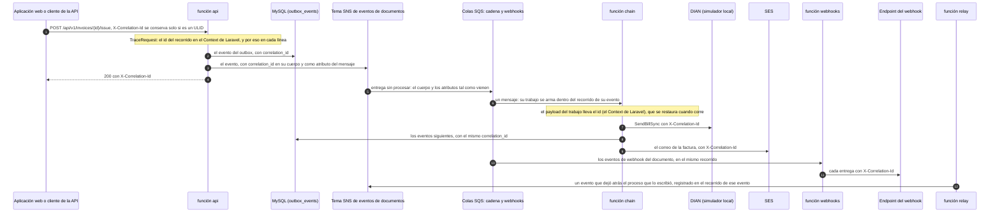

# Observabilidad

[English](../observability.md) · **Español**

<!-- Traducción de docs/observability.md con SHA-256 43ff129c9d218c357768ed41e9eefce5ad570860101459a1942057ab3dffdc9e. make docs-stamp actualiza esta línea cuando la traducción ya sigue al original. -->

Esta página describe cómo la plataforma informa lo que le pasa:

- registros estructurados, en los que un mismo id sigue a cada factura desde su petición hasta sus webhooks
- métricas de la aplicación y de AWS
- unas pocas alarmas, y cada una dice qué hacer
- un notificador que convierte las alarmas en mensajes de chat
- un tablero de operación
- consultas guardadas para los operadores

Todo es código: los stacks `alerts` y `observability` de la app de CDK (`infra/cdk`) y el servicio serverless de las funciones (`infra/functions`). La nube emulada lo despliega todo en el emulador local, y `make cloud-check` lo pone a prueba. [limitations.md](limitations.md) lista lo que el emulador no reproduce. No se despliega nada en una cuenta de AWS.

Los runbooks que nombran las alarmas están en [runbooks](runbooks/README.md), uno por alarma. Cada paso da su comando para el emulador y para una cuenta real.

## La línea de registro

Cada función, en PHP o en TypeScript, escribe un objeto JSON por línea, con los mismos campos. [`backend/resources/observability/log-schema.json`](../../backend/resources/observability/log-schema.json) los define una sola vez. El formateador del backend (`App\Support\Observability\JsonLogFormatter`) y el logger de las funciones en TypeScript (`infra/functions/shared/log.mts`) escriben las líneas con este esquema. Los filtros de métricas y las consultas guardadas de la app de CDK las leen. Una prueba comprueba que cada uno se ciña al archivo.

Cada campo está en todas las líneas, con `null` cuando no aplica. Las excepciones son `error` y `detail`, que solo aparecen cuando los hay.

| Campo | Tipo | Qué contiene |
| --- | --- | --- |
| `time` | cadena | Cuándo se escribió la línea, en UTC, en ISO 8601 con milisegundos: `2026-11-20T15:04:05.123Z` |
| `level` | cadena | `debug`, `info`, `notice`, `warning`, `error`, `critical`, `alert`, `emergency` |
| `message` | cadena | Lo que pasó, en una frase, con los secretos y los datos personales enmascarados |
| `function` | cadena | La función: `api`, `chain`, `webhooks`, `relay`, `scheduler`, `console`, `origin-verifier`, `notifier` |
| `stage` | cadena | `local`, `prod` |
| `correlation_id` | cadena o null | El recorrido al que pertenece la línea (más abajo) |
| `request_id` | cadena o null | La petición o la invocación que escribió la línea: el `X-Request-Id` de una petición a la API, o el id que AWS le da a la invocación de cualquier otra función |
| `company_id` | cadena o null | La empresa para la que se hace el trabajo: un id interno |
| `actor` | cadena o null | `user:<id>` o `api-key:<id>` en una petición; `system` en los trabajos, las ejecuciones programadas y las operaciones |
| `document_id` | cadena o null | El documento electrónico del que trata el trabajo: un id interno |
| `event` | cadena o null | El tipo de línea (mira los eventos más abajo); `null` en una línea del framework o de una librería |
| `duration_ms` | número o null | Cuánto tardó el trabajo |
| `outcome` | cadena o null | `success`, `failure`, `accepted`, `rejected`, `retried`, `skipped` |
| `error` | objeto | Si hay un error: su `class`; su `message`, enmascarado como el mensaje de la línea; y una `trace` recortada a los primeros 8 marcos, como `file:line function`, sin argumentos |
| `detail` | objeto | Unos pocos valores más, cada uno bajo una clave que lista el esquema; cualquier otra se descarta. Las claves cubren la ruta y el estado de una petición, el trabajo y su cola, la operación de la DIAN y su regla, la alarma y su estado... |

Una línea de la función chain, tal como la guarda CloudWatch Logs:

```json
{"time":"2026-11-20T21:33:41.209Z","level":"info","message":"SendBillSync to the DIAN ended responded (HTTP 200).","function":"chain","stage":"local","correlation_id":"01m7xe4m4safsymr3wz4vee9w9","request_id":"6c1d2e3f-4a5b-4c6d-8e7f-9a0b1c2d3e4f","company_id":"01m7xe3gkyqapxeqsvrb2phqq0","actor":"system","document_id":"01m7xe4m3zxgrmenf2sgybxhym","event":"dian.call","duration_ms":41.0,"outcome":"success","detail":{"operation":"SendBillSync","status":200,"result":"responded"}}
```

Los eventos:

| Evento | Lo escribe | Qué registra |
| --- | --- | --- |
| `http.request` | api | Una petición y su respuesta: la ruta tal como se declaró (`api/v1/invoices/{document}/issue`), el método, el estado y el tiempo. Nunca el cuerpo, los parámetros de consulta ni las cabeceras. |
| `auth.refused` | api | Un inicio de sesión con una contraseña equivocada, o una petición con una llave de API inválida, revocada o vencida. Nunca la dirección de correo ni la llave. |
| `document.issued` | api, console | Se emitió una factura, una nota crédito o una nota débito |
| `outbox.published` | cada proceso que escribe en el outbox | Los eventos del outbox que publicó el mismo proceso que los escribió, después de su commit (el camino rápido) |
| `outbox.relayed` | relay | Un evento que publicó el relay porque el proceso que lo escribió no lo hizo (la red de seguridad), registrado en el recorrido de ese evento |
| `outbox.relay_run` | relay | Una ejecución del relay, cada minuto: cuántos eventos publicó y el retraso del outbox después de la ejecución |
| `outbox.swept` | scheduler | Un barrido reinició cadenas, entregas o webhooks atascados |
| `chain.resumed` | chain | Un paso de la cadena o de la entrega que se había rendido volvió de la cola de mensajes fallidos (dead-letter queue), devuelto por un operador, y empezó de nuevo, como hace Reintentar ahora |
| `queue.job` | chain, webhooks | Corrió un trabajo: su clase, su cola, el intento, el tiempo y el resultado |
| `queue.dead_letter` | chain, webhooks | Un trabajo se rindió definitivamente: una copia de su mensaje, con el motivo, queda en la cola de mensajes fallidos de su cola ([runbooks/dead-letters.md](runbooks/dead-letters.md)) |
| `dian.call` | chain, console | Una llamada al servicio web de la DIAN: la operación, el estado HTTP, el tiempo y el resultado |
| `dian.response` | chain, console | La DIAN aceptó o rechazó un documento |
| `dian.rule` | chain, console | Una regla de la DIAN, por su id, que rechazó un documento o generó una notificación sobre él |
| `delivery.email` | chain, console | El correo de un documento, enviado o fallido. Nunca su dirección, su asunto ni su adjunto. |
| `webhook.delivery` | webhooks | Un intento de entrega de un webhook. Nunca su URL, su cuerpo ni su respuesta. |
| `secret.reread` | cada función en PHP | La base de datos rechazó las credenciales de una función en caliente, y la función volvió a leer su secreto |
| `console.command` | relay, scheduler, console | Un comando de artisan: su nombre (nunca sus argumentos), su código de salida y su tiempo |
| `scheduler.task` | scheduler | Una tarea del programador de Laravel |
| `runtime.output` | relay, scheduler, console | Una línea que un proceso imprimió por fuera del logger (el propio PHP, una excepción renderizada), guardada como el mensaje enmascarado |
| `edge.refused` | origin-verifier | Una petición que no llegó por el borde. Nunca el valor que traía ni su dirección. |
| `edge.secret` | origin-verifier | No se pudo leer el secreto del borde |
| `alarm.notification` | notifier | Una alarma convertida en mensaje de chat: enviado, omitido o fallido |

**Ni secretos ni datos personales.** La aplicación solo registra ids internos. Nunca pone en un mensaje una contraseña, una llave, un token, un correo, un número de identificación ni un documento. El formateador conserva solo los campos del esquema y las claves de `detail` que el esquema lista. Además enmascara, en cada texto, todo lo que todavía parezca un secreto o un dato personal (`App\Support\Observability\Redactor`):

- las claves y los certificados PEM, y los documentos en XML
- las llaves de API (`dei_`), los secretos de los webhooks (`whsec_`) y `APP_KEY`
- los tokens bearer, los JSON Web Tokens y las llaves de acceso de AWS
- los valores de una clave cuyo nombre indica un secreto (`password=`, `"token":`)
- los correos, los números lo bastante largos para identificar a una persona o una empresa, y las direcciones IPv4
- cualquier secuencia larga de letras y dígitos que no sea un UUID

`tests/Integration/Security/SecretsInLogsTest.php` recorre el flujo completo de la plataforma y guarda cada línea. El flujo cubre la creación de una cuenta, un inicio de sesión rechazado, un certificado, llaves de API, un webhook, una factura a través de la cadena, una invitación y el restablecimiento de una contraseña. La prueba no encuentra ningún secreto, ningún correo, nombre ni NIT, y ninguna línea por fuera del esquema. `make cloud-check` revisa cada línea que escribieron las funciones durante la revisión, en busca de los valores de los secretos de la etapa y de correos, llaves y tokens.

**Adónde van las líneas.**

- Cada función escribe en su propio grupo de registros, `/aws/lambda/dian-einvoice-<stage>-<function>`. El servicio serverless lo crea, con su conservación: 7 días en la etapa local y 365 en producción.
- Los registros de sistema de Lambda (el inicio, el fin y el reporte de cada invocación) también son JSON (`LogFormat: JSON`).
- API Gateway escribe un objeto JSON por petición en `/aws/http-api/dian-einvoice-<stage>-functions`. Guarda la ruta, el estado y las latencias, la del verificador de origen incluida. Nunca guarda los parámetros de consulta, las cabeceras ni la dirección de la que vino la petición.
- En producción, AWS WAF escribe las peticiones que bloqueó o contó en `aws-waf-logs-dian-einvoice-prod-edge`, sin las cabeceras `Authorization` y `Cookie`.

Las funciones en PHP registran por el canal stderr de Laravel, con el formateador (`LOG_STDERR_FORMATTER`). Las funciones que corren artisan (relay, scheduler, console) pasan cada comando por `App\Support\Lambda\ArtisanHandler`. Este devuelve lo que imprime el comando en la respuesta de la invocación, en vez de registrarlo. Las tareas del programador corren dentro del proceso de la función scheduler. Así, nada llega a los registros por fuera del esquema.

El stack local (`make up`, `make demo`) conserva el formato de línea de Laravel y no escribe ninguna de las líneas de peticiones ni de trabajos. Solo las funciones registran en JSON.

## El id de correlación

Un recorrido empieza en su primera entrada al sistema: una petición a la API, una ejecución programada del relay o del programador, o un comando. El recorrido recibe un id de correlación, un ULID en minúsculas. Lo llevan cada línea, evento del outbox, mensaje, trabajo, llamada a la DIAN, webhook y correo del recorrido.

La API devuelve el id en `X-Correlation-Id`, también en los errores. Cada respuesta `application/problem+json` lo lleva además como `correlation_id`, junto a `request_id`. La API conserva el id que envía un cliente solo si tiene esa forma, y si no, genera uno nuevo. La referencia de la API (`/docs/api`, `openapi.json`) documenta la cabecera en cada operación: la petición puede enviarla, y cada respuesta la lleva. También documenta el id en el esquema de cada problema.

En los registros, `request_id` nombra la petición o la invocación que escribió una línea. `correlation_id` nombra el recorrido completo, a través de las funciones.



En el stack local, el proceso del relay despacha los trabajos de cada evento dentro del recorrido de ese evento. Los workers restauran el recorrido de la misma forma cuando empieza cada trabajo. Un barrido que reinicia una cadena atascada registra los eventos nuevos en su propio recorrido, el de una ejecución programada. Las líneas de la cadena reiniciada siguen nombrando el documento (`document_id`).

## Métricas

Las métricas de la aplicación salen de las líneas de registro, a través de los filtros de métricas del stack observability (espacio de nombres `dian-einvoice/<stage>`). Cada métrica tiene un filtro por cada función que escribe su evento, sobre el grupo de registros de esa función. La aplicación no llama a ninguna API para publicar una métrica. Una prueba comprueba que cada campo que lee un filtro exista en el esquema, y que cada filtro esté sobre un grupo de registros que crea el servicio serverless.

| Métrica | De dónde sale | Qué muestra |
| --- | --- | --- |
| `DocumentsIssued` | `document.issued` (api, console) | El volumen del negocio. Cero en horario laboral significa que la API o las empresas no pueden emitir. |
| `DocumentsAccepted` | `dian.response` con outcome `accepted` (chain, console) | Lo que reciben los clientes. Sigue a `DocumentsIssued` en cuestión de minutos. |
| `DocumentsRejected` | `dian.response` con outcome `rejected` (chain, console) | Un aumento significa que cambió el XML, el CUFE o una regla de la DIAN. La consulta guardada `dian-rejections-by-rule` muestra cuál. |
| `DianCalls` | `dian.call` (chain, console) | Cada llamada a la DIAN: el denominador de la tasa de errores de la DIAN |
| `DianErrors` | `dian.call` con outcome `failure` (chain, console) | Las llamadas sin resultado de validación: está fallando la DIAN, o el camino de salida de la plataforma |
| `DianLatency` | `dian.call`, su `duration_ms` (chain, console) | La mayor parte del tiempo entre la emisión y la aceptación, y la primera señal de que la DIAN está por fallar |
| `ChainStepDuration` | `queue.job` en la cola `chain`, su `duration_ms`, por `Job` (chain) | En qué se va el tiempo de la cadena (XML, firma, transmisión, PDF, correo), y cualquier trabajo a punto de agotar su tiempo de espera |
| `WebhookDeliveriesFailed` | `webhook.delivery` con outcome `failure` (webhooks) | Un endpoint caído es problema de su empresa. Muchos a la vez apuntan al camino de salida de la plataforma. |
| `RelayPublishedEvents` | `outbox.relayed` (relay) | Los eventos que el relay tuvo que publicar. Debería pasar casi nunca; si no, el camino rápido está fallando. |
| `RelayRuns` | `outbox.relay_run` (relay) | El latido del relay, uno por minuto |
| `OutboxLag` | `outbox.relay_run`, su `detail.lag_seconds` (relay) | La antigüedad del evento sin publicar más antiguo. Delata una cadena que no avanza aunque todas las funciones corran. |
| `SecretRereads` | `secret.reread` (cada función en PHP) | Normal una vez por entorno después de una rotación. Un problema si sigue pasando. |
| `AuthenticationFailures` | `auth.refused` (api) | Alguien tratando de adivinar, o una integración con una llave revocada |
| `OriginVerifierFailures` | `edge.secret` con outcome `failure` (origin-verifier) | Sin los valores que guarda, el verificador de origen rechazaría cada petición que llega por el borde |

Las métricas nativas de AWS cubren el resto, en el tablero y en las alarmas:

- Lambda: las invocaciones, los errores, el throttling, la duración y la concurrencia de cada función
- SQS: los mensajes en espera y la antigüedad del mensaje más antiguo, en cada cola y en cada cola de mensajes fallidos
- API Gateway: las peticiones, los 4xx, los 5xx y la latencia
- CloudFront: las peticiones y las tasas de error del borde
- AWS WAF (producción): las peticiones bloqueadas y las permitidas
- Aurora (producción): la capacidad y las conexiones
- el NAT gateway (producción): los bytes hacia internet y los errores de asignación de puertos

**El formato de métricas integradas, como alternativa.** CloudWatch también puede tomar métricas escritas dentro de las propias líneas de registro, sin filtro de métricas. Es el formato de métricas integradas (embedded metric format): un objeto `_aws` con el espacio de nombres, las dimensiones y los valores. Permitiría que una línea llevara varias métricas, con las dimensiones que decida el código. El precio es un formato que el emulador no documenta, y métricas definidas en la aplicación en vez de en la infraestructura.

Los filtros de métricas mantienen las métricas en la app de CDK, junto a sus alarmas, y el emulador los evalúa. Una métrica que necesite más dimensiones de las que admite un filtro (tres) sería la razón para cambiar.

## Alarmas

Las alarmas son pocas, y cada una dice qué hacer cuando se dispara. Su descripción dice qué significa su estado y nombra el runbook que la atiende.

Cada alarma publica sus cambios de estado, a `ALARM` y de vuelta a `OK`, en el tema `dian-einvoice-<stage>-alarms`. El tema se cifra con una llave de KMS propia, que solo puede usar el CloudWatch de la cuenta. El notificador (más abajo) convierte los cambios de estado en mensajes.

Los datos que faltan cuentan como dentro del umbral, salvo en `relay-not-running`: ahí, el silencio del relay es la alarma.

| Alarma | Condición | Por qué importa | Runbook |
| --- | --- | --- | --- |
| `chain-dead-letters` | Un mensaje en la cola de mensajes fallidos de `chain` (1 minuto) | Un trabajo de la cadena falló en todos sus intentos, o SNS no pudo entregar un evento. Nada lo va a reintentar. | `docs/runbooks/dead-letters.md` |
| `webhooks-dead-letters` | Un mensaje en la cola de mensajes fallidos de `webhooks` (1 minuto) | Lo mismo, para los webhooks | `docs/runbooks/dead-letters.md` |
| `chain-queue-age` | El mensaje más antiguo de `chain` lleva más de 10 minutos en la cola, durante 5 minutos | Más que cualquier reintento de la cadena (144 s como máximo): el consumidor de la cola no lo está tomando | `docs/runbooks/queue-backlog.md` |
| `webhooks-queue-age` | Lo mismo, para `webhooks` | Más que cualquier reintento de un webhook (144 s como máximo) | `docs/runbooks/queue-backlog.md` |
| `function-errors` | Una o más invocaciones fallidas de cualquier función en 5 minutos (métricas calculadas sobre todas las funciones) | Una caída, un tiempo de espera agotado o un comando programado que terminó con error. Las fallas parciales de un lote y los errores HTTP no cuentan aquí. | `docs/runbooks/function-errors.md` |
| `function-throttles` | Una o más invocaciones de cualquier función frenadas por throttling en 5 minutos | Al tope de la concurrencia reservada, las peticiones reciben 429 o 503, o los mensajes esperan | `docs/runbooks/function-throttles.md` |
| `api-server-errors` | 5 o más respuestas 5xx en API Gateway en 5 minutos | Están fallando peticiones de la aplicación web y de las integraciones | `docs/runbooks/api-errors.md` |
| `api-latency` | El p99 de API Gateway por encima de 2 s durante 15 minutos | El doble del objetivo de latencia de la API | `docs/runbooks/api-latency.md` |
| `relay-not-running` | Ninguna ejecución del relay en 3 minutos (aquí los datos que faltan cuentan como fuera del umbral) | Los eventos que deja atrás el camino rápido se quedan esperando, y sus cadenas se detienen | `docs/runbooks/outbox-relay.md` |
| `outbox-lag` | Un evento sin publicar por más de 2 minutos, durante 2 ejecuciones del relay | El tema rechaza los eventos, o el relay no da abasto | `docs/runbooks/outbox-relay.md` |
| `dian-error-rate` | Más del 20 % de las llamadas a la DIAN sin resultado, cuando hay 5 o más en 5 minutos, durante 10 minutos (métricas calculadas) | Está fallando la DIAN, o el camino de salida hacia ella, y la cadena espera sus reintentos | `docs/runbooks/dian-errors.md` |
| `webhook-failures` | 20 o más entregas de webhooks fallidas en 15 minutos | Están fallando los endpoints de las empresas, o el camino de salida de la plataforma | `docs/runbooks/webhook-failures.md` |
| `origin-verifier-errors` | El verificador de origen no pudo leer el secreto del borde (1 minuto) | Un verificador en caliente sigue usando los valores que guarda, pero uno nuevo no tiene ninguno, y fallan las peticiones que le llegan por el borde | `docs/runbooks/origin-verifier.md` |
| `notifier-failures` | Una notificación en la cola de mensajes fallidos del notificador (1 minuto). Esta alarma también publica en el tema de respaldo, con un correo. | Al chat le están faltando alarmas. Esta alarma les llega a los operadores sin pasar por el notificador. | `docs/runbooks/notifier.md` |
| `database-capacity` (producción) | Más de 3,5 de las 4 ACU durante 15 minutos | La base de datos está a punto de dejar de crecer, y `max_connections` depende de su máximo | `docs/runbooks/database-capacity.md` |
| `database-connections` (producción) | Más de 108 conexiones (el 80 % de las 135 permitidas a la capacidad máxima) durante 5 minutos | Están a punto de rechazarse las conexiones nuevas de las funciones, de las funciones de rotación y de los operadores | `docs/runbooks/database-capacity.md` |
| `service-degraded` (producción, compuesta) | Cualquiera de `api-server-errors`, `api-latency`, `chain-dead-letters`, `chain-queue-age`, `dian-error-rate`, `relay-not-running`, `origin-verifier-errors`, `function-errors` | La que avisa a quien está de turno: el servicio está degradado, en la parte que sea. Las alarmas en `ALARM` que agrupa dicen dónde. | `docs/runbooks/service-degraded.md` |

## El notificador

El notificador (`infra/functions/notifier`) es una función en TypeScript sobre Node.js 24. El servicio serverless lo define junto con las demás funciones. Corre por fuera de la VPC, con un rol propio que solo puede leer el secreto del webhook del chat y enviar a su propia cola de mensajes fallidos.

El notificador está suscrito al tema de las alarmas. Por cada notificación escribe un mensaje corto que acepta un webhook de chat compatible con Slack (`{"text": ...}`). El mensaje da la alarma, su estado y el anterior, qué significa, por qué (la razón de CloudWatch), su runbook y cuándo:

```text
:red_circle: *ALARM* dian-einvoice-prod-chain-dead-letters (was OK)
A message reached the chain queue's dead-letter queue: a job failed every attempt, or SNS could not deliver an event, and nothing will retry it.
Reason: Threshold Crossed: 1 out of the last 1 datapoints [3.0 (20/11/26 20:59:00)] was greater than the threshold (0.0) (minimum 1 datapoint for OK -> ALARM transition).
Runbook: docs/runbooks/dead-letters.md
At 2026-11-20T21:00:12.345+0000 in US East (N. Virginia)
```

- **La dirección.** La dirección del webhook está en el secreto `dian-einvoice/<stage>/alerts/chat-webhook` (`{"url": "..."}`). El notificador la lee una vez cada 5 minutos y nunca la registra: quien la tenga puede publicar en el chat. En producción, el secreto empieza vacío, y los operadores ponen allí su dirección (`aws secretsmanager put-secret-value`). Mientras tanto, el notificador solo registra cada alarma. En la etapa local, el secreto apunta al receptor de webhooks del simulador de la DIAN, que guarda lo que recibe.
- **Las fallas.** El notificador le da a cada publicación hasta 3 intentos, de 5 s cada uno, con esperas de 0,25 s y 1 s entre ellos. Si el chat no acepta ninguno, la notificación va, tal como la publicó CloudWatch, a la cola de mensajes fallidos `dian-einvoice-<stage>-notifier-dlq`. Si aun así falla una invocación, Lambda la reintenta dos veces y luego la envía a la misma cola (su destino en caso de falla). Lo que SNS no logre entregarle al notificador también va allí (la política de redrive de su suscripción).
- **El respaldo.** La alarma de la cola de mensajes fallidos (`notifier-failures`) publica también en el tema de respaldo `dian-einvoice-<stage>-alarms-fallback`, que tiene una suscripción por correo. La dirección de correo (`operators@dian-einvoice.example`) es un parámetro del despliegue: `cdk deploy -c alertsEmail=...`.
- **Lo que no envía.** Una alarma que pasa de `INSUFFICIENT_DATA` a `OK`, como hace toda alarma nueva, solo se registra.
- **Las pruebas.** Las pruebas del notificador (`infra/functions/notifier/test`) le pasan notificaciones de alarmas tal como las publica CloudWatch. Cubren una alarma sobre una métrica, su vuelta a `OK`, datos insuficientes, métricas calculadas, una alarma compuesta y un estado forzado a mano. Usan dobles de prueba del chat, de Secrets Manager y de SQS.

## Objetivos de servicio

| Objetivo | Meta, en 30 días | Lo defienden |
| --- | --- | --- |
| Disponibilidad de la API | El 99,9 % de las peticiones a la API no devuelven ningún 5xx (un presupuesto de errores de 43 minutos al mes) | `api-server-errors`, `function-errors`, `function-throttles`, `origin-verifier-errors`, `database-connections`, `service-degraded` |
| Latencia de la API | El 99 % de las peticiones a la API reciben respuesta en no más de 1 segundo, medido en API Gateway | `api-latency`, `database-capacity`, `function-throttles`, `service-degraded` |
| Tiempo hasta la respuesta de la DIAN | La DIAN acepta o rechaza el 99 % de los documentos emitidos en los 5 minutos siguientes a su emisión, sin contar los minutos en que la propia DIAN está caída | `chain-queue-age`, `chain-dead-letters`, `dian-error-rate`, `relay-not-running`, `outbox-lag`, `service-degraded` |

Las alarmas detectan un consumo rápido del presupuesto de errores. Medir cada objetivo en sus 30 días es una consulta sobre las métricas del tablero, no una alarma.

## Tablero y consultas guardadas

Un solo tablero, `dian-einvoice-<stage>-operations`, muestra:

- el estado de cada alarma
- las peticiones, los errores y la latencia de la API en API Gateway, y los del borde en CloudFront
- los documentos emitidos, aceptados y rechazados
- la duración de cada trabajo de la cadena
- las llamadas a la DIAN, sus errores y su latencia
- las colas y sus colas de mensajes fallidos
- el relay y el retraso del outbox
- los webhooks fallidos, las autenticaciones rechazadas y las relecturas de secretos
- las invocaciones, los errores, el throttling y la duración de cada función
- la concurrencia de cada función frente a su concurrencia reservada: los límites que fija el servicio serverless, y una prueba comprueba que el tablero use esos mismos límites
- en producción, la capacidad y las conexiones de la base de datos frente a su máximo, el firewall y el tráfico de salida

Las consultas guardadas de CloudWatch Logs Insights, bajo `dian-einvoice/<stage>/`:

| Consulta | Qué encuentra | En el emulador |
| --- | --- | --- |
| `follow-a-journey` | Cada línea de un recorrido, en orden, a través de las funciones de la aplicación | La corre `make cloud-check`. Solo usa `fields`, `filter`, `sort` y `limit`, los comandos que evalúa el emulador. |
| `errors-by-function` | Cuántas líneas de error escribió cada función, primero la que más | Guardada, no se corre: necesita `stats` |
| `slow-requests` | Las peticiones a la API que tardaron más de un segundo, primero la más lenta | Guardada, no se corre |
| `dian-rejections-by-rule` | Qué reglas de la DIAN rechazan documentos, primero la más frecuente | Guardada, no se corre: necesita `stats` |

## Cómo seguir una factura

1. Consigue su id de correlación: el `X-Correlation-Id` de la respuesta que la emitió, o el `correlation_id` de cualquier línea que nombre el documento (`document_id`).
2. En CloudWatch Logs Insights, abre la consulta guardada `dian-einvoice/<stage>/follow-a-journey`. Pon el id en lugar de `REPLACE-WITH-THE-CORRELATION-ID` y corre la consulta sobre el tiempo transcurrido desde la emisión. Las líneas salen en orden:
   - la petición a la API (`http.request`, `document.issued`, `outbox.published`)
   - cada trabajo de la cadena (`queue.job`), con su llamada a la DIAN (`dian.call`)
   - la respuesta de la DIAN (`dian.response`, `dian.rule`)
   - el correo (`delivery.email`)
   - los webhooks (`webhook.delivery`)
   - `outbox.relayed`, si el relay tuvo que publicar uno de los eventos del recorrido
3. En la nube emulada, `make cloud-follow ID=<correlation-id>` corre la misma consulta guardada e imprime las líneas. Por defecto mira las últimas 24 horas (`HOURS=24`). `make cloud-check` sigue la factura que emite a través del borde, y comprueba que su id aparezca en api, chain y webhooks. Siete de las 33 líneas de un recorrido:

```text
33 lines of the journey 01m7xg8djzcvdhw6v07ashwf9e in the last 24 hours (saved query dian-einvoice/local/follow-a-journey):
2026-11-20 22:11:59.759  api        document.issued    success   An invoice was issued.
2026-11-20 22:11:59.766  api        http.request       success   POST api/v1/invoices/{document}/issue answered 200.
2026-11-20 22:12:00.539  chain      queue.job          success   GenerateXml succeeded after attempt 1.
2026-11-20 22:12:02.616  chain      dian.call          success   SendBillSync to the DIAN ended responded (HTTP 200).
2026-11-20 22:12:03.536  chain      dian.response      accepted  The DIAN accepted the document.
2026-11-20 22:12:06.579  chain      delivery.email     success   The email of the document was sent.
2026-11-20 22:12:21.644  webhooks   webhook.delivery   success   Webhook delivery attempt 1 succeeded.
```

## En la nube emulada

`make cloud-up` despliega el stack alerts antes de las funciones, y el stack observability por separado, después de las funciones y del borde. Luego le da al emulador lo que su CloudFormation descarta: las métricas de las alarmas con métricas calculadas, y las consultas guardadas (`infra/functions/scripts/observability.mjs reconcile`). Igual que la reconciliación del borde, este paso solo corre contra el emulador, es idempotente y dice qué aplicó y cuándo deja de hacer falta.

Allí corre cada pieza: los grupos de registros y sus líneas, los filtros de métricas y sus métricas, las alarmas sobre una sola métrica, el tema de las alarmas, el notificador y el receptor local del chat. Ese receptor es el receptor de webhooks del simulador de la DIAN, bajo el id de empresa `0alarmnotifications0000000`.

`make cloud-check` revisa la observabilidad en su paso 11:

- Existe lo que declaran las plantillas: 25 filtros de métricas, 14 alarmas con su métrica, sus acciones y su runbook, el tablero, 4 consultas guardadas y la suscripción del notificador.
- Un estado forzado en `chain-dead-letters` llega al chat tal como lo formatea el notificador, y lo mismo pasa con la vuelta a `OK`.
- Cada línea que escribieron las funciones durante la revisión es un JSON que cumple el esquema.
- La factura emitida a través del borde se puede seguir por el id que recibió su cliente.
- Ningún registro contiene un valor de los secretos de la etapa, un correo, una llave ni un token.
- `DocumentsIssued` cuenta los documentos emitidos.

La revisión completa tarda unos tres minutos.

Más comandos:

- `make cloud-alarms` imprime el estado de cada alarma con su runbook, y los últimos mensajes que recibió el chat. `make cloud-follow ID=<correlation-id>` imprime las líneas de un recorrido. La consola web del emulador (`http://localhost:8604/_floci/ui`) muestra los grupos de registros de las funciones y corre consultas de Logs Insights.
- `make cloud-drill` corre por separado, en unos cuatro minutos y medio. El simulador de la DIAN responde con HTTP 500 a cada llamada. Las transmisiones de las facturas emitidas mientras tanto se rinden y van a la cola de mensajes fallidos de la cadena. El emulador pone `chain-dead-letters` en `ALARM` de verdad, y el chat la recibe con su runbook. Los comandos de ese runbook devuelven los mensajes fallidos a su cola. Cada factura termina aceptada y entregada una sola vez, y la alarma vuelve a `OK`. El simulacro imprime cuánto se tardó en detectar, en notificar y en recuperarse, medido en el emulador ([runbooks/drill-report.md](runbooks/drill-report.md)).
- `make cloud-alarm-check` también corre por separado, porque tarda de tres a cuatro minutos. El emulador evalúa `chain-dead-letters` de verdad. Un mensaje en su cola de mensajes fallidos la pone en `ALARM` en menos de un minuto, y sacar el mensaje la devuelve a `OK`; cada cambio llega al chat. Una notificación que el chat rechaza (el modo de error del receptor) va a la cola de mensajes fallidos del notificador. La alarma de esa cola, `notifier-failures`, llega al chat cuando el chat vuelve a aceptar mensajes.

Lo que se queda solo en código, o corre sin datos, está en [limitations.md](limitations.md#observabilidad):

- las métricas nativas de AWS y sus alarmas
- la evaluación de las métricas calculadas, y la alarma compuesta
- cómo se dibuja el tablero
- las consultas con `stats`
- los registros de sistema de Lambda, los registros de acceso de API Gateway y los registros de AWS WAF
