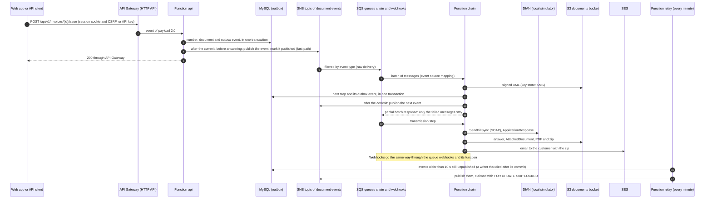
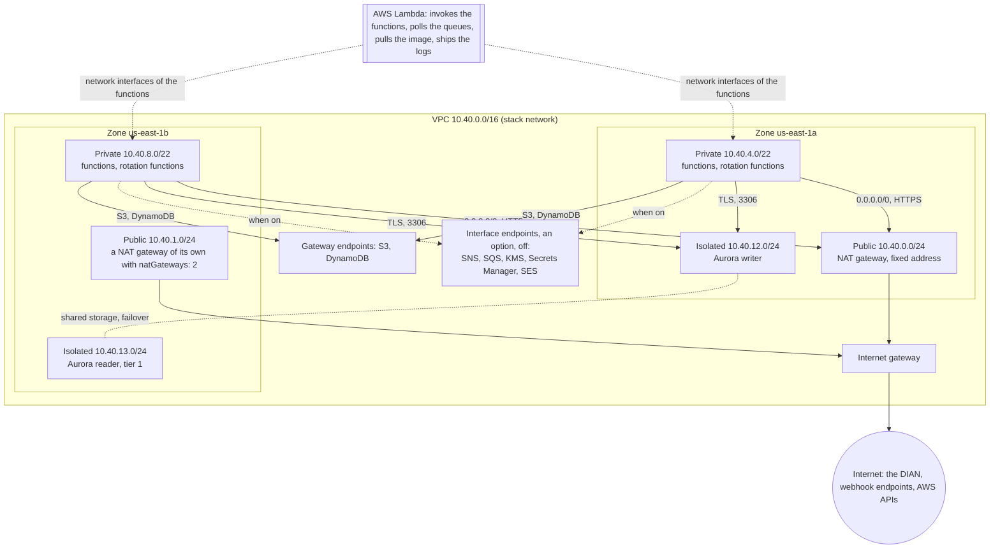

# Infrastructure

The production cloud architecture of the platform, written as code and proven locally. Nothing is deployed to a real AWS account: the AWS services run in a local emulator, [Floci](https://github.com/floci-io/floci) (open source, MIT, no account or token). Infrastructure task 1 brought messaging, storage, data, keys and email; task 2 runs the application as AWS Lambda functions; task 3 gives prod its private network and its managed database (Aurora MySQL Serverless v2), which exist only in the stage prod and are validated offline, never deployed, not even to the emulator, and splits the access to the database into two identities, in both stages. Task 4 adds the edge in front of the API and the web app and the delivery pipeline; task 5 the observability, the operations and the cost.

## Two environments

| | Local stack (default) | Emulated cloud |
| --- | --- | --- |
| Start | `make up`, `make demo` | `make cloud-up`, `make cloud-demo` |
| Stop | `make down` | `make cloud-down`; `make cloud-clean` also removes its state |
| Check | `make test`, `make checks` | `make cloud-check` |
| The application | containers that run all the time: `api`, `worker` ×2, `relay` | Lambda functions in the emulator, started per execution environment; nothing of the application runs all the time |
| AWS services | none | Floci on 127.0.0.1:8604 (compose profile `cloud`), with the Docker socket; its web console (functions and their logs, queues, buckets, tables, secrets, keys, the emails SES took, the stacks), with no account, on 127.0.0.1:8605, started the first time `http://localhost:8604/_floci/ui` is opened |
| Configuration | `backend/.env` | the environment of each function, from the serverless service and the SSM parameters of the CDK app; secrets from Secrets Manager |
| Database | MySQL, database `dian_einvoice`, one user | the same MySQL, database `dian_einvoice_cloud`, with its two identities: migrations (the console function) and application (every other function), each with its secret |

Both use the same ports (web app 8601, API 8600, DIAN simulator 8602), so one runs at a time: `make cloud-up` stops the API, workers and relay of the local stack, and `make up` stops the emulator and the proxy of the emulated cloud and removes the containers of its functions. They share the DIAN simulator; `make cloud-demo`, like `make seed`, resets it. In the emulated cloud the port of the API belongs to `cloud-gateway`, a minimal reverse proxy (nginx) in front of API Gateway, which the emulator serves by host name only (`<api id>.execute-api.localhost.floci.io`); in AWS clients call API Gateway, and from task 4 the content delivery network in front of it.

## The CDK app

`infra/cdk`, AWS CDK in TypeScript, run by Node's type stripping in its own container. Two stages: `local`, deployed to the emulator with the normal CDK commands (`cdk bootstrap`, `cdk deploy "local/*"`), and `prod`, synthesized and validated but never deployed (its account is a placeholder, so the CLI refuses real credentials). Synthesis needs no network: `make cdk-check` runs it in a container without one. The stacks network and database exist in prod only: the emulator could not give meaningful evidence for a VPC, its routes and security groups, or a managed database, so they are checked on what synthesis produces (assertions, cdk-nag, cfn-lint and the schema validation of CDK) and never deployed.

| Stack | Resources |
| --- | --- |
| `dian-einvoice-<stage>-messaging` | SNS topic of document events (TLS only, encrypted with the AWS managed key); SQS queues `chain` and `webhooks`, each with its dead-letter queue (14 days), visibility timeout 60 s locally and 360 s in prod, and `maxReceiveCount` 10; one raw subscription per queue, filtered on the `type` attribute with the routes the backend declares (`backend/resources/outbox/routes.json`) |
| `dian-einvoice-<stage>-storage` | Documents bucket: private, SSE-S3 with a bucket key, versioned, TLS only, server access logs; current versions move to Standard-IA at 90 days and Glacier Instant Retrieval at 365 and never expire; old versions expire (30 days locally, 90 in prod). The deployments bucket of the serverless service (its templates and state, 7 days locally, 90 in prod) |
| `dian-einvoice-<stage>-data` | DynamoDB tables `cache`, `sessions` and `limits` in the format of Laravel's store (key `key`, TTL on `expires_at`), on demand |
| `dian-einvoice-<stage>-security` | KMS key of the signing certificates (rotation on), and the secret `dian-einvoice/<stage>/app`, whose `APP_KEY` Secrets Manager generates and which holds nothing else. In the stage local, which has no managed database, also the secrets of the two identities of the database (below), which prod keeps in the stack database |
| `dian-einvoice-<stage>-mail` | SES identity: the sender address locally; in prod the domain, with Easy DKIM and a MAIL FROM subdomain |
| `dian-einvoice-<stage>-compute` | One IAM role per function (`dian-einvoice-<stage>-<function>-function`), which may read the secret of its identity of the database (the console function both), the role EventBridge Scheduler invokes the scheduled functions with, and the ECR repository of the image of the functions (scan on push, immutable tags in prod, only Lambda pulls, for the functions of the stage) |
| `dian-einvoice-prod-network` (prod only) | VPC across two zones with public, private and isolated subnets, one NAT gateway with a fixed address (one per zone as an option), gateway endpoints for S3 and DynamoDB, interface endpoints for the other AWS services of the adapters as an option, the security group of the functions, the default security group without rules, and flow logs (below) |
| `dian-einvoice-prod-database` (prod only) | Aurora MySQL Serverless v2 compatible with MySQL 8.4, its KMS key, parameters, log groups and security groups, the secrets of the two identities with the rotation functions of AWS, and RDS Proxy as an option (below) |

Every stack also creates one managed IAM policy per consumer and capability (consume a queue, publish to the topic, read and write the documents, use a table, use the signing key with the encryption context of the key store, read the secret, send email as the platform address, read the queues and their dead letters) and publishes the names, ARNs and policies under `/dian-einvoice/<stage>/<stack>/` in SSM Parameter Store. Names carry the stage; resources carry the tags `project`, `stage` and `managed-by`, and stacks also `component`. cdk-nag (AWS Solutions) runs on every synthesis; its exceptions are acknowledged next to their resources with their reasons, and listed in `infra/cdk/cdk.out/validation-report.json`: per stage the three tables without point-in-time recovery, the objects of the documents bucket, the secret of `APP_KEY` without rotation, and one per role for the log streams of its function; in prod also one per role for the network interfaces of a function in a VPC, and three on the database (IAM authentication, the default port, Backtrack); locally also the secrets of the two identities, which no rotation function of AWS can rotate in the emulator. The reasons are next to each resource and in the section on the database below.

## The functions

`infra/functions`, a serverless service deployed with [osls](https://github.com/oss-serverless/osls) 4.8.1, the free fork of the Serverless Framework (MIT, no account, no telemetry), in a container of its own: the stack `dian-einvoice-<stage>-functions`. The stage local is deployed to the emulator by `make cloud-up`; prod is packaged without a network or credentials and validated by `make cdk-check`.

Every function runs one container image, the target `lambda` of `backend/Dockerfile`: the application with its production dependencies on the official image of [Bref](https://bref.sh) 3 for PHP 8.5 (`bref/php-85:3.0.12`, the minor version of the local image), with the extensions the application requires (the `ext-*` of `backend/composer.json`: the build fails when one is missing) and Bref's Laravel bridge. A function chooses its runtime of Bref (`BREF_RUNTIME`) and its handler (the command of the image):

| Function | Trigger | Mode of Bref | Memory | Timeout | Concurrency | Why |
| --- | --- | --- | --- | --- | --- | --- |
| `api` | API Gateway HTTP API, every route (`$default`), payload 2.0 | `fpm`, `public/index.php` | 1024 MB | 28 s | 40 reserved | The whole HTTP API under `/api/v1`, the CSRF cookie of the web app and the reference at `/docs/api`. Memory buys CPU for short answers and short cold starts (Lambda gives CPU in proportion); below the 30 s API Gateway waits for an integration. 40 environments at once are 40 requests in flight, the biggest share of the connection budget |
| `chain` | SQS queue `chain`: batches of up to 10, no batching window, partial batch response, at most 10 invocations at once | `function`, `App\Support\Outbox\Sqs\SqsEventsHandler` | 1024 MB | 60 s | 10 reserved | Every step of the electronic document chain and the delivery: XML, XAdES signature, transmission to the DIAN, PDF (dompdf) and email. Signing and the PDF want CPU and memory. A job may run 35 s, as in the local workers; 60 s is one such job and the margin, and a batch stops starting jobs it could not finish before the deadline and hands them back |
| `webhooks` | SQS queue `webhooks`: the same, at most 5 at once | `function`, the same handler | 512 MB | 60 s | 5 reserved | Webhook events and their deliveries: HTTP calls of 5 s at most, little CPU |
| `relay` | EventBridge Scheduler, `rate(1 minute)`, input `"outbox:publish-pending"` | `console`, `artisan` | 512 MB | 60 s | 1 reserved | The safety net of the outbox. It publishes for up to 40 s and leaves the rest to the next run. One at a time; a run that fails is not retried (no asynchronous retries, events older than 60 s dropped, no retries of the schedule): the next minute is its retry |
| `scheduler` | EventBridge Scheduler, `rate(1 minute)`, input `"schedule:run"` | `console`, `artisan` | 512 MB | 120 s | 2 reserved | The Laravel scheduler: the sweepers (stalled chains, deliveries and webhooks, expired idempotency keys, the retention pruning once an hour) and a heartbeat. Two at once let a long pruning overlap the next minute; each task runs on one process per minute and never alongside itself (locks of the cache). No retries, as the relay |
| `console` | none: invoked on demand | `console`, `artisan` | 1024 MB | 900 s | 2 reserved | Migrations and operation commands (`make cloud-up` migrates with it, `make cloud-demo` seeds, `make cloud-check` runs its steps, `make cloud-artisan ARGS="..."` runs any other): the event is the command line of `php artisan`. The longest a Lambda function may run |

The roles come from the stack compute (`role: !Sub '${ApiRoleArn}'`), the queues, the topic, the bucket, the tables, the key and the secret from the parameters the CDK app publishes in SSM (`resources/parameters.yml`, parameters of the template whose defaults are those names, which CloudFormation reads when it deploys); the mappings of the queues and the schedules are written as CloudFormation (`resources/triggers.yml`), since osls cannot take an ARN from a parameter or set a retry policy on a schedule. The functions have no IAM of their own. Each one writes its logs to stderr, to its log group `/aws/lambda/<function>` (7 days locally, 365 in prod), and API Gateway its access log to a log group of the service.

### The journey of an invoice

### The outbox without a relay that runs all the time

Every change records its integration events in the outbox table in its own transaction, as in the local stack. Locally the relay process publishes them all the time. The functions have no such process, and a relay function once a minute alone would add up to a minute to every step of the chain, so in the functions (`OUTBOX_PUBLISH_AFTER_COMMIT`):

- **Fast path.** Whoever wrote the events publishes them right after its transaction commits (`DB::afterCommit`), before it answers the request or finishes the job, and marks them published (`App\Support\Outbox\OutboxFastPath`). The events of one transaction go together. A publish that fails loses nothing: the change is committed, the error is reported, and the rows stay unpublished in the outbox.
- **Safety net.** The relay function publishes, once a minute, the events still unpublished that are older than 10 s (`php artisan outbox:publish-pending`): those of a process that died after its commit, or whose publish failed.
- Both claim rows the way every relay does: `FOR UPDATE SKIP LOCKED` in read committed, publish, mark published, commit. A row one holds is skipped by the other, and one already published is not taken again. Delivery stays at least once (a process that dies between the publish and its commit publishes again), and every consumer is idempotent.
- The demo seeder runs the chain of its documents in line, so it publishes nothing after its commits and pauses the relay function and the sweepers in the shared cache until it ends (`App\Support\Outbox\OutboxPause`), as `make seed` stops the local relay.

The local stack keeps its relay process unchanged; the fast path is off there.

### Inside a function

- **Read-only file system but `/tmp`.** Bref's Laravel bridge, registered only inside Lambda, puts the storage of Laravel, the compiled views and the file cache in `/tmp`; dompdf, the heartbeat and the cache of the secrets write there too. The manifests of the packages and of the service providers are written when the image is built. The emulator runs every function as an unprivileged user (`993:990`, as Lambda does) that owns nothing in the image.
- **Secrets once per cold start.** When an execution environment starts, the bridge caches the whole configuration in `/tmp` (`php artisan config:cache`, `BREF_LARAVEL_CACHE_CONFIG`), which reads the secret of the application and the secret of the identity of the database of the function from Secrets Manager (`App\Support\Secrets\LoadSecrets`); later requests and jobs boot from that cache and read nothing. A rotated secret reaches the environments started after the rotation; one already warm reads the secret of its identity again only when the database refuses its password (below).
- **Logs to stderr**, where Lambda sends them to CloudWatch Logs; the formatter of Bref starts each line with the id of the request.
- **Nothing after the answer.** AWS freezes an environment as soon as it answers, which the emulator does not reproduce, so nothing may wait for after the answer: the outbox publishes before it, PHP-FPM of Bref has `fastcgi_finish_request` disabled, no scheduled task runs in the background, and `tests/Unit/Support/NothingAfterTheAnswerTest.php` refuses the calls that would leave work for later (after-response dispatches, `defer()`, terminating callbacks, shutdown functions, background processes).
- **The client address.** PHP-FPM receives every request from the Bref runtime (127.0.0.1); the address API Gateway saw is the last one of `X-Forwarded-For`. The functions trust 127.0.0.1 alone (`TRUSTED_PROXIES`), so a client cannot choose its own address for the rate limits, and of the forwarded headers only the address and the scheme count, never the host.
- **The consumers.** The handler of the queues maps each SQS record to the job of task 1 (the same mapping of outbox events and jobs, `SqsEventsQueue::jobFor`) and runs it with Laravel's queue worker, one after another: a job that succeeds deletes its message; one that throws changes the visibility of its message to the wait of its backoff and is reported as failed; an event due later stays invisible until then; a record whose job would not finish before the deadline goes back at once. The retries, the dead-letter queue after `maxReceiveCount` and the idempotency of the handlers are those of task 1. After each batch the function gives its database connection back.

### The budget of database connections

Each execution environment holds at most one connection to the database: PHP-FPM of Bref runs one worker per environment and closes its connection with every request, and the consumers close theirs after each batch. The reserved concurrency of the functions caps the environments at once: 40 (api) + 10 (chain) + 5 (webhooks) + 1 (relay) + 2 (scheduler) + 2 (console) = **60 connections at most**, which a test of the CDK app holds the template of the functions to. The managed database of prod gives 135 at its maximum capacity of 4 ACU, and `infra/cdk/test/database.test.ts` holds that figure, from the table AWS documents, at or above those 60 plus a margin of 20 for the rotation functions and the operators (the database section below); RDS Proxy, an option, would let the API grow beyond them. In AWS, reserved concurrency needs an account limit of concurrent executions above its sum plus the 100 that stay unreserved; new accounts may start lower and need a quota increase.

### The visibility timeout of the queues

Lambda refuses a mapping whose queue hides a message for less than the timeout of its function, and AWS recommends six times that timeout, plus the batching window, so a batch Lambda retries after a throttle is not received twice meanwhile. The consumers have a timeout of 60 s and no batching window: the queues of prod hide a message for 360 s, six times it. Those of the stage local keep the minimum, 60 s, while the emulator gives failed records back late: Floci 2.5.0 holds every record a function reports as failed for the visibility timeout of its queue (docs/limitations.md), so at 360 s each retry and each receive of an unreadable message would wait six minutes, and make cloud-check would no longer take a few minutes. `infra/cdk/test/functions.test.ts` ties the two numbers, read from the CDK app and from the template osls packaged: at least the timeout of the function in both stages, six times it in prod.

### Production, validated without deploying

`make cdk-check`, also a job of CI, runs without a network or credentials: osls packages both stages (the image named by a placeholder digest, `@sha256:0…0`, until the pipeline of task 4 builds and pushes it to ECR), the tests of the CDK app assert the template of the functions (every function has a timeout, memory, a concurrency limit and a role of its own from the stack compute; the mappings report failures per item; the scheduled functions retry nothing; every parameter it reads is one the CDK app publishes, the network and the database ones included in prod; each function has its identity of the database and an encrypted connection; it holds no IAM), include it in a stack of their own to run the same rules of cdk-nag as the CDK app (one exception: API Gateway does not authorize, the application does), synthesize the CDK app, and cfn-lint 1.60.1 checks every template (one exception, on the template of the functions: a DependsOn osls writes that a reference already implies).

## Decisions of the functions

- **A container image, not layers.** The layers of Bref are published from AWS accounts of Bref, which the emulator cannot mount, and an image is the same artifact in the emulator and in AWS: built once, by digest, with the exact PHP and extensions the build checks. It also lifts the limit of 250 MB of a zip with its layers. The cost: an image to keep in ECR, and a slower first cold start of each new image in AWS while Lambda caches it.
- **Fast path with a safety net.** Publishing after the commit keeps the chain as fast as with a relay that runs all the time, without one; the relay function keeps the guarantee of the outbox when a writer dies after its commit. The alternatives were a relay function once a minute alone (up to a minute per step) or a stream of the database (MySQL has none a function can subscribe to without another service).
- **The budget of connections.** Reserved concurrency per function, consistent with the mappings (at most as many invocations at once as the function may run), rather than one limit for the account: a burst of the API cannot take the connections of the chain, and the total fits the database.
- **What goes in the CDK app, what in the serverless service.** Each resource is defined once. Shared and stateful resources (queues, topic, buckets, tables, key, secret, the ECR repository, the deployments bucket) and every IAM role are in the CDK app, which cdk-nag checks; the functions and their triggers (API Gateway and its routes, the mappings, the schedules, the log groups of the functions) are in the serverless service, where osls packages an image function in one step. The service reads what it needs from the SSM parameters of the CDK app when CloudFormation deploys it, so nothing is copied between the two.
- **arm64.** Graviton is cheaper per second. It would take: the images of Bref for arm64 (`bref/arm-php-85`), a build of the image for `linux/arm64` (in CI with QEMU or an arm64 runner), `architecture: arm64` in the serverless service, and the emulator with `FLOCI_SERVICES_LAMBDA_HONOUR_ARCHITECTURES` on a host that runs arm64 containers. This machine and CI are x86_64, so the functions are x86_64.

## The network and the database of prod

The stacks `dian-einvoice-prod-network` and `dian-einvoice-prod-database` exist in the stage prod only, and are never deployed, not even to the emulator, which could not give meaningful evidence for them: the emulated cloud keeps the MySQL of compose and the network of compose. They are proven on what synthesis produces: `infra/cdk/test/network.test.ts` and `infra/cdk/test/database.test.ts` (the zones and tiers, no route out of the isolated subnets, the NAT gateways the stage asks for, a path to every AWS service of the adapters, the exact rules of every security group, the flow logs, a database that is not public, encrypted, protected against deletion, backed up and with more connections than the functions hold, and the same stage with every option turned the other way), cdk-nag, cfn-lint, and the schema validation of CDK.

- **Public subnets**: the NAT gateways only, the way out to the internet, each with an Elastic IP kept when the stack goes, so an allow list of the DIAN or of a customer that names it outlives the stack (`/dian-einvoice/prod/network/egress-addresses`). Nothing gets a public address of its own.
- **Private subnets with egress**: the network interfaces Lambda creates for the functions, those of the rotation functions of the secrets, and, when turned on, RDS Proxy and the interface endpoints. Their route to the internet goes through the NAT gateway; S3 and DynamoDB, through their gateway endpoints.
- **Isolated subnets**: the database. Their route tables have no route at all beyond the VPC: no internet gateway, no NAT gateway, no endpoint.
- **Flow logs** of the whole VPC, accepted and rejected traffic, to the log group `/dian-einvoice/prod/vpc-flow-logs`, kept a year, through a role only the flow logs of this account may assume.

### How a function in the VPC reaches each AWS service

The services the adapters call are listed by the backend (`backend/resources/aws/services.json`), which a backend test checks against the code (`tests/Unit/Support/AwsServicesTest.php`: the clients each adapter builds and the mailer); the network gives each one a path, and a test of the CDK app checks every path and this table. The emulator would not notice a function without a path to a service: in it every function reaches every service.

| Service | Endpoint | Called by | Path from the private subnets |
| --- | --- | --- | --- |
| Amazon DynamoDB | `dynamodb` | The cache, the web sessions and the rate limits (Laravel's DynamoDB store): every function | Gateway endpoint on the route tables of the private subnets, free, without the NAT gateway |
| Amazon S3 | `s3` | The files of electronic documents (`S3DocumentStorage`): api, chain, console | Gateway endpoint on the route tables of the private subnets, free, without the NAT gateway |
| AWS Secrets Manager | `secretsmanager` | The secrets of each cold start (`LoadSecrets`) and the connector of the database after a refusal: every function; also the rotation functions and RDS Proxy | NAT gateway, or its interface endpoint when `interfaceEndpoints` is on |
| Amazon SNS | `sns` | The outbox events (`SnsOutboxPublisher`): every function that writes, and the relay | NAT gateway, or its interface endpoint when `interfaceEndpoints` is on |
| Amazon SQS | `sqs` | The jobs the application dispatches to the chain queue, and the visibility of the messages a consumer fails (`SqsEventsQueue`): api, chain, webhooks, console | NAT gateway, or its interface endpoint when `interfaceEndpoints` is on |
| AWS KMS | `kms` | The key store of the signing certificates (`KmsKeyStore`): api, chain, console | NAT gateway, or its interface endpoint when `interfaceEndpoints` is on |
| Amazon SES (API v2) | `email` | Email (Laravel's mailer): chain, console | NAT gateway, or its interface endpoint when `interfaceEndpoints` is on |

Lambda itself needs no path from the VPC: it invokes the functions, polls the SQS queues of the mappings, pulls the image from ECR and takes the logs of stderr to CloudWatch Logs from outside it, and the functions get their credentials from their environment. The DIAN and the webhook endpoints are on the internet, through the NAT gateway.

### Security groups

Every group allows nothing it is not told to; `infra/cdk/test/network.test.ts` holds the rules of the stage to exactly these:

| Group | In | Out |
| --- | --- | --- |
| `dian-einvoice-prod-functions` (stack network) | nothing: Lambda invokes the functions from outside the VPC | TCP 443 to anywhere (the DIAN, webhook endpoints and the AWS APIs, through the NAT gateway or the endpoints), TCP 3306 to the database |
| `dian-einvoice-prod-database` (stack database) | TCP 3306 from the functions and from the rotation functions | nothing |
| `dian-einvoice-prod-database-rotation` | nothing | TCP 443 to anywhere (the Secrets Manager API), TCP 3306 to the database |
| `dian-einvoice-prod-database-proxy`, with RDS Proxy | TCP 3306 from the functions, which then reach the database through it only | TCP 3306 to the database, TCP 443 to anywhere (Secrets Manager) |
| `dian-einvoice-prod-endpoints`, with interface endpoints | TCP 443 from the functions, the rotation functions and RDS Proxy | nothing |
| The default group of the VPC | nothing (a custom resource of CDK removes its rules) | nothing |

Webhooks go out on port 443 only in production (the stage prod, where `WEBHOOK_REQUIRE_HTTPS` is on by default), as the group of the functions opens no other port toward the internet: a subscription to a URL with another scheme or port is refused when it is created or changed, with a 422 in `application/problem+json` whose `errors.url` gives the reason, and a subscription saved before is refused again before each attempt. The local stack and the emulated cloud keep their local receiver, on http and port 8602. Security groups do not filter DNS to the resolver of the VPC, which resolves the names of the endpoints and of the database. The rules toward the database are written in the stack database, which the network, deployed first, cannot depend on.

### The database

Aurora MySQL Serverless v2, version `8.4.mysql_aurora.8.4.8`, compatible with MySQL 8.4 as the MySQL of compose, in the isolated subnets and never public, with the writer in the first zone and a reader in the second one. Encrypted with a KMS key of its own (rotation on), protected against deletion, and kept with its key, its secrets and its log groups when the stack goes. Backups every day from 01:00 to 02:00 in Colombia (06:00-07:00 UTC), kept 35 days; maintenance on Sundays from 02:30 to 03:30 (07:30-08:30 UTC); minor versions change in code (`engineVersion`), not by themselves, so the template and the cluster never disagree. Its parameters require TLS 1.2 or 1.3 on every connection (`require_secure_transport`, the default of 8.4, written down), log queries slower than a second, and audit connections, privilege changes and schema changes, Aurora's own health checks left out; the error, slow query and audit logs go to log groups kept a year. The server certificate is signed by `rds-ca-rsa2048-g1`, one of the certificate authorities of the global bundle of RDS that the image of the functions carries (`/opt/rds/global-bundle.pem`, pinned by its SHA-256 in `backend/Dockerfile`), and the functions of prod verify it on every connection (`DB_SSL_CA`, `DB_SSL_VERIFY_SERVER_CERT`, `backend/config/database.php`).

It publishes what the functions read, under the names task 2 gave them:

| Parameter | Value |
| --- | --- |
| `/dian-einvoice/prod/network/private-subnet-ids` | The private subnets of the functions, separated by commas (stack network) |
| `/dian-einvoice/prod/network/functions-security-group-id` | The security group of the functions, which the database admits (stack network) |
| `/dian-einvoice/prod/network/egress-addresses` | The fixed public addresses of the way out, for the allow lists of the DIAN and of webhook endpoints (stack network) |
| `/dian-einvoice/prod/database/host` | The address of the writer, or of RDS Proxy in front of it |
| `/dian-einvoice/prod/database/port` | Its port |
| `/dian-einvoice/prod/database/name` | The database of the application |
| `/dian-einvoice/prod/database/secret-arn` | The secret of the application identity, rotated (both stages) |
| `/dian-einvoice/prod/database/migrations-secret-arn` | The secret of the migrations identity, rotated, for the console function only (both stages) |

### The two identities of the database

In both stages the application reaches the database as two identities, each with its secret in Secrets Manager, in the format of Amazon RDS (`username`, `password`, `dbname`, and in prod `host`, `port` and `engine` once the secret is attached to the cluster):

| | Migrations identity | Application identity |
| --- | --- | --- |
| Used by | the console function only (migrations and operations) | every other function: api, chain, webhooks, relay, scheduler |
| May | change the schema of the database of the application; create the application identity and grant it what it holds | `SELECT`, `INSERT`, `UPDATE` and `DELETE` on the database of the application, nothing of its schema, TLS required |
| Secret | `dian-einvoice/<stage>/database/migrations`; the console function reads it, and the secret of the application identity to provision it | `dian-einvoice/<stage>/database/application`; no other role reads the migrations one |
| In prod | the master user of the cluster (`dian_migrations`), rotated as a single user every 30 days | `dian_app` and `dian_app_clone`, rotated with alternating users every 30 days, the migrations identity as superuser |
| In the emulated cloud | `dian_cloud_migrations`, which `make cloud-up` creates from its secret as the MySQL root user, as Aurora creates its master user | `dian_cloud_app`, which `make cloud-check` rotates twice the way the rotation function would |

The application identity is created by one idempotent command, `php artisan db:application-identity`, which the console function runs with the migrations identity after the migrations, the same on the MySQL of compose (`make cloud-up`) and in prod: the user of the current version of the secret gets its password, TLS and exactly the four privileges; the user of the previous version, still valid until the next rotation, gets the same privileges and keeps its password; then the command connects as the identity and fails if it holds anything more. The first rotation of the application identity waits for its schedule, since the user does not exist before the first migrations.

**Rotation without stopping warm functions.** The rotation functions are those of AWS (the applications `SecretsManagerRDSMySQLRotationSingleUser` and `SecretsManagerRDSMySQLRotationMultiUser` of the Serverless Application Repository), in the private subnets with a security group of their own. A function reads its secret once per cold start, so a warm one may hold a password a rotation replaced since. Two things keep that from showing:

- **Alternating users** for the application identity: each rotation sets a new password on the user that is not current and makes it current; the credentials a warm function holds keep working until the rotation after next, 30 days later, far longer than an execution environment lives.
- **One more read, once**: when the database refuses the credentials of a connection whose credentials come from a secret (error 1045), the MySQL connector of the application (`App\Support\Database\RefreshingMySqlConnector`) reads that secret again through the Secrets Manager adapter, keeps the new credentials for the rest of the execution environment in `/tmp` and retries once. A refusal within 30 s of a read does not read again (Laravel reconnects once by itself on this error, and a password that keeps failing would otherwise read the secret on every connection). This covers the single-user rotation of the migrations identity, whose window between the change of the password and the change of the secret is seconds, and the application identity behind RDS Proxy, which does not support alternating users.

The secret of `APP_KEY` does not rotate: it encrypts stored values (the PINs and technical keys of the software, the webhook secrets) that a rotation would have to re-encrypt first (docs/limitations.md).

### Decisions of the network and the database

- **Two zones.** The fewest that keep the database and the functions running when one fails: Aurora needs a subnet group in two zones at least, and the reader lives in the other zone than the writer. A third zone would add subnets and, with one NAT gateway per zone, a third gateway, without a third copy of the database (Aurora keeps six copies of the storage across three zones anyway). The zones are a setting of the stage (`network.availabilityZones`), by name; each account maps names to zones of its own.
- **One NAT gateway, by default.** What leaves for the internet is asynchronous and retried: the transmission to the DIAN (its retries and the outbox), the webhooks (their retries) and the email (the delivery step). Losing the way out delays that work and loses none of it. One gateway costs about $33 a month ($0.045 an hour) plus $0.045 per GB; one per zone (`natGateways: 2`) doubles the fixed part to keep the way out when the zone of the gateway fails. The AWS APIs without a gateway endpoint also leave through it, and some calls to them happen inside a request: what that means when the gateway is lost is in the table of failures below, and the interface endpoints remove it.
- **Gateway endpoints for S3 and DynamoDB, interface endpoints off by default.** The gateway endpoints are free and keep the busiest services (the documents, the cache, the sessions and the rate limits) off the NAT gateway. An interface endpoint costs about $0.01 an hour in each zone plus $0.01 per GB: the five other services in two zones come to about $73 a month, more than the NAT gateway, which the DIAN and the webhooks need anyway. Turn them on (`interfaceEndpoints: true`) when the AWS traffic through the NAT gateway costs more than they do, when new execution environments must start and certificates must be uploaded while the NAT gateway is lost, or when a rule asks that calls to AWS never leave the network of AWS.
- **Capacity: 0.5 to 4 ACU.** The minimum is the lowest that keeps the instance running. Zero would let it pause after 5 minutes without connections, but the relay and scheduler functions connect every minute, so it would never pause, and resuming takes about 15 s (30 s or more after a day), half of the 28 s the API has. The maximum sets `max_connections`, from the table AWS documents (1 ACU: 90; 4 ACU: 135; 8 ACU: 1,000): 135 cover the 60 connections of the functions plus a margin of 20, and a test ties the three. The next step, 8 ACU, would give 1,000; `max_connections` is static, so a change of the maximum takes effect after the instances reboot. At $0.12 per ACU-hour (Aurora Standard, us-east-1), the minimum costs about $44 a month per instance, and an hour at 4 ACU about $0.48.
- **A reader in the other zone, on by default.** Without one, a failed writer is replaced by a new instance, which AWS says typically takes less than 10 minutes and may not succeed while the zone is impaired: the API and the chain would stop meanwhile. With a reader in promotion tier 1, which scales with the writer, a failover promotes a warm instance of the same size, typically within 30 seconds. It doubles the cost of the instances (about $44 a month more at the minimum), which an invoicing platform that SMEs depend on to sell is worth; a smaller deployment turns it off (`reader: false`). The application does not read from it.
- **RDS Proxy off, as an option (`proxy: true`).** The functions need 60 connections and the database offers 135, so there is nothing to pool yet. The proxy is billed for 8 ACU at least, whatever the database uses: about $0.015 per ACU-hour in us-east-1, about $88 a month, as much as both instances of the database at their minimum. It keeps connections open, so the instances never pause (moot here), and it does not support the alternating users strategy: behind it the application identity rotates as a single user, and the connector covers the seconds of the change. Turn it on when the reserved concurrency of the functions must outgrow `max_connections` (an API of more than about 95 environments at 4 ACU), when bursts of new connections at scale-out show as errors of too many connections, or to shorten failovers for the functions, whose connections it moves to the new writer.
- **Passwords, not IAM authentication.** Each identity authenticates with a password in its secret, rotated by AWS. IAM authentication would replace those passwords, not add to them (an Aurora MySQL user set up for IAM cannot use a password), would need a token for every connection the functions open, one per request, and AWS asks 300 to 1000 MiB of extra memory on the instance for it, most of the 1 GiB of the minimum capacity. cdk-nag rule RDS6, acknowledged with this reason.
- **The default port, 3306.** The port is not a secret: the functions read it from their environment, and only the groups of the functions, RDS Proxy and the rotation functions reach it, in isolated subnets without a route out. Another port would hide nothing from what can reach it and break the parity with the MySQL of compose. cdk-nag rule RDS11, acknowledged.
- **35 days of backups, no Backtrack.** A logical error, such as a migration or a bug that rewrites rows, may be noticed weeks later, at the monthly close of the books of a company or of its VAT and withholding returns: 35 days, the most Aurora keeps, cover a whole month and its close, and backup storage up to the size of the cluster costs nothing. Backtrack rewinds the whole cluster, every company at once: undoing the mistake of one company would undo the invoices the others issued since, already accepted by the DIAN. Recovery is a point-in-time restore into a new cluster, from which the rows affected are copied back (cdk-nag rule RDS14, acknowledged). The documents themselves are also kept in the documents bucket, which never expires them.
- **Two identities and their rotation**, as above: the migrations identity is the master user, as the only user Aurora creates is the one that can create the others; the application identity holds data privileges only, so a flaw in a function cannot change the schema or the privileges; 30 days between rotations, far longer than an execution environment lives and well inside what the rules of cdk-nag ask.

### When something fails

| What fails | What happens | How it recovers |
| --- | --- | --- |
| A zone | Lambda starts new environments in the private subnet of the other zone. If the database writer was there, Aurora promotes the reader (next row). If the NAT gateway was there (the default, one gateway in the first zone), the functions in the other zone lose the way out too (last row); with `natGateways: 2` they keep their own | By itself when the zone returns: Lambda uses both subnets again, and Aurora replaces the lost instance as a reader |
| The writer of the database, failed over to the reader | The cluster endpoint moves to the promoted reader, typically within 30 seconds. The connections open at that moment drop: those requests answer an error and those jobs fail and go back to their queue | The functions open a new connection for every request and every batch, so the next ones reach the new writer; Laravel reconnects once when it finds a connection lost; the failed jobs run again after their backoff, and every handler is idempotent. Aurora recreates the lost instance as the new reader |
| The way out to the internet (the NAT gateway, or the zone it lives in) | The DIAN, the webhook endpoints and SES are unreachable: transmissions, webhooks and emails fail and wait for their retries. The outbox events stay unpublished in their table (SNS is unreachable), so the chain pauses after its current step. S3, DynamoDB and the database keep working. Without interface endpoints, also: new execution environments cannot read their secrets and fail to start, while warm ones keep serving; uploading a certificate (KMS) and sending an invitation or a password reset (SQS) answer an error; a failed job goes back to its queue after the visibility timeout instead of its backoff | By itself when the way out returns: the relay function publishes the events left behind within a minute, the retries of the DIAN and the webhooks run, and SQS gives back the failed jobs. Nothing is lost: every pending step is a row of the outbox or a message of a queue. The interface endpoints keep the AWS APIs reachable meanwhile |
| A rotation of a secret, with functions warm | Nothing visible: warm functions keep the old credentials of the application identity until the rotation after next; when the database refuses a password, the connector reads the secret again and retries once | By itself. A rotation that fails is retried by Secrets Manager in its next window; the old credentials keep working meanwhile |
| Secrets Manager, unreachable | New execution environments cannot start; warm ones keep serving with what they read; the rotation functions fail and retry in their next window | By itself when it returns |

## Each piece, locally and in AWS

The application reaches AWS only through its ports; `backend/config/adapters.php` and Laravel's own settings choose the adapter.

| Piece | Local stack | AWS (emulated cloud, production) |
| --- | --- | --- |
| HTTP API | `api` (FrankenPHP) | API Gateway HTTP API and the function `api` (PHP-FPM of Bref) |
| Events between the steps of the chain | Outbox relay → Redis queue | The writer after its commit (fast path), and the function `relay` once a minute → SNS topic of document events (`SnsOutboxPublisher`) |
| Jobs of the electronic document chain and the delivery | Redis queue, `worker` ×2 | SQS queue `chain`, the function `chain` (event source mapping, partial batch response) |
| Webhook events and deliveries | the same Redis queue | SQS queue `webhooks`, the function `webhooks` |
| Jobs the application dispatches itself (invitations, password resets) | the same Redis queue | SQS queue `chain` |
| Retries with backoff | delayed Redis jobs | visibility timeout of the message (ChangeMessageVisibility) |
| Retries scheduled for later (transmission, webhooks) | delayed Redis jobs | the message stays invisible in its queue until it is due |
| Dead letters | table `failed_jobs` | dead-letter queue of each queue, by the redrive policy; `failed_jobs` still records the failures |
| Sweepers and pruning | the relay, every half minute | the Laravel scheduler in the function `scheduler`, every minute |
| Migrations and operation commands | `php artisan` in `api` | the function `console` |
| Files of electronic documents | private disk `storage/app/documents` | S3 bucket (`S3DocumentStorage`) |
| Email | SMTP to the local mailbox (Mailpit) | SES, v2 API (the emulator keeps every email, at `/_aws/ses`) |
| Cache | Redis | DynamoDB table `cache` |
| Web sessions | Redis | DynamoDB table `sessions` |
| Rate limits (sign-in, API keys...) | Redis | DynamoDB table `limits` |
| Signing certificates | `key_store_entries`, encrypted with `APP_KEY` | `kms_key_store_entries`: each one encrypted with a data key of its own that the KMS key protects (`KmsKeyStore`) |
| Secrets of the application (`APP_KEY`) | `backend/.env` | Secrets Manager, read once per execution environment (`LoadSecrets` and the configuration cache) |
| Credentials of the database | `backend/.env`, one user | the secret of the identity of each function in Secrets Manager (migrations for the console, application for the rest), read once per execution environment and again when the database refuses them (`RefreshingMySqlConnector`) |
| Names of the resources, for other stacks | — | SSM parameters `/dian-einvoice/<stage>/...` |
| Health checks | database and Redis | database, cache store and queue |
| Database | MySQL in compose | emulated cloud: MySQL in compose, its own database and two identities over TLS; prod: Aurora MySQL Serverless v2 in the isolated subnets, TLS with the certificate verified |
| Network | the network of compose | emulated cloud: the network of compose; prod: the VPC of the stack network, the functions in its private subnets |
| DIAN | local simulator | local simulator |

## What the emulator does not do

It does not evaluate IAM policies, resource policies (TLS only, the topic as the only sender of the queues) or key policies, does not apply the encryption key of the topic, the server access logs of the buckets or the storage classes of the lifecycle rules, delivers no email, does not freeze a function after it answers, runs at most one invocation at a time per mapping of a queue, and (release 2.5.0) gives back a record a function reported as failed after the visibility timeout of its queue rather than after the wait the function set. It cannot run the rotation functions of AWS, which `make cloud-check` stands in for, step by step, and it is given neither the network nor the database of prod, which are never deployed. Those parts are checked on the synthesized and packaged templates (the tests of the CDK app, cdk-nag and cfn-lint) only. The details are in [limitations.md](limitations.md).
