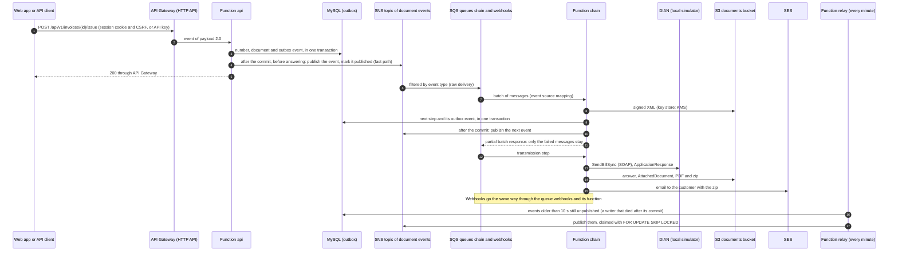

# Infrastructure

The production cloud architecture of the platform, written as code and proven locally. Nothing is deployed to a real AWS account: the AWS services run in a local emulator, [Floci](https://github.com/floci-io/floci) (open source, MIT, no account or token). Infrastructure task 1 brought messaging, storage, data, keys and email; task 2, this page's second half, runs the application as AWS Lambda functions. Task 3 adds the network, the managed database, the edge in front of the API and the web app, and the delivery pipeline; task 4 the observability.

## Two environments

| | Local stack (default) | Emulated cloud |
| --- | --- | --- |
| Start | `make up`, `make demo` | `make cloud-up`, `make cloud-demo` |
| Stop | `make down` | `make cloud-down`; `make cloud-clean` also removes its state |
| Check | `make test`, `make checks` | `make cloud-check` |
| The application | containers that run all the time: `api`, `worker` ×2, `relay` | Lambda functions in the emulator, started per execution environment; nothing of the application runs all the time |
| AWS services | none | Floci on 127.0.0.1:8604 (compose profile `cloud`), with the Docker socket; its web console (functions and their logs, queues, buckets, tables, secrets, keys, the emails SES took, the stacks), with no account, on 127.0.0.1:8605, started the first time `http://localhost:8604/_floci/ui` is opened |
| Configuration | `backend/.env` | the environment of each function, from the serverless service and the SSM parameters of the CDK app; secrets from Secrets Manager |
| Database | MySQL, database `dian_einvoice` | the same MySQL, database `dian_einvoice_cloud` |

Both use the same ports (web app 8601, API 8600, DIAN simulator 8602), so one runs at a time: `make cloud-up` stops the API, workers and relay of the local stack, and `make up` stops the emulator and the proxy of the emulated cloud and removes the containers of its functions. They share the DIAN simulator; `make cloud-demo`, like `make seed`, resets it. In the emulated cloud the port of the API belongs to `cloud-gateway`, a minimal reverse proxy (nginx) in front of API Gateway, which the emulator serves by host name only (`<api id>.execute-api.localhost.floci.io`); in AWS clients call API Gateway, and in task 3 the content delivery network in front of it.

## The CDK app

`infra/cdk`, AWS CDK in TypeScript, run by Node's type stripping in its own container. Two stages: `local`, deployed to the emulator with the normal CDK commands (`cdk bootstrap`, `cdk deploy "local/*"`), and `prod`, synthesized and validated but never deployed (its account is a placeholder, so the CLI refuses real credentials). Synthesis needs no network: `make cdk-check` runs it in a container without one.

| Stack | Resources |
| --- | --- |
| `dian-einvoice-<stage>-messaging` | SNS topic of document events (TLS only, encrypted with the AWS managed key); SQS queues `chain` and `webhooks`, each with its dead-letter queue (14 days), visibility timeout 60 s locally and 360 s in prod, and `maxReceiveCount` 10; one raw subscription per queue, filtered on the `type` attribute with the routes the backend declares (`backend/resources/outbox/routes.json`) |
| `dian-einvoice-<stage>-storage` | Documents bucket: private, SSE-S3 with a bucket key, versioned, TLS only, server access logs; current versions move to Standard-IA at 90 days and Glacier Instant Retrieval at 365 and never expire; old versions expire (30 days locally, 90 in prod). The deployments bucket of the serverless service (its templates and state, 7 days locally, 90 in prod) |
| `dian-einvoice-<stage>-data` | DynamoDB tables `cache`, `sessions` and `limits` in the format of Laravel's store (key `key`, TTL on `expires_at`), on demand |
| `dian-einvoice-<stage>-security` | KMS key of the signing certificates (rotation on), and the secret `dian-einvoice/<stage>/app`, whose `APP_KEY` Secrets Manager generates |
| `dian-einvoice-<stage>-mail` | SES identity: the sender address locally; in prod the domain, with Easy DKIM and a MAIL FROM subdomain |
| `dian-einvoice-<stage>-compute` | One IAM role per function (`dian-einvoice-<stage>-<function>-function`), the role EventBridge Scheduler invokes the scheduled functions with, and the ECR repository of the image of the functions (scan on push, immutable tags in prod, only Lambda pulls, for the functions of the stage) |

Every stack also creates one managed IAM policy per consumer and capability (consume a queue, publish to the topic, read and write the documents, use a table, use the signing key with the encryption context of the key store, read the secret, send email as the platform address, read the queues and their dead letters) and publishes the names, ARNs and policies under `/dian-einvoice/<stage>/<stack>/` in SSM Parameter Store. Names carry the stage; resources carry the tags `project`, `stage` and `managed-by`, and stacks also `component`. cdk-nag (AWS Solutions) runs on every synthesis; its exceptions are acknowledged next to their resources with their reasons, and listed in `infra/cdk/cdk.out/validation-report.json`: per stage the three tables without point-in-time recovery, the objects of the documents bucket, the secret without rotation, and one per role for the log streams of its function, plus, in prod, one per role for the network interfaces of a function in a VPC.

## The functions

`infra/functions`, a serverless service deployed with [osls](https://github.com/oss-serverless/osls) 4.8.1, the free fork of the Serverless Framework (MIT, no account, no telemetry), in a container of its own: the stack `dian-einvoice-<stage>-functions`. The stage local is deployed to the emulator by `make cloud-up`; prod is packaged without a network or credentials and validated by `make cdk-check`.

Every function runs one container image, the target `lambda` of `backend/Dockerfile`: the application with its production dependencies on the official image of [Bref](https://bref.sh) 3 for PHP 8.5 (`bref/php-85:3.0.12`, the minor version of the local image), with the extensions the application requires (the `ext-*` of `backend/composer.json`: the build fails when one is missing) and Bref's Laravel bridge. A function chooses its runtime of Bref (`BREF_RUNTIME`) and its handler (the command of the image):

| Function | Trigger | Mode of Bref | Memory | Timeout | Concurrency | Why |
| --- | --- | --- | --- | --- | --- | --- |
| `api` | API Gateway HTTP API, every route (`$default`), payload 2.0 | `fpm`, `public/index.php` | 1024 MB | 28 s | 40 reserved | The whole HTTP API under `/api/v1`, the CSRF cookie of the web app and the reference at `/docs/api`. Memory buys CPU for short answers and short cold starts (Lambda gives CPU in proportion); below the 30 s API Gateway waits for an integration. 40 environments at once are 40 requests in flight, the biggest share of the connection budget |
| `chain` | SQS queue `chain`: batches of up to 10, no batching window, partial batch response, at most 10 invocations at once | `function`, `App\Support\Outbox\Sqs\SqsEventsHandler` | 1024 MB | 60 s | 10 reserved | Every step of the electronic document chain and the delivery: XML, XAdES signature, transmission to the DIAN, PDF (dompdf) and email. Signing and the PDF want CPU and memory. A job may run 35 s, as in the local workers; 60 s is one such job and the margin, and a batch stops starting jobs it could not finish before the deadline and hands them back |
| `webhooks` | SQS queue `webhooks`: the same, at most 5 at once | `function`, the same handler | 512 MB | 60 s | 5 reserved | Webhook events and their deliveries: HTTP calls of 5 s at most, little CPU |
| `relay` | EventBridge Scheduler, `rate(1 minute)`, input `"outbox:publish-pending"` | `console`, `artisan` | 512 MB | 60 s | 1 reserved | The safety net of the outbox. It publishes for up to 40 s and leaves the rest to the next run. One at a time; a run that fails is not retried (no asynchronous retries, events older than 60 s dropped, no retries of the schedule): the next minute is its retry |
| `scheduler` | EventBridge Scheduler, `rate(1 minute)`, input `"schedule:run"` | `console`, `artisan` | 512 MB | 120 s | 2 reserved | The Laravel scheduler: the sweepers (stalled chains, deliveries and webhooks, expired idempotency keys, the retention pruning once an hour) and a heartbeat. Two at once let a long pruning overlap the next minute; each task runs on one process per minute and never alongside itself (locks of the cache). No retries, as the relay |
| `console` | none: invoked on demand | `console`, `artisan` | 1024 MB | 900 s | 2 reserved | Migrations and operation commands (`make cloud-up` migrates with it, `make cloud-demo` seeds, `make cloud-check` runs its steps, `make cloud-artisan ARGS="..."` runs any other): the event is the command line of `php artisan`. The longest a Lambda function may run |

The roles come from the stack compute (`role: !Sub '${ApiRoleArn}'`), the queues, the topic, the bucket, the tables, the key and the secret from the parameters the CDK app publishes in SSM (`resources/parameters.yml`, parameters of the template whose defaults are those names, which CloudFormation reads when it deploys); the mappings of the queues and the schedules are written as CloudFormation (`resources/triggers.yml`), since osls cannot take an ARN from a parameter or set a retry policy on a schedule. The functions have no IAM of their own. Each one writes its logs to stderr, to its log group `/aws/lambda/<function>` (7 days locally, 365 in prod), and API Gateway its access log to a log group of the service.

### The journey of an invoice

### The outbox without a relay that runs all the time

Every change records its integration events in the outbox table in its own transaction, as in the local stack. Locally the relay process publishes them all the time. The functions have no such process, and a relay function once a minute alone would add up to a minute to every step of the chain, so in the functions (`OUTBOX_PUBLISH_AFTER_COMMIT`):

- **Fast path.** Whoever wrote the events publishes them right after its transaction commits (`DB::afterCommit`), before it answers the request or finishes the job, and marks them published (`App\Support\Outbox\OutboxFastPath`). The events of one transaction go together. A publish that fails loses nothing: the change is committed, the error is reported, and the rows stay unpublished in the outbox.
- **Safety net.** The relay function publishes, once a minute, the events still unpublished that are older than 10 s (`php artisan outbox:publish-pending`): those of a process that died after its commit, or whose publish failed.
- Both claim rows the way every relay does: `FOR UPDATE SKIP LOCKED` in read committed, publish, mark published, commit. A row one holds is skipped by the other, and one already published is not taken again. Delivery stays at least once (a process that dies between the publish and its commit publishes again), and every consumer is idempotent.
- The demo seeder runs the chain of its documents in line, so it publishes nothing after its commits and pauses the relay function and the sweepers in the shared cache until it ends (`App\Support\Outbox\OutboxPause`), as `make seed` stops the local relay.

The local stack keeps its relay process unchanged; the fast path is off there.

### Inside a function

- **Read-only file system but `/tmp`.** Bref's Laravel bridge, registered only inside Lambda, puts the storage of Laravel, the compiled views and the file cache in `/tmp`; dompdf, the heartbeat and the cache of the secrets write there too. The manifests of the packages and of the service providers are written when the image is built. The emulator runs every function as an unprivileged user (`993:990`, as Lambda does) that owns nothing in the image.
- **Secrets once per cold start.** When an execution environment starts, the bridge caches the whole configuration in `/tmp` (`php artisan config:cache`, `BREF_LARAVEL_CACHE_CONFIG`), which reads the secret of the application from Secrets Manager (`App\Support\Secrets\LoadSecrets`); later requests and jobs boot from that cache and read nothing. A rotated secret reaches the environments started after the rotation.
- **Logs to stderr**, where Lambda sends them to CloudWatch Logs; the formatter of Bref starts each line with the id of the request.
- **Nothing after the answer.** AWS freezes an environment as soon as it answers, which the emulator does not reproduce, so nothing may wait for after the answer: the outbox publishes before it, PHP-FPM of Bref has `fastcgi_finish_request` disabled, no scheduled task runs in the background, and `tests/Unit/Support/NothingAfterTheAnswerTest.php` refuses the calls that would leave work for later (after-response dispatches, `defer()`, terminating callbacks, shutdown functions, background processes).
- **The client address.** PHP-FPM receives every request from the Bref runtime (127.0.0.1); the address API Gateway saw is the last one of `X-Forwarded-For`. The functions trust 127.0.0.1 alone (`TRUSTED_PROXIES`), so a client cannot choose its own address for the rate limits, and of the forwarded headers only the address and the scheme count, never the host.
- **The consumers.** The handler of the queues maps each SQS record to the job of task 1 (the same mapping of outbox events and jobs, `SqsEventsQueue::jobFor`) and runs it with Laravel's queue worker, one after another: a job that succeeds deletes its message; one that throws changes the visibility of its message to the wait of its backoff and is reported as failed; an event due later stays invisible until then; a record whose job would not finish before the deadline goes back at once. The retries, the dead-letter queue after `maxReceiveCount` and the idempotency of the handlers are those of task 1. After each batch the function gives its database connection back.

### The budget of database connections

Each execution environment holds at most one connection to the database: PHP-FPM of Bref runs one worker per environment and closes its connection with every request, and the consumers close theirs after each batch. The reserved concurrency of the functions caps the environments at once: 40 (api) + 10 (chain) + 5 (webhooks) + 1 (relay) + 2 (scheduler) + 2 (console) = **60 connections at most**, which a test of the CDK app holds the template of the functions to. The managed database of task 3 must allow these 60 besides its own maintenance (MySQL on a `db.t4g.small` allows about 150); a proxy of connections in front of it (RDS Proxy) would let the API grow beyond them. In AWS, reserved concurrency needs an account limit of concurrent executions above its sum plus the 100 that stay unreserved; new accounts may start lower and need a quota increase.

### The visibility timeout of the queues

Lambda refuses a mapping whose queue hides a message for less than the timeout of its function, and AWS recommends six times that timeout, plus the batching window, so a batch Lambda retries after a throttle is not received twice meanwhile. The consumers have a timeout of 60 s and no batching window: the queues of prod hide a message for 360 s, six times it. Those of the stage local keep the minimum, 60 s, while the emulator gives failed records back late: Floci 2.5.0 holds every record a function reports as failed for the visibility timeout of its queue (docs/limitations.md), so at 360 s each retry and each receive of an unreadable message would wait six minutes, and make cloud-check would no longer take a few minutes. `infra/cdk/test/functions.test.ts` ties the two numbers, read from the CDK app and from the template osls packaged: at least the timeout of the function in both stages, six times it in prod.

### What task 3 publishes for prod

In prod the functions run in the private subnets of the network of task 3 and reach its managed database. The stage prod of the serverless service already reads these SSM parameters (`infra/functions/stages/prod.yml`), and the roles of the stack compute may read the secret of the database; task 3 publishes them:

| Parameter | Value |
| --- | --- |
| `/dian-einvoice/prod/network/private-subnet-ids` | The private subnets of the functions, separated by commas |
| `/dian-einvoice/prod/network/functions-security-group-id` | The security group of the functions, which the database admits |
| `/dian-einvoice/prod/database/host` | The address of the database |
| `/dian-einvoice/prod/database/port` | Its port |
| `/dian-einvoice/prod/database/name` | The database of the application |
| `/dian-einvoice/prod/database/secret-arn` | The secret with its credentials (format of Amazon RDS: `username`, `password`, and `host`, `port`, `dbname` when attached), rotated |

The functions read that secret when each environment starts (`DB_SECRETS_ID`), over the secret of the application.

### Production, validated without deploying

`make cdk-check`, also a job of CI, runs without a network or credentials: osls packages both stages (the image named by a placeholder digest, `@sha256:0…0`, until the pipeline of task 3 builds and pushes it to ECR), the tests of the CDK app assert the template of the functions (every function has a timeout, memory, a concurrency limit and a role of its own from the stack compute; the mappings report failures per item; the scheduled functions retry nothing; every parameter it reads is one the CDK app publishes, or in prod one task 3 will; it holds no IAM), include it in a stack of their own to run the same rules of cdk-nag as the CDK app (one exception: API Gateway does not authorize, the application does), synthesize the CDK app, and cfn-lint 1.60.1 checks every template (one exception, on the template of the functions: a DependsOn osls writes that a reference already implies).

## Decisions

- **A container image, not layers.** The layers of Bref are published from AWS accounts of Bref, which the emulator cannot mount, and an image is the same artifact in the emulator and in AWS: built once, by digest, with the exact PHP and extensions the build checks. It also lifts the limit of 250 MB of a zip with its layers. The cost: an image to keep in ECR, and a slower first cold start of each new image in AWS while Lambda caches it.
- **Fast path with a safety net.** Publishing after the commit keeps the chain as fast as with a relay that runs all the time, without one; the relay function keeps the guarantee of the outbox when a writer dies after its commit. The alternatives were a relay function once a minute alone (up to a minute per step) or a stream of the database (MySQL has none a function can subscribe to without another service).
- **The budget of connections.** Reserved concurrency per function, consistent with the mappings (at most as many invocations at once as the function may run), rather than one limit for the account: a burst of the API cannot take the connections of the chain, and the total fits the database.
- **What goes in the CDK app, what in the serverless service.** Each resource is defined once. Shared and stateful resources (queues, topic, buckets, tables, key, secret, the ECR repository, the deployments bucket) and every IAM role are in the CDK app, which cdk-nag checks; the functions and their triggers (API Gateway and its routes, the mappings, the schedules, the log groups of the functions) are in the serverless service, where osls packages an image function in one step. The service reads what it needs from the SSM parameters of the CDK app when CloudFormation deploys it, so nothing is copied between the two.
- **arm64.** Graviton is cheaper per second. It would take: the images of Bref for arm64 (`bref/arm-php-85`), a build of the image for `linux/arm64` (in CI with QEMU or an arm64 runner), `architecture: arm64` in the serverless service, and the emulator with `FLOCI_SERVICES_LAMBDA_HONOUR_ARCHITECTURES` on a host that runs arm64 containers. This machine and CI are x86_64, so the functions are x86_64.

## Each piece, locally and in AWS

The application reaches AWS only through its ports; `backend/config/adapters.php` and Laravel's own settings choose the adapter.

| Piece | Local stack | AWS (emulated cloud, production) |
| --- | --- | --- |
| HTTP API | `api` (FrankenPHP) | API Gateway HTTP API and the function `api` (PHP-FPM of Bref) |
| Events between the steps of the chain | Outbox relay → Redis queue | The writer after its commit (fast path), and the function `relay` once a minute → SNS topic of document events (`SnsOutboxPublisher`) |
| Jobs of the electronic document chain and the delivery | Redis queue, `worker` ×2 | SQS queue `chain`, the function `chain` (event source mapping, partial batch response) |
| Webhook events and deliveries | the same Redis queue | SQS queue `webhooks`, the function `webhooks` |
| Jobs the application dispatches itself (invitations, password resets) | the same Redis queue | SQS queue `chain` |
| Retries with backoff | delayed Redis jobs | visibility timeout of the message (ChangeMessageVisibility) |
| Retries scheduled for later (transmission, webhooks) | delayed Redis jobs | the message stays invisible in its queue until it is due |
| Dead letters | table `failed_jobs` | dead-letter queue of each queue, by the redrive policy; `failed_jobs` still records the failures |
| Sweepers and pruning | the relay, every half minute | the Laravel scheduler in the function `scheduler`, every minute |
| Migrations and operation commands | `php artisan` in `api` | the function `console` |
| Files of electronic documents | private disk `storage/app/documents` | S3 bucket (`S3DocumentStorage`) |
| Email | SMTP to the local mailbox (Mailpit) | SES, v2 API (the emulator keeps every email, at `/_aws/ses`) |
| Cache | Redis | DynamoDB table `cache` |
| Web sessions | Redis | DynamoDB table `sessions` |
| Rate limits (sign-in, API keys...) | Redis | DynamoDB table `limits` |
| Signing certificates | `key_store_entries`, encrypted with `APP_KEY` | `kms_key_store_entries`: each one encrypted with a data key of its own that the KMS key protects (`KmsKeyStore`) |
| Secrets of the application (`APP_KEY`, database credentials) | `backend/.env` | Secrets Manager, read once per execution environment (`LoadSecrets` and the configuration cache) |
| Names of the resources, for other stacks | — | SSM parameters `/dian-einvoice/<stage>/...` |
| Health checks | database and Redis | database, cache store and queue |
| Database | MySQL in compose | MySQL in compose, its own database (managed database: task 3) |
| DIAN | local simulator | local simulator |

## What the emulator does not do

It does not evaluate IAM policies, resource policies (TLS only, the topic as the only sender of the queues) or key policies, does not apply the encryption key of the topic, the server access logs of the buckets or the storage classes of the lifecycle rules, delivers no email, does not freeze a function after it answers, runs at most one invocation at a time per mapping of a queue, and (release 2.5.0) gives back a record a function reported as failed after the visibility timeout of its queue rather than after the wait the function set. Those parts are checked on the synthesized and packaged templates (the tests of the CDK app, cdk-nag and cfn-lint) only. The details are in [limitations.md](limitations.md).
