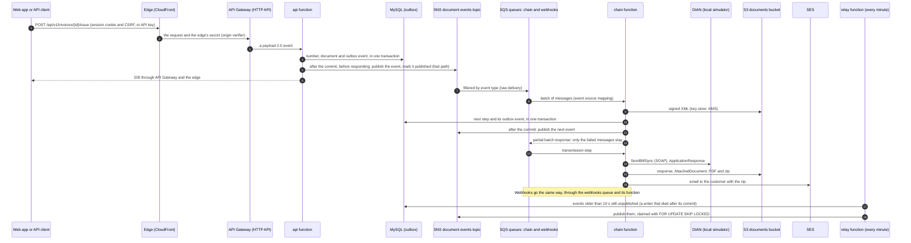
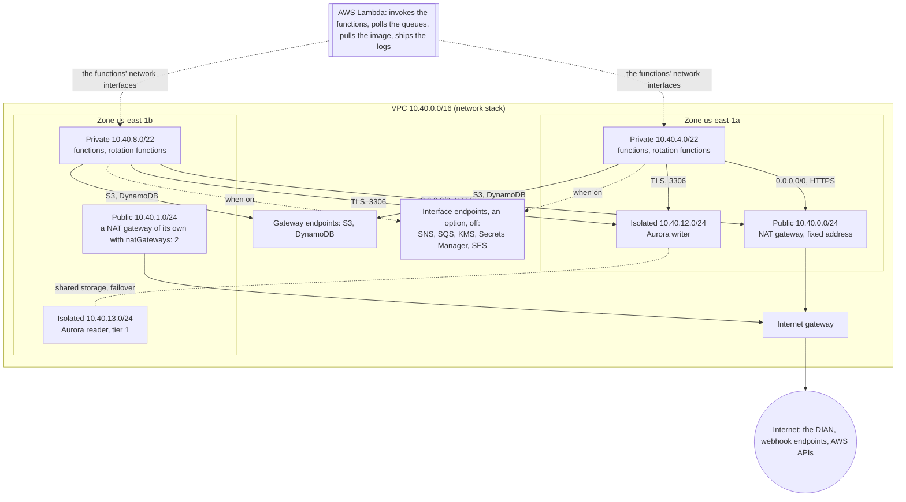
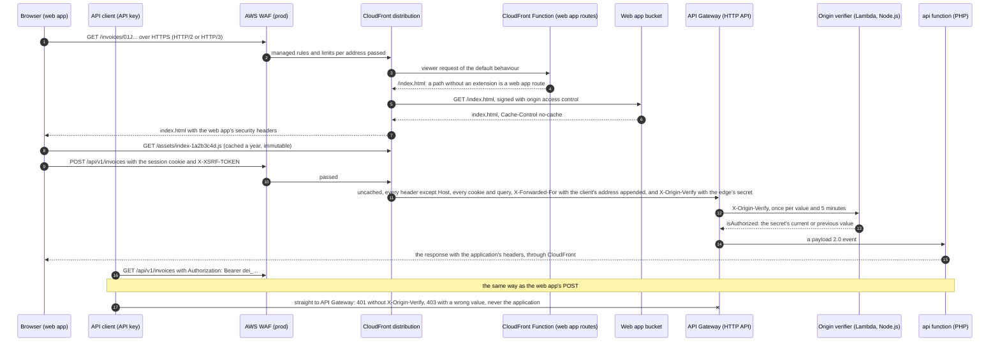

# Infrastructure

This page describes the platform's production cloud architecture, written as code and proven locally. Nothing is deployed to a real AWS account. The AWS services run in a local emulator, [Floci](https://github.com/floci-io/floci) (open source, MIT, no account or token).

The architecture covers:

- **Messaging, storage, data, keys and email.**
- **The application, as AWS Lambda functions.**
- **A private network and a managed database for prod** (Aurora MySQL Serverless v2). They exist only in the prod stage and are validated offline. They are never deployed, not even to the emulator. In both stages, access to the database is split between two identities.
- **The edge in front of the web app and the API**: one CloudFront distribution under one domain, its security headers, a firewall in prod, and an origin verifier. The API responds only to requests that came through the edge.
- **Observability** ([observability.md](observability.md)): structured logs in which one id follows each invoice from end to end, application and AWS metrics, alarms, a dashboard and an alarm notifier.
- **Operation and delivery**: a runbook for every alarm, and an incident drill that runs end to end in the emulated cloud. The deployment to a real account is written as code, with its guide ([deployment.md](deployment.md)), and has never been run.

## How it fits together

The code defines every resource once:

- The CDK app (`infra/cdk`) holds the shared and stateful resources, and every IAM role.
- The serverless service (`infra/functions`) holds the functions and their triggers. It reads the names the CDK app publishes in SSM.

One script deploys a stage (`scripts/deploy.sh`). `make cloud-up` runs it against the local emulator, and the deployment workflow would run it against an account.

The application reaches AWS only through its adapters, which configuration chooses. It writes one JSON line per event. The metrics and the alarms come from those lines, and each alarm names the runbook that handles it.

| To learn about | Read |
| --- | --- |
| The two environments, the stacks, the functions, the network, the database, the edge | this page |
| The log lines, the correlation id, the metrics, the alarms, the notifier, the dashboard, the service objectives | [observability.md](observability.md) |
| What to do when an alarm goes off, how to rotate a secret, how to handle a customer's report | [runbooks](runbooks/README.md) |
| How an incident is rehearsed, and what one run showed | `make cloud-drill`, [drill-report.md](runbooks/drill-report.md) |
| Deploying to a real account: what it needs, the first deployment, routine deployments, rolling back, tearing down | [deployment.md](deployment.md) |
| What the emulator does not reproduce, what was never verified, what is not built | [limitations.md](limitations.md) |
| The assets, trust boundaries, threats and mitigations | [threat-model.md](threat-model.md) |

## Two environments

| | Local stack (default) | Emulated cloud |
| --- | --- | --- |
| Start | `make up`, `make demo` | `make cloud-up`, `make cloud-demo` |
| Stop | `make down` | `make cloud-down`; `make cloud-clean` also removes its state |
| Check | `make test`, `make checks`, `make e2e` | `make cloud-check`, `make cloud-e2e`, `make cloud-alarm-check` (a real alarm evaluation, [observability.md](observability.md)), `make cloud-drill` (an incident drill, [runbooks](runbooks/README.md)) |
| Deploy | `make up` | `make cloud-up`, through `scripts/deploy.sh`, the script for every stage ([deployment.md](deployment.md)); `make cloud-deploy STEP=<step>` runs one step |
| Logs | Laravel's line format, in each container's output | one JSON object per line in the platform's log schema, in one log group per function; `make cloud-follow ID=<correlation-id>` prints a journey |
| The application | containers that run all the time: `api`, `worker` ×2, `relay` | Lambda functions in the emulator, started per execution environment; no part of the application runs all the time |
| The web app | Vite's development server (`web`), which forwards `/api` and `/sanctum` to the API | the production build, in the edge's bucket, served by the emulator's CloudFront distribution, with the API on the same origin |
| AWS services | none | Floci on 127.0.0.1:8604 (Compose profile `cloud`), with the Docker socket. Its web console needs no account and runs on 127.0.0.1:8605. It starts the first time you open `http://localhost:8604/_floci/ui`. It shows the functions and their logs, queues, buckets, tables, secrets, keys, the emails SES accepted, and the stacks |
| Configuration | `backend/.env` | each function's environment, from the serverless service and the CDK app's SSM parameters; secrets from Secrets Manager |
| Database | MySQL, database `dian_einvoice`, one user | the same MySQL, database `dian_einvoice_cloud`, with its two identities, each with its own secret: migrations (the console function) and application (every other function) |

Both environments use the same ports (web app 8601, API 8600, DIAN simulator 8602), so only one runs at a time:

- `make cloud-up` stops the local stack's API, workers, relay and web app development server.
- `make up` stops the emulator and the emulated cloud's proxy, and removes the emulated cloud's function containers.

One DIAN simulator serves both environments, and keeps each one's records apart: taxpayers, processed documents, failure modes, the activity log and the webhook receiver.

- The local stack uses the simulator's root paths (`http://simulator:8602/...`). The emulated cloud uses the same paths under `/cloud` (`http://simulator:8602/cloud/...`).
- So switching between `make up` and `make cloud-up` never makes the simulator reject a new document with rule 90, and needs no reload of the demo data.
- `make seed` clears only the local stack's records in the simulator, and `make cloud-demo` only the cloud's. `make clean` removes the simulator's volume, and so clears both.
- Even so, `make cloud-e2e` first checks (`cloud:check demo`) that the cloud's records hold no document of the demo companies under a number the cloud's database has not issued yet. This guard stops at once and says to run `make cloud-demo`.

In the emulated cloud, both ports belong to `cloud-gateway`, a minimal reverse proxy (nginx) in front of the CloudFront distribution. The emulator serves the distribution by host name only (`<id>.cloudfront.localhost.floci.io`). Port 8601 serves the web app and the API on one origin, as in production. Port 8600 serves the same edge, so the API's address keeps responding. In AWS, the platform's domain points at the distribution (see [The edge](#the-edge)).

## The CDK app

The CDK app lives in `infra/cdk`. It is AWS CDK in TypeScript, run by Node's type stripping in its own container. It has two stages:

- `local` is deployed to the emulator with the usual CDK commands (`cdk bootstrap`, `cdk deploy`). Every stack except for the edge goes first. The edge follows, after the functions it fronts.
- `prod` is synthesized and validated, but never deployed. Its account is a placeholder, so the CLI refuses real credentials. The exception is a deployment that passes the account as a parameter (`-c account=<12 digits>`), as `scripts/deploy.sh prod` does ([deployment.md](deployment.md)).

Synthesis needs no network: `make cdk-check` runs it in a container without one.

The network and database stacks exist in prod only. The emulator could not give meaningful evidence for a VPC, its routes and security groups, or a managed database. So these stacks are checked on what synthesis produces (assertions, cdk-nag, cfn-lint and CDK's schema validation), and never deployed. The same goes for the delivery stack, which holds the deployment pipeline's roles for a real account.

| Stack | Resources |
| --- | --- |
| `dian-einvoice-<stage>-messaging` | The SNS topic of document events: TLS only, encrypted with the AWS managed key. The SQS queues `chain` and `webhooks`, each with a dead-letter queue (14 days), a visibility timeout of 60 s locally and 360 s in prod, and a `maxReceiveCount` of 10. One raw subscription per queue, filtered on the `type` attribute with the routes the backend declares (`backend/resources/outbox/routes.json`). |
| `dian-einvoice-<stage>-storage` | The documents bucket: private, SSE-S3 with a bucket key, versioned, TLS only, with server access logs. Current versions move to Standard-IA at 90 days and to Glacier Instant Retrieval at 365, and never expire. Old versions expire after 30 days locally and 90 in prod. The serverless service's deployments bucket, for its templates and state (7 days locally, 90 in prod). |
| `dian-einvoice-<stage>-data` | The DynamoDB tables `cache`, `sessions` and `limits`, in the format of Laravel's DynamoDB store (key `key`, TTL on `expires_at`), with on-demand capacity. |
| `dian-einvoice-<stage>-security` | The KMS key for the signing certificates, with rotation on. The secret `dian-einvoice/<stage>/app`, which holds only `APP_KEY`, generated by Secrets Manager. The edge secret `dian-einvoice/<stage>/edge/origin-verify`: 64 letters and digits that Secrets Manager generates (see [The origin verifier](#the-origin-verifier)). In the local stage, which has no managed database, this stack also holds the two database identities' secrets ([below](#the-two-database-identities)); prod keeps them in the database stack. |
| `dian-einvoice-<stage>-mail` | The SES identity: the sender address locally; in prod, the domain, with Easy DKIM and a MAIL FROM subdomain. |
| `dian-einvoice-<stage>-alerts` | Where the alarms go. It is deployed before the functions, because the notifier subscribes to it. It holds the alarm topic and the fallback topic, both encrypted with their own KMS key, which the account's CloudWatch may use. It also holds the fallback topic's email subscription (a deployment parameter), the notifier's dead-letter queue, and the secret with the chat webhook's address ([observability.md](observability.md)). |
| `dian-einvoice-<stage>-compute` | The IAM roles: one per function, plus one each for the origin verifier, the notifier and EventBridge Scheduler (below the table). The ECR repository for the functions' image: scan on push, a lifecycle that keeps the recent images, and pulls by Lambda only, for the stage's functions. In prod, also immutable tags and encryption with ECR's AWS managed key. |
| `dian-einvoice-<stage>-edge` | The CloudFront distribution in front of the web app and the API. The web app's bucket: private, versioned, read only by the distribution. The distribution's CloudFront Function, cache policy and response headers policy, and its access log bucket. In prod, also its domain and certificate, its AWS WAF web ACL, and the logs of what the firewall blocks (see [The edge](#the-edge)). Deployed after the functions, whose HTTP API it fronts. |
| `dian-einvoice-<stage>-observability` | The application metrics, as metric filters over the functions' structured logs. The alarms with their runbooks; in prod, also the composite alarm for a degraded service. The operations dashboard and the saved Logs Insights queries ([observability.md](observability.md)). Deployed last, after the functions and the edge, because it reads their log groups, HTTP API and distribution. |
| `dian-einvoice-prod-network` (prod only) | A VPC across two zones, with public, private and isolated subnets. One NAT gateway with a fixed address (one per zone, as an option). Gateway endpoints for S3 and DynamoDB and, as an option, interface endpoints for the adapters' other AWS services. The functions' security group, the default security group without rules, and flow logs (below). |
| `dian-einvoice-prod-database` (prod only) | Aurora MySQL Serverless v2, compatible with MySQL 8.4, with its KMS key, parameters, log groups and security groups. The two identities' secrets, with the AWS rotation functions. RDS Proxy, as an option (below). |
| `dian-einvoice-prod-delivery` (prod only) | The deployment pipeline for a real account: the GitHub Actions OpenID Connect provider (or the account's existing one); the deploy role, which the workflow assumes only from this repository's `production` environment; and the role CloudFormation uses to deploy the functions stack ([deployment.md](deployment.md)). An administrator deploys it once; the pipeline never does. It is validated offline and never deployed. |

The compute stack's roles:

- one per function (`dian-einvoice-<stage>-<function>-function`), which may read its database identity's secret (the console function may read both);
- the origin verifier's role, which may only read the edge secret;
- the notifier's role, which may only read the chat webhook secret and send to its dead-letter queue;
- the role EventBridge Scheduler uses to invoke the scheduled functions.

Every stack also creates one managed IAM policy per consumer and capability:

- consume a queue;
- publish to the topic;
- read and write the documents;
- use a table;
- use the signing key with the key store's encryption context;
- read the secret;
- send email as the platform address;
- read the queues and their dead letters.

Each stack publishes its names, ARNs and policies in SSM Parameter Store, under `/dian-einvoice/<stage>/<stack>/`. Names carry the stage. Resources carry the tags `project`, `stage` and `managed-by`, and stacks also carry `component`.

cdk-nag (AWS Solutions) runs on every synthesis. Its exceptions are acknowledged next to their resources, with their reasons, and listed in `infra/cdk/cdk.out/validation-report.json`:

- **In each stage:**
  - the three tables without point-in-time recovery;
  - the documents bucket's objects;
  - the `APP_KEY` secret, which does not rotate;
  - the edge secret, rotated by its procedure rather than by a rotation function;
  - the chat webhook secret, whose address the chat service issues;
  - the notifier's dead-letter queue, which is itself a dead-letter queue;
  - one per role, for its function's log streams (the origin verifier and the notifier included);
  - the distribution, which has no geographic restriction.
- **In prod, also:**
  - one per role, for the network interfaces of a function in a VPC;
  - three on the database: IAM authentication, the default port, Backtrack;
  - one per resource with a wildcard in the delivery stack's two roles. Each gives the reason it cannot be narrower (`lib/delivery-stack.ts`): an action that takes no ARN, or a name that CloudFormation or a service completes with its own id.
- **Locally, also:**
  - the two identities' secrets, which no AWS rotation function can rotate in the emulator;
  - on the distribution, CloudFront's default certificate (no domain of its own) and no web ACL (the emulator applies no AWS WAF).

The reasons are next to each resource, and in the database and edge sections below.

## The functions

The functions live in `infra/functions`, a serverless service deployed with [osls](https://github.com/oss-serverless/osls) 4.8.1, in its own container. osls is the free fork of the Serverless Framework (MIT, no account, no telemetry). The service deploys as the stack `dian-einvoice-<stage>-functions`. `make cloud-up` deploys the local stage to the emulator. The prod stage is packaged without a network or credentials, and validated by `make cdk-check`.

Every PHP function runs one container image: the `lambda` target of `backend/Dockerfile`. The image holds:

- the application with its production dependencies, on the official [Bref](https://bref.sh) 3 image for PHP 8.5 (`bref/php-85:3.0.12`, the same PHP minor version as the local image);
- the extensions the application requires (the `ext-*` entries of `backend/composer.json`; the build fails when one is missing);
- Bref's Laravel bridge.

A function chooses its Bref runtime (`BREF_RUNTIME`) and its handler (the image's command):

| Function | Trigger | Bref mode | Memory | Timeout | Concurrency | Why |
| --- | --- | --- | --- | --- | --- | --- |
| `api` | API Gateway HTTP API, every route (`$default`), payload 2.0, behind the origin verifier | `fpm`, `public/index.php` | 1024 MB | 28 s | 40 reserved | The whole HTTP API under `/api/v1`, the web app's CSRF cookie and the API reference at `/docs/api`. Memory buys CPU (Lambda allocates CPU in proportion to memory), for fast responses and short cold starts. The timeout stays below the 30 s that API Gateway waits for an integration. 40 environments at once are 40 requests in flight: the biggest share of the connection budget. |
| `chain` | SQS queue `chain`: batches of up to 10, no batching window, partial batch response, at most 10 invocations at once | `function`, `App\Support\Outbox\Sqs\SqsEventsHandler` | 1024 MB | 60 s | 10 reserved | Every step of the electronic document chain and the delivery: XML, XAdES signature, transmission to the DIAN, PDF (dompdf) and email. Signing and the PDF need CPU and memory. A job may run 35 s, as in the local workers, and 60 s fits one such job plus a margin. A batch stops starting jobs it could not finish before the deadline, and hands them back. |
| `webhooks` | SQS queue `webhooks`: the same, at most 5 at once | `function`, the same handler | 512 MB | 60 s | 5 reserved | Webhook events and their deliveries: HTTP calls of 5 s at most, with little CPU. |
| `relay` | EventBridge Scheduler, `rate(1 minute)`, input `"outbox:publish-pending"` | `function`, `App\Support\Lambda\ArtisanHandler` | 512 MB | 60 s | 1 reserved | The outbox's safety net. It publishes for up to 40 s and leaves the rest to the next run. One run at a time. A failed run is not retried (no asynchronous retries, events older than 60 s dropped, no schedule retries): the next minute is its retry. |
| `scheduler` | EventBridge Scheduler, `rate(1 minute)`, input `"schedule:run"` | `function`, the same handler | 512 MB | 120 s | 2 reserved | The Laravel scheduler: the sweepers (stalled chains, deliveries and webhooks, expired idempotency keys, the hourly retention pruning) and a heartbeat. Two at once let a long pruning overlap the next minute. Each task runs in one process per minute, and never alongside itself (cache locks). No retries, like the relay. |
| `console` | none: invoked on demand | `function`, the same handler | 1024 MB | 900 s | 2 reserved | Migrations and operation commands: `make cloud-up` migrates with it, `make cloud-demo` seeds, `make cloud-check` runs its steps, and `make cloud-artisan ARGS="..."` runs any other command. The event is the `php artisan` command line. The timeout is the longest a Lambda function may run. |
| `origin-verifier` | the authorizer of every API Gateway route: a payload 2.0 request authorizer with simple responses, its response cached 5 minutes per `X-Origin-Verify` value | not Bref: Node.js 24, a zip of `origin-verifier/` built from TypeScript | 128 MB | 5 s | 10 reserved | The edge's origin verifier (below): one comparison and, at most every 30 s, one Secrets Manager read. Outside the VPC, with a role that may only read the edge secret; no database. Its cap bounds what a flood of made-up values, sent straight to API Gateway, can run. |
| `notifier` | the alarm topic (alerts stack): an SNS subscription, whose failures go to the notifier's dead-letter queue | not Bref: Node.js 24, a zip of `notifier/` built from TypeScript | 128 MB | 20 s | 2 reserved | Turns each alarm state change into a short message to the chat webhook, whose address is in Secrets Manager ([observability.md](observability.md)). Three attempts of 5 s at most, then two Lambda asynchronous retries, then its dead-letter queue. Outside the VPC; alarms are few. |

Reserved concurrency is a stage parameter (the serverless service's `reservedConcurrency`):

- `reserved` sets the values above, in both stages.
- `unreserved` leaves `ReservedConcurrentExecutions` out of every function. It suits an account whose concurrent-execution quota is below their sum (72) plus the 100 that Lambda keeps unreserved, as a new account's quota may be ([deployment.md](deployment.md)).

Transmissions to the DIAN retry five times in prod (2, 5, 15, 45 and 120 s), and twice in the local stage (2 and 5 s, `dianRetryDelays`). The local stage retries less because the emulator stretches every scheduled retry to its queue's visibility timeout ([limitations.md](limitations.md)).

Where each function's settings come from:

- **Roles** come from the compute stack (`role: !Sub '${ApiRoleArn}'`). The functions have no IAM of their own.
- **The queues, the topics, the bucket, the tables, the key and the secrets** come from the parameters the CDK app publishes in SSM (`resources/parameters.yml`). These are template parameters whose defaults are those names, and CloudFormation reads them when it deploys.
- **The queue mappings, the schedules and the notifier's subscription** are written as CloudFormation (`resources/triggers.yml`). The reason: osls cannot take an ARN from a parameter, or set a retry policy on a schedule.

Each function writes one JSON object per line, in the platform's log schema ([observability.md](observability.md)), to its log group `/aws/lambda/<function>` (7 days locally, 365 in prod). Lambda's system logs are in JSON too. API Gateway writes its access log, one JSON object per request, to a log group of the serverless service.

The relay, the scheduler and the console run php artisan through the application's own handler (`App\Support\Lambda\ArtisanHandler`, on Bref's function runtime). That handler returns a command's output in its response, and logs only JSON. Bref's console runtime would print that output into the log instead.

### The journey of an invoice

### The outbox without a relay that runs all the time

Every change records its integration events in the outbox table, in its own transaction, as in the local stack. Locally, the relay process publishes them all the time. The functions have no such process. A relay function that ran once a minute, on its own, would add up to a minute to every chain step. So the functions work this way (`OUTBOX_PUBLISH_AFTER_COMMIT`):

- **Fast path.** The writer publishes its events right after its transaction commits (`DB::afterCommit`), before it responds to the request or finishes the job. It then marks them published (`App\Support\Outbox\OutboxFastPath`). One transaction's events go together. A failed publish loses nothing: the change is committed, the error is reported, and the rows stay unpublished in the outbox.
- **Safety net.** Once a minute, the relay function publishes the unpublished events older than 10 s (`php artisan outbox:publish-pending`). They belong to a process that died after its commit, or whose publish failed.
- **Claiming rows.** Both claim rows the way every relay does: `FOR UPDATE SKIP LOCKED` in read committed, then publish, mark published and commit. Each skips a row the other holds, and neither takes a row already published. Delivery stays at least once: a process that dies between the publish and its commit publishes again. Every consumer is idempotent.
- **The demo seeder** runs its documents' chain inline, so it publishes nothing after its commits. Until it ends, it pauses the relay function and the sweepers through the shared cache (`App\Support\Outbox\OutboxPause`), as `make seed` stops the local relay.

The local stack keeps its relay process, and the fast path is off there.

### Inside a function

- **Read-only file system, except for `/tmp`.** Bref's Laravel bridge, registered only inside Lambda, puts Laravel's storage, the compiled views and the file cache in `/tmp`. dompdf, the heartbeat and the secrets cache write there too. The package and service provider manifests are written when the image is built. The emulator runs every function as an unprivileged user (`993:990`, as Lambda does) that owns nothing in the image.
- **Secrets once per cold start.** When an execution environment starts, the bridge caches the whole configuration in `/tmp` (`php artisan config:cache`, `BREF_LARAVEL_CACHE_CONFIG`). Building that cache reads two secrets from Secrets Manager (`App\Support\Secrets\LoadSecrets`): the application secret, and the secret of the function's database identity. Later requests and jobs boot from that cache and read nothing. A rotated secret reaches the environments started after the rotation. A warm environment reads its identity's secret again only when the database refuses its password (below).
- **Logs to stderr.** Lambda sends them to CloudWatch Logs: one JSON object per line, in the platform's log schema (`App\Support\Observability\JsonLogFormatter`, [observability.md](observability.md)). PHP-FPM logs from warning up, and Bref prints nothing about its initialization (`BREF_LARAVEL_OMIT_INITLOG`), so no line falls outside the schema.
- **Nothing after the response.** AWS freezes an environment as soon as it responds. The emulator does not reproduce this, so no work may wait until after the response:
  - the outbox publishes before the response;
  - Bref's PHP-FPM has `fastcgi_finish_request` disabled;
  - no scheduled task runs in the background;
  - `tests/Unit/Support/NothingAfterTheAnswerTest.php` refuses the calls that would leave work for later (after-response dispatches, `defer()`, terminating callbacks, shutdown functions, background processes).
- **The client address.** PHP-FPM receives every request from the Bref runtime (127.0.0.1), and the functions trust only 127.0.0.1 (`TRUSTED_PROXIES`). So a request's address is the last entry of `X-Forwarded-For`, which behind the edge is not the client's. Before anything counts a request, the application keeps only the entry the edge appended (`App\Http\Middleware\EdgeClientAddress`; see [The application behind the edge](#the-application-behind-the-edge)). That is the last entry, once any entry that API Gateway appended for its peer is dropped.
  - A client cannot choose its own address for the rate limits by sending any header.
  - Without that entry, every such request shares the runtime's address. This makes a limit stricter, never looser.
  - Of the forwarded headers, only the address and the scheme count, never the host. Behind the edge, the application generates every URL from `APP_URL`, the public origin.
- **The consumers.** The queue handler maps each SQS record to its job through `SqsEventsQueue::jobFor`: the SQS queue driver's own mapping of outbox events to jobs, with the same handlers. It runs the jobs one after another with Laravel's queue worker:
  - a job that succeeds deletes its message;
  - a job that throws changes its message's visibility to its backoff wait, and is reported as failed;
  - an event due later stays invisible until then;
  - a record whose job would not finish before the deadline goes back at once.

  The retries, the dead-letter queue after `maxReceiveCount` and the handlers' idempotency belong to the SQS messaging layer, not to the functions. After each batch, the function gives its database connection back.

### The database connection budget

Each execution environment holds at most one database connection. Bref's PHP-FPM runs one worker per environment and closes its connection after every request. The consumers close theirs after each batch.

The functions' reserved concurrency caps how many environments run at once:

40 (api) + 10 (chain) + 5 (webhooks) + 1 (relay) + 2 (scheduler) + 2 (console) = **60 connections at most**

A CDK app test holds the functions' template to that figure. The edge's origin verifier never connects to the database, so it does not count.

Prod's managed database allows 135 connections at its maximum capacity of 4 ACU. `infra/cdk/test/database.test.ts` takes that figure from the table AWS documents. It holds the figure at or above those 60, plus a margin of 20 for the rotation functions and the operators (see [The database](#the-database)). RDS Proxy, an option, would let the API grow beyond them.

In AWS, reserved concurrency needs an account limit of concurrent executions above its sum, plus the 100 that stay unreserved. New accounts may start lower, and then need a quota increase.

### The queue visibility timeout

Lambda refuses a mapping whose queue hides a message for less than its function's timeout. AWS recommends six times that timeout, plus the batching window. That way, a batch that Lambda retries after a throttle is not received twice in the meantime.

- The consumers have a 60 s timeout and no batching window. The prod queues hide a message for 360 s, six times the timeout.
- The local stage's queues keep the minimum, 60 s, because the emulator gives failed records back late. Floci 2.5.0 holds every record a function reports as failed for its queue's visibility timeout ([limitations.md](limitations.md)). At 360 s, each retry and each receive of an unreadable message would wait six minutes. `make cloud-check` would then take far longer than a few minutes.

`infra/cdk/test/functions.test.ts` ties the two numbers together, reading them from the CDK app and from the template osls packaged. The visibility timeout must be at least the function's timeout in both stages, and six times it in prod.

### The dead letters, and moving them back

A message reaches its queue's dead-letter queue in three cases:

- its job threw on every one of its 10 receives (the redrive policy);
- SNS could not deliver it;
- a step gave up for good on its own: a transmission the DIAN never responded to after its retries, or an email the mail server kept refusing.

A step that gives up for good ends its document as failed at that step. Its job also copies its message to the dead-letter queue at once, with the body and attributes it came with. The copy carries its reason in the `dead_letter_reason` attribute (`App\Support\Outbox\Sqs\SqsEventJob`, log event `queue.dead_letter`). The consumers may send to their own dead-letter queue, and to no other. Locally, the same failure stays in `failed_jobs`.

Once the cause is fixed, an operator moves the dead letters back with SQS's native redrive (`StartMessageMoveTask`, `make cloud-redrive`). The destination is the channel's queue, so both kinds go back: the messages the redrive policy moved, and the copies a step left.

A message that comes back for a document still failed at its step, in its run, starts that step again. The web app's **Retry now** action does the same (`ChainStep`, `DeliveryJob`, log event `chain.resumed`): it starts a new run from the step that gave up. When a send may have reached the DIAN, the transmission asks GetStatus first. Any other message for that document does nothing, whether an older attempt or a run a user already retried. So a dead letter moved back twice acts once.

**Retry now** and the redrive are two ways back from one failure. Whichever comes first recovers the document, and the other does nothing: each checks, under the document's lock, that the document still failed in that run. `tests/Integration/Dian/RecoveryTest.php` holds this, in either order: one more send to the DIAN, one email, and one webhook for each event.

A dead letter keeps its document's journey: its correlation id is in the body and in the attributes. The step it starts again continues under that id. So `make cloud-follow` tells the failure, the dead letter and the recovery as one story (`make cloud-drill` checks it). In the local stack, `queue:retry` moves `failed_jobs` back the same way. The runbook is [runbooks/dead-letters.md](runbooks/dead-letters.md), and `make cloud-drill` rehearses it.

### Production, validated without deploying

`make cdk-check`, also a CI job, runs without a network or credentials:

1. **osls packages both stages.** The image is named by a placeholder digest, `@sha256:0…0`, which the deployment pipeline replaces with the digest it pushed to ECR. The origin verifier and the notifier are built from TypeScript. osls packages prod once more without reserved concurrency, with a separate image for the console function.
2. **The CDK app's tests assert the functions' template:**
   - every function has a timeout, memory, a concurrency limit and its own role from the compute stack;
   - the only route is behind the origin verifier, a Node.js zip outside the VPC;
   - the mappings report failures per item;
   - the scheduled functions retry nothing;
   - every parameter the template reads is one the CDK app publishes, including the network and database ones in prod;
   - each function has its own database identity and an encrypted connection;
   - the template holds no IAM.
3. **The tests run cdk-nag on that template.** They include it in a stack of its own, to run the same cdk-nag rules as the CDK app. There is one exception per Node.js function. The origin verifier and the notifier run Node.js 24, the newest runtime the emulator runs, while the rule asks for the newest one in AWS.
4. **The tests synthesize the CDK app.**
5. **cfn-lint 1.60.1 checks every template**, with one exception, on the functions' template: a DependsOn that osls writes, which a reference already implies.
6. **actionlint 1.7.7 checks the GitHub Actions workflows**, the deployment workflow included.

The delivery tests (`infra/cdk/test/delivery.test.ts`) hold the image repository to immutable tags, scanning and encryption. They hold the deploy role's trust to exactly one environment of one repository. They hold its permissions to no administrator access, and to no wildcard without its reason.

## Function design decisions

- **A container image, not layers.** Bref publishes its layers from its own AWS accounts, which the emulator cannot mount. An image is the same artifact in the emulator and in AWS: built once, deployed by digest, with the exact PHP and extensions the build checks. It also lifts the 250 MB limit on a zip with its layers. The cost: an image to keep in ECR, and a slower first cold start for each new image in AWS, while Lambda caches it.
- **Fast path with a safety net.** Publishing after the commit keeps the chain as fast as an always-on relay would, without running one. The relay function keeps the outbox's guarantee when a writer dies after its commit. The alternatives were a relay function alone, once a minute (up to a minute per step), or a database stream. MySQL has no stream that a function can subscribe to without another service.
- **The connection budget.** Reserved concurrency per function, consistent with the mappings (at most as many invocations at once as the function may run), rather than one limit for the account. A burst on the API cannot take the chain's connections, and the total fits the database.
- **What goes in the CDK app, and what in the serverless service.** Each resource is defined once.
  - The CDK app, which cdk-nag checks, holds the shared and stateful resources (queues, topic, buckets, tables, key, secret, the ECR repository, the deployments bucket) and every IAM role.
  - The serverless service holds the functions and their triggers (API Gateway and its routes, the mappings, the schedules, the functions' log groups). There, osls packages an image function in one step.
  - The service reads what it needs from the CDK app's SSM parameters when CloudFormation deploys it, so nothing is copied between the two.
- **arm64.** Graviton is cheaper per second. Moving to it would take:
  - Bref's arm64 images (`bref/arm-php-85`);
  - an image build for `linux/arm64` (in CI, with QEMU or an arm64 runner);
  - `architecture: arm64` in the serverless service;
  - the emulator with `FLOCI_SERVICES_LAMBDA_HONOUR_ARCHITECTURES`, on a host that runs arm64 containers.

  This machine and CI are x86_64, so the functions are x86_64.

## The prod network and database

The stacks `dian-einvoice-prod-network` and `dian-einvoice-prod-database` exist only in the prod stage. They are never deployed, not even to the emulator, which could not give meaningful evidence for them. The emulated cloud uses Compose's MySQL and network instead.

They are proven on what synthesis produces: by cdk-nag, cfn-lint, CDK's schema validation, and the tests in `infra/cdk/test/network.test.ts` and `infra/cdk/test/database.test.ts`. The tests check:

- the zones and tiers;
- no route out of the isolated subnets;
- the NAT gateways the stage asks for;
- a path to every AWS service the adapters call;
- the exact rules of every security group;
- the flow logs;
- a database that is not public, is encrypted, is protected against deletion, is backed up, and allows more connections than the functions hold;
- the same stage with every option turned the other way.

- **Public subnets** hold only the NAT gateways, the way out to the internet. Each gateway has an Elastic IP that is kept when the stack is deleted. So a DIAN or customer allow list that names the address outlives the stack (`/dian-einvoice/prod/network/egress-addresses`). Nothing else gets a public address of its own.
- **Private subnets with egress** hold the network interfaces that Lambda creates for the functions and for the secrets' rotation functions. When turned on, RDS Proxy and the interface endpoints live there too. Their route to the internet goes through the NAT gateway; S3 and DynamoDB are reached through their gateway endpoints.
- **Isolated subnets** hold the database. Their route tables have no route at all beyond the VPC: no internet gateway, no NAT gateway, no endpoint.
- **Flow logs** record the whole VPC's accepted and rejected traffic, in the log group `/dian-einvoice/prod/vpc-flow-logs`, kept a year. They write through a role that only this account's flow logs may assume.

### How a function in the VPC reaches each AWS service

The backend lists the AWS services its adapters call (`backend/resources/aws/services.json`). A backend test checks that list against the code (`tests/Unit/Support/AwsServicesTest.php`: the clients each adapter builds, and the mailer). The network gives each service a path, and a CDK app test checks every path and this table. The emulator would not notice a function without a path to a service: there, every function reaches every service.

| Service | Endpoint | Called by | Path from the private subnets |
| --- | --- | --- | --- |
| Amazon DynamoDB | `dynamodb` | The cache, the web sessions and the rate limits (Laravel's DynamoDB store): every function | Gateway endpoint on the private subnets' route tables: free, and it bypasses the NAT gateway |
| Amazon S3 | `s3` | Electronic document files (`S3DocumentStorage`): api, chain, console | Gateway endpoint on the private subnets' route tables: free, and it bypasses the NAT gateway |
| AWS Secrets Manager | `secretsmanager` | The secrets read at each cold start (`LoadSecrets`), and the database connector after a refusal: every function; also the rotation functions and RDS Proxy | NAT gateway, or its interface endpoint when `interfaceEndpoints` is on |
| Amazon SNS | `sns` | The outbox events (`SnsOutboxPublisher`): every function that writes, and the relay | NAT gateway, or its interface endpoint when `interfaceEndpoints` is on |
| Amazon SQS | `sqs` | The jobs the application dispatches to the chain queue, and visibility changes for the messages a consumer fails (`SqsEventsQueue`): api, chain, webhooks, console | NAT gateway, or its interface endpoint when `interfaceEndpoints` is on |
| AWS KMS | `kms` | The signing certificates' key store (`KmsKeyStore`): api, chain, console | NAT gateway, or its interface endpoint when `interfaceEndpoints` is on |
| Amazon SES (API v2) | `email` | Email (Laravel's mailer): chain, console | NAT gateway, or its interface endpoint when `interfaceEndpoints` is on |

Lambda itself needs no path from the VPC. It works from outside the VPC: it invokes the functions, polls the mappings' SQS queues, pulls the image from ECR, and takes the stderr logs to CloudWatch Logs. The functions get their credentials from their environment. The DIAN and the webhook endpoints are on the internet, reached through the NAT gateway.

### Security groups

Every group allows only what it is told to allow. `infra/cdk/test/network.test.ts` holds the stage's rules to exactly these:

| Group | In | Out |
| --- | --- | --- |
| `dian-einvoice-prod-functions` (network stack) | nothing: Lambda invokes the functions from outside the VPC | TCP 443 to anywhere (the DIAN, webhook endpoints and the AWS APIs, through the NAT gateway or the endpoints); TCP 3306 to the database |
| `dian-einvoice-prod-database` (database stack) | TCP 3306 from the functions and from the rotation functions | nothing |
| `dian-einvoice-prod-database-rotation` | nothing | TCP 443 to anywhere (the Secrets Manager API); TCP 3306 to the database |
| `dian-einvoice-prod-database-proxy`, with RDS Proxy | TCP 3306 from the functions, which then reach the database only through it | TCP 3306 to the database; TCP 443 to anywhere (Secrets Manager) |
| `dian-einvoice-prod-endpoints`, with interface endpoints | TCP 443 from the functions, the rotation functions and RDS Proxy | nothing |
| The VPC's default group | nothing (a CDK custom resource removes its rules) | nothing |

In production (the prod stage, where `WEBHOOK_REQUIRE_HTTPS` is on by default), webhooks go out on port 443 only, because the functions' group opens no other port toward the internet. As a result:

- A subscription to a URL with another scheme or port is refused when it is created or changed. The response is a 422 in `application/problem+json`, whose `errors.url` gives the reason.
- A subscription saved earlier is refused again before each attempt.

The local stack and the emulated cloud keep their local webhook receiver, on http and port 8602.

Security groups do not filter DNS to the VPC's resolver, which resolves the endpoint and database names. The rules toward the database are written in the database stack. The network stack is deployed first, so it cannot depend on the database stack.

### The database

The database is Aurora MySQL Serverless v2, version `8.4.mysql_aurora.8.4.8`, compatible with MySQL 8.4 like the MySQL in Compose. It sits in the isolated subnets and is never public. The writer is in the first zone, and a reader in the second.

- **Protection.** The cluster is encrypted with its own KMS key (rotation on) and protected against deletion. When the stack is deleted, the cluster is kept, with its key, its secrets and its log groups.
- **Backups and maintenance.** Backups run every day from 01:00 to 02:00 Colombia time (06:00-07:00 UTC), and are kept 35 days. Maintenance runs on Sundays from 02:30 to 03:30 (07:30-08:30 UTC).
- **Versions.** Minor versions change in code (`engineVersion`), not on their own, so the template and the cluster never disagree.
- **Parameters.** They require TLS 1.2 or 1.3 on every connection (`require_secure_transport`, the 8.4 default, written down). They log queries slower than a second. They audit connections, privilege changes and schema changes, leaving out Aurora's own health checks. The error, slow query and audit logs go to log groups kept a year.
- **Server certificate.** It is signed by `rds-ca-rsa2048-g1`, one of the certificate authorities in the RDS global bundle. The functions' image carries that bundle (`/opt/rds/global-bundle.pem`, pinned by its SHA-256 in `backend/Dockerfile`). The prod functions verify the certificate on every connection (`DB_SSL_CA`, `DB_SSL_VERIFY_SERVER_CERT`, `backend/config/database.php`).

The network and database stacks publish what the functions read, under the names the functions expect:

| Parameter | Value |
| --- | --- |
| `/dian-einvoice/prod/network/private-subnet-ids` | The functions' private subnets, separated by commas (network stack) |
| `/dian-einvoice/prod/network/functions-security-group-id` | The functions' security group, which the database admits (network stack) |
| `/dian-einvoice/prod/network/egress-addresses` | The fixed public addresses for outbound traffic, for DIAN and webhook endpoint allow lists (network stack) |
| `/dian-einvoice/prod/database/host` | The writer's address, or that of RDS Proxy in front of it |
| `/dian-einvoice/prod/database/port` | Its port |
| `/dian-einvoice/prod/database/name` | The application database |
| `/dian-einvoice/prod/database/secret-arn` | The application identity's secret, rotated (both stages) |
| `/dian-einvoice/prod/database/migrations-secret-arn` | The migrations identity's secret, rotated, for the console function only (both stages) |

### The two database identities

In both stages, the application reaches the database as two identities. Each has its secret in Secrets Manager, in the Amazon RDS format: `username`, `password` and `dbname`, plus, in prod, `host`, `port` and `engine` once the secret is attached to the cluster.

| | Migrations identity | Application identity |
| --- | --- | --- |
| Used by | the console function only (migrations and operations) | every other function: api, chain, webhooks, relay, scheduler |
| May | change the application database's schema; create the application identity and grant it its privileges | `SELECT`, `INSERT`, `UPDATE` and `DELETE` on the application database, nothing on its schema, TLS required |
| Secret | `dian-einvoice/<stage>/database/migrations`; the console function reads it, and reads the application identity's secret to provision that identity | `dian-einvoice/<stage>/database/application`; no other role reads the migrations secret |
| In prod | the cluster's master user (`dian_migrations`), rotated as a single user every 30 days | `dian_app` and `dian_app_clone`, rotated with alternating users every 30 days, with the migrations identity as superuser |
| In the emulated cloud | `dian_cloud_migrations`, which `make cloud-up` creates from its secret as the MySQL root user, as Aurora creates its master user | `dian_cloud_app`, which `make cloud-check` rotates twice, the way the rotation function would |

One idempotent command creates the application identity: `php artisan db:application-identity`. The console function runs it with the migrations identity, after the migrations. It works the same on the MySQL in Compose (`make cloud-up`) and in prod:

1. The user of the secret's current version gets its password, TLS and exactly the four privileges.
2. The user of the previous version, still valid until the next rotation, gets the same privileges and keeps its password.
3. The command then connects as the identity, and fails if the identity holds anything more.

The application identity's first rotation waits for its schedule, since the user does not exist before the first migrations.

**Rotation without stopping warm functions.** The rotation functions are AWS's own: the Serverless Application Repository applications `SecretsManagerRDSMySQLRotationSingleUser` and `SecretsManagerRDSMySQLRotationMultiUser`. They run in the private subnets, with their own security group. A function reads its secret once per cold start, so a warm function may hold a password that a rotation has since replaced. Two things keep that from showing:

- **Alternating users** for the application identity. Each rotation sets a new password on the user that is not current, and makes that user current. The credentials a warm function holds keep working until the rotation after next, 30 days later: far longer than an execution environment lives.
- **One more read, once.** Error 1045 means the database refused a connection's credentials. When those credentials come from a secret, the application's MySQL connector (`App\Support\Database\RefreshingMySqlConnector`) reads that secret again, through the Secrets Manager adapter. It keeps the new credentials in `/tmp` for the rest of the execution environment, and retries once. A refusal within 30 s of a read does not read again. Laravel reconnects once by itself on this error, and a password that keeps failing would otherwise read the secret on every connection. This covers two cases:
  - the migrations identity's single-user rotation, whose window between the password change and the secret change lasts seconds;
  - the application identity behind RDS Proxy, which does not support alternating users.

The `APP_KEY` secret does not rotate. It encrypts stored values (the software PINs and technical keys, the webhook secrets), which a rotation would have to re-encrypt first ([limitations.md](limitations.md)).

### Network and database design decisions

- **Two zones.** Two is the fewest that keep the database and the functions running when one zone fails. Aurora needs a subnet group in at least two zones, and the reader lives in a different zone from the writer. A third zone would add subnets and, with one NAT gateway per zone, a third gateway. It would add no third copy of the database: Aurora keeps six copies of the storage across three zones anyway.

  The zones are a stage setting (`network.availabilityZones`), by name; each account maps names to its own zones.
- **One NAT gateway, by default.** The traffic that leaves for the internet is asynchronous and retried. It is the transmission to the DIAN (its retries and the outbox), the webhooks (their retries) and the email (the delivery step). Losing the way out delays that work and loses none of it.
  - One gateway costs about $33 a month ($0.045 an hour), plus $0.045 per GB.
  - One per zone (`natGateways: 2`) doubles the fixed part, to keep the way out when the gateway's zone fails.
  - The AWS APIs without a gateway endpoint also go through it, and some calls to them happen inside a request. [When something fails](#when-something-fails) says what that means when the gateway is lost; the interface endpoints remove that dependency.
- **Gateway endpoints for S3 and DynamoDB; interface endpoints off by default.** The gateway endpoints are free, and keep the busiest services (the documents, the cache, the sessions and the rate limits) off the NAT gateway. An interface endpoint costs about $0.01 an hour in each zone, plus $0.01 per GB. The five other services in two zones come to about $73 a month. That is more than the NAT gateway, which the DIAN and the webhooks need anyway. Turn them on (`interfaceEndpoints: true`) when:
  - the AWS traffic through the NAT gateway costs more than they do;
  - new execution environments must start, and certificates must be uploaded, while the NAT gateway is lost;
  - a rule asks that calls to AWS never leave the AWS network.
- **Capacity: 0.5 to 4 ACU.**
  - The minimum is the lowest that keeps the instance running. Zero would let it pause after 5 minutes without connections. But the relay and scheduler functions connect every minute, so it would never pause. And resuming takes about 15 s (30 s or more after a day), half of the API's 28 s.
  - The maximum sets `max_connections`, from the table AWS documents (1 ACU: 90; 4 ACU: 135; 8 ACU: 1,000). 135 connections cover the functions' 60 plus a margin of 20, and a test ties the three figures together.
  - The next step, 8 ACU, would give 1,000. `max_connections` is static, so a change to the maximum takes effect after the instances reboot.
  - At $0.12 per ACU-hour (Aurora Standard, us-east-1), the minimum costs about $44 a month per instance. An hour at 4 ACU costs about $0.48.
- **A reader in the other zone, on by default.** Without a reader, a new instance replaces a failed writer. AWS says that typically takes less than 10 minutes, and may not succeed while the zone is impaired. The API and the chain would stop in the meantime.

  With a reader in promotion tier 1, which scales with the writer, a failover promotes a warm instance of the same size, typically within 30 seconds. The reader doubles the instance cost (about $44 a month more at the minimum). An invoicing platform that SMEs depend on to sell is worth that; a smaller deployment turns it off (`reader: false`). The application does not read from it.
- **RDS Proxy off, as an option (`proxy: true`).** The functions need 60 connections and the database offers 135, so there is nothing to pool yet.

  The proxy is billed for at least 8 ACU, whatever the database uses: about $0.015 per ACU-hour in us-east-1, or about $88 a month. That is as much as both database instances at their minimum. It keeps connections open, so the instances never pause (moot here). It does not support the alternating users strategy: behind it, the application identity rotates as a single user, and the connector covers the seconds of the change. Turn it on:
  - when the functions' reserved concurrency must outgrow `max_connections` (an API of more than about 95 environments at 4 ACU);
  - when bursts of new connections at scale-out show up as too-many-connections errors;
  - to shorten failovers for the functions, since it moves their connections to the new writer.
- **Passwords, not IAM authentication.** Each identity authenticates with a password in its secret, rotated by AWS. IAM authentication would replace those passwords, not add to them: an Aurora MySQL user set up for IAM cannot use a password. It would need a token for every connection the functions open, one per request. And AWS asks for 300 to 1000 MiB of extra instance memory for it, most of the minimum capacity's 1 GiB. cdk-nag rule RDS6 is acknowledged with this reason.
- **The default port, 3306.** The port is not a secret: the functions read it from their environment. Only the security groups of the functions, RDS Proxy and the rotation functions reach it, in isolated subnets without a route out. Another port would hide nothing from what can reach it, and would break parity with the MySQL in Compose. cdk-nag rule RDS11 is acknowledged.
- **35 days of backups, no Backtrack.** A logical error, such as a migration or a bug that rewrites rows, may be noticed weeks later. That can happen at a company's monthly close: of its books, or of its VAT and withholding returns. 35 days, the most Aurora keeps, cover a whole month and its close. Backup storage up to the cluster's size costs nothing.

  Backtrack rewinds the whole cluster, every company at once. Undoing one company's mistake would undo the invoices the others have issued since, already accepted by the DIAN. Recovery is a point-in-time restore into a new cluster, from which the affected rows are copied back (cdk-nag rule RDS14, acknowledged). The documents themselves are also kept in the documents bucket, which never expires them.
- **Two identities and their rotation**, as above:
  - The migrations identity is the master user, because the only user Aurora creates is the one that can create the others.
  - The application identity holds data privileges only, so a flaw in a function cannot change the schema or the privileges.
  - 30 days between rotations is far longer than an execution environment lives, and well inside what the cdk-nag rules ask.

### When something fails

| What fails | What happens | How it recovers |
| --- | --- | --- |
| A zone | Lambda starts new environments in the other zone's private subnet. If the database writer was in the failed zone, Aurora promotes the reader (next row). If the NAT gateway was there too, the functions in the other zone lose the way out (see the way out to the internet, below). By default, the only gateway is in the first zone. With `natGateways: 2`, they keep their own. | By itself, when the zone returns. Lambda uses both subnets again, and Aurora replaces the lost instance as a reader. |
| The database writer, failed over to the reader | The cluster endpoint moves to the promoted reader, typically within 30 seconds. The connections open at that moment drop: those requests return an error, and those jobs fail and go back to their queue. | The functions open a new connection for every request and every batch, so the next ones reach the new writer. Laravel reconnects once when it finds a connection lost. The failed jobs run again after their backoff, and every handler is idempotent. Aurora recreates the lost instance as the new reader. |
| The way out to the internet (the NAT gateway, or the zone it lives in) | The DIAN, the webhook endpoints and SES are unreachable: transmissions, webhooks and emails fail and wait for their retries. The outbox events stay unpublished in their table (SNS is unreachable), so the chain pauses after its current step. S3, DynamoDB and the database keep working. Without interface endpoints, more fails (see below the table). | By itself, when the way out returns. The relay function publishes the events left behind within a minute, the DIAN and webhook retries run, and SQS gives back the failed jobs. Nothing is lost: every pending step is an outbox row or a queue message. The interface endpoints keep the AWS APIs reachable in the meantime. |
| A secret rotation, with warm functions | Nothing visible. Warm functions keep the application identity's old credentials until the rotation after next. When the database refuses a password, the connector reads the secret again and retries once. | By itself. Secrets Manager retries a failed rotation in its next window; the old credentials keep working in the meantime. |
| Secrets Manager, unreachable | New execution environments cannot start. Warm ones keep serving with what they read. The rotation functions fail, and retry in their next window. | By itself, when it returns. |

Without interface endpoints, losing the way out to the internet also means:

- new execution environments cannot read their secrets and fail to start, while warm ones keep serving;
- uploading a certificate (KMS) and sending an invitation or a password reset (SQS) return an error;
- a failed job goes back to its queue after the visibility timeout, instead of after its backoff.

## The edge

One CloudFront distribution (stack `dian-einvoice-<stage>-edge`) serves the web app and the API under one domain:

- the web app's build, from a private bucket;
- the API's paths, from the functions' API Gateway HTTP API, which responds only to requests that came through the distribution (the origin verifier).

Both stages have the edge. The emulator serves its distribution and applies most of its settings (below). Prod adds its own domain, with TLS 1.2 at least, and a firewall.

| Behavior | Origin | Cache | To the origin | Response headers | Function |
| --- | --- | --- | --- | --- | --- |
| `/api/*`, `/sanctum/*`, `/docs/*` (`backend/resources/http/paths.json`) | the functions' API Gateway, over HTTPS with TLS 1.2, with the edge secret in `X-Origin-Verify` | none (managed policy CachingDisabled) | every method; every header except Host, every cookie and query string, and the CloudFront headers (managed policy AllViewerExceptHostHeader); `X-Forwarded-For` with the client's address appended | the application's own, untouched | none |
| `/assets/*` | the bucket, through origin access control | each file's `Cache-Control`: a year, immutable | GET and HEAD, nothing from the request | the web app's security headers | none |
| default (`*`) | the bucket | each file's `Cache-Control`: `no-cache` for `index.html` | GET and HEAD | the web app's security headers | `panel-routes`, viewer request |

- **The web app.** Each stage has a bucket (`dian-einvoice-<stage>-panel-<account>-<region>`). It is private (every public access blocked, objects owned by the bucket), encrypted and TLS only. Its server access logs go to the edge's log bucket. It is versioned: an upload keeps the version it replaced for 7 days locally and 90 in prod.
  - Only the distribution reads it, through origin access control. A bucket policy admits CloudFront for this distribution only (`AWS:SourceArn`), to read and to list, so a missing file returns 404 rather than 403.
  - `infra/functions/scripts/panel.mjs` uploads the Vite build, with each file's type and cache settings. The files under `assets/` carry a hash of their content in their names (the script refuses one that does not), and are cached a year, immutable. `index.html` and every other file get `no-cache`, so a new build shows at once.
  - The fingerprinted files go first and `index.html` last, so no page names a file that is not uploaded yet. Files from earlier builds are removed, except for the fingerprinted ones from the last week, which a tab that is still open may load.
  - In prod, the script then invalidates the files that are not fingerprinted. `panel.mjs rollback` puts back the previous version of each of them, `index.html` included; the fingerprinted files that version names are still in the bucket.
- **The API.** The application's paths (`backend/resources/http/paths.json`) have behaviors of their own, so no API request reaches the bucket. A backend test holds every application route to one of them (`tests/Integration/Security/EdgeTest.php`), except for Scramble's development tools, which the functions turn off. API Gateway responds by its own name, so the viewer's Host stays behind.
- **The web app's routes.** The CloudFront Function `panel-routes` (`infra/cdk/edge/panel-routes.js`, runtime cloudfront-js-2.0) runs only on the default behavior's viewer request. It rewrites a path whose last segment has no extension to `/index.html`, whose router then shows the route. A file keeps its path. The function's cases (`infra/cdk/edge/panel-routes.cases.json`) are tested on the function (`infra/cdk/test/edge.test.ts`). In the emulated cloud, they are also tested on the proxy that stands in for it (`make cloud-check`).
- **Transport.** HTTPS only: the web app redirects plain HTTP, and the API refuses it (a redirect would turn a POST into a GET). HTTP/2 and HTTP/3, IPv4 and IPv6. With its own domain (prod), the edge uses the ACM certificate and the security policy `TLSv1.2_2021`, SNI only. Without one, it uses CloudFront's default certificate. The web app is compressed (gzip and Brotli); the API is not, because its responses are not cached.
- **Logs.** CloudFront's standard access logs record every request, without its cookies, which carry the session. They go to the bucket `dian-einvoice-<stage>-edge-logs-<account>-<region>` (prefix `cloudfront/`), kept 30 days locally and a year in prod. The web app bucket's server access logs go there too (prefix `panel/`).
- **The domain** is a deployment parameter, never a lookup in an account: `cdk deploy -c edgeDomainName=app.example.com -c edgeCertificateArn=arn:aws:acm:us-east-1:...`. CloudFront takes certificates from us-east-1 only. Without these parameters, prod uses the placeholders in `infra/cdk/lib/stage.ts`. With an empty `edgeDomainName`, it uses the name CloudFront gives the distribution. The record that points the domain at the distribution belongs to whoever holds the domain ([limitations.md](limitations.md)). The tests synthesize prod with and without a domain.
- **Price class: all edge locations.** The users are Colombian businesses and their customers. The South American edge locations (Bogotá among them) are only in the class that includes every location. The cheaper classes would serve Colombia from North America, with more latency on every API request and every page. Data transfer costs more per GB in South America than in North America. A web app built once and cached, and responses of a few KB, keep that cost small ([cost.md](cost.md) estimates it).

### The security headers

One file, `backend/resources/http/security-headers.json`, holds every security header the platform sends. A test holds each of its consumers to it:

- The backend sets its own responses' headers from it (`App\Http\Middleware\SecurityHeaders`; `ErrorsAndHeadersTest`).
- The CDK app builds the web app's response headers policy from it (`infra/cdk/lib/edge-stack.ts`; `edge.test.ts`).
- `make cloud-check` reads the headers back through the edge.

The edge adds nothing to the API's responses, so they carry the application's headers, neither duplicated nor contradicted.

| Header | Web app (the edge) | API (the application) |
| --- | --- | --- |
| `Strict-Transport-Security` | `max-age=31536000; includeSubDomains` | the same, in production |
| `X-Content-Type-Options` | `nosniff` | `nosniff` |
| `X-Frame-Options` | `DENY` | `DENY` |
| `Referrer-Policy` | `same-origin` | `no-referrer` |
| `Permissions-Policy` | accelerometer, camera, geolocation, gyroscope, magnetometer, microphone, payment and usb denied | — |
| `Content-Security-Policy` | the policy below | data and problems: `default-src 'none'; frame-ancestors 'none'`; files: `frame-ancestors 'none'`; the API reference: its own policy |

The web app's policy, directive by directive, with the reason for each source beyond its own origin (the file keeps these reasons next to the values):

| Directive | Sources | Why |
| --- | --- | --- |
| `default-src` | `'none'` | Nothing is allowed unless a directive below names it. |
| `script-src` | `'self'` and the hash of the inline script in `index.html` | The scripts are build files. The inline script applies the saved theme before the first paint, so a page in dark mode never flashes white. It is allowed by its hash, which a test computes from `frontend/index.html`, never by `'unsafe-inline'` or `'unsafe-eval'`. |
| `style-src` | `'self'` and four hashes | The styles are build files, or properties set from script, which the policy does not govern. The hashes admit fixed style elements from libraries, by their exact text (below the table). No `'unsafe-inline'`: the charts set their colors as variables on their container, and their hover cards' swatches as classes. |
| `img-src`, `font-src`, `connect-src` | `'self'` | Images, the Inter font and every API call come from the same origin. |
| `frame-src` | `blob:` | An invoice's PDF is shown in a frame, from an object URL for the file the API returned. Only a script from the origin can create one. Chromium's PDF viewer runs in that frame under this policy (`make cloud-e2e`). |
| `object-src`, `base-uri` | `'none'` | No plugins, and no `<base>` to redirect relative URLs. |
| `form-action` | `'self'` | Scripts send the forms. A form that a failed script left to the browser still reaches only this origin. |
| `frame-ancestors` | `'none'` | Never framed, with `X-Frame-Options` for older browsers. |

The four `style-src` hashes admit these style elements:

- the empty one that the charts (Unovis) fill through the CSS object model;
- the ones Reka UI renders with a combobox's and a select's lists (they hide the scrollbar);
- the one VueUse adds for an instant while the theme changes.

What the policy leaves out:

- **No `upgrade-insecure-requests`.** Every URL is relative to an origin that is HTTPS only, with HSTS, so there is nothing to upgrade. The emulated cloud serves plain HTTP on localhost.
- **No `require-trusted-types-for`.** Vue inserts static parts of its templates as markup, and Unovis inserts its hover cards the same way.
- **No reporting endpoint.** `make cloud-e2e` fails on the first violation the browser reports. A violation in production reaches no log ([limitations.md](limitations.md)).

**The API reference** (`/docs/api`, Scramble's page with Stoplight Elements) shares the session's origin behind the edge. So it has its own policy, which the application sets (`App\Support\ApiDocs\SecureApiReference`):

- `script-src` names the exact Stoplight Elements 8.4.2 file on unpkg.com. Both Stoplight Elements files get Subresource Integrity (`sha384`, pinned in the same security headers file), so the browser runs those exact bytes or nothing.
- The page's inline scripts are allowed by the hashes the middleware computes for each response, never by `'unsafe-inline'` or `'unsafe-eval'`. They are Scramble's interceptor, which sends the CSRF token, and the API document, which changes with the API.
- Styles may be inline: Stoplight Elements styles its components at run time, and styles cannot run code.
- `connect-src 'self'` serves Try it.
- `frame-ancestors`, `base-uri` and `object-src` are `'none'`.

The alternative, serving those files from the domain, would need a copy of Scramble's page: a view the backend does not keep.

### The firewall (prod)

An AWS WAF web ACL (scope CloudFront) sits on the distribution. It allows requests by default, and applies these rules:

| Priority | Rule | Action | Why |
| --- | --- | --- | --- |
| 0 | AWS managed: Amazon IP reputation list | block | Addresses AWS has seen in attacks and bot networks. |
| 1 | AWS managed: core rule set | block, except for `SizeRestrictions_BODY` and `NoUserAgent_HEADER`, which count | Common web application exploits. A body over 8 KB is legitimate here: an invoice with many lines, or the signing certificate (up to 100 KB, in a multipart form). The application limits its own bodies. Several HTTP libraries send no User-Agent by default, so blocking that would block an integration. |
| 2 | AWS managed: known bad inputs | block | Payloads known to exploit software (Log4j and the like). |
| 3 | sign-in endpoints, per address | 429 above 100 requests in 5 minutes | `POST` on the sign-in, sign-up, password reset and invitation endpoints (`authentication` in `paths.json`, which a backend test holds to throttled POST routes). A flood of guesses stops at the edge, before it reaches a function. Behind the edge, the application limits them more finely: five failures a minute per email and address. |
| 4 | every request, per address | 429 above 3,000 requests in 5 minutes | A ceiling against floods. It is well above what the application allows an API key (120 a minute), so a platform that integrates several companies from one address fits under it. |

The limits count the address CloudFront sees, which no header changes. Both limit rules return 429 with `Retry-After` and a JSON problem. A request body is inspected up to CloudFront's 16 KB; the rules on the body keep their own handling of larger bodies. A web ACL costs a monthly fee per web ACL and per rule, plus a fee per million requests ([cost.md](cost.md) estimates it). The AWS managed groups used here have no fee of their own.

### The origin verifier

The distribution adds the edge secret, `dian-einvoice/<stage>/edge/origin-verify` (64 letters and digits that Secrets Manager generates), to every request it sends to API Gateway, in `X-Origin-Verify`. CloudFront replaces any header of that name that a viewer sends.

- API Gateway itself returns 401 to a request without the header.
- Otherwise, API Gateway calls the origin verifier, `infra/functions/origin-verifier`, and caches its response for 5 minutes per header value. The verifier is TypeScript on Node.js 24. osls packages it as a zip of its build, apart from the PHP image, and the serverless service defines it with the other functions.
- The verifier compares the value in constant time with the current and the previous versions of the secret. It reduces both sides to their SHA-256 first, and compares them with `timingSafeEqual`.
- It keeps the secret's values in memory for 30 s. When a request brings a value it does not hold, it reads them again sooner, at most every 5 s. When Secrets Manager does not respond, it keeps the values it holds.
- A wrong value gets 403, before the application.

The verifier's role may read that secret and write its logs, and nothing else. It runs outside the VPC and touches no database.

How the value reaches the distribution:

- **In the local stage**, as a deployment parameter (`OriginVerifyValue`, `NoEcho`), which `make cloud-up` reads from the secret and pipes to the CDK CLI. The emulator expands dynamic references to Secrets Manager only in RDS credentials.
- **In prod**, as a dynamic reference that CloudFormation resolves (`{{resolve:secretsmanager:...}}`). The `OriginVerifyVersion` parameter pins it to a version (empty: the current version).

Anyone who may read the distribution's configuration sees the value, because CloudFront keeps custom headers as they are. So permission to read the distribution belongs with the operators.

**Rotating the edge secret without downtime.** The verifier accepts both the current and the previous version, so a rotation goes like this:

1. Put a new value as the current version: `aws secretsmanager put-secret-value --secret-id dian-einvoice/prod/edge/origin-verify --secret-string "$(openssl rand -hex 32)"`. The value it replaces becomes the previous version, which is still accepted. Note the new version's id (`VersionId` in the response).
2. Wait 30 s, the time the verifier keeps the values. The edge takes longer than that to update anyway, and a value the verifier does not hold makes it read the secret again at once.
3. Deploy the edge with that version: `cdk deploy prod/edge --parameters OriginVerifyVersion=<version id>`. CloudFormation resolves the new value, and CloudFront sends it as each edge location takes the new configuration. In the meantime, the other locations still send the previous value, which is valid.
4. Before any other rotation, wait until the distribution is deployed (`aws cloudfront wait distribution-deployed --id <id>`), plus 5 more minutes, the authorizer's cache time. A second rotation drops the first value, so it must not happen while an edge location still sends that value.

A value that a rotation dropped may still pass for up to 5 minutes afterward, the authorizer's cache time, when a request brought it just before.

**mTLS to the origin: not adopted.** Since January 2026, CloudFront can present a client certificate to its origin, API Gateway included. The API would then accept only connections that prove they come from the distribution, with no shared value in a header. mTLS needs:

- the API's own domain (API Gateway checks client certificates on custom domains only, with a trust store in S3);
- a certificate authority and its life cycle: AWS Private CA, which costs a monthly fee per authority, or our own CA, whose certificates are imported into ACM and renewed before they expire.

The emulator cannot exercise any of it. The secret header gives the same guarantee against a client that skips the edge. It rotates without downtime, and runs here end to end. mTLS replaces it when the API has its own domain and the operators have a CA to run.

### The application behind the edge

- **One origin.** The web app and the API share the domain. So the session cookie and Sanctum's `XSRF-TOKEN` cookie are host-only cookies for that origin (`SESSION_DOMAIN` unset), `Secure` in prod, `SameSite=Lax`. Sanctum's stateful domain is that origin (`SANCTUM_STATEFUL_DOMAINS`: `localhost:8601` in the emulated cloud, the domain in prod). The web app sends `Referer` on its own origin (`Referrer-Policy: same-origin`), which Sanctum reads to recognize it.
  - CORS is not offered for the CSRF cookie, which only the web app requests, on its own origin.
  - The API under `/api/v1` keeps responding to any origin without credentials. So a page from another origin can call it with an API key, never with the session.
- **The client address**, for the rate limits, is the entry the edge appended to `X-Forwarded-For`.
  - **What AWS documents.** CloudFront appends the address of the client's connection to the `X-Forwarded-For` it received, whatever the client wrote there. API Gateway appends the edge location's address after it. AWS does not document what CloudFront does with a `CloudFront-Viewer-Address` that a viewer sends, so the application does not read that header.
  - **The rule.** The application finds that entry without counting the entries the hops after the edge append, which only a real account could confirm. It drops the last entry only when it is the peer API Gateway reports for the connection it received: the source address in the event's request context (`requestContext.http.sourceIp`). Bref passes it to PHP-FPM in `LAMBDA_REQUEST_CONTEXT`, a server variable no header can set. The application compares both as normalized addresses (IPv6 in one notation, IPv4 mapped into IPv6 as IPv4), and takes the last entry left.
  - **Why the rule works.** When API Gateway appends its peer's address (the edge location's), that entry goes, and the one before it (CloudFront's) remains. When API Gateway appends nothing, the last entry is already CloudFront's, and it stays, since the client's connection is never the edge location's. Everything before that entry is the client's to write and counts for nothing, even an entry that names the edge location.
  - **When no address can be believed.** Without a peer, without an entry left, or with an entry that is not an address, no forwarded address is believed at all. The request then counts as the runtime, which makes a limit stricter, never looser. An API Gateway that appended an entry other than its peer would also make a limit stricter: every client of an edge location would share one address.
  - **Every stage.** The same rule and the same settings apply in every stage. The emulator's API Gateway appends nothing after its CloudFront, and reports 127.0.0.1 as the peer of every request. No entry that its CloudFront appends is ever that address. So the emulated cloud runs prod's rule as it is, in the case without an API Gateway entry.
  - **Tests.** The backend tests both cases, with and without the API Gateway entry, the addresses a client writes in either header, and an address's different spellings. `make cloud-check` sends a false `X-Forwarded-For`, a false `CloudFront-Viewer-Address`, both, and an `X-Forwarded-For` that ends with the peer the emulator's API Gateway reports. It checks that the sign-in limit counts only the address the edge saw.
- **Generated URLs** use `APP_URL`, the public origin (`App\Http\PublicOrigin`). Behind the edge, the application sees API Gateway's host, which refuses whoever does not come through the edge. Without `APP_URL`, a list's page links and the API reference's servers would lead nowhere.
- **The web app**, in a production build, names the API by its own origin (`frontend/src/config/product.ts`). The local stack's development server keeps the API's address, 8600.

### The edge in the emulated cloud

`make cloud-up` deploys in this order:

1. every CDK app stack except for the edge and observability stacks;
2. the functions, with osls, which publish their HTTP API's id in `/dian-einvoice/local/functions/http-api-id`;
3. the edge stack, with the secret's value as its parameter;
4. the observability stack, alone (its metric filters read the functions' log groups).

It then builds the web app for production (`pnpm build`), and uploads it with `panel.mjs`, the script every stage uses.

Every request then goes through the emulator's distribution: its behaviors, the web app's response headers policy, the edge secret, API Gateway with the origin verifier, and the bucket. The origin verifier's first call in the emulator pulls the image of Lambda's Node.js runtime. Two things the emulator does not do are done next to it:

- **Floci 2.5.0's CloudFormation drops part of each behavior**: the methods it allows and caches, its cache and origin request policies, and its functions. The API would then get no query strings, cookies or writes. `infra/functions/scripts/edge.mjs reconcile` gives the distribution those settings, as the deployed template declares them, through the emulator's CloudFront API. It creates nothing, changes nothing the template does not say, and refuses to run against anything other than the emulator. `make cloud-check` checks that the distribution holds the template.
- **The emulator serves a distribution by its host name, and runs no CloudFront Function.** `cloud-gateway` (nginx, `infra/functions/gateway.conf.template`) gives each request that host name. It rewrites the web app's routes to `/index.html` as the function does, with the same cases. It adds no header of its own, so the distribution sees the client as CloudFront would. Port 8601 serves the web app and the API on one origin; port 8600 serves the same edge.

`make cloud-check` exercises the edge as a browser and a client would (step 3). It checks that:

- API Gateway refuses a call without the secret, and one with a wrong value;
- the API responds through the edge, with the application's headers;
- the web app comes from the bucket, with every header the security headers file names, and its files are cached a year;
- a deep link returns `index.html` (the function's cases);
- an API 404 and an API 401 stay API problems.

In the console function, it also checks:

- the sign-in with the session cookie and CSRF on the web app's origin;
- a 403 that stays an API problem;
- list links that name the public origin;
- that the limits do not count an address the client writes.

`make cloud-e2e` runs in Chromium against 8601, on the production build under its policy. It covers the journey of `make e2e`, the API reference, and a tour of the whole web app (`e2e/tests/tour.spec.ts`). The tour reads every route the router declares from the running app, and loads each one as a deep link with the demo data. It opens each route's main dialogs, menus and lists, the command palette, every theme and a chart's hover card. The test fails on the first policy violation the browser reports, in any frame.

### Edge design decisions

- **A secret header, not mTLS, for the origin**, for the reasons above.
- **A CloudFront Function, not custom error responses, for the web app's routes.** Custom error responses apply to the whole distribution. Returning `index.html` for 403 and 404 would also turn the API's 403 and 404 responses (problems that clients read) into a web app page. The function runs only on the default behavior, on the request, and costs a fraction of a cent per million requests.
- **One distribution for both**, not two domains. The web app needs the API on its own origin, so that the session cookie, CSRF and CORS stay simple. API clients use the same domain.
- **Managed policies for the API** (CachingDisabled, AllViewerExceptHostHeader): the ones AWS documents for API Gateway origins. A policy of our own would only copy them. There is no response headers policy on the API: the application already sets its headers, and two sources would drift.
- **The web app's cache follows each file** (`Cache-Control`, set by the upload), with a minimum of 0. A file without `Cache-Control` is never cached. A `no-cache` file is revalidated on every request (an `ETag` response of a few bytes). The fingerprinted files live a year at the edge and in the browser.
- **Standard (legacy) access logs to S3**, not the newer log delivery. The emulator creates no `AWS::Logs::Delivery` resources, and one definition serves both stages. CloudFront writes these logs with ACLs, so their bucket allows ACLs (owner preferred), which no other bucket in the platform does.
- **Rotation by procedure, not by a rotation function.** The new value must reach the distribution, which CloudFormation owns. A function that rotated the secret and updated the distribution behind CloudFormation's back would make the template lie.

## Each piece, locally and in AWS

The application reaches AWS only through its ports. `backend/config/adapters.php` and Laravel's own settings choose each adapter.

| Piece | Local stack | AWS (emulated cloud, production) |
| --- | --- | --- |
| Web app | Vite's development server, which forwards `/api` and `/sanctum` to the API | the production build in the edge's bucket, served by the CloudFront distribution with its security headers; the API on the same origin |
| Edge | none | the CloudFront distribution (edge stack), with AWS WAF in prod; in the emulated cloud, the `cloud-gateway` proxy in front of it, for the host name and the web app's routes |
| HTTP API | `api` (FrankenPHP) | API Gateway HTTP API behind the origin verifier (the `origin-verifier` function, Node.js), and the `api` function (Bref's PHP-FPM) |
| Events between chain steps | Outbox relay → Redis queue | The writer after its commit (fast path), and the `relay` function once a minute → SNS topic of document events (`SnsOutboxPublisher`) |
| Chain and delivery jobs | Redis queue, `worker` ×2 | SQS queue `chain`, the `chain` function (event source mapping, partial batch response) |
| Webhook events and deliveries | the same Redis queue | SQS queue `webhooks`, the `webhooks` function |
| Jobs the application dispatches itself (invitations, password resets) | the same Redis queue | SQS queue `chain` |
| Retries with backoff | delayed Redis jobs | the message's visibility timeout (ChangeMessageVisibility) |
| Retries scheduled for later (transmission, webhooks) | delayed Redis jobs | the message stays invisible in its queue until it is due |
| Dead letters | table `failed_jobs`; `php artisan queue:retry` moves them back | each queue's dead-letter queue, filled by the redrive policy and by the copy that a step that gives up puts there; `failed_jobs` still records the failures; SQS's native redrive moves them back, and a step that gave up starts again |
| Sweepers and pruning | the relay, every half minute | the Laravel scheduler in the `scheduler` function, every minute |
| Migrations and operation commands | `php artisan` in `api` | the `console` function |
| Electronic document files | private disk `storage/app/documents` | S3 bucket (`S3DocumentStorage`) |
| Email | SMTP to the local mailbox (Mailpit) | SES, v2 API (the emulator keeps every email, at `/_aws/ses`) |
| Cache | Redis | DynamoDB table `cache` |
| Web sessions | Redis | DynamoDB table `sessions` |
| Rate limits (sign-in, API keys...) | Redis | DynamoDB table `limits` |
| Signing certificates | `key_store_entries`, encrypted with `APP_KEY` | `kms_key_store_entries`: each one encrypted with its own data key, which the KMS key protects (`KmsKeyStore`) |
| Application secrets (`APP_KEY`) | `backend/.env` | Secrets Manager, read once per execution environment (`LoadSecrets` and the configuration cache) |
| Edge secret | — | Secrets Manager: the distribution sends it to API Gateway, and the origin verifier checks it |
| Database credentials | `backend/.env`, one user | each function's identity secret in Secrets Manager (migrations for the console, application for the rest), read once per execution environment and again when the database refuses them (`RefreshingMySqlConnector`) |
| Resource names, for other stacks | — | SSM parameters `/dian-einvoice/<stage>/...` |
| Health checks | database and Redis | database, cache store and queue |
| Logs | Laravel's line format, in each container's output | one JSON object per line in the platform's log schema, to one log group per function in CloudWatch Logs, with each journey's correlation id ([observability.md](observability.md)) |
| Metrics, alarms and notifications | none | metric filters over the logs, and AWS's native metrics; alarms to the encrypted alarm topic; the `notifier` function posts them to a chat webhook; one dashboard and saved queries |
| Database | MySQL in Compose | emulated cloud: MySQL in Compose, with its own database and two identities over TLS; prod: Aurora MySQL Serverless v2 in the isolated subnets, TLS with the certificate verified |
| Network | the Compose network | emulated cloud: the Compose network; prod: the network stack's VPC, with the functions in its private subnets |
| DIAN | local simulator | local simulator |

## What the emulator does not do

The emulator does not reproduce everything:

- **Policies and storage.** It does not evaluate IAM policies, resource policies (TLS only, the topic as the queues' only sender) or key policies. It does not apply the topic's encryption key, the buckets' server access logs or the lifecycle rules' storage classes.
- **Email.** It delivers no email.
- **Functions and queues.** It does not freeze a function after it responds, and runs at most one invocation at a time per queue mapping. Release 2.5.0 gives back a record that a function reported as failed after its queue's visibility timeout, rather than after the wait the function set.
- **Rotation, network and database.** It cannot run the AWS rotation functions; `make cloud-check` stands in for them, step by step. It is given neither the prod network nor the prod database, which are never deployed.
- **The edge.** It applies no AWS WAF (prod only), caches and compresses nothing, and runs no CloudFront Function (the proxy in front of it rewrites the web app's routes). It serves plain HTTP whatever the viewer protocol policy says, and writes no access logs. Its CloudFormation drops each behavior's methods, policies and functions, which `make cloud-up` gives back to the distribution from its template.
- **Observability.** It publishes only the SQS metrics and the log filter metrics. It evaluates no metric math alarm, and runs no composite alarm action. It cannot create saved queries through CloudFormation, and drops the metrics of an alarm written as a metric data query; `make cloud-up` gives both back from the template. It draws no dashboard, and writes no Lambda system logs and no API Gateway access logs.

Those parts are checked only on the synthesized and packaged templates (the CDK app's tests, cdk-nag and cfn-lint). The details are in [limitations.md](limitations.md).
