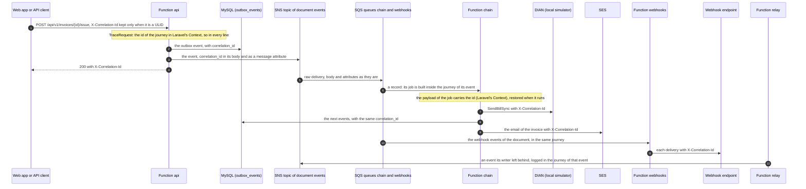

# Observability

How the platform tells what happens to it (Infrastructure task 5): structured logs in which one id follows every invoice from its request to its webhooks, the metrics of the application and of AWS, a few alarms that each say what to do, a notifier that turns them into messages for a chat, one operations dashboard and the saved queries of an operator. Everything is code: the stacks `alerts` and `observability` of the CDK app (`infra/cdk`) and the serverless service of the functions (`infra/functions`). The emulated cloud deploys all of it to the local emulator and `make cloud-check` runs it; what the emulator does not reproduce is in [limitations.md](limitations.md). Nothing is deployed to an AWS account. The runbooks the alarms name are in [runbooks](runbooks/README.md) (Infrastructure task 6), one per alarm, each step with its command for the emulator and for a real account.

## The log line

Every function, PHP and TypeScript, writes one JSON object per line with the same fields, defined once in [`backend/resources/observability/log-schema.json`](../backend/resources/observability/log-schema.json): the formatter of the backend (`App\Support\Observability\JsonLogFormatter`) and the logger of the TypeScript functions (`infra/functions/shared/log.mts`) write it, the metric filters and the saved queries of the CDK app read it, and a test holds each of them to the file. Every field is present on every line, `null` when it does not apply; `error` and `detail` only when there is one.

| Field | Type | What it holds |
| --- | --- | --- |
| `time` | string | The moment of the line, UTC, ISO 8601 with milliseconds: `2026-11-20T15:04:05.123Z` |
| `level` | string | `debug`, `info`, `notice`, `warning`, `error`, `critical`, `alert`, `emergency` |
| `message` | string | What happened, in a sentence, with secrets and personal data masked |
| `function` | string | The function: `api`, `chain`, `webhooks`, `relay`, `scheduler`, `console`, `origin-verifier`, `notifier` |
| `stage` | string | `local`, `prod` |
| `correlation_id` | string or null | The journey the line belongs to (below) |
| `request_id` | string or null | The request or invocation that wrote it: the `X-Request-Id` of a request to the API, the id AWS gives the invocation of any other function |
| `company_id` | string or null | The company the work acts on: an internal id |
| `actor` | string or null | `user:<id>` or `api-key:<id>` in a request, `system` in jobs, scheduled runs and operations |
| `document_id` | string or null | The electronic document the work is about: an internal id |
| `event` | string or null | What kind of line it is (the events below); `null` for a line of the framework or a library |
| `duration_ms` | number or null | How long the work took |
| `outcome` | string or null | `success`, `failure`, `accepted`, `rejected`, `retried`, `skipped` |
| `error` | object | On an error: its `class`, its `message`, masked like the message, and a `trace` cut to its first 8 frames, as `file:line function`, without arguments |
| `detail` | object | A few more values, each one of the keys the schema lists (the route and status of a request, the job and its queue, the operation of the DIAN and its rule, the alarm and its state...); anything else is dropped |

A line of the chain, as CloudWatch Logs keeps it:

```json
{"time":"2026-11-20T21:33:41.209Z","level":"info","message":"SendBillSync to the DIAN ended responded (HTTP 200).","function":"chain","stage":"local","correlation_id":"01m7xe4m4safsymr3wz4vee9w9","request_id":"6c1d2e3f-4a5b-4c6d-8e7f-9a0b1c2d3e4f","company_id":"01m7xe3gkyqapxeqsvrb2phqq0","actor":"system","document_id":"01m7xe4m3zxgrmenf2sgybxhym","event":"dian.call","duration_ms":41.0,"outcome":"success","detail":{"operation":"SendBillSync","status":200,"result":"responded"}}
```

The events:

| Event | Written by | What it tells |
| --- | --- | --- |
| `http.request` | api | A request answered: its route as declared (`api/v1/invoices/{document}/issue`), method, status and time, never its body, query or headers |
| `auth.refused` | api | A sign-in with a wrong password or a request with an API key that is not valid, revoked or expired, never the address or the key |
| `document.issued` | api, console | An invoice, credit note or debit note issued |
| `outbox.published` | every writer | Outbox events a writer published itself after its commit (the fast path) |
| `outbox.relayed` | relay | One event the relay published because its writer did not (the safety net), in the journey of that event |
| `outbox.relay_run` | relay | One run of the relay, every minute: how many it published and the lag of the outbox after it |
| `outbox.swept` | scheduler | A sweeper restarted stalled chains, deliveries or webhooks |
| `chain.resumed` | chain | A step of the chain or of the delivery that gave up came back from the dead-letter queue, moved back by an operator, and started again, as Retry now does |
| `queue.job` | chain, webhooks | A job ran: its class, queue, attempt, time and outcome |
| `queue.dead_letter` | chain, webhooks | A job gave up for good: a copy of its message, with its reason, is in the dead-letter queue of its queue ([runbooks/dead-letters.md](runbooks/dead-letters.md)) |
| `dian.call` | chain | A call to the web service of the DIAN: operation, HTTP status, time, result |
| `dian.response` | chain | The DIAN accepted or rejected a document |
| `dian.rule` | chain | One rule of the DIAN that rejected a document or notified something about it, by its id |
| `delivery.email` | chain | The email of a document, sent or failed, never its address, subject or attachment |
| `webhook.delivery` | webhooks | One delivery attempt of a webhook, never its URL, body or answer |
| `secret.reread` | every PHP function | The database refused the credentials of a warm function, which read its secret again |
| `console.command` | relay, scheduler, console | A command of artisan: its name, never its arguments, its exit code and time |
| `scheduler.task` | scheduler | A task of the Laravel scheduler |
| `runtime.output` | relay, scheduler, console | A line a process printed outside the logger (PHP itself, a rendered exception), as its masked message |
| `edge.refused` | origin-verifier | A request that did not come through the edge, never the value it brought or its address |
| `edge.secret` | origin-verifier | The secret of the edge could not be read |
| `alarm.notification` | notifier | An alarm turned into a message for the chat: sent, skipped or failed |

**No secret and no personal data.** The application logs internal ids only, and never puts a password, key, token, email, identification number or document into a message. The formatter keeps only the fields of the schema and the keys of `detail` it lists, and masks what still looks like one in every text (`App\Support\Observability\Redactor`): PEM keys and certificates, documents in XML, the API keys (`dei_`), webhook secrets (`whsec_`), `APP_KEY`, bearer and JSON web tokens, AWS access keys, values given to a key that names a secret (`password=`, `"token":`), emails, numbers long enough to identify a person or a company, IPv4 addresses, and any long run of letters and digits that is not a UUID. `tests/Integration/Security/SecretsInLogsTest.php` runs the whole flow of the platform (sign-up, a refused sign-in, a certificate, API keys, a webhook, an invoice through the chain, an invitation, a password reset) with every line kept and finds no secret, no email, name or NIT, and no line outside the schema; `make cloud-check` sweeps every line the functions wrote during the check for the values of the secrets of the stage and for emails, keys and tokens.

**Where the lines go.** Each function writes to its own log group, `/aws/lambda/dian-einvoice-<stage>-<function>`, created by the serverless service with its retention (7 days locally, 365 in prod). The system logs of Lambda (the start, end and report of each invocation) are JSON too (`LogFormat: JSON`); API Gateway writes one JSON object per request to `/aws/http-api/dian-einvoice-<stage>-functions` (its route, status, latencies and those of the origin verifier, never its query, headers or the address it came from); in prod, AWS WAF writes the requests it blocked or counted to `aws-waf-logs-dian-einvoice-prod-edge`, without the `Authorization` and `Cookie` headers. The functions of PHP log through the stderr channel of Laravel with the formatter (`LOG_STDERR_FORMATTER`); the functions that run artisan (relay, scheduler, console) run each command through `App\Support\Lambda\ArtisanHandler`, which answers what the command prints instead of logging it, and the tasks of the scheduler run in its process, so nothing reaches the log outside the schema. The local stack (`make up`, `make demo`) keeps the line format of Laravel and none of the lines of requests and jobs: only the functions log JSON.

## The correlation id

A journey begins at its first entry into the system: a request to the API, a scheduled run of the relay or the scheduler, or a command. It gets a correlation id, a ULID in lower case, which every line, outbox event, message, job, call to the DIAN, webhook and email of that journey carries. The API answers it in `X-Correlation-Id`, on errors too, where every `application/problem+json` also carries it as `correlation_id` next to `request_id`; it keeps the one a client sends only when it has that form, and gives a new one otherwise. The API reference (`/docs/api`, `openapi.json`) documents the header on every operation, as one a request may send and one every answer carries, and in the schema of every problem. In the log, `request_id` names the request or the invocation that wrote a line; `correlation_id` names the whole journey across functions.



Locally the relay process dispatches the jobs of each event inside its journey, and the workers restore it as each job starts, the same way. A sweeper that restarts a stalled chain records its new events in its own journey, a scheduled run; the lines of the restarted chain still name the document (`document_id`).

## Metrics

The metrics of the application come from the log lines, through metric filters of the stack observability (namespace `dian-einvoice/<stage>`), one on the log group of each function that writes the event: the application calls no API to publish a metric. A test holds every field a filter reads to the schema, and every filter to a log group the serverless service creates.

| Metric | From | What it tells |
| --- | --- | --- |
| `DocumentsIssued` | `document.issued` (api, console) | The business volume: zero during business hours means the API or the companies cannot issue |
| `DocumentsAccepted` | `dian.response`, outcome `accepted` (chain, console) | What the customers receive; it follows `DocumentsIssued` within minutes |
| `DocumentsRejected` | `dian.response`, outcome `rejected` (chain, console) | A rise means the XML, the CUFE or a rule of the DIAN changed; the saved query of rejections by rule says which |
| `DianCalls` | `dian.call` (chain, console) | Every call to the DIAN: the denominator of its error rate |
| `DianErrors` | `dian.call`, outcome `failure` (chain, console) | Calls without a validation result: the DIAN or the way out is failing |
| `DianLatency` | `dian.call`, its `duration_ms` (chain, console) | Most of the time from issue to acceptance, and the first sign of a DIAN about to fail |
| `ChainStepDuration` | `queue.job` of the queue `chain`, its `duration_ms`, by `Job` (chain) | Where the time of the chain goes (XML, signature, transmission, PDF, email), and a job close to its timeout |
| `WebhookDeliveriesFailed` | `webhook.delivery`, outcome `failure` (webhooks) | One endpoint down is the problem of its company; many at once, the way out of the platform |
| `RelayPublishedEvents` | `outbox.relayed` (relay) | Events the relay had to publish: almost never, or the fast path is failing |
| `RelayRuns` | `outbox.relay_run` (relay) | The heartbeat of the relay, one a minute |
| `OutboxLag` | `outbox.relay_run`, its `detail.lag_seconds` (relay) | The age of the oldest event still unpublished: a chain that does not move although every function runs |
| `SecretRereads` | `secret.reread` (every PHP function) | Once per environment after a rotation is expected; a problem when it keeps happening |
| `AuthenticationFailures` | `auth.refused` (api) | Someone guessing, or an integration with a revoked key |
| `OriginVerifierFailures` | `edge.secret`, outcome `failure` (origin-verifier) | Without the values it holds, every request through the edge would be refused |

The native metrics of AWS cover the rest, on the dashboard and in the alarms: Lambda (invocations, errors, throttles, duration and concurrency of every function), SQS (messages waiting and the age of the oldest in each queue and dead-letter queue), API Gateway (requests, 4xx, 5xx, latency), CloudFront (requests and error rates of the edge), AWS WAF (requests blocked and allowed, prod), Aurora (capacity and connections, prod) and the NAT gateway (bytes to the internet and port allocation errors, prod).

**The embedded metric format, as an alternative.** CloudWatch can also take metrics written into the log lines themselves (the embedded metric format: an `_aws` object with the namespace, the dimensions and the values), with no metric filter. It would let a line carry several metrics and dimensions decided by the code, at the price of a format the emulator does not document and of metrics defined in the application instead of in the infrastructure. The metric filters keep the metrics in the CDK app, next to their alarms, and the emulator evaluates them; a metric that needs more dimensions than a filter takes (three) would be the reason to move.

## Alarms

Few, and each answers what to do when it goes off: its description says what its state means and names the runbook that attends it. Every alarm publishes its changes of state, to `ALARM` and back to `OK`, to the topic `dian-einvoice-<stage>-alarms`, encrypted with a KMS key of its own that only CloudWatch of the account may use; the notifier (below) turns them into messages. Missing data counts as not breaching, but for the relay, whose silence is the alarm.

| Alarm | Condition | Why it matters | Runbook |
| --- | --- | --- | --- |
| `chain-dead-letters` | A message in the dead-letter queue of `chain` (1 minute) | A job of the chain failed every attempt, or SNS could not deliver an event: nothing will retry it | `docs/runbooks/dead-letters.md` |
| `webhooks-dead-letters` | A message in the dead-letter queue of `webhooks` (1 minute) | The same for the webhooks | `docs/runbooks/dead-letters.md` |
| `chain-queue-age` | The oldest message of `chain` older than 10 minutes, for 5 minutes | Longer than any retry of the chain (at most 144 s): its consumer does not take it | `docs/runbooks/queue-backlog.md` |
| `webhooks-queue-age` | The same for `webhooks` | Longer than any retry of a webhook (at most 120 s) | `docs/runbooks/queue-backlog.md` |
| `function-errors` | One or more failed invocations of any function in 5 minutes (metric math over every function) | A crash, a timeout or a scheduled command that exited with an error; partial batch failures and HTTP errors are not counted here | `docs/runbooks/function-errors.md` |
| `function-throttles` | One or more throttled invocations of any function in 5 minutes | Requests answered 429 or 503, or messages that wait, at the reserved concurrency | `docs/runbooks/function-throttles.md` |
| `api-server-errors` | 5 or more 5xx at API Gateway in 5 minutes | Requests of the web app and of the integrations are failing | `docs/runbooks/api-errors.md` |
| `api-latency` | The 99th percentile of API Gateway above 2 s for 15 minutes | Twice the objective of latency | `docs/runbooks/api-latency.md` |
| `relay-not-running` | No run of the relay for 3 minutes (missing data breaches) | Events the fast path leaves behind wait, and their chains stop | `docs/runbooks/outbox-relay.md` |
| `outbox-lag` | An event unpublished for more than 2 minutes, for 2 runs of the relay | The topic refuses them, or the relay cannot keep up | `docs/runbooks/outbox-relay.md` |
| `dian-error-rate` | More than 20% of 5 or more calls to the DIAN in 5 minutes without a result, for 10 minutes (metric math) | The DIAN or the way out to it fails, and the chain waits on its retries | `docs/runbooks/dian-errors.md` |
| `webhook-failures` | 20 or more failed webhook deliveries in 15 minutes | Endpoints of the companies, or the way out of the platform, fail | `docs/runbooks/webhook-failures.md` |
| `origin-verifier-errors` | The origin verifier could not read the secret of the edge (1 minute) | Once the values it holds expire, every request through the edge is refused | `docs/runbooks/origin-verifier.md` |
| `notifier-failures` | A notification in the dead-letter queue of the notifier (1 minute); also to the fallback topic, with an email | The chat misses alarms; this one reaches the operators without the notifier | `docs/runbooks/notifier.md` |
| `database-capacity` (prod) | More than 3.5 of the 4 ACU for 15 minutes | The database is about to stop growing, and `max_connections` is tied to its maximum | `docs/runbooks/database-capacity.md` |
| `database-connections` (prod) | More than 108 connections, 80% of the 135 at the maximum, for 5 minutes | New connections of the functions, the rotation functions and the operators are about to be refused | `docs/runbooks/database-capacity.md` |
| `service-degraded` (prod, composite) | Any of `api-server-errors`, `api-latency`, `chain-dead-letters`, `chain-queue-age`, `dian-error-rate`, `relay-not-running`, `origin-verifier-errors`, `function-errors` | The one to page on: the service is degraded, whatever part of it; the alarms in `ALARM` below it say where | `docs/runbooks/service-degraded.md` |

## The notifier

`infra/functions/notifier`, a function in TypeScript on Node.js 24, defined in the serverless service with the other functions, outside the VPC, with a role of its own that may only read the secret of the chat webhook and send to its own dead-letter queue. It is subscribed to the topic of the alarms; for each notification it writes a short message a chat webhook compatible with Slack takes (`{"text": ...}`): which alarm, its state and the one before, what it means, why (the reason of CloudWatch), its runbook, and when:

```text
:red_circle: *ALARM* dian-einvoice-prod-chain-dead-letters (was OK)
A message reached the dead-letter queue of the chain queue: a job failed every attempt, or SNS could not deliver an event, and nothing will retry it.
Reason: Threshold Crossed: 1 out of the last 1 datapoints [3.0 (20/11/26 20:59:00)] was greater than the threshold (0.0) (minimum 1 datapoint for OK -> ALARM transition).
Runbook: docs/runbooks/dead-letters.md
At 2026-11-20T21:00:12.345+0000 in US East (N. Virginia)
```

- **The address** of the webhook is in the secret `dian-einvoice/<stage>/alerts/chat-webhook` (`{"url": "..."}`), read once every 5 minutes and never logged: whoever holds it posts to the chat. In prod it starts empty and the operators put their address there (`aws secretsmanager put-secret-value`); until then the notifier only logs each alarm. The stage local names the local webhook receiver of the DIAN simulator, which keeps what it takes.
- **Failures**: a post the chat does not take is tried 3 times (waits of 0.25 and 1 s, 5 s each); then the notification goes, as CloudWatch published it, to the dead-letter queue `dian-einvoice-<stage>-notifier-dlq`, whose alarm (`notifier-failures`) also publishes to the fallback topic `dian-einvoice-<stage>-alarms-fallback`, with an email subscription (`operators@dian-einvoice.example`, a parameter of the deployment: `cdk deploy -c alertsEmail=...`). An invocation that fails anyway is retried twice by Lambda and then sent to the same queue (the destination of its failures), as is what SNS cannot hand it (the redrive policy of its subscription).
- **What it does not send**: an alarm that settles to `OK` from `INSUFFICIENT_DATA`, as every new alarm does, is only logged.
- Its tests take notifications of alarms as CloudWatch publishes them (a metric alarm, its way back to `OK`, insufficient data, metric math, a composite alarm, a state forced by hand) and fakes of the chat, Secrets Manager and SQS (`infra/functions/notifier/test`).

## Objectives of service

| Objective | Target, over 30 days | Defended by |
| --- | --- | --- |
| API availability | 99.9% of the requests to the API answered without a 5xx (43 minutes of error budget a month) | `api-server-errors`, `function-errors`, `function-throttles`, `origin-verifier-errors`, `database-connections`, `service-degraded` |
| API latency | 99% of the requests answered within 1 second at API Gateway | `api-latency`, `database-capacity`, `function-throttles`, `service-degraded` |
| Time to the answer of the DIAN | 99% of the documents issued accepted or rejected by the DIAN within 5 minutes of their issue, the minutes the DIAN itself is down aside | `chain-queue-age`, `chain-dead-letters`, `dian-error-rate`, `relay-not-running`, `outbox-lag`, `service-degraded` |

The alarms catch a fast burn of the budget; measuring each objective over its 30 days is a query over the metrics of the dashboard, not an alarm.

## Dashboard and saved queries

One dashboard, `dian-einvoice-<stage>-operations`: the state of every alarm; the requests, errors and latency of the API at API Gateway and of the edge at CloudFront; documents issued, accepted and rejected; the time of each job of the chain; the calls, errors and latency of the DIAN; the queues and their dead-letter queues; the relay and the lag of the outbox; failed webhooks, refused authentications, secrets read again; the invocations, errors, throttles and duration of every function, and the concurrency of each one against its reserved concurrency (the limits the serverless service sets, which a test holds the dashboard to); in prod, the capacity and connections of the database against its maximum, the firewall and the way out.

The saved queries of CloudWatch Logs Insights, under `dian-einvoice/<stage>/`:

| Query | What it finds | In the emulator |
| --- | --- | --- |
| `follow-a-journey` | Every line of one journey, in order, over the functions of the application | Run by `make cloud-check`: written with `fields`, `filter`, `sort` and `limit` only, the commands the emulator evaluates |
| `errors-by-function` | How many lines of error each function wrote, worst first | Saved, not run: it needs `stats` |
| `slow-requests` | The requests to the API that took more than a second, slowest first | Saved, not run |
| `dian-rejections-by-rule` | Which rules of the DIAN reject documents, most frequent first | Saved, not run: it needs `stats` |

## How to follow an invoice

1. Take its correlation id: the `X-Correlation-Id` of the answer that issued it, or, from any line that names the document (`document_id`), its `correlation_id`.
2. In CloudWatch Logs Insights, open the saved query `dian-einvoice/<stage>/follow-a-journey`, put the id in place of `REPLACE-WITH-THE-CORRELATION-ID`, and run it over the time since the issue. The lines come in order: the request to the API (`http.request`, `document.issued`, `outbox.published`), then each job of the chain (`queue.job`) with its call to the DIAN (`dian.call`), the answer (`dian.response`, `dian.rule`), the email (`delivery.email`), and the webhooks (`webhook.delivery`); `outbox.relayed` if the relay had to publish one of its events.
3. In the emulated cloud, `make cloud-follow ID=<correlation-id>` runs the same saved query and prints the lines (`HOURS=24` back by default); `make cloud-check` follows the invoice it issues through the edge and checks that its id appears in api, chain and webhooks.

```text
33 lines of the journey 01m7xg8djzcvdhw6v07ashwf9e in the last 24 hours (saved query dian-einvoice/local/follow-a-journey):
2026-11-20 22:11:59.759  api        document.issued    success   An invoice was issued.
2026-11-20 22:11:59.766  api        http.request       success   POST api/v1/invoices/{document}/issue answered 200.
2026-11-20 22:12:00.539  chain      queue.job          success   GenerateXml succeeded after attempt 1.
2026-11-20 22:12:02.616  chain      dian.call          success   SendBillSync to the DIAN ended responded (HTTP 200).
2026-11-20 22:12:03.536  chain      dian.response      accepted  The DIAN accepted the document.
2026-11-20 22:12:06.579  chain      delivery.email     success   The email of the document was sent.
2026-11-20 22:12:21.644  webhooks   webhook.delivery   success   Webhook delivery attempt 1 succeeded.
```

## In the emulated cloud

`make cloud-up` deploys the stack alerts before the functions and the stack observability after the functions and the edge, alone, then gives the emulator what its CloudFormation drops (`infra/functions/scripts/observability.mjs reconcile`: the metrics of the alarms of metric math and the saved queries), as the reconciliation of the edge does: only against the emulator, idempotent, saying what it applied and when it is no longer needed. Every piece runs there: the log groups and their lines, the metric filters and their metrics, the alarms on single metrics, the topic of the alarms, the notifier and the local receiver of the chat (the webhook receiver of the DIAN simulator, under the company id `0alarmnotifications0000000`).

- `make cloud-check`, step 11: what the templates declare exists (25 metric filters, 14 alarms with their metric, actions and runbook, the dashboard, 4 saved queries, the subscription of the notifier); a state forced on `chain-dead-letters` reaches the chat as the notifier formats it, and back to `OK`; every line the functions wrote during the check is JSON in the schema; the invoice issued through the edge is followed by the id its client got; no log holds a value of a secret of the stage, an email, a key or a token; and `DocumentsIssued` counts the documents issued. The whole check takes about three minutes and a quarter.
- `make cloud-alarms` prints the state of every alarm with its runbook and the last messages the chat took; `make cloud-follow ID=<correlation-id>` the lines of a journey. The web console of the emulator (`http://localhost:8604/_floci/ui`) shows the log groups of the functions and runs queries of Logs Insights.
- `make cloud-drill`, apart too, in about four minutes: the DIAN simulator answers HTTP 500 to every call, the transmissions of the invoices issued meanwhile give up into the dead-letter queue of the chain, the emulator turns `chain-dead-letters` to `ALARM` for real and the chat gets it with its runbook; the commands of that runbook move the dead letters back, every invoice ends accepted and delivered once, and the alarm goes back to `OK`. It prints the time to detect, to notify and to recover, figures of the emulator ([runbooks/drill-report.md](runbooks/drill-report.md)).
- `make cloud-alarm-check`, apart since it takes three to four minutes: the emulator evaluates `chain-dead-letters` for real (a message in its dead-letter queue turns it to `ALARM` within a minute, taking it out back to `OK`, each change in the chat), and a notification the chat refuses (the error mode of the receiver) goes to the dead-letter queue of the notifier, whose alarm `notifier-failures` reaches the chat once it takes messages again.

What stays code only, or runs without data, is in [limitations.md](limitations.md#observability): the native metrics of AWS and their alarms, the evaluation of metric math, the composite alarm, the drawing of the dashboard, the queries with `stats`, the system logs of Lambda, the access logs of API Gateway and the logs of AWS WAF.
