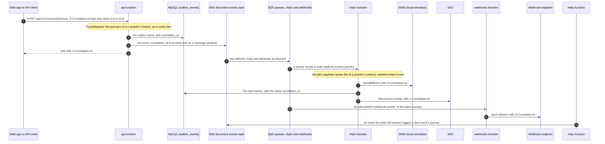

# Observability

This page describes how the platform reports what happens to it:

- structured logs, in which one id follows every invoice from its request to its webhooks
- application and AWS metrics
- a few alarms, each of which says what to do
- a notifier that turns the alarms into chat messages
- one operations dashboard
- saved queries for operators

Everything is code: the CDK app's `alerts` and `observability` stacks (`infra/cdk`) and the functions' serverless service (`infra/functions`). The emulated cloud deploys all of it to the local emulator, and `make cloud-check` runs it. [limitations.md](limitations.md) lists what the emulator does not reproduce. Nothing is deployed to an AWS account.

The runbooks the alarms name are in [runbooks](runbooks/README.md), one per alarm. Each step gives its command for the emulator and for a real account.

## The log line

Every function, in PHP or TypeScript, writes one JSON object per line, with the same fields. [`backend/resources/observability/log-schema.json`](../backend/resources/observability/log-schema.json) defines them once. The backend's formatter (`App\Support\Observability\JsonLogFormatter`) and the TypeScript functions' logger (`infra/functions/shared/log.mts`) write lines in this schema. The CDK app's metric filters and saved queries read them. A test holds each of them to the file.

Every field is present on every line, `null` when it does not apply. The exceptions are `error` and `detail`, which appear only when there is one.

| Field | Type | What it holds |
| --- | --- | --- |
| `time` | string | When the line was written, in UTC, as ISO 8601 with milliseconds: `2026-11-20T15:04:05.123Z` |
| `level` | string | `debug`, `info`, `notice`, `warning`, `error`, `critical`, `alert`, `emergency` |
| `message` | string | What happened, in a sentence, with secrets and personal data masked |
| `function` | string | The function: `api`, `chain`, `webhooks`, `relay`, `scheduler`, `console`, `origin-verifier`, `notifier` |
| `stage` | string | `local`, `prod` |
| `correlation_id` | string or null | The journey the line belongs to (see below) |
| `request_id` | string or null | The request or invocation that wrote the line: an API request's `X-Request-Id`, or the id AWS gives any other function's invocation |
| `company_id` | string or null | The company the work acts on: an internal id |
| `actor` | string or null | `user:<id>` or `api-key:<id>` in a request; `system` in jobs, scheduled runs and operations |
| `document_id` | string or null | The electronic document the work is about: an internal id |
| `event` | string or null | The kind of line (see the events below); `null` for a line from the framework or a library |
| `duration_ms` | number or null | How long the work took |
| `outcome` | string or null | `success`, `failure`, `accepted`, `rejected`, `retried`, `skipped` |
| `error` | object | On an error: its `class`; its `message`, masked like the line's message; and a `trace` cut to the first 8 frames, as `file:line function`, without arguments |
| `detail` | object | A few more values, each under a key the schema lists; anything else is dropped. The keys cover a request's route and status, the job and its queue, the DIAN operation and its rule, the alarm and its state... |

A line from the chain function, as CloudWatch Logs stores it:

```json
{"time":"2026-11-20T21:33:41.209Z","level":"info","message":"SendBillSync to the DIAN ended responded (HTTP 200).","function":"chain","stage":"local","correlation_id":"01m7xe4m4safsymr3wz4vee9w9","request_id":"6c1d2e3f-4a5b-4c6d-8e7f-9a0b1c2d3e4f","company_id":"01m7xe3gkyqapxeqsvrb2phqq0","actor":"system","document_id":"01m7xe4m3zxgrmenf2sgybxhym","event":"dian.call","duration_ms":41.0,"outcome":"success","detail":{"operation":"SendBillSync","status":200,"result":"responded"}}
```

The events:

| Event | Written by | What it records |
| --- | --- | --- |
| `http.request` | api | A request and its response: the route as declared (`api/v1/invoices/{document}/issue`), the method, status and time. Never the body, query or headers. |
| `auth.refused` | api | A sign-in with a wrong password, or a request with an API key that is invalid, revoked or expired. Never the address or the key. |
| `document.issued` | api, console | An invoice, credit note or debit note was issued |
| `outbox.published` | every writer | Outbox events a writer published itself after its commit (the fast path) |
| `outbox.relayed` | relay | One event the relay published because its writer did not (the safety net), logged in that event's journey |
| `outbox.relay_run` | relay | One relay run, every minute: how many events it published, and the outbox lag after the run |
| `outbox.swept` | scheduler | A sweeper restarted stalled chains, deliveries or webhooks |
| `chain.resumed` | chain | A chain or delivery step that gave up came back from the dead-letter queue, moved back by an operator, and started again, as Retry now does |
| `queue.job` | chain, webhooks | A job ran: its class, queue, attempt, time and outcome |
| `queue.dead_letter` | chain, webhooks | A job gave up for good: a copy of its message, with the reason, is in its queue's dead-letter queue ([runbooks/dead-letters.md](runbooks/dead-letters.md)) |
| `dian.call` | chain | A call to the DIAN web service: operation, HTTP status, time and result |
| `dian.response` | chain | The DIAN accepted or rejected a document |
| `dian.rule` | chain | One DIAN rule, by its id, that rejected a document or raised a notification about it |
| `delivery.email` | chain | A document's email, sent or failed. Never its address, subject or attachment. |
| `webhook.delivery` | webhooks | One webhook delivery attempt. Never its URL, body or response. |
| `secret.reread` | every PHP function | The database refused a warm function's credentials, and the function read its secret again |
| `console.command` | relay, scheduler, console | An artisan command: its name (never its arguments), its exit code and its time |
| `scheduler.task` | scheduler | A Laravel scheduler task |
| `runtime.output` | relay, scheduler, console | A line a process printed outside the logger (PHP itself, a rendered exception), kept as the masked message |
| `edge.refused` | origin-verifier | A request that did not come through the edge. Never the value it carried or its address. |
| `edge.secret` | origin-verifier | The edge secret could not be read |
| `alarm.notification` | notifier | An alarm turned into a chat message: sent, skipped or failed |

**No secrets and no personal data.** The application logs internal ids only. It never puts a password, key, token, email, identification number or document into a message. The formatter keeps only the schema's fields and the `detail` keys the schema lists. It also masks, in every text, anything that still looks like a secret or personal data (`App\Support\Observability\Redactor`):

- PEM keys and certificates, and documents in XML
- API keys (`dei_`), webhook secrets (`whsec_`) and `APP_KEY`
- bearer tokens, JSON web tokens and AWS access keys
- values given to a key that names a secret (`password=`, `"token":`)
- emails, numbers long enough to identify a person or a company, and IPv4 addresses
- any long run of letters and digits that is not a UUID

`tests/Integration/Security/SecretsInLogsTest.php` runs the platform's whole flow and keeps every line. The flow covers sign-up, a refused sign-in, a certificate, API keys, a webhook, an invoice through the chain, an invitation and a password reset. The test finds no secret, no email, name or NIT, and no line outside the schema. `make cloud-check` sweeps every line the functions wrote during the check for the stage's secret values, and for emails, keys and tokens.

**Where the lines go.**

- Each function writes to its own log group, `/aws/lambda/dian-einvoice-<stage>-<function>`. The serverless service creates it, with its retention: 7 days locally, 365 in prod.
- Lambda's system logs (each invocation's start, end and report) are JSON too (`LogFormat: JSON`).
- API Gateway writes one JSON object per request to `/aws/http-api/dian-einvoice-<stage>-functions`. It holds the route, the status and the latencies, the origin verifier's included. It never holds the query, the headers or the address the request came from.
- In prod, AWS WAF writes the requests it blocked or counted to `aws-waf-logs-dian-einvoice-prod-edge`, without the `Authorization` and `Cookie` headers.

The PHP functions log through Laravel's stderr channel, with the formatter (`LOG_STDERR_FORMATTER`). The functions that run artisan (relay, scheduler, console) run each command through `App\Support\Lambda\ArtisanHandler`. It returns what the command prints in the invocation's response, instead of logging it. The scheduler's tasks run inside the scheduler function's process. So nothing reaches the log outside the schema.

The local stack (`make up`, `make demo`) keeps Laravel's line format and writes none of the request and job lines. Only the functions log JSON.

## The correlation id

A journey begins at its first entry into the system: a request to the API, a scheduled run of the relay or the scheduler, or a command. The journey gets a correlation id, a lowercase ULID. Every line, outbox event, message, job, DIAN call, webhook and email of the journey carries it.

The API returns the id in `X-Correlation-Id`, on errors too. Every `application/problem+json` response also carries it as `correlation_id`, next to `request_id`. The API keeps the id a client sends only when it has that form, and generates a new one otherwise. The API reference (`/docs/api`, `openapi.json`) documents the header on every operation: one a request may send, and one every response carries. It also documents the id in every problem's schema.

In the log, `request_id` names the request or invocation that wrote a line. `correlation_id` names the whole journey, across functions.



Locally, the relay process dispatches each event's jobs inside the event's journey. The workers restore the journey as each job starts, the same way. A sweeper that restarts a stalled chain records the new events in its own journey, a scheduled run. The restarted chain's lines still name the document (`document_id`).

## Metrics

The application metrics come from the log lines, through the observability stack's metric filters (namespace `dian-einvoice/<stage>`). Each metric has one filter per function that writes its event, on that function's log group. The application calls no API to publish a metric. A test holds every field a filter reads to the schema, and every filter to a log group the serverless service creates.

| Metric | From | What it shows |
| --- | --- | --- |
| `DocumentsIssued` | `document.issued` (api, console) | The business volume. Zero during business hours means the API or the companies cannot issue. |
| `DocumentsAccepted` | `dian.response`, outcome `accepted` (chain, console) | What the customers receive. It follows `DocumentsIssued` within minutes. |
| `DocumentsRejected` | `dian.response`, outcome `rejected` (chain, console) | A rise means the XML, the CUFE or a DIAN rule changed. The `dian-rejections-by-rule` saved query shows which. |
| `DianCalls` | `dian.call` (chain, console) | Every call to the DIAN: the denominator of the DIAN error rate |
| `DianErrors` | `dian.call`, outcome `failure` (chain, console) | Calls without a validation result: the DIAN, or the platform's outbound path, is failing |
| `DianLatency` | `dian.call`, its `duration_ms` (chain, console) | Most of the time from issue to acceptance, and the first sign that the DIAN is about to fail |
| `ChainStepDuration` | `queue.job` on the `chain` queue, its `duration_ms`, by `Job` (chain) | Where the chain's time goes (XML, signature, transmission, PDF, email), and any job close to its timeout |
| `WebhookDeliveriesFailed` | `webhook.delivery`, outcome `failure` (webhooks) | One endpoint down is its company's problem. Many at once point to the platform's outbound path. |
| `RelayPublishedEvents` | `outbox.relayed` (relay) | Events the relay had to publish. It should be almost never; otherwise the fast path is failing. |
| `RelayRuns` | `outbox.relay_run` (relay) | The relay's heartbeat, one a minute |
| `OutboxLag` | `outbox.relay_run`, its `detail.lag_seconds` (relay) | The oldest unpublished event's age. It reveals a chain that does not move although every function runs. |
| `SecretRereads` | `secret.reread` (every PHP function) | Expected once per environment after a rotation. A problem when it keeps happening. |
| `AuthenticationFailures` | `auth.refused` (api) | Someone guessing, or an integration with a revoked key |
| `OriginVerifierFailures` | `edge.secret`, outcome `failure` (origin-verifier) | Without the values it holds, the origin verifier would refuse every request through the edge |

Native AWS metrics cover the rest, on the dashboard and in the alarms:

- Lambda: every function's invocations, errors, throttles, duration and concurrency
- SQS: messages waiting and the oldest message's age, in each queue and dead-letter queue
- API Gateway: requests, 4xx, 5xx and latency
- CloudFront: the edge's requests and error rates
- AWS WAF (prod): requests blocked and allowed
- Aurora (prod): capacity and connections
- the NAT gateway (prod): bytes to the internet and port allocation errors

**The embedded metric format, as an alternative.** CloudWatch can also take metrics written into the log lines themselves, with no metric filter. This is the embedded metric format: an `_aws` object with the namespace, the dimensions and the values. It would let a line carry several metrics, with dimensions the code decides. The price is a format the emulator does not document, and metrics defined in the application instead of the infrastructure.

The metric filters keep the metrics in the CDK app, next to their alarms, and the emulator evaluates them. A metric that needs more dimensions than a filter takes (three) would be the reason to switch.

## Alarms

The alarms are few, and each one says what to do when it goes off. Its description says what its state means and names the runbook that handles it.

Every alarm publishes its state changes, to `ALARM` and back to `OK`, to the `dian-einvoice-<stage>-alarms` topic. The topic is encrypted with a KMS key of its own, which only the account's CloudWatch may use. The notifier (below) turns the state changes into messages.

Missing data counts as not breaching, except for `relay-not-running`: the relay's silence is the alarm.

| Alarm | Condition | Why it matters | Runbook |
| --- | --- | --- | --- |
| `chain-dead-letters` | A message in the `chain` dead-letter queue (1 minute) | A chain job failed every attempt, or SNS could not deliver an event. Nothing will retry it. | `docs/runbooks/dead-letters.md` |
| `webhooks-dead-letters` | A message in the `webhooks` dead-letter queue (1 minute) | The same, for the webhooks | `docs/runbooks/dead-letters.md` |
| `chain-queue-age` | The oldest message in `chain` is more than 10 minutes old, for 5 minutes | Longer than any chain retry (144 s at most): the queue's consumer is not taking it | `docs/runbooks/queue-backlog.md` |
| `webhooks-queue-age` | The same, for `webhooks` | Longer than any webhook retry (120 s at most) | `docs/runbooks/queue-backlog.md` |
| `function-errors` | One or more failed invocations of any function in 5 minutes (metric math over every function) | A crash, a timeout, or a scheduled command that exited with an error. Partial batch failures and HTTP errors do not count here. | `docs/runbooks/function-errors.md` |
| `function-throttles` | One or more throttled invocations of any function in 5 minutes | At the reserved concurrency, requests get 429 or 503, or messages wait | `docs/runbooks/function-throttles.md` |
| `api-server-errors` | 5 or more 5xx at API Gateway in 5 minutes | Requests from the web app and the integrations are failing | `docs/runbooks/api-errors.md` |
| `api-latency` | API Gateway's 99th percentile above 2 s for 15 minutes | Twice the API latency objective | `docs/runbooks/api-latency.md` |
| `relay-not-running` | No relay run for 3 minutes (missing data breaches) | Events the fast path leaves behind wait, and their chains stop | `docs/runbooks/outbox-relay.md` |
| `outbox-lag` | An event unpublished for more than 2 minutes, for 2 relay runs | The topic refuses the events, or the relay cannot keep up | `docs/runbooks/outbox-relay.md` |
| `dian-error-rate` | More than 20% of 5 or more DIAN calls in 5 minutes without a result, for 10 minutes (metric math) | The DIAN, or the outbound path to it, is failing, and the chain waits on its retries | `docs/runbooks/dian-errors.md` |
| `webhook-failures` | 20 or more failed webhook deliveries in 15 minutes | The companies' endpoints, or the platform's outbound path, are failing | `docs/runbooks/webhook-failures.md` |
| `origin-verifier-errors` | The origin verifier could not read the edge secret (1 minute) | Once the values it holds expire, every request through the edge is refused | `docs/runbooks/origin-verifier.md` |
| `notifier-failures` | A notification in the notifier's dead-letter queue (1 minute). This alarm also publishes to the fallback topic, with an email. | The chat is missing alarms. This alarm reaches the operators without the notifier. | `docs/runbooks/notifier.md` |
| `database-capacity` (prod) | More than 3.5 of the 4 ACU for 15 minutes | The database is about to stop growing, and `max_connections` is tied to its maximum | `docs/runbooks/database-capacity.md` |
| `database-connections` (prod) | More than 108 connections (80% of the 135 allowed at maximum capacity) for 5 minutes | New connections from the functions, the rotation functions and the operators are about to be refused | `docs/runbooks/database-capacity.md` |
| `service-degraded` (prod, composite) | Any of `api-server-errors`, `api-latency`, `chain-dead-letters`, `chain-queue-age`, `dian-error-rate`, `relay-not-running`, `origin-verifier-errors`, `function-errors` | The one to page on: the service is degraded, in whatever part. The alarms in `ALARM` under it say where. | `docs/runbooks/service-degraded.md` |

## The notifier

The notifier (`infra/functions/notifier`) is a TypeScript function on Node.js 24. The serverless service defines it with the other functions. It runs outside the VPC, with a role of its own that may only read the chat webhook secret and send to its own dead-letter queue.

The notifier is subscribed to the alarm topic. For each notification, it writes a short message that a Slack-compatible chat webhook accepts (`{"text": ...}`). The message gives the alarm, its state and the previous one, what it means, why (CloudWatch's reason), its runbook, and when:

```text
:red_circle: *ALARM* dian-einvoice-prod-chain-dead-letters (was OK)
A message reached the chain queue's dead-letter queue: a job failed every attempt, or SNS could not deliver an event, and nothing will retry it.
Reason: Threshold Crossed: 1 out of the last 1 datapoints [3.0 (20/11/26 20:59:00)] was greater than the threshold (0.0) (minimum 1 datapoint for OK -> ALARM transition).
Runbook: docs/runbooks/dead-letters.md
At 2026-11-20T21:00:12.345+0000 in US East (N. Virginia)
```

- **The address.** The webhook's address is in the secret `dian-einvoice/<stage>/alerts/chat-webhook` (`{"url": "..."}`). The notifier reads it once every 5 minutes and never logs it: whoever holds it can post to the chat. In prod, the secret starts empty, and the operators put their address there (`aws secretsmanager put-secret-value`). Until then, the notifier only logs each alarm. In the local stage, the secret names the DIAN simulator's webhook receiver, which keeps what it receives.
- **Failures.** The notifier gives each post up to 3 attempts, 5 s each, with waits of 0.25 s and 1 s between them. If the chat accepts none, the notification goes, as CloudWatch published it, to the dead-letter queue `dian-einvoice-<stage>-notifier-dlq`. If an invocation fails anyway, Lambda retries it twice, then sends it to the same queue (its failure destination). Whatever SNS cannot hand to the notifier goes there too (its subscription's redrive policy).
- **The fallback.** The dead-letter queue's alarm (`notifier-failures`) also publishes to the fallback topic `dian-einvoice-<stage>-alarms-fallback`, which has an email subscription. The email address (`operators@dian-einvoice.example`) is a deployment parameter: `cdk deploy -c alertsEmail=...`.
- **What it does not send.** An alarm that settles to `OK` from `INSUFFICIENT_DATA`, as every new alarm does, is only logged.
- **Tests.** The notifier's tests (`infra/functions/notifier/test`) feed it alarm notifications as CloudWatch publishes them. They cover a metric alarm, its return to `OK`, insufficient data, metric math, a composite alarm and a state forced by hand. They use fakes of the chat, Secrets Manager and SQS.

## Service objectives

| Objective | Target, over 30 days | Defended by |
| --- | --- | --- |
| API availability | 99.9% of API requests return no 5xx (an error budget of 43 minutes a month) | `api-server-errors`, `function-errors`, `function-throttles`, `origin-verifier-errors`, `database-connections`, `service-degraded` |
| API latency | 99% of API requests get a response within 1 second at API Gateway | `api-latency`, `database-capacity`, `function-throttles`, `service-degraded` |
| Time to the DIAN response | 99% of the documents issued are accepted or rejected by the DIAN within 5 minutes of their issue, not counting the minutes the DIAN itself is down | `chain-queue-age`, `chain-dead-letters`, `dian-error-rate`, `relay-not-running`, `outbox-lag`, `service-degraded` |

The alarms catch a fast burn of the error budget. Measuring each objective over its 30 days is a query over the dashboard's metrics, not an alarm.

## Dashboard and saved queries

One dashboard, `dian-einvoice-<stage>-operations`, shows:

- the state of every alarm
- API requests, errors and latency at API Gateway, and the edge's at CloudFront
- documents issued, accepted and rejected
- each chain job's duration
- DIAN calls, errors and latency
- the queues and their dead-letter queues
- the relay and the outbox lag
- failed webhooks, refused authentications and secret rereads
- every function's invocations, errors, throttles and duration
- each function's concurrency against its reserved concurrency: the limits the serverless service sets, which a test holds the dashboard to
- in prod, the database's capacity and connections against its maximum, the firewall and outbound traffic

The CloudWatch Logs Insights saved queries, under `dian-einvoice/<stage>/`:

| Query | What it finds | In the emulator |
| --- | --- | --- |
| `follow-a-journey` | Every line of one journey, in order, across the application's functions | Run by `make cloud-check`. It uses only `fields`, `filter`, `sort` and `limit`, the commands the emulator evaluates. |
| `errors-by-function` | How many error lines each function wrote, worst first | Saved, not run: it needs `stats` |
| `slow-requests` | API requests that took more than a second, slowest first | Saved, not run |
| `dian-rejections-by-rule` | Which DIAN rules reject documents, most frequent first | Saved, not run: it needs `stats` |

## How to follow an invoice

1. Get its correlation id: the `X-Correlation-Id` of the response that issued it, or the `correlation_id` of any line that names the document (`document_id`).
2. In CloudWatch Logs Insights, open the saved query `dian-einvoice/<stage>/follow-a-journey`. Put the id in place of `REPLACE-WITH-THE-CORRELATION-ID`, and run the query over the time since the issue. The lines come in order:
   - the API request (`http.request`, `document.issued`, `outbox.published`)
   - each chain job (`queue.job`), with its DIAN call (`dian.call`)
   - the DIAN response (`dian.response`, `dian.rule`)
   - the email (`delivery.email`)
   - the webhooks (`webhook.delivery`)
   - `outbox.relayed`, if the relay had to publish one of the journey's events
3. In the emulated cloud, `make cloud-follow ID=<correlation-id>` runs the same saved query and prints the lines. By default, it looks back 24 hours (`HOURS=24`). `make cloud-check` follows the invoice it issues through the edge, and checks that its id appears in api, chain and webhooks.

```text
33 lines of the journey 01m7xg8djzcvdhw6v07ashwf9e in the last 24 hours (saved query dian-einvoice/local/follow-a-journey):
2026-11-20 22:11:59.759  api        document.issued    success   An invoice was issued.
2026-11-20 22:11:59.766  api        http.request       success   POST api/v1/invoices/{document}/issue answered 200.
2026-11-20 22:12:00.539  chain      queue.job          success   GenerateXml succeeded after attempt 1.
2026-11-20 22:12:02.616  chain      dian.call          success   SendBillSync to the DIAN ended responded (HTTP 200).
2026-11-20 22:12:03.536  chain      dian.response      accepted  The DIAN accepted the document.
2026-11-20 22:12:06.579  chain      delivery.email     success   The email of the document was sent.
2026-11-20 22:12:21.644  webhooks   webhook.delivery   success   Webhook delivery attempt 1 succeeded.
```

## In the emulated cloud

`make cloud-up` deploys the alerts stack before the functions, and the observability stack after the functions and the edge, on its own. It then gives the emulator what the emulator's CloudFormation drops: the metrics of the metric-math alarms, and the saved queries (`infra/functions/scripts/observability.mjs reconcile`). Like the edge reconciliation, this step runs only against the emulator, is idempotent, and says what it applied and when it is no longer needed.

Every piece runs there: the log groups and their lines, the metric filters and their metrics, the single-metric alarms, the alarm topic, the notifier and the local chat receiver. That receiver is the DIAN simulator's webhook receiver, under the company id `0alarmnotifications0000000`.

`make cloud-check` checks observability in its step 11:

- What the templates declare exists: 25 metric filters, 14 alarms with their metric, actions and runbook, the dashboard, 4 saved queries and the notifier's subscription.
- A state forced on `chain-dead-letters` reaches the chat as the notifier formats it, and so does the return to `OK`.
- Every line the functions wrote during the check is JSON in the schema.
- The invoice issued through the edge can be followed by the id its client got.
- No log holds a value of the stage's secrets, an email, a key or a token.
- `DocumentsIssued` counts the documents issued.

The whole check takes about three and a quarter minutes.

More commands:

- `make cloud-alarms` prints every alarm's state with its runbook, and the last messages the chat received. `make cloud-follow ID=<correlation-id>` prints a journey's lines. The emulator's web console (`http://localhost:8604/_floci/ui`) shows the functions' log groups and runs Logs Insights queries.
- `make cloud-drill` runs on its own, in about four minutes. The DIAN simulator responds with HTTP 500 to every call. The transmissions of the invoices issued meanwhile give up into the chain's dead-letter queue. The emulator turns `chain-dead-letters` to `ALARM` for real, and the chat receives it with its runbook. That runbook's commands move the dead letters back. Every invoice ends accepted and delivered once, and the alarm returns to `OK`. The drill prints the time to detect, to notify and to recover, as measured on the emulator ([runbooks/drill-report.md](runbooks/drill-report.md)).
- `make cloud-alarm-check` also runs on its own, since it takes three to four minutes. The emulator evaluates `chain-dead-letters` for real. A message in its dead-letter queue turns it to `ALARM` within a minute, and taking the message out turns it back to `OK`; each change reaches the chat. A notification the chat refuses (the receiver's error mode) goes to the notifier's dead-letter queue. That queue's alarm, `notifier-failures`, reaches the chat once the chat accepts messages again.

What stays code only, or runs without data, is in [limitations.md](limitations.md#observability):

- the native AWS metrics and their alarms
- the evaluation of metric math, and the composite alarm
- the dashboard's rendering
- the queries with `stats`
- Lambda's system logs, API Gateway's access logs and the AWS WAF logs
